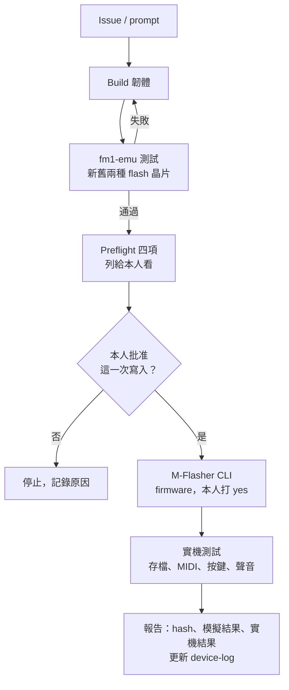

<!-- Generated by SpecStory, Markdown v2.1.0 -->

# 2026-11-16 17:00:05Z

<!-- Claude Code Session 5f461408-bbdd-44d0-bb3b-b0642eabaa31 (2026-11-16 17:00:05Z) -->

_**User (2026-11-16 17:00:05Z)**_

這是我跟ChatGPT的調研 請務必詳細閱讀 包括我提過的一些需求其實很多都是我想要記錄到本repo中的
@.specstory/references/chatgpt-FM1刷機建議-20261117-0058.md 

這個repo是我要記錄 M-VAVE FM-1 的各種事情
包括資源、使用心得
整理最關鍵的東西 以及可以能夠有各種agentic setup所需的context
然後有一個 documents （Zensical 搭的 GitHub Page）可以用來自己看的筆記
我可能會想要針對特地的firmware e.g. SLOOP 會有專門的section介紹使用
然後起始getting started如何刷機等等 注意事項等等

也幫忙setup一下 AGENTS.md

然後第一階段最好setup完後能夠驗收：「裝 M-Flasher、備份原廠、刷 SLOOP 2.8.5」

---

_**Agent (claude-fable-5-2 2026-11-16 17:00:11Z)**_

<tool-use data-tool-type="read" data-tool-name="Read"><details>
<summary>Tool use: **Read**</summary>
 `./.specstory/references/chatgpt-FM1刷機建議-20261117-0058.md`

```text
1	---
2	source: chatgpt
3	title: "FM1刷機建議"
4	url: "https://chatgpt.com/c/6afb1853-e05c-83e8-a0e4-eaf220984af9"
5	conversation_id: "6afb1853-e05c-83e8-a0e4-eaf220984af9"
6	model: "gpt-6-thinking"
7	created_at: "2026-11-16 14:51:00Z"
8	exported_at: "2026-11-17T00:58:26+08:00"
9	messages: 10
10	include_thinking: false
11	include_tools: false
12	exporter: "chatgpt-export-markdown v1.5.1"
13	---
14	
15	# FM1刷機建議
16	
17	<!-- Generated by chatgpt-export-markdown v1.5.1 -->
18	
19	_**User (2026-11-16 14:53:20Z)**_
20	
21	初次拿到 M-Vave FM1 我應該刷什麼firmware好？ 好像有說先刷一些能夠確保不會變成磚？
22	https://github.com/jvitkauskas/m-flasher
23	https://github.com/jvitkauskas/m-bootloader
24	
25	然後 SLOOP 好像很popular？
26	https://github.com/isod89/sloop3-fm1
27	https://github.com/isod89/sloop-fm1
28	
29	是不是也有人拿它來做別的？比如控制AI agent？
30	它有哪些可能性？我看有USB type-C口 不知道能控制到什麼程度
31	也有3.5mm的MIDI跟音源output
32	
33	---
34	
35	_**Assistant (gpt-6-thinking, 2026-11-16 14:53:23Z)**_
36	
37	我會先核對 FM1 的 bootloader、刷機與救磚流程，再比較原廠、SLOOP／SLOOP3 和其他社群韌體。最後特別查 USB-C、TRS MIDI、音訊輸出的實際能力，區分哪些能直接拿來控制電腦或 AI Agent、哪些需要改韌體。
38	
39	**如果你剛拿到 M-VAVE FM1，我會建議先用 M-Flasher 完整備份，確認 Flash 晶片，再視相容性安裝 m-bootloader，最後刷 SLOOP 2.8.5。** 等熟悉之後，再試 SLOOP 3 或 MIDI Controller 韌體。
40	
41	這台的有趣之處是：它不只是便宜的迷你 FM 合成器，現在已經有相當活躍的開源韌體生態，可以把它變成 Groovebox、Drum Machine、Sampler，甚至是電腦控制器。
42	
43	但有個重要提醒：**2026 年後期出貨的部分 FM1 改用了新款 Flash 晶片 `UC25HQ80`，舊版自訂韌體和 bootloader 不一定完全相容。** 所以不建議剛拆箱就直接刷 bootloader。<Cite refs={["turn913682view4","turn147947search8","turn361886view2"]}/>
44	
45	## 1. 我建議的第一次刷機順序
46	
47	<box border radius="xl" padding={3} gap={3}>
48	  <list marker="number" connector="solid" gap={3}>
49	    <list-item>
50	      **先確認原廠版本**
51	
52	      開機確認 Firmware 版本，並接上 Mac 或 Windows 電腦，使用 USB-C 資料線。
53	    </list-item>
54	    <list-item>
55	      **M-Flasher：完整備份與晶片檢查**
56	
57	      保存整個 Flash 的備份，不只是音色。檢查晶片是 `P25Q80H` 還是較新的 `UC25HQ80`。
58	    </list-item>
59	    <list-item>
60	      **m-bootloader：增加救援能力（條件式）**
61	
62	      如果晶片相容且願意承擔替換 bootloader 的風險，再安裝。它提供按鍵進入 Download Mode、Recovery Menu 與韌體完整性檢查。
63	    </list-item>
64	    <list-item>
65	      **SLOOP 2.8.5：開始玩音樂**
66	
67	      目前比 SLOOP 3 更適合當第一套常用韌體。SLOOP 3 還是 Public Beta。
68	    </list-item>
69	    <list-item>
70	      **再探索 CTL-1 / SLOOP 3 / 其他韌體**
71	
72	      分別測試 MIDI 控制器、全新 Groovebox 引擎，以及其他用途。
73	    </list-item>
74	  </list>
75	</box>
76	
77	要特別分清楚這兩個工具：
78	
79	| 工具 | 作用 |
80	|---|---|
81	| <Link url="https://github.com/jvitkauskas/m-flasher" title="M-Flasher"/> | 電腦端刷機、備份、還原與救援工具 |
82	| <Link url="https://github.com/jvitkauskas/m-bootloader" title="m-bootloader"/> | 安裝在 FM1 裡的開機與復原程式 |
83	
84	m-bootloader 能降低**應用程式韌體刷壞後**的復原難度，但它本身也是高風險的 Flash 區域。安裝它並不代表裝置從此不可能變磚。<Cite refs={["turn361886view0","turn913682view4"]}/>
85	
86	## 2. 真的有人把 FM1 做成 AI Agent 控制器！
87	
88	而且剛好有人做了**專門整合 Herdr、tmux、Claude Code、Codex 的版本**，不只是概念。
89	
90	<row align="start" gap={3}>
91	  <AsyncImage query="kevinelliott FM-1 Agent Deck FM1 Herdr firmware screen coding agents grid" aspectRatio="4:5" maxWidth="164px"/>
92	  <box flex="1" gap={1}>
93	    <title size="lg"><Link url="https://github.com/kevinelliott/fm-1-agent-deck" title="FM-1 Agent Deck"/></title>
94	    <text color="secondary" size="xs">kevinelliott · v0.7 · 2026 年 11 月</text>
95	    將 FM1 變成實體的 Coding Agent 控制台，使用 USB MIDI 和電腦端 Python Daemon 通訊。已在真實 FM1 上測試較早版本，最新 0.7 主要經模擬器測試，仍屬早期專案。
96	  </box>
97	</row>
98	
99	它的設計特別有意思：
100	
101	- **27 個發光琴鍵**：每個鍵對應一個 Agent，燈光代表 Working、Idle、Blocked、Done 等狀態。
102	- **240×240 螢幕**：顯示 Agent 列表、最近輸出、待批准的操作。
103	- **旋鈕**：切換 Agent、頁面、選單與提示詞。
104	- **REC / FX / PLAY 等按鈕**：批准、拒絕、繼續或中斷 Agent，也支援預設 Prompt 與佇列。
105	- **Herdr 原生整合**：透過 Herdr socket API 獲得 Agent 狀態；也能用 tmux backend 辨識 CLI Agent。
106	
107	<Cite refs={["turn204413view0","turn204413search0"]}/>
108	
109	<box border radius="lg" padding={3} gap={2}>
110	  <text weight="medium" size="sm">Agent Deck 的工作架構</text>
111	  <box background="surface-secondary" radius="md" padding={3} align="center" gap={1}>
112	    <icon name="sliders-horizontal" size="lg"/>
113	    **M-Vave FM1**
114	
115	    <caption>琴鍵、旋鈕、LED、螢幕</caption>
116	  </box>
117	  <col align="center" gap="0">
118	    <icon name="arrow-down-up" color="secondary"/>
119	    <caption>USB-C · MIDI 雙向通訊</caption>
120	  </col>
121	  <box background="surface-secondary" radius="md" padding={3} align="center" gap={1}>
122	    **Python Host Daemon**
123	
124	    <text size="xs" color="secondary">host/agentdeck.py</text>
125	    <caption>Agent 狀態同步、指令路由</caption>
126	  </box>
127	  <col align="center" gap="0">
128	    <icon name="arrow-down-up" color="secondary"/>
129	    <caption>Herdr Socket API / tmux</caption>
130	  </col>
131	  <grid columns={3} gap={2}>
132	    {#each ["Claude Code","Codex","其他 CLI Agents"] as agent}
133	      <grid-item>
134	        <box background="surface-secondary" radius="md" padding={2} align="center" justify="center" minHeight="60px">
135	          <text size="xs" weight="medium" textAlign="center">{agent}</text>
136	        </box>
137	      </grid-item>
138	    {/each}
139	  </grid>
140	</box>
141	
142	這甚至有你之前關注的 Herdr Agent 狀態偵測功能。不過狀態仍取決於 Herdr 回傳結果的準確性，tmux backend 則使用文字和畫面變化的 heuristic，無法保證完全準確。
143	
144	在真正刷入 FM1 前，可以先用 repo 提供的模擬模式試驗：
145	
146	
147	
148	它還有 <Link url="https://kevinelliott.github.io/fm-1-agent-deck/play/" title="線上 FM1 模擬器"/>，可以看到虛擬裝置的畫面與操作。
149	
150	**如果你打算把 FM1 同時當作 Coding Agent Dashboard 和音樂設備，Agent Deck 是很值得研究的開源專案。** 但它現在是獨立韌體，刷入後會暫時取代合成器功能，並不是在 SLOOP 上安裝的一個 Plugin。
151	
152	補充一個實際使用時的重要細節：**Agent Deck v0.7 已將 Host Daemon 從 `agentdeck.py` 改名為 `agtdeck.py`。** 上面展示的是舊版指令，新版應使用：
153	
154	
155	
156	真正刷入 Agent Deck 並接上電腦後，才需要安裝 MIDI 套件並啟動硬體模式：
157	
158	
159	
160	專案目前也支援 Prompt Preset、Agent Context 用量、Git Diff 畫面、待批准操作列表等。不過我會先關閉 Auto-Approve，避免按鍵誤觸造成不必要的檔案修改或終端指令執行。<Cite refs={["turn319816view2","turn319816view3"]}/>
161	
162	## 3. SLOOP 2.8 vs SLOOP 3：到底刷哪個？
163	
164	<grid columns={2} gap={3}>
165	  <grid-item>
166	    <AsyncImage query="M Vave FM1 SLOOP 2.8 firmware live groovebox screenshot screen" aspectRatio="5:4"/>
167	    **<Link url="https://github.com/isod89/sloop-fm1" title="SLOOP 2.8.5"/>**
168	
169	    <text color="secondary" size="xs">相對成熟 · 日常使用首選</text>
170	  </grid-item>
171	  <grid-item>
172	    <AsyncImage query="M Vave FM1 SLOOP 3 firmware groovebox piano roll screen" aspectRatio="5:4"/>
173	    **<Link url="https://github.com/isod89/sloop3-fm1" title="SLOOP 3.3.7"/>**
174	
175	    <text color="secondary" size="xs">Public Beta · 全新架構</text>
176	  </grid-item>
177	</grid>
178	
179	這兩者不是一般的小版本升級。SLOOP 3 幾乎從零重寫了音訊引擎、Sequencer 和 UI。
180	
181	| 功能 | SLOOP 2.8.5 | SLOOP 3.3.7 |
182	|---|---|---|
183	| Track | 3 Synth + 1 Drum | 4 Synth + 1 Drum |
184	| 合成引擎 | 12 種 | 13 種 |
185	| 最大 Pattern 長度 | 64 Steps | 128 Steps |
186	| 每 Track Patterns | 既有 Section/Pattern 系統 | 8 |
187	| 音訊運算 | Fixed-point DSP | 32-bit Float |
188	| 音訊 Block | 256 Samples | 64 Samples |
189	| Polyphony | 8 個共享 Synth Voices | 32 個共享 Voices，另有 Release Voices |
190	| Sample Slicing | 基本 Sample/GRAIN | 獨立 SLICE 引擎 |
191	| USB Audio / MIDI | 有 | 有 |
192	| 穩定性 | 2.8 系列較成熟，仍標示 Beta | 公開測試中 |
193	| Bootloader 要求 | 可透過一般更新路徑安裝 | **必須使用 m-bootloader MIDI MODE** |
194	
195	SLOOP 3.3.7 在 11 月 16 日才發布，修復了不同 Track 的時間偏移、Loop 重複錄入和預設 Quantization 等問題。新功能很吸引人，但我不會推薦拿它作為第一套常用韌體。<Cite refs={["turn361886view1","turn361886view2","turn598197view2","turn319816view0"]}/>
196	
197	**我的選擇是先 SLOOP 2.8.5，之後再升 SLOOP 3。** SLOOP 3 可以讀取 2.8 的部分專案和設定，但回退時最好使用原始備份，而不是假設資料格式可以雙向相容。
198	
199	## 4. 其他值得試的 FM1 Firmware
200	
201	音樂類與工具類都已經有不少作品，以下選幾個比較有特色的。
202	
203	| Firmware | 把 FM1 變成什麼 | 適合用途 |
204	|---|---|---|
205	| <Link url="https://github.com/charlesvestal/fm1-ctl" title="CTL-1"/> | USB/BLE MIDI 控制器，支援 Scale、Chord、CC Banks | 控制電腦、DAW、外部合成器 |
206	| <Link url="https://github.com/ignis32/trireme_fm1" title="Trireme"/> | Vial 相容 USB HID Macro Keyboard | 快捷鍵、滑鼠、桌面自動化 |
207	| <Link url="https://github.com/smememe/fm1-macropad-patch" title="Macropad Patch"/> | 將原廠 V15 改成 MIDI Macro Pad | Host 端自訂所有按鍵行為 |
208	| <Link url="https://midihax.github.io/fm1-midi-processor/html/index.html" title="MIDI Processor"/> | MIDI 過濾、Remap、Monitor | MIDI Routing、Debug |
209	| <Link url="https://github.com/zvenson/zp12" title="zp12"/> | SP-12 風格的 Lo-fi Sampling Drum Machine | Hip-hop、鼓機 |
210	| <Link url="https://github.com/charlesvestal/fm1-x0x" title="X0X"/> | 808/909/303 類型 Groovebox | Acid、Techno |
211	| <Link url="https://github.com/keremimo/melodee" title="Melodee"/> | 多引擎 Synth + Sequencer | 合成器與和弦演奏 |
212	| <Link url="https://github.com/jvitkauskas/m-apps" title="m-apps"/> | RAM App / SD Card Launcher 實驗框架 | Firmware 開發與進階擴充 |
213	
214	<caption>部分專案仍處於早期開發、模擬器測試或有限硬體驗證階段，不代表每個都適合直接刷入日常使用的裝置。<Cite refs={["turn913682view1","turn411981search1","turn944187search5","turn186334search0"]}/></caption>
215	
216	其中 **Trireme 特別值得注意**：它能讓 FM1 直接模擬 USB 鍵盤／滑鼠，不一定需要 Python Daemon。它有五個 Layers、Macro、Tap Dance，甚至能用螢幕顯示每個按鍵的功能。可用來控制 Herdr、終端或其他桌面應用程式，但作者也說部分功能尚未完整測試。<Cite ref="turn319816view4"/>
217	
218	至於同時裝多個 Firmware，目前一般用法還是反覆刷入、切換。`m-apps` 的 SD Card Firmware Slots 已經在探索多系統切換，但需要 SD Card 硬體改裝與額外驗證，並不是一般 FM1 拆箱就有的功能。
219	
220	## 5. USB-C、3.5mm MIDI、Audio 能做到哪些事？
221	
222	<box border radius="xl" padding={3} gap={3}>
223	  <row align="center" gap={3}>
224	    <box background="surface-secondary" padding={2} radius="lg">
225	      <icon name="usb" size="lg"/>
226	    </box>
227	    <box flex="1" gap={1}>
228	      **USB Type-C**
229	
230	      <text color="secondary" size="sm">充電、USB MIDI IN/OUT、Firmware 更新、USB Audio（依韌體），以及自訂 HID 裝置。</text>
231	    </box>
232	  </row>
233	  <divider color="subtle"/>
234	  <row align="center" gap={3}>
235	    <box background="surface-secondary" padding={2} radius="lg">
236	      <icon name="music-2" size="lg"/>
237	    </box>
238	    <box flex="1" gap={1}>
239	      **3.5mm TRS MIDI IN**
240	
241	      <text color="secondary" size="sm">接收其他 MIDI 設備的 Note、CC、Clock 等。不是原生 MIDI OUT。</text>
242	    </box>
243	  </row>
244	  <divider color="subtle"/>
245	  <row align="center" gap={3}>
246	    <box background="surface-secondary" padding={2} radius="lg">
247	      <icon name="headphones" size="lg"/>
248	    </box>
249	    <box flex="1" gap={1}>
250	      **3.5mm Stereo Audio OUT**
251	
252	      <text color="secondary" size="sm">輸出聲音到耳機、Mixer、錄音介面。這是類比聲音，不是 MIDI，也不是 Audio IN。</text>
253	    </box>
254	  </row>
255	  <divider color="subtle"/>
256	  <row align="center" gap={3}>
257	    <box background="surface-secondary" padding={2} radius="lg">
258	      <icon name="bluetooth" size="lg"/>
259	    </box>
260	    <box flex="1" gap={1}>
261	      **Bluetooth MIDI**
262	
263	      <text color="secondary" size="sm">原廠和 CTL-1 等部分韌體支援，但 SLOOP 不支援 BLE MIDI。</text>
264	    </box>
265	  </row>
266	</box>
267	
268	<Cite refs={["turn147947search1","turn598197view4","turn944187search2","turn581980view4"]}/>
269	
270	USB-C 的關鍵限制是：**FM1 本身通常是 USB Device，不是 USB Host。** 例如不能直接拿 USB-C 鍵盤插在 FM1 上就使用。需要 Mac、手機或 USB MIDI Host 充當中間設備。
271	
272	反過來，Mac 可以：
273	
274	- 接收 FM1 的 MIDI Note / Control Change。
275	- 把 MIDI 指令送回 FM1 控制合成器。
276	- 使用支援 USB Audio 的韌體直接數位錄音。
277	- 用自訂韌體將 FM1 變成 HID Keyboard / Mouse。
278	- 用雙向 MIDI 自訂顯示資料、LED 狀態以及 Host 控制協定。
279	
280	你不需要真的重刷成 Agent Deck 才能控制 AI Agent。例如使用 **CTL-1 + Python `mido`**，接收琴鍵與旋鈕事件，再轉成 Herdr API 呼叫即可。可以先這樣確認電腦看到的 MIDI 介面：
281	
282	
283	
284	需要注意的是，不同韌體對按鍵與旋鈕的 MIDI Mapping 不同；不能假設每個實體按鈕在原廠韌體下都會發送獨立事件。
285	
286	## 6. 如果刷失敗，怎麼救？
287	
288	<text color="secondary" weight="medium" size="xs">以下按問題程度由輕到重排列</text>
289	
290	| 情況 | 恢復方式 |
291	|---|---|
292	| SLOOP 2.x 開不了 | 關機，按住 `OCT−` 開機，進入 USB Rescue，再刷一次 |
293	| 裝了 m-bootloader | 按住 `PLAY` 開機進 Recovery Menu，選 `MIDI MODE` 重新安裝 |
294	| 瀏覽器安裝器無法修復 | 按住 `REC` 開機，進入晶片 USB Download Mode，使用 M-Flasher |
295	| 無畫面但 USB 可辨識 ROM Download 裝置 | 使用 M-Flasher 還原 Flash |
296	| 完全無法透過 USB 辨識 | 可能需 RP2040 USB_KEY / FM-1 Transporter 等硬體救援手段 |
297	
298	這些恢復方式依賴裝置目前的 bootloader、韌體與 USB 偵測狀態，並非保證成功。<Cite refs={["turn913682view4","turn186334search7"]}/>
299	
300	目前核對到的版本：
301	
302	| 工具／韌體 | 2026-11-16 最新查得版本 |
303	|---|---|
304	| <Link url="https://github.com/jvitkauskas/m-flasher/releases" title="M-Flasher"/> | **0.12.1** |
305	| <Link url="https://github.com/jvitkauskas/m-bootloader/releases" title="m-bootloader"/> | **2.4** |
306	| <Link url="https://github.com/isod89/sloop-fm1/releases" title="SLOOP 2"/> | **2.8.5** |
307	| <Link url="https://github.com/isod89/sloop3-fm1/releases" title="SLOOP 3"/> | **3.3.7 Public Beta** |
308	| <Link url="https://github.com/kevinelliott/fm-1-agent-deck" title="Agent Deck"/> | **0.7** |
309	
310	<Cite refs={["turn581980view0","turn598197view1","turn598197view2","turn175157view5","turn204413view0"]}/>
311	
312	特別值得一提：M-Flasher 自 0.12.0 起，安裝 Firmware 時會保留現有 Bootloader；要恢復原廠 Bootloader，需要另外指定操作。這能避免換韌體時意外覆寫救援環境。<Cite ref="turn581980view1"/>
313	
314	另外，原廠 V16 已在社群文件中記載，但目前抓取到的 M-VAVE 官方產品頁仍列出 V15。兩者的設定儲存格式有變動，**不要為了符合某個舊刷機教學就直接把 V16 降回 V15**，否則可能破壞音色與設定資料。<Cite refs={["turn411981search1","turn913682view4","turn147947search1"]}/>
315	
316	---
317	
318	## 最後：我會怎麼利用這台 FM1？
319	
320	考量你對音樂器材、Herdr 和 Coding Agent 的興趣，我會把它當成可以在兩種模式間切換的小型研究平台：
321	
322	**模式 A：Pocket Groovebox** — 刷 SLOOP 2.8.5，玩 Drum、Bass、Loop、Sample，利用 USB Audio 錄進 Mac 或 DAW。
323	
324	**模式 B：Agent Control Surface** — 刷 Agent Deck，研究實體 Agent 狀態指示、批准流程與 Herdr 整合，甚至延伸成自己的硬體 Agent Dashboard。
325	
326	如果想自己開發融合版本，我會優先研究 Dinghy／fm1-base 以及 Agent Deck 的雙向 MIDI Protocol，因為螢幕、LED、按鍵控制、Host 通訊，都有可參考的實作。不需要從零逆向整台機器。
327	
328	**現在最值得做的第一步，是接上 FM1、開啟 M-Flasher 0.12.1，查看 `FLASH CHIP` 和目前 Firmware 版本。** 這兩個資訊將直接決定你能否比較放心地安裝 m-bootloader 2.4，以及能不能進一步刷 SLOOP 3。
329	
330	---
331	
332	_**User (2026-11-16 16:35:27Z)**_
333	
334	我如果要測試驗證是不是可以通過這種emulator？（類似docker？）
335	
336	https\://github.com/joakimeriksson/fm1-emu\
337	https\://joakimeriksson.github.io/fm1-emu/?fw=felucca&mhz=100
338	
339	
340	
341	---
342	
343	
344	
345	另外現在agentic的方式有哪些
346	
347	有官方agent skill？
348	
349	現在agent能夠怎麽自動化的操作燒錄等相關指令嗎？
350	
351	---
352	
353	_**Assistant (gpt-6-thinking, 2026-11-16 16:35:31Z)**_
354	
355	我會先查 `fm1-emu` 實際模擬到哪一層（CPU、顯示、音訊、MIDI、USB、Flash），再看 M-Flasher／m-bootloader 是否已有 CLI、API 或 Agent Skill。重點是區分「能在 emulator 驗證韌體」和「能讓 Agent 安全地操作實機刷寫」這兩件事。
356	
357	可以，而且 **`fm1-emu` 已經很接近你想要的「Firmware 開發＋Agent 自動測試環境」了**。它不只是讓你在瀏覽器裡玩模擬合成器，而是可以執行 FM1 的真實韌體、模擬硬體、輸出測試結果，甚至模擬 Flash 寫入中途斷電。
358	
359	另外也找到一套社群已經在使用的 **FM1 Agent Skills + `AGENTS.md` 工作流**，不需要從零開始設計。
360	
361	## 1. fm1-emu 是什麼？和 Docker 有什麼不同？
362	
363	<AsyncImage query="joakimeriksson fm1-emu browser M VAVE FM1 emulator Felucca interface black synthesizer screenshot" aspectRatio="16:9"/>
364	
365	你提供的 <Link url="https://joakimeriksson.github.io/fm1-emu/?fw=felucca&mhz=100" title="Felucca 模擬器"/> 執行的是**原本要在 FM1 硬體上跑的 Firmware**，而非另一個用 JavaScript 重寫的模擬合成器。
366	
367	<box border radius="lg" padding={3} gap={2}>
368	  <text weight="medium" size="sm">技術架構</text>
369	  <box background="surface-secondary" radius="md" padding={3} align="center" gap={1}>
370	    **原始 FM1 Firmware（.fwsc）**
371	
372	    <caption>同一份韌體可用於模擬器與實機</caption>
373	  </box>
374	  <row justify="center">
375	    <icon name="arrow-down" color="secondary"/>
376	  </row>
377	  <grid columns={2} gap={2}>
378	    <grid-item>
379	      <box border radius="md" padding={2} gap={1} align="center">
380	        **fm1-emu**
381	
382	        <caption>模擬 CPU、記憶體、LCD、按鍵、音訊及部分周邊</caption>
383	      </box>
384	    </grid-item>
385	    <grid-item>
386	      <box border radius="md" padding={2} gap={1} align="center">
387	        **真實 FM1**
388	
389	        <caption>JieLi SoC、Flash、實體周邊</caption>
390	      </box>
391	    </grid-item>
392	  </grid>
393	  <row justify="center">
394	    <icon name="arrow-down" color="secondary"/>
395	  </row>
396	  <grid columns={2} gap={2}>
397	    <grid-item>
398	      <box background="surface-secondary" radius="md" padding={2} align="center">
399	        <text size="sm" weight="medium">測試與 Debug</text>
400	      </box>
401	    </grid-item>
402	    <grid-item>
403	      <box background="surface-secondary" radius="md" padding={2} align="center">
404	        <text size="sm" weight="medium">硬體驗證與刷寫</text>
405	      </box>
406	    </grid-item>
407	  </grid>
408	</box>
409	
410	Docker 與它的關係是：
411	
412	| | Docker | fm1-emu |
413	|---|---|---|
414	| 主要功能 | 隔離應用與執行環境 | 模擬 FM1 硬體 |
415	| 執行什麼 | 主機相容的程式 | FM1 原生 Firmware |
416	| CPU | 共用 Host Kernel、原生執行 | 模擬指令集，部分平台使用 JIT |
417	| 模擬硬體 | 通常不會 | 有 |
418	| Headless 自動測試 | 可以 | 可以 |
419	| CI / Agent 整合 | 可以 | 可以 |
420	| 可放在 Docker 裡？ | — | 可以，適合 Headless CLI |
421	
422	所以更精確的類比是 **QEMU / Renode 一類的硬體模擬器**，而不是 Docker。你可以把 Docker 用作外層的可重現測試環境。
423	
424	### 目前模擬能力
425	
426	| 能力 | 支援狀態 |
427	|---|---|
428	| 真實 Firmware 執行 | <icon name="check-circle" color="success" inline/> |
429	| LCD、琴鍵、旋鈕 | <icon name="check-circle" color="success" inline/> |
430	| 音訊與 MIDI | <icon name="check-circle" color="success" inline/> |
431	| Flash 狀態持久化 | <icon name="check-circle" color="success" inline/> |
432	| 模擬新舊 Flash 晶片 | <icon name="check-circle" color="success" inline/> |
433	| 模擬寫入中途斷電 | <icon name="check-circle" color="success" inline/> |
434	| USB MIDI 裝置枚舉 | <icon name="check-circle" color="success" inline/> 部分韌體 |
435	| Headless / 批次測試 | <icon name="check-circle" color="success" inline/> |
436	| 真實刷機 ROM / USB 硬體復原驗證 | <icon name="x-circle" color="danger" inline/> 不能替代實機 |
437	
438	官方 README 明確指出，USB controller 的中斷尚未完整支援，所以使用 USB polling 的 Felucca 系列比較容易測試；原廠中斷驅動的 USB Firmware 不能直接假設也會正確枚舉。<Cite refs={["turn357319search0","turn910996search0"]}/>
439	
440	### 特別重要：你的 URL 是 `mhz=100`
441	
442	實際 FM1 時脈是 **240 MHz**。100 MHz 比較適合降低電腦模擬負擔，不能用來驗證真實裝置的時序表現。
443	
444	用於開發測試時，我建議至少測試 240 MHz，並加跑 Strict Mode。
445	
446	## 2. 最新版還能模擬新款 Flash 晶片
447	
448	這點恰好能解決你上一個問題：新出貨 FM1 的 `UC25HQ80` 相容性。
449	
450	你可以直接比較兩種模擬環境：
451	
452	<box gap={2}>
453	  <row align="center" justify="between">
454	    <box gap="0">
455	      **舊版 Flash 晶片**
456	
457	      <caption>Puya · JEDEC 0x856014</caption>
458	    </box>
459	    <button size="sm" color="secondary" variant="outline" onClick={()=>GenUI.openUrl("https://joakimeriksson.github.io/fm1-emu/?fw=felucca&mhz=240")}>開啟模擬器 <icon name="external-link" inline size="xs"/></button>
460	  </row>
461	  <divider color="subtle"/>
462	  <row align="center" justify="between">
463	    <box gap="0">
464	      **新版 Flash 晶片**
465	
466	      <caption>UC25HQ80 · JEDEC 0xB36014</caption>
467	    </box>
468	    <button size="sm" color="secondary" variant="outline" onClick={()=>GenUI.openUrl("https://joakimeriksson.github.io/fm1-emu/?fw=felucca&mhz=240&chip=uc25hq80")}>開啟模擬器 <icon name="external-link" inline size="xs"/></button>
469	  </row>
470	</box>
471	
472	兩邊做一樣的操作，例如改音色、Save、重新開機，再檢查設定是否保留。
473	
474	如果韌體只能在舊晶片正常保存設定，新晶片重啟後遺失，就能在刷機前發現至少一部分相容性問題。
475	
476	**但模擬器測試通過 ≠ 100% 保證硬體安全。** 尤其 bootloader 安裝、ROM Download Mode、USB 枚舉、實體 Flash 寫入等，仍應留給實機測試。
477	
478	以上是 `fm1-emu` v0.5.1 已公開的能力。<Cite refs={["turn357319view1","turn910996view2","turn170394view2"]}/>
479	
480	## 3. 已經有 FM1 專用 Agent Skills，而且有 Docker / Podman 建置環境
481	
482	沒有找到 M-VAVE 原廠發布的官方 Agent Skill，但找到的社群方案其實相當完整。
483	
484	<box gap={3}>
485	  <row align="start" gap={3}>
486	    <box background="surface-secondary" radius="lg" padding={3}>
487	      <icon name="bot" size="lg"/>
488	    </box>
489	    <box flex="1" gap={1}>
490	      **<Link url="https://github.com/maxfridbe/mvave-fm1" title="maxfridbe/mvave-fm1"/>**
491	
492	      <badge color="success">最適合入門</badge>
493	
494	      兩個 Claude Code Skills：`mvave-fm1-firmware` 與 `mvave-fm1-software-development`，涵蓋備份、刷機、救磚、Firmware 開發、硬體 API、Flash Layout 與安全規則。
495	
496	      還包含 Podman `Containerfile`、`mvave-build.sh`、固定 checksum 的 JieLi Toolchain，以及 GitHub Actions Build。
497	    </box>
498	  </row>
499	  <divider color="subtle"/>
500	  <row align="start" gap={3}>
501	    <box background="surface-secondary" radius="lg" padding={3}>
502	      <icon name="workflow" size="lg"/>
503	    </box>
504	    <box flex="1" gap={1}>
505	      **<Link url="https://github.com/kmplngj/Felucca" title="kmplngj/Felucca"/>**
506	
507	      更完整的 Agent-driven Firmware 開發範例。
508	
509	      有 `AGENTS.md`、`CLAUDE.md`、六個 Skills，包括 Issue Delivery、PR Testing、Firmware Watch，以及 `full-stop`、`full-send` 等工作流。
510	
511	      其測試系統涵蓋 Firmware Build、Host DSP Tests、Browser Emulator Tests。
512	    </box>
513	  </row>
514	  <divider color="subtle"/>
515	  <row align="start" gap={3}>
516	    <box background="surface-secondary" radius="lg" padding={3}>
517	      <icon name="book-open" size="lg"/>
518	    </box>
519	    <box flex="1" gap={1}>
520	      **<Link url="https://sbegueria.github.io/fm1-dev-wiki/AI-Skills.html" title="FM1 Developers' Wiki：AI Skills"/>**
521	
522	      彙整社群 Agent Skills、開發工具、來源及已知錯誤。這個頁面還列出 Felucca Editor、SLOOP Editor Skill 與 Firmware 移植工具。
523	    </box>
524	  </row>
525	</box>
526	
527	<Cite refs={["turn822148view0","turn822148view2","turn640735view0"]}/>
528	
529	其中 `maxfridbe/mvave-fm1` 是你問的最直接答案，作者已經做過 Linux 實機備份與 ORBIT 韌體安裝，並有 CI 成功建置 Dinghy、Felucca、ORBIT。不過容器內產出的 Firmware 尚未完成實機刷寫驗證。<Cite ref="turn822148view0"/>
530	
531	### 安裝 Skills（Claude Code）
532	
533	
534	
535	這是普通的 `SKILL.md` 格式；Codex 或其他支援 Agent Skills 的工具也能重用內容，但要放進對應 Client 支援的 Skills 目錄。
536	
537	### 容器化建置 Firmware
538	
539	`mvave-fm1` 的工作流提供：
540	
541	
542	
543	輸出會是 `out/dinghy/dinghy.fwsc`。
544	
545	作者刻意將刷機放在 Host 執行，**Container 只負責 Build/Test，不直接操控實機**。這是我也推薦的安全邊界。
546	
547	## 4. Agent 可以如何自動測試 Firmware？
548	
549	你可以先在 Mac 上執行：
550	
551	
552	
553	也能直接開啟你自己編譯出的 Firmware：
554	
555	
556	
557	而更適合 Agent 的是 `fm1-emu` 批次執行器：
558	
559	
560	
561	它提供 Headless `--shot`、WAV 與螢幕輸出、Breakpoint、Memory Dump 等能力。也可以使用 `FM1_BENCH_KEYS` 注入按鍵、旋鈕、MIDI 事件，或用 `FM1_FLASH_CUT=N` 模擬 Flash 操作中途斷電。<Cite ref="turn910996search0"/>
562	
563	這代表 Coding Agent 可以自動執行一整組測試：
564	
565	| 測試場景 | Agent 自動化 |
566	|---|---|
567	| Firmware 能否開機 | 可 |
568	| LCD 畫面是否符合預期 | 截圖比對 |
569	| 按鍵、旋鈕是否有效 | 注入事件 |
570	| Synth 是否產生預期聲音 | WAV / DSP 數值比較 |
571	| RAM、CPU 用量 | 部分可測，搭配 Target Build |
572	| 新舊 Flash 保存設定 | 可 |
573	| 寫入中途斷電後復原 | 可模擬 |
574	| USB MIDI 協定 | 部分韌體可測 |
575	| 實機播放音質、電源與裝置穩定性 | 仍需要實機 |
576	
577	例如，`kmplngj/Felucca` 已提供這類 Agent 能直接執行的測試命令：
578	
579	
580	
581	它還會測量 DSP regression 與 firmware memory budget，這已經是相當正式的 Firmware CI 架構。<Cite ref="turn522108view2"/>
582	
583	## 5. 真正刷機也可以 CLI 自動化
584	
585	這點很重要：**M-Flasher 本身已經提供 Command Line Interface**，不需要 Agent 去模擬滑鼠操作 GUI。
586	
587	<box border radius="lg" padding={3} gap={2}>
588	  <text weight="medium" size="sm">M-Flasher 已支援的 CLI</text>
589	  <table>
590	    <table-row><table-cell><text weight="medium" size="sm">偵測裝置</text></table-cell><table-cell><text size="sm"><code>m-flasher find</code></text></table-cell></table-row>
591	    <table-row><table-cell><text weight="medium" size="sm">進入 Download Mode</text></table-cell><table-cell><text size="sm"><code>m-flasher download-mode</code></text></table-cell></table-row>
592	    <table-row><table-cell><text weight="medium" size="sm">晶片與韌體資訊</text></table-cell><table-cell><text size="sm"><code>m-flasher info</code></text></table-cell></table-row>
593	    <table-row><table-cell><text weight="medium" size="sm">備份完整 Flash</text></table-cell><table-cell><text size="sm"><code>m-flasher backup [DIR]</code></text></table-cell></table-row>
594	    <table-row><table-cell><text weight="medium" size="sm">安裝 Firmware</text></table-cell><table-cell><text size="sm"><code>m-flasher firmware PACKAGE.fwsc</code></text></table-cell></table-row>
595	    <table-row><table-cell><text weight="medium" size="sm">安裝 Bootloader</text></table-cell><table-cell><text size="sm"><code>m-flasher bootloader --file UBOOT.boot</code></text></table-cell></table-row>
596	    <table-row><table-cell><text weight="medium" size="sm">還原備份</text></table-cell><table-cell><text size="sm"><code>m-flasher restore BACKUP.bin</code></text></table-cell></table-row>
597	    <table-row><table-cell><text weight="medium" size="sm">重新啟動</text></table-cell><table-cell><text size="sm"><code>m-flasher restart</code></text></table-cell></table-row>
598	  </table>
599	  <caption>均為上游文件記載的現有功能。<Cite ref="turn522108view0"/></caption>
600	</box>
601	
602	在 macOS 安裝 GUI 版本後，CLI 執行檔位於：
603	
604	
605	
606	可以設定 Shell Alias：
607	
608	
609	
610	首次取得 USB 裝置控制權時，macOS 可能要求管理員驗證與可移除磁碟權限；這是需要人在本機協助的部分，不適合完全交給 Cloud Agent 或純 SSH Session。
611	
612	### 我會採用的 Agent 權限設計
613	
614	<box border radius="xl" padding={3} gap={2}>
615	  <list marker="number" connector="solid" gap={3}>
616	    <list-item>
617	      <row justify="between" align="center">
618	        **Discover + Backup**
619	        <badge>自動</badge>
620	      </row>
621	      Agent 執行 `find`、`info`、`backup`，檢查 Flash Chip、Board、現有 Firmware、SHA-256。
622	    </list-item>
623	    <list-item>
624	      <row justify="between" align="center">
625	        **Build + Emulator Tests**
626	        <badge>自動</badge>
627	      </row>
628	      編譯、執行模擬測試、保存報告，遇到不相容晶片立即停止。
629	    </list-item>
630	    <list-item>
631	      <row justify="between" align="center">
632	        **Flash Preflight**
633	        <badge>人工確認</badge>
634	      </row>
635	      顯示 Firmware Hash、Backup Path、Flash Map、預期修改的區域，使用者檢查後才允許刷寫。
636	    </list-item>
637	    <list-item>
638	      <row justify="between" align="center">
639	        **Flash + Verify**
640	        <badge>受控執行</badge>
641	      </row>
642	      使用 `m-flasher firmware`，保留互動確認，不預設使用 `--yes`；等待工具完成寫入與驗證後再重新啟動。
643	    </list-item>
644	    <list-item>
645	      <row justify="between" align="center">
646	        **Post-flash Hardware Test**
647	        <badge>半自動</badge>
648	      </row>
649	      驗證 USB MIDI、Firmware 版本與存檔功能。人類確認音訊、實體按鍵、重新開機等項目。
650	    </list-item>
651	  </list>
652	</box>
653	
654	這個流程很適合讓本機 Claude Code、Codex CLI 或 Herdr 控制的 Terminal Agent 執行。
655	
656	不過，**M-Flasher 的 ROM Download Mode 與真正 Bootloader 安裝不能完全透過 fm1-emu 驗證**。可以在 emulator 裡測試 USB MIDI 更新協定，但低階 ROM 刷寫與硬體救援還是兩套不同的機制。
657	
658	## 6. 你可以做到的完整 Agentic Workflow
659	
660	<box border radius="xl" padding={3} gap={2}>
661	  <box background="surface-secondary" radius="md" padding={3} align="center" gap={1}>
662	    <icon name="message-square-code" size="lg"/>
663	    **Issue / Prompt**
664	
665	    <caption>「修改 FM1 Firmware，新增自訂 Agent 狀態面板」</caption>
666	  </box>
667	  <row justify="center"><icon name="arrow-down" color="secondary"/></row>
668	  <grid columns={2} gap={2}>
669	    <grid-item>
670	      <box border radius="md" padding={3} gap={1} align="center">
671	        <icon name="bot"/>
672	        **Coding Agent**
673	
674	        <caption>Code、Build、Review、修復問題</caption>
675	      </box>
676	    </grid-item>
677	    <grid-item>
678	      <box border radius="md" padding={3} gap={1} align="center">
679	        <icon name="container"/>
680	        **Build Container**
681	
682	        <caption>JieLi SDK、固定工具鏈與依賴</caption>
683	      </box>
684	    </grid-item>
685	  </grid>
686	  <row justify="center"><icon name="arrow-down" color="secondary"/></row>
687	  <box border radius="md" padding={3} align="center" gap={1}>
688	    <icon name="monitor"/>
689	    **fm1-emu Test Harness**
690	
691	    <caption>Headless、畫面、音訊、MIDI、Flash、Regression</caption>
692	  </box>
693	  <row justify="center"><icon name="arrow-down" color="secondary"/></row>
694	  <box border radius="md" padding={3} align="center" gap={1}>
695	    <icon name="shield-check"/>
696	    **Preflight + 人工批准**
697	
698	    <caption>Firmware Artifact、Flash Chip 相容性、完整備份</caption>
699	  </box>
700	  <row justify="center"><icon name="arrow-down" color="secondary"/></row>
701	  <box border radius="md" padding={3} align="center" gap={1}>
702	    <icon name="cpu"/>
703	    **M-Flasher CLI → FM1 實機**
704	
705	    <caption>Flash、Verify、Restart、硬體測試</caption>
706	  </box>
707	  <row justify="center"><icon name="arrow-down" color="secondary"/></row>
708	  <box background="surface-secondary" radius="md" padding={3} align="center" gap={1}>
709	    **Test Report → GitHub PR**
710	
711	    <caption>附上模擬測試、二進位檔 Hash、實機結果</caption>
712	  </box>
713	</box>
714	
715	這套流程也可以拆成數個 Agent：Coding、Firmware Validation、Hardware Operator、Reviewer。只有 Hardware Operator 有呼叫 M-Flasher 的權限，而且寫入動作必須通過人工批准。
716	
717	## 我的建議：從現成 Skill 開始，擴充成自己的 FM1 Dev Harness
718	
719	你不需要立刻自己開發一套 Agent Skill。比較合理的順序是：
720	
721	1. 先安裝 `maxfridbe/mvave-fm1` 的兩個 Skills，作為刷寫和開發知識庫。
722	2. 參考 `kmplngj/Felucca` 的 `AGENTS.md`、Host Tests、PR Testing 與 Issue Delivery 工作流。
723	3. 用 `fm1-emu` 做成固定的 `build → test → report` 腳本，驗證舊／新 Flash 晶片。
724	4. 另外封裝 M-Flasher CLI，將讀取與備份設成自動，將所有寫入設成受控操作。
725	
726	如果你未來想修改 Agent Deck，把 FM1 當作 Herdr / Codex 的實體控制器，這個環境也很好用：Agent 可以先在模擬器裡修改畫面、LED 與 MIDI 訊息，跑完回歸測試，再決定是否需要刷到實機。
727	
728	**最值得優先實現的能力，不是自動刷機，而是讓 Agent 自動完成「修改 Firmware → Emulator 測試 → 產出驗證報告」，然後以一個明確的人工批准步驟接上實機。** 這樣即使一次有多個 Agent 並行實驗，也不會因為某個實驗失敗而反覆冒著刷壞 FM1 的風險。
729	
730	---
731	
732	_**User (2026-11-16 16:43:53Z)**_
733	
734	兩版晶片有什麼區別嗎？（好像銷售時並沒有特別標明？只有拿到機器才知道？）
735	
736	另外 幫我整理一下現在 比如刷機、模擬相關的基礎repo 比較權威推薦的（包含我列過的）
737	以及現在推薦玩的 包含玩音樂的跟agent相關的
738	
739	然後是否適合以哪個agent skill的方法為主 還是自己維護一個？
740	
741	---
742	
743	_**Assistant (gpt-6-thinking, 2026-11-16 16:43:59Z)**_
744	
745	我會把它整理成一份可長期維護的 FM1 技術地圖：先查兩種 Flash 晶片的實際差異與辨識方法，再把工具鏈、模擬器、音樂韌體、Agent 控制器和 Skills 分層比較。最後會給出一個適合你用 Herdr／Codex／Claude 並行開發的主方案，而不是只列 GitHub 專案。
746	
747	# M-VAVE FM1 生態系整理（2026 年 11 月）
748	
749	我會把 FM1 的開源生態分成四層：**硬體與救援工具 → 模擬器與 SDK → 可玩的 Firmware → Agent Skills／自動化**。
750	
751	先講結論：
752	
753	- **新舊 Flash 晶片的硬體規格相近，真正的差異是 Firmware 相容性與救援風險。**
754	- 刷機工具以 <Link url="https://github.com/jvitkauskas/m-flasher" title="M-Flasher"/> 為主，模擬器以 <Link url="https://github.com/joakimeriksson/fm1-emu" title="fm1-emu"/> 為主。
755	- 音樂 Firmware 建議先試 **SLOOP 2.8.5**，再探索 SLOOP 3、Clipper、Melodee。
756	- Agent 方向最值得研究的是 **FM-1 Agent Deck**，因為它已整合 Herdr。
757	- Agent Skill 不建議從零寫一份大型知識庫。我更推薦**以社群現有 Skill 為知識來源，自己維護一個很薄的 Orchestration Skill + 可測試的 CLI 工具**。
758	
759	## 一、兩種 Flash 晶片到底差在哪？
760	
761	<box border radius="lg" padding={3} gap={2}>
762	  <grid columns={2} gap={3}>
763	    <grid-item>
764	      <text color="secondary" weight="medium" size="xs">早期 FM1</text>
765	      <title size="xl">P25Q80H</title>
766	      <text color="secondary" size="xs">Puya</text>
767	      <text size="sm">JEDEC `0x856014`</text>
768	    </grid-item>
769	    <grid-item>
770	      <text color="secondary" weight="medium" size="xs">部分 2026 秋季新機</text>
771	      <title size="xl">UC25HQ80</title>
772	      <text color="secondary" size="xs">UCUN</text>
773	      <text size="sm">JEDEC `0xB36014`</text>
774	    </grid-item>
775	  </grid>
776	  <divider color="subtle"/>
777	  <grid columns={2} gap={3}>
778	    <grid-item>
779	      <caption>Flash 容量</caption>
780	      **1 MiB**
781	    </grid-item>
782	    <grid-item>
783	      <caption>Flash 容量</caption>
784	      **1 MiB**
785	    </grid-item>
786	    <grid-item>
787	      <caption>介面</caption>
788	      **SPI NOR**
789	    </grid-item>
790	    <grid-item>
791	      <caption>介面</caption>
792	      **SPI NOR**
793	    </grid-item>
794	  </grid>
795	</box>
796	
797	已知兩者容量相同，基本的 NOR Flash 讀取、Erase、Page Program 指令也相容。並沒有證據顯示新晶片能讓合成器變快、增加音色數量或提升音質。<Cite refs={["turn252431search0","turn252431search4"]}/>
798	
799	### 為什麼換一顆 Flash 會讓 Firmware 出問題？
800	
801	問題主要來自 Firmware 的晶片識別邏輯。
802	
803	例如舊程式可能這樣寫：
804	
805	
806	
807	新的 `0xB36014` 沒有被列入白名單。即使它使用相同的基本指令，程式還是會拒絕寫入。
808	
809	已經出現的實際問題包括：
810	
811	| 問題 | 可能結果 |
812	|---|---|
813	| Firmware 不認識 JEDEC ID | Save Preset、Project 失敗 |
814	| 只保存到 RAM | 關機後音色／Project 消失 |
815	| Update Loader 不認識新晶片 | 無法更新到修正版本 |
816	| Bootloader 不完全相容 | 可能無法正常開機，需要低階救援 |
817	
818	Clipper 1.3.1 的 Release Notes 就記錄了這個問題及修復方式；SLOOP 2.8.5 也加入了新版晶片支援。<Cite refs={["turn252431search4","turn982787view5"]}/>
819	
820	### 購買時能不能知道是哪一版？
821	
822	**目前沒有可靠、公開的銷售型號或 SKU，能讓你在購買前確定 Flash 晶片。**
823	
824	一些新機的螢幕下方有印「M-VAVE」Logo，社群報告指出這可能是新版批次的外觀線索；但它不是經過驗證的一對一對應關係，不能單靠 Logo、顏色或購買日期判定晶片。
825	
826	比較可靠的方法是收到機器後，使用 M-Flasher 進入 USB Download Mode，讀取 `FLASH CHIP` / JEDEC ID。這是讀取操作，不需要先刷入自訂 Firmware。<Cite refs={["turn252431search5","turn252431search11","turn982787view2"]}/>
827	
828	### 我會怎麼選？
829	
830	| | 舊 Puya | 新 UCUN |
831	|---|---|---|
832	| 原廠功能 | 正常 | 正常 |
833	| 使用較舊的社群 Firmware | 相容性通常較好 | 需要檢查晶片支援 |
834	| SLOOP 2.8.5 | 支援 | 支援 |
835	| m-bootloader | 有較多實機驗證 | **仍有啟動失敗回報** |
836	| 想頻繁刷各種實驗 Firmware | 較方便 | 需要較謹慎 |
837	
838	**如果已經買到新版，沒有必要為了 Flash 晶片退換貨。** 但在新版上，我會改變前面提過的刷機順序：先完整備份、確認目標 Firmware 支援新晶片，**不要直接把安裝 m-bootloader 當成無風險的第一步**。
839	
840	m-bootloader 作者已記錄：有一台新版晶片裝置安裝舊版 bootloader 後無法啟動；另有裝置成功執行較新版本。因此目前只能說相容性正在改善，還不能當作全機型已驗證。<Cite refs={["turn519205view3","turn252431search12"]}/>
841	
842	## 二、FM1 基礎工具與 Repo 地圖
843	
844	這裡的「權威」我分成三種：**原廠來源、工具作者的一手實作、經社群整理與交叉驗證的技術文件**。GitHub Stars 可以參考，但不能直接當作刷機安全性的證據。
845	
846	### A. 必備：Firmware 安裝、救援、模擬器
847	
848	| Repo | 角色 | 我的評價 |
849	|---|---|---|
850	| <Link url="https://github.com/jvitkauskas/m-flasher" title="jvitkauskas/m-flasher"/> | 讀取晶片、完整備份、刷機、還原、CLI | **必備**。實機操作主工具 |
851	| <Link url="https://github.com/jvitkauskas/m-bootloader" title="jvitkauskas/m-bootloader"/> | Recovery Menu、USB MIDI Recovery、CRC 驗證 | 推薦研究，安裝要看晶片 |
852	| <Link url="https://github.com/joakimeriksson/fm1-emu" title="joakimeriksson/fm1-emu"/> | 真實 Firmware CPU Emulator、Browser／Native／Headless | **必備**。自動化測試首選 |
853	| <Link url="https://github.com/ocean/FM1Kit" title="ocean/FM1Kit"/> | Swift + CoreMIDI，macOS／iOS 韌體更新工具包 | 想寫 Mac 原生控制程式時很有價值 |
854	
855	M-Flasher 目前為 0.12.1，m-bootloader 為 2.4。兩個專案都是同一作者 Julius Vitkauskas，並有相互配合的測試與文件。m-bootloader 2.4 的實機測試主要仍集中在舊 Flash 晶片。<Cite refs={["turn580044view2","turn580044view3","turn580044view0"]}/>
856	
857	`FM1Kit` 則特別適合 Apple 生態：它已提供 Firmware 安裝、更新復原、Flash 備份與 CoreMIDI 整合。不過作者報告的主要硬體測試來自單台 FM1，不能取代 M-Flasher 的跨機型相容性確認。<Cite ref="turn644657search6"/>
858	
859	### B. 文件、資料庫、原廠 SDK
860	
861	| Repo／資源 | 定位 | 推薦程度 |
862	|---|---|---|
863	| <Link url="https://github.com/m-vave/fm1_open" title="m-vave/fm1_open"/> | M-VAVE 官方開放韌體、SDK、Workbench | 官方基準，必看 |
864	| <Link url="https://sbegueria.github.io/fm1-dev-wiki/" title="FM1 Developers' Wiki"/> | Boot Chain、Memory Map、Recovery、效能與開發文件 | **技術問題優先查閱** |
865	| <Link url="https://github.com/aroum/fm1-custom-fw" title="aroum/fm1-custom-fw"/> | 逆向工程、SysEx、Firmware／工具總目錄 | 大型社群入口 |
866	| <Link url="https://github.com/cicloid/awesome-fm-1" title="cicloid/awesome-fm-1"/> | Awesome List、Firmware 與工具分類 | 快速探索 |
867	| <Link url="https://thefirmwarehub.com/" title="The Firmware Hub"/> | Firmware Catalog、一鍵 WebMIDI Installer、救援資訊 | 玩各種 Firmware 很方便 |
868	
869	<Cite refs={["turn441254search0","turn441254search2","turn418364view1","turn418364view0"]}/>
870	
871	這三個社群資源的分工很清楚：
872	
873	- **找新 Firmware**：The Firmware Hub 或 awesome-fm-1。
874	- **查底層正確性**：FM1 Developers' Wiki，尤其是其 `[HW]`、`[SDK]`、`[CODE]`、`[?]` 證據標記。
875	- **查逆向工程與相關工具**：aroum/fm1-custom-fw。
876	
877	注意 The Firmware Hub 明確聲明：它只做 Firmware 封裝檢查，**不負責逐一測試硬體相容性或品質**。因此一鍵 Install 很方便，但不能視為安全認證。<Cite ref="turn418364view0"/>
878	
879	### C. 想自己寫 Firmware：用哪個 Base？
880	
881	這一層非常值得你研究，因為現在 FM1 已經不必每個專案都從頭處理 LCD、GPIO、USB 和 Flash。
882	
883	| 專案 | 架構定位 | 我會用在 |
884	|---|---|---|
885	| <Link url="https://github.com/hugelton/felucca-bsp" title="felucca-bsp"/> | 基礎 BSP / HAL，MPL-2.0 | 自己管理硬體與上層架構 |
886	| <Link url="https://github.com/charlesvestal/fm1-base" title="fm1-base"/> | BSP + 螢幕、按鍵、MIDI、Audio、Storage、Simulator | **新專案首選** |
887	| <Link url="https://github.com/hugelton/Felucca" title="hugelton/Felucca"/> | 完整多引擎 Synth，GPL-3.0 | 研究社群合成器架構 |
888	| <Link url="https://github.com/zvenson/dinghy" title="zvenson/dinghy"/> | 極簡可運作 Firmware Template | 學習 Build／OTA／硬體 |
889	| <Link url="https://github.com/Keitark/fm1-nes" title="Keitark/fm1-nes"/> | JieLi SDK、RTOS、LCD、USB 原生開發例子 | 深入 SoC／底層實驗 |
890	| <Link url="https://github.com/kmplngj/Felucca" title="kmplngj/Felucca"/> | Felucca 衍生專案，完整測試與 Agent Workflow | **Agentic 開發架構範本** |
891	
892	<Cite refs={["turn177273view2","turn644657search2","turn644657search0"]}/>
893	
894	<box border radius="lg" padding={3} gap={2}>
895	  <text weight="medium" size="sm">主要 Firmware 開發路線</text>
896	  <svg viewBox="0 0 340 194" width="100%" xmlns="http://www.w3.org/2000/svg">
897	    {#each [{x:8,y:6,w:154,h:36,t:"felucca-bsp"},{x:178,y:6,w:154,h:36,t:"JieLi SDK / FM1 Open"},{x:8,y:78,w:154,h:36,t:"fm1-base"},{x:178,y:78,w:154,h:36,t:"RTOS / 原廠應用"},{x:8,y:150,w:154,h:36,t:"自訂 Agent / MIDI App"},{x:178,y:150,w:154,h:36,t:"原廠引擎擴充"}] as a}
898	      <rect x={a.x} y={a.y} width={a.w} height={a.h} rx="7" fill={a.x<100?"#327eac":"#8c6ab1"} fillOpacity=".14" stroke={a.x<100?"#479dc7":"#a289c6"} strokeOpacity=".65"/>
899	      <text x={a.x+a.w/2} y={a.y+22} fontSize="11.5" fill="currentColor" textAnchor="middle">{a.t}</text>
900	    {/each}
901	    {#each [85,255] as x}
902	      <path d={`M${x} 42V78 M${x} 114V150`} stroke="currentColor" opacity=".5" strokeWidth="1.5" fill="none"/>
903	      <path d={`M${x-4} 72L${x} 78L${x+4} 72 M${x-4} 144L${x} 150L${x+4} 144`} stroke="currentColor" opacity=".5" strokeWidth="1.5" fill="none"/>
904	    {/each}
905	  </svg>
906	  <caption>左邊適合從零做控制器或獨立 Firmware；右邊適合使用原廠 SDK、RTOS 與既有合成引擎。</caption>
907	</box>
```
</details></tool-use>

_**Agent (claude-fable-5-2 2026-11-16 17:00:15Z)**_

<tool-use data-tool-type="shell" data-tool-name="Bash"><details>
<summary>Tool use: **Bash**</summary>
List repo contents, tracked files, and available tooling

`ls -la && git ls-files && find .specstory -maxdepth 3 | head -50 && wc -c .specstory/references/* && which uv zensical gh; gh repo view --json nameWithOwner,visibility,url 2>&1 | head -5; git remote -v`

```text
.agents/skills/zensical-site-bootstrap/SKILL.md
.agents/skills/zensical-site-bootstrap/assets/check-docs-site.py
.agents/skills/zensical-site-bootstrap/assets/docs-check.yml
.agents/skills/zensical-site-bootstrap/assets/index.md.template
.agents/skills/zensical-site-bootstrap/assets/zensical.toml.template
.agents/skills/zensical-site-bootstrap/references/pilot-and-migration.md
.agents/skills/zensical-site-bootstrap/scripts/init-docs-site.py
.agents/skills/zensical-site-bootstrap/tests/test_site.py
.claude/settings.json
.claude/skills/zensical-site-bootstrap
.gitignore
.specstory/.project.json
.specstory/cli/config.toml
".specstory/references/chatgpt-FM1\345\210\267\346\251\237\345\273\272\350\255\260-20261117-0058.md"
README.md
skills-lock.json
.specstory
.specstory/.DS_Store
.specstory/references
.specstory/cli
.specstory/statistics.json
.specstory/history
.specstory/.project.json
.specstory/references/chatgpt-FM1刷機建議-20261117-0058.md
.specstory/cli/config.toml
.specstory/history/2026-11-16_16-37-18Z-chatgpt-repo-at-specstory.md
   79981 .specstory/references/chatgpt-FM1刷機建議-20261117-0058.md
/Users/zhouhanru/.local/bin/uv
/Users/zhouhanru/.local/bin/zensical
/opt/homebrew/bin/gh
{"nameWithOwner":"daviddwlee84/M-VAVE_FM-1","url":"https://github.com/daviddwlee84/M-VAVE_FM-1","visibility":"PUBLIC"}
origin	git@github.com:daviddwlee84/M-VAVE_FM-1.git (fetch)
origin	git@github.com:daviddwlee84/M-VAVE_FM-1.git (push)
```
</details></tool-use>

_**Agent (claude-fable-5-2 2026-11-16 17:00:18Z)**_

<tool-use data-tool-type="read" data-tool-name="Read"><details>
<summary>Tool use: **Read**</summary>
 `./.specstory/references/chatgpt-FM1刷機建議-20261117-0058.md`

```text
908	
909	**為什麼我推薦 `fm1-base`？**
910	
911	它不只是一個 HAL，還包含了 Host Simulator、Browser Emulator、Storage、Screen、USB MIDI，並支援部分 Bluetooth、Wi-Fi 與 USB Audio 功能。比直接 fork 一套完整 Felucca/SLOOP 合成器更符合控制器專案的需求。
912	
913	而且採用 MPL-2.0，可以讓你自己的應用程式選擇其他授權，不像直接修改 GPL-3.0 的 Felucca/SLOOP 時會受到較嚴格的衍生作品授權約束。
914	
915	不過 `fm1-base` 仍是 Beta，平台 API 可能變動；也不是 GPL 程式碼可以隨意改授權的捷徑。<Cite refs={["turn644657search2","turn177273view2"]}/>
916	
917	`fm1-emu` 和 `fm1-base` 的模擬器也要分清：
918	
919	| | fm1-emu | fm1-base Simulator |
920	|---|---|---|
921	| 模擬層 | CPU / 硬體 | Application / Platform API |
922	| 能跑其他人的 `.fwsc` | 可以 | 一般不行 |
923	| 能在電腦執行相同 App 邏輯 | 可以，透過硬體模擬 | 可以，原生編譯 |
924	| 執行速度 | 有模擬成本 | 通常較快 |
925	| 適合 | 黑箱測試、相容性、最終 Firmware 驗證 | Unit Test、UI／邏輯開發 |
926	
927	**兩者最好都保留**：先用 Host Tests 快速回歸，再讓 `fm1-emu` 執行最後產生的 Firmware Artifact。<Cite refs={["turn177273view3","turn644657search2"]}/>
928	
929	## 三、目前最值得玩的音樂 Firmware
930	
931	你可以先用 <Link url="https://joakimeriksson.github.io/fm1-emu/" title="fm1-emu 線上模擬器"/> 試玩，再決定哪些值得刷進真機。
932	
933	<text color="secondary" size="xs">以下是按用途與可玩性整理的個人推薦，不是 GitHub Stars 排名。新 Flash 晶片的相容性只在有文件證據時標明。</text>
934	
935	<box gap={3}>
936	  <row align="start" gap={3}>
937	    <AsyncImage query="M VAVE FM1 SLOOP groovebox custom firmware screen synthesizer" aspectRatio="4:5" maxWidth="116px"/>
938	    <box flex="1" gap={1}>
939	      **<Link url="https://github.com/isod89/sloop-fm1" title="SLOOP 2.8.5"/>**
940	
941	      <text color="secondary" size="xs">Groovebox · 首推 · 新晶片已支援</text>
942	
943	      3 Synth Tracks + Drum Track、Pattern、Drum Kits、Sampling、DX7 音色。很適合不接電腦直接做完整 Beat，優先體驗。
944	    </box>
945	  </row>
946	  <divider color="subtle"/>
947	  <row align="start" gap={3}>
948	    <AsyncImage query="M VAVE FM1 SLOOP 3 groovebox firmware custom screen" aspectRatio="4:5" maxWidth="116px"/>
949	    <box flex="1" gap={1}>
950	      **<Link url="https://github.com/isod89/sloop3-fm1" title="SLOOP 3"/>**
951	
952	      <text color="secondary" size="xs">新一代 Groovebox · Public Beta</text>
953	
954	      5 Tracks、13 Engines、Piano Roll、Punch-in Effects。結構重新設計，功能更豐富，但需要 m-bootloader，先用 Emulator 熟悉比較好。
955	    </box>
956	  </row>
957	  <divider color="subtle"/>
958	  <row align="start" gap={3}>
959	    <AsyncImage query="M VAVE FM1 Melodee firmware synthesizer screen" aspectRatio="4:5" maxWidth="116px"/>
960	    <box flex="1" gap={1}>
961	      **<Link url="https://github.com/keremimo/melodee" title="Melodee 1.6.1"/>**
962	
963	      <text color="secondary" size="xs">Synth + Sequencer · 新晶片已支援</text>
964	
965	      4 個內部聲部、4 個 MIDI Tracks、和弦與 Song Mode，還有 Bluetooth MIDI。偏向完整音樂編曲。
966	    </box>
967	  </row>
968	  <divider color="subtle"/>
969	  <row align="start" gap={3}>
970	    <AsyncImage query="M VAVE FM1 Clipper synthesizer firmware screen" aspectRatio="4:5" maxWidth="116px"/>
971	    <box flex="1" gap={1}>
972	      **<Link url="https://github.com/isod89/clipper-fm1" title="Clipper 1.3.1"/>**
973	
974	      <text color="secondary" size="xs">深度 Sound Design · 新晶片已支援</text>
975	
976	      源自 SLOOP，偏向更細緻的合成器參數控制與音色設計；也有 Web Editor。
977	    </box>
978	  </row>
979	  <divider color="subtle"/>
980	  <row align="start" gap={3}>
981	    <AsyncImage query="M VAVE FM1 X0X groovebox 808 909 303 firmware" aspectRatio="4:5" maxWidth="116px"/>
982	    <box flex="1" gap={1}>
983	      **<Link url="https://github.com/charlesvestal/fm1-x0x" title="X0X"/>**
984	
985	      <text color="secondary" size="xs">808 / 909 / 303 · Techno / Acid</text>
986	
987	      如果喜歡經典 Roland 鼓機和 Bassline 的 Workflow，這是非常有辨識度的選擇。
988	    </box>
989	  </row>
990	  <divider color="subtle"/>
991	  <row align="start" gap={3}>
992	    <AsyncImage query="M VAVE FM1 zp12 SP12 sampler firmware screen" aspectRatio="4:5" maxWidth="116px"/>
993	    <box flex="1" gap={1}>
994	      **<Link url="https://github.com/zvenson/zp12" title="zp12"/>**
995	
996	      <text color="secondary" size="xs">SP-12 風格 · Lo-fi Sampling</text>
997	
998	      適合 Sample-based Drum Programming、Hip-hop、Lo-fi Beat。
999	    </box>
1000	  </row>
1001	</box>
1002	
1003	<Cite refs={["turn982787view5","turn982787view6","turn418364search0","turn928025view3","turn928025view7","turn928025view6"]}/>
1004	
1005	如果比較在意即興演奏而不是 Sequencing，我還會補充 <Link url="https://github.com/charlesvestal/fm1-ctl" title="CTL-1"/>：它能當 MIDI Controller，同時保留 General MIDI 聲音，外接其他音樂軟體非常實用。
1006	
1007	目前確定明確加入新晶片辨識的例子有 SLOOP 2.8.5、Clipper 1.3.1、Melodee 1.6.1。其他版本即使能在模擬器正常開機，也要再驗證存檔、更新與實機結果。<Cite refs={["turn418364search6","turn252431search4"]}/>
1008	
1009	## 四、Agent 相關 Firmware 與應用
1010	
1011	這裡有兩種不同方向：一種是**用 FM1 控制 Coding Agent**，另一種是**讓 AI Agent 自動操作 FM1 製作音樂**。
1012	
1013	| 專案 | 功能 | 我會如何使用 |
1014	|---|---|---|
1015	| <Link url="https://github.com/kevinelliott/fm-1-agent-deck" title="FM-1 Agent Deck"/> | FM1 顯示／控制 Herdr、tmux、Claude Code、Codex | **Agent Dashboard 首選** |
1016	| <Link url="https://github.com/ignis32/trireme_fm1" title="Trireme"/> | Vial 相容 USB HID Macro Keyboard | 不需自訂 Host Daemon 的快捷鍵 |
1017	| <Link url="https://github.com/charlesvestal/fm1-ctl" title="CTL-1"/> | 可映射的 MIDI Controller | FM1 MIDI → Python → 任意 Agent API |
1018	| <Link url="https://github.com/hunterxiong2026/fm1-sloop-editor-2026" title="SLOOP Editor Skill"/> | 自然語言生成編曲、透過 SysEx 寫入 FM1 | **AI 自動編曲實驗** |
1019	| <Link url="https://github.com/hunterxiong2026/fm1-felucca-editor-2026" title="Felucca Editor Skill"/> | 自然語言編輯音色、Tracks、Songs | AI 音色設計／自動編曲 |
1020	
1021	其中有兩個相容性限制特別需要注意：
1022	
1023	**Agent Deck** 已有針對 Herdr Socket API 的實際測試，也能在 `fm1-emu` 看到完整介面。但尚未找到針對新版 UC25HQ80 Flash 的明確實機驗證，所以我會先用 Emulator 和 Host 模擬模式測試。<Cite refs={["turn519205view9","turn928025view2"]}/>
1024	
1025	**SLOOP Editor Skill** 目前是針對 SLOOP 2.4.1 的 SysEx Protocol、偏 Windows 的 Python 工具，而不是為最新 2.8.5 或 3.x 設計。Felucca Editor 也是以 Felucca 1.5 與 Windows `winmm.dll` 為主。因此它們很適合作為 Agent 控制 MIDI 的參考實作，但不建議直接拿來對最新 Firmware 寫入 Project。<Cite refs={["turn928025view0","turn928025view1"]}/>
1026	
1027	另一個有趣的方向是將兩種控制模式合併：**保留音樂 Firmware，使用 USB MIDI + Host Python Daemon 來控制 Agent**，而不是必須刷成 Agent Deck。這樣 FM1 仍然能發聲，但能否取得全部按鍵、旋鈕、雙向螢幕狀態，取決於該 Firmware 的 MIDI Protocol。
1028	
1029	## 五、Agent Skills：選哪套當主體？
1030	
1031	我比較了目前幾套 Skills 的內容，結論是：**不推薦直接把任何一套社群 Skill 原封不動當成長期唯一標準。**
1032	
1033	其中一個重要原因是 FM1 生態更新太快。例如社群已經發現 `maxfridbe/mvave-fm1` 的部分文件有過時或不精確的內容，包括「SoC 不具備 FPU」、特定 USB ID，以及只適用 ORBIT 的 Recovery 流程。FM1 Developers' Wiki 已經列出這些差異。<Cite ref="turn177273view0"/>
1034	
1035	### 現有方案比較
1036	
1037	| 方案 | 強項 | 不足 | 我的選擇 |
1038	|---|---|---|---|
1039	| <Link url="https://github.com/maxfridbe/mvave-fm1" title="maxfridbe/mvave-fm1"/> | 刷機／救援知識與 Podman Build | 部分資料較舊、偏 ORBIT | **知識參考** |
1040	| <Link url="https://github.com/kmplngj/Felucca" title="kmplngj/Felucca"/> | AGENTS.md、CI、測試、Review、Hardware Gate | 工作流與 Felucca 耦合 | **工作流主體** |
1041	| <Link url="https://github.com/charlesvestal/fm1-base" title="fm1-base"/> | Platform API、Host Simulator、開發 Template | Beta、不是完整的通用管理 Skill | **新 Firmware 的技術基礎** |
1042	| 自己維護 Thin Skill | 跨 Agent、適合你的工具與硬體 | 需要維護少量規則與腳本 | **長期採用** |
1043	
1044	### 我推薦的架構：AGENTS.md + Thin Skill + Scripts
1045	
1046	<box border radius="xl" padding={3} gap={2}>
1047	  <box background="surface-secondary" radius="md" padding={3} gap={1} align="center">
1048	    **Canonical `AGENTS.md`**
1049	
1050	    <caption>共用規則、設備安全、測試 Gate、參考來源</caption>
1051	  </box>
1052	  <row justify="center"><icon name="arrow-down" color="secondary"/></row>
1053	  <grid columns={3} gap={2}>
1054	    <grid-item>
1055	      <box border radius="md" padding={2} gap={1} align="center">
1056	        **Claude**
1057	        <caption>CLAUDE.md</caption>
1058	      </box>
1059	    </grid-item>
1060	    <grid-item>
1061	      <box border radius="md" padding={2} gap={1} align="center">
1062	        **Codex**
1063	        <caption>AGENTS.md</caption>
1064	      </box>
1065	    </grid-item>
1066	    <grid-item>
1067	      <box border radius="md" padding={2} gap={1} align="center">
1068	        **Herdr**
1069	        <caption>Agent Sessions</caption>
1070	      </box>
1071	    </grid-item>
1072	  </grid>
1073	  <row justify="center"><icon name="arrow-down" color="secondary"/></row>
1074	  <box border radius="md" padding={3} gap={1} align="center">
1075	    **FM1 Thin Agent Skill**
1076	
1077	    <caption>選擇任務、呼叫 CLI、解讀結果</caption>
1078	  </box>
1079	  <row justify="center"><icon name="arrow-down" color="secondary"/></row>
1080	  <grid columns={2} gap={2}>
1081	    <grid-item>
1082	      <box background="surface-secondary" radius="md" padding={2} align="center">
1083	        **Build + Test**
1084	
1085	        <caption>Container、fm1-emu、CI</caption>
1086	      </box>
1087	    </grid-item>
1088	    <grid-item>
1089	      <box background="surface-secondary" radius="md" padding={2} align="center">
1090	        **Device Tools**
1091	
1092	        <caption>M-Flasher、MIDI、Backup</caption>
1093	      </box>
1094	    </grid-item>
1095	  </grid>
1096	  <row justify="center"><icon name="arrow-down" color="secondary"/></row>
1097	  <box border radius="md" padding={3} align="center" gap={1}>
1098	    <icon name="shield-check" color="secondary"/>
1099	    **Hardware Write Approval**
1100	
1101	    <caption>實機刷寫必須通過人工確認</caption>
1102	  </box>
1103	</box>
1104	
1105	這樣即使之後換 Herdr UI、Agent Client 或 Coding Model，底層測試流程與權限規則也不需要重寫。
1106	
1107	### 自己的 Repository 可以長這樣
1108	
1109	
1110	
1111	這是建議的專案結構，不代表現在已經有這套工具。
1112	
1113	`upstream/` 可以使用 Git Submodule、lockfile 或固定版本引用；`artifacts/` 和實機 Backup 則應排除 Git 追蹤。
1114	
1115	### Skill 負責什麼？CLI 負責什麼？
1116	
1117	核心原則是：**Skill 處理決策，Script 處理可重現的執行。**
1118	
1119	例如，使用者對 Agent 說「幫我測試 SLOOP 3 是否能在新版 Flash FM1 運作」，Skill 應該知道要：
1120	
1121	1. 查詢 SLOOP 3 的來源、Release、目標裝置與已知相容性。
1122	2. 建立測試工作區，下載並確認 Firmware Hash。
1123	3. 使用兩種 Flash Chip 執行 fm1-emu。
1124	4. 執行 Boot、Save、Power Cycle、Reload、MIDI 測試。
1125	5. 生成測試報告，區分 Emulator Pass 與 Hardware Verified。
1126	
1127	但每個具體動作都由固定的 CLI Script 執行，而不是讓 LLM 自由拼湊 Flash 地址、USB 指令或 Erase 操作。
1128	
1129	我會把安全規則寫在 `AGENTS.md`：
1130	
1131	
1132	
1133	另外值得直接採用 `kmplngj/Felucca` 的兩個設計：
1134	
1135	**第一，Hardware Gate。** GitHub CI 可以自動完成 Build、Host Tests、Emulator Regression，但實機測試結果必須由人確認，才能批准正式 Release。
1136	
1137	**第二，Firmware Watch。** 由 Agent 追蹤上游 Firmware 與工具的更新，把值得採用的修正整理成結構化 Ledger，而不是每次開新 Session 都重新搜尋所有 Repo。這個流程在 `kmplngj/Felucca` 已有參考實作。<Cite ref="turn177273view1"/>
1138	
1139	## 六、建議你的第一輪實驗
1140	
1141	我會這樣安排，不需要一開始就做完整 Dev Harness。
1142	
1143	{@body const trials=[{name:"確認硬體",desc:"M-Flasher 讀取 JEDEC ID、Bootloader 與 Firmware，再做完整備份",time:"實機"},{name:"線上試玩",desc:"用 fm1-emu 體驗 SLOOP 2、SLOOP 3、Melodee 和 Agent Deck",time:"免刷機"},{name:"Agent Deck 測試",desc:"先用 Browser Emulator 和 Host Daemon --simulate，驗證 Herdr 狀態同步",time:"免刷機"},{name:"真正刷音樂 Firmware",desc:"依晶片相容性選 SLOOP 2.8.5，實測保存與重啟",time:"需批准"},{name:"建置自己的工作台",desc:"固定工具版本、導入 Agent Skill、CI、Emulator Regression",time:"開發"}]}
1144	{@body const [done,setDone]=DIL.useState([false,false,false,false,false])}
1145	<box border radius="lg" padding={3} gap={3}>
1146	  <row align="center" justify="between">
1147	    **FM1 初始研究 Checklist**
1148	    <text color="secondary" size="xs" tabularNums>{done.filter(Boolean).length} / 5</text>
1149	  </row>
1150	  <box background="surface-tertiary" height="5px" radius="full" clip>
1151	    <box height="100%" background="surface-inverted" width={`${done.filter(Boolean).length*20}%`} radius="full"/>
1152	  </box>
1153	  {#each trials as t,i}
1154	    <row align="start" gap={3} key={i}>
1155	      <checkbox checked={done[i]} onChange={v=>setDone(old=>old.map((x,j)=>j===i?v:x))} lineThrough={false}/>
1156	      <box flex="1" gap={1}>
1157	        <row justify="between" align="center">
1158	          <text weight="medium">{t.name}</text>
1159	          <text color="tertiary" size="xs">{t.time}</text>
1160	        </row>
1161	        <text color="secondary" size="sm">{t.desc}</text>
1162	      </box>
1163	    </row>
1164	  {/each}
1165	</box>
1166	
1167	<text weight="medium">最終推薦組合</text>
1168	
1169	| 項目 | 推薦 |
1170	|---|---|
1171	| 實機刷寫與 Backup | **M-Flasher** |
1172	| Bootloader | **m-bootloader**，先確認晶片風險 |
1173	| Emulator | **fm1-emu** |
1174	| 音樂 Firmware | **SLOOP 2.8.5** |
1175	| Agent Controller | **FM-1 Agent Deck** |
1176	| 新 Firmware 開發 | **fm1-base + fm1-emu** |
1177	| Agent 知識庫 | **FM1 Developers' Wiki + maxfridbe Skills** |
1178	| Agentic Workflow | **kmplngj/Felucca 的 AGENTS.md 模式** |
1179	| 長期維護方式 | **自己的 Thin Skill + 固定 CLI／CI** |
1180	
1181	我認為 FM1 很適合成為一個小型的 **Agentic Embedded Development** 實驗平台。它有真實硬體、開源 Firmware、可執行原生映像檔的 Emulator、可程式化刷機工具，以及 Coding Agent 控制器的實際案例。
1182	
1183	而且相較於一次就要設計完整的自訂硬體，FM1 能先把 **Firmware 開發、模擬測試、實機驗證與 Agent Orchestration** 這整條鏈接起來。這是它對你的開發工具研究最有價值的地方。
1184	
1185	---
1186	
1187	_**User (2026-11-16 16:50:51Z)**_
1188	
1189	是說燒錄的話是插著device並且讓它保持開機就可以了？ 還是我會需要手動操作什麼嗎？就是說如果讓agnet純自動操作的話？能做到什麼程度？
1190	
1191	---
1192	
1193	_**Assistant (gpt-6-thinking, 2026-11-16 16:50:59Z)**_
1194	
1195	**可以。只要 FM1 的韌體仍能正常透過 USB MIDI 通訊，通常插著 USB-C 資料線、保持開機，Agent 就能從電腦端自動切換 Download Mode、備份、刷入韌體、驗證與重新啟動。**
1196	
1197	不一定需要你每次手動按住某個鍵。關鍵取決於目前的 Firmware、Bootloader，以及裝置是否還能被電腦辨識。
1198	
1199	## 1. 不同情況，需要多少人工操作？
1200	
1201	| FM1 當前狀態 | Agent 能否自動進入刷機模式？ | 需要你做什麼 |
1202	|---|---|---|
1203	| 原廠 V15／V16 正常運作 | <icon name="check-circle" color="success" inline/> 可以 | 插 USB、開機 |
1204	| Felucca 正常運作 | <icon name="check-circle" color="success" inline/> 可以 | 插 USB、開機 |
1205	| SLOOP 或其他自訂韌體 | 視 USB MIDI／Update Mode 實作 | 可能要手動按鍵 |
1206	| 已安裝 m-bootloader，Firmware 正常 | 視目前韌體支援 | 通常可自動，否則手動 |
1207	| Firmware 損壞但 m-bootloader 正常 | <icon name="x-circle" color="danger" inline/> 一般不能自行觸發 | 按住 `REC` 再開機 |
1208	| Bootloader 也損壞 | <icon name="x-circle" color="danger" inline/> 不可靠 | 可能需要 USB_KEY 硬體救援 |
1209	
1210	原廠韌體與 Felucca 的核心能力是支援一個 USB MIDI SysEx 指令：
1211	
1212	
1213	
1214	M-Flasher 會利用這個指令告訴 FM1：「重新啟動並進入晶片的 USB Download Mode。」
1215	
1216	因此正常情況下，**電腦可以主動讓 FM1 進入刷機模式，不需要人去按實體按鍵**。<Cite refs={["turn637428search1","turn637428search0"]}/>
1217	
1218	但 `m-bootloader` 不等於遠端電源控制器。如果 Firmware 已經死掉、USB MIDI 也沒有運作，即使 m-bootloader 本身正常，電腦通常無法透過 USB 要求它重新進入 Recovery Mode。
1219	
1220	這時才需要手動按住 `REC` 開機，或按 `PLAY` 進入 Recovery Menu。<Cite ref="turn637428search9"/>
1221	
1222	## 2. 真正讓 Agent 自動刷機的 CLI 流程
1223	
1224	假設 FM1 接在你的 Mac mini 上，已安裝 M-Flasher，且目前是原廠韌體。
1225	
1226	<box border radius="lg" padding={3} gap={2}>
1227	  <text color="secondary" weight="medium" size="xs">從正常開機到更新完成</text>
1228	  <list marker="number" connector="solid" gap={2}>
1229	    <list-item>Agent 偵測 USB MIDI 裝置</list-item>
1230	    <list-item>發送 SysEx，FM1 自動進入 Download Mode</list-item>
1231	    <list-item>讀取晶片資訊，完整備份 Flash</list-item>
1232	    <list-item>檢查 Firmware、晶片相容性與 Hash</list-item>
1233	    <list-item>取得你的刷寫授權</list-item>
1234	    <list-item>寫入 Firmware，讀回驗證</list-item>
1235	    <list-item>軟體重新啟動 FM1，確認 USB MIDI 恢復</list-item>
1236	  </list>
1237	</box>
1238	
1239	對應的命令如下：
1240	
1241	
1242	
1243	最後一步預設會展示預計修改的 Flash 區域，並要求輸入 `yes`。這正好可以讓 Agent 停下來，等你批准。
1244	
1245	如果改成：
1246	
1247	
1248	
1249	就能跳過 M-Flasher 的互動確認，做到真正無人值守刷機。
1250	
1251	但我建議只在**外部已經有獨立審批和相容性檢查的自動化系統**中使用 `--yes`，而不是讓 Coding Agent 自己決定什麼時候跳過確認。
1252	
1253	M-Flasher 也會自動保存寫入前的備份、只寫入不同的區域，並讀回驗證；官方文件描述的寫入流程本身不需要操作 FM1 的按鈕。<Cite refs={["turn304060view0","turn242163view1"]}/>
1254	
1255	## 3. macOS 有一個特別的限制
1256	
1257	你目前使用 Mac 開發的話，需要考慮 macOS 權限。
1258	
1259	首次使用 M-Flasher 時：
1260	
1261	- macOS 可能要求管理員密碼，讓 M-Flasher 接管 USB 裝置。
1262	- 可能跳出一次性「允許存取可移除磁碟」的視窗。
1263	- 這個初始授權需要在本機圖形介面完成，不能假設純 SSH Session 可以處理。
1264	
1265	M-Flasher 的作者也明確提醒不要直接透過 SSH 進行首次權限設定。<Cite ref="turn242163view0"/>
1266	
1267	所以，若你想讓 Herdr 或 Codex 的 Remote Agent 持續刷機，我會更偏好讓 FM1 連在一台 Linux 主機：
1268	
1269	| | macOS | Linux |
1270	|---|---|---|
1271	| 首次權限設定 | GUI + 管理員驗證 | 安裝 udev rules |
1272	| CLI 刷寫 | 支援 | 支援 |
1273	| SSH 遠端操作 | 權限設定較麻煩 | 更適合 |
1274	| Headless CI Runner | 可行但要事先配置 | **比較推薦** |
1275	| 完全無人值守 | 有權限與恢復限制 | 正常路徑較容易 |
1276	
1277	Linux 安裝套件會設定必要的 udev rule 與 SCSI generic driver，讓一般使用者也能執行 M-Flasher。
1278	
1279	## 4. 如果你想 24/7 自動研究、編譯、燒錄呢？
1280	
1281	我會分成兩個層級。
1282	
1283	<text weight="medium">Level 1：純軟體自動化</text>
1284	
1285	<box border radius="lg" padding={3} gap={2}>
1286	  <row justify="center" align="center" gap={2}>
1287	    <box background="surface-secondary" radius="md" padding={2} flex="1" align="center">
1288	      **Coding Agent**
1289	
1290	      <caption>Herdr / Codex</caption>
1291	    </box>
1292	    <icon name="arrow-right"/>
1293	    <box background="surface-secondary" radius="md" padding={2} flex="1" align="center">
1294	      **Linux Host**
1295	
1296	      <caption>Build + CLI</caption>
1297	    </box>
1298	  </row>
1299	  <row justify="center">
1300	    <icon name="arrow-down"/>
1301	  </row>
1302	  <box border radius="md" padding={3} align="center" gap={1}>
1303	    **USB-C → FM1**
1304	
1305	    <caption>自動切換模式、刷機、驗證、重啟</caption>
1306	  </box>
1307	</box>
1308	
1309	FM1 正常運作時可以反覆執行：
1310	
1311	`Build → Emulate → Flash → Verify → Run`
1312	
1313	若刷壞後還能透過 USB MIDI／ROM Download Mode 存取，也有機會直接恢復。
1314	
1315	但如果裝置完全不再響應 USB，這條鏈就會中斷。
1316	
1317	<text weight="medium">Level 2：具備實體復原能力的硬體測試台</text>
1318	
1319	如果你真的希望 Agent 連硬體恢復都能操作，可以額外研究：
1320	
1321	- RP2040 實作的 **USB_KEY**，強制 FM1 的 ROM 進入下載模式。
1322	- 可控制的供電／開關電路，實現 Power Cycle。
1323	- USB Data Switch / Relay，用來在正常連線與 USB_KEY 救援之間切換。
1324	- USB Camera，讓 Agent 確認螢幕、LED 是否正常。
1325	
1326	可參考 <Link url="https://github.com/jvitkauskas/m-bootloader" title="m-bootloader 規格"/> 與 <Link url="https://sbegueria.github.io/fm1-dev-wiki/Recovery.html" title="FM1 Recovery 文件"/>。
1327	
1328	這是一個值得做的 Embedded Hardware-in-the-Loop Test Bench，不過**不是買個智慧插座就能達成**：USB_KEY 需要在特定開機階段操作 USB 資料線，也必須避免 Host 和 USB_KEY 同時驅動 D+/D−。需要自己設計控制電路與驗證程序。<Cite ref="turn242163view3"/>
1329	
1330	## 5. 我建議給 Agent 的自動化權限
1331	
1332	{@body const [mode,setMode]=DIL.useState("guarded")}
1333	{@body const perms=[{name:"偵測設備、讀取資訊",auto:true,guarded:true,manual:true},{name:"完整 Flash 備份",auto:true,guarded:true,manual:true},{name:"Build、Emulator 測試",auto:true,guarded:true,manual:true},{name:"切換 Download Mode",auto:true,guarded:true,manual:false},{name:"刷入 Application Firmware",auto:true,guarded:false,manual:false},{name:"更換 Bootloader",auto:false,guarded:false,manual:false},{name:"Flash Restore / Erase",auto:false,guarded:false,manual:false}]}
1334	<box border radius="lg" padding={3} gap={3}>
1335	  <text weight="medium">自動化策略比較</text>
1336	  <segmented-control block size="md" value={mode} onChange={setMode} options={[{label:"完全自動",value:"auto"},{label:"審批刷機",value:"guarded"},{label:"保守模式",value:"manual"}]}/>
1337	  {#each perms as p,i}
1338	    <row key={i} align="center" justify="between">
1339	      <text size="sm">{p.name}</text>
1340	      {#if p[mode]}
1341	        <row gap={1} align="center">
1342	          <icon name="check-circle-2" color="success" size="sm"/>
1343	          <text color="secondary" size="xs">自動</text>
1344	        </row>
1345	      {:else if mode==="guarded" && p.name==="刷入 Application Firmware"}
1346	        <row gap={1} align="center">
1347	          <icon name="hand" color="secondary" size="sm"/>
1348	          <text color="secondary" size="xs">批准後執行</text>
1349	        </row>
1350	      {:else}
1351	        <row gap={1} align="center">
1352	          <icon name="lock" color="secondary" size="sm"/>
1353	          <text color="secondary" size="xs">禁止自動執行</text>
1354	        </row>
1355	      {/if}
1356	    </row>
1357	  {/each}
1358	  <divider color="subtle"/>
1359	  {#if mode==="auto"}
1360	    <text color="secondary" size="sm">適合已有硬體恢復手段、且 Firmware 與晶片相容性已驗證的測試設備。即使如此也不允許自動更換 Bootloader 或還原整顆 Flash。</text>
1361	  {:else if mode==="guarded"}
1362	    <text color="secondary" size="sm">**我的首選。** 保留完整的自動 Build/Test/Backup 流程，只在真正寫入 Firmware 時需要你確認。</text>
1363	  {:else}
1364	    <text color="secondary" size="sm">適合首次拿到 FM1、尚未確認 Flash 晶片與復原能力的階段。</text>
1365	  {/if}
1366	</box>
1367	
1368	這是我建議的權限政策，不是 M-Flasher 內建的三種模式。實作時要由獨立的 Wrapper／CI Gate 強制執行，不能只依賴 Agent 遵守 Prompt。
1369	
1370	**總結：你想要的純 Agent 自動刷機，在正常 USB 通訊的情況下已經可以實現。** 你不需要每次走到機器前面按鍵；M-Flasher 的 `download-mode`、`firmware`、`restart` 已經把主要流程串起來。
1371	
1372	我會先讓它跑通正常情況下的「一鍵備份／刷入／軟體重啟」，等你確認 FM1 的晶片型號、幾套 Firmware 的更新行為，再決定值不值得做 RP2040 的自動救磚測試台。
1373	
1374	---
1375	
1376	_**User (2026-11-16 16:53:55Z)**_
1377	
1378	最後再總結一下 如果getting started的話 先刷與配置哪些？然後才開始正常玩？
1379	（我有可能刷多個firmware上去然後怎樣在開機時切換著玩嗎？）
1380	
1381	---
1382	
1383	_**Assistant (gpt-6-thinking, 2026-11-16 16:53:58Z)**_
1384	
1385	我會再核對一次目前的多韌體切換方案，尤其是 m-bootloader 能不能在開機時選 Firmware，以及 SD 卡／RAM App 方案是否真的能在一般 FM1 上使用。接著給你一份拆箱後照著做的最短流程。
1386	
1387	# FM1 Getting Started：我推薦的刷機與設定順序
1388	
1389	**先備份原廠 → 確認 Flash 晶片 → 刷 SLOOP 2.8.5 → 開始玩音樂。** 等你想頻繁切換韌體、開發 Agent Deck 時，再考慮 m-bootloader 或多韌體方案。
1390	
1391	先回答你最關心的問題：
1392	
1393	**FM1 確實已經有多 Firmware 切換方案，但原廠機器不能像電腦的 GRUB 一樣，直接在開機選單選 SLOOP、Melodee、Agent Deck。**
1394	
1395	目前有三種路線：
1396	
1397	| 方案 | 多韌體切換方式 | 需要硬體改裝？ | 推薦 |
1398	|---|---|---|---|
1399	| M-Flasher | USB 連電腦，重新刷入另一套 Firmware | 否 | **現在最推薦** |
1400	| m-bootloader | Recovery Menu、韌體安裝、啟動 RAM App | 否 | 救援與開發，不是一般多系統選單 |
1401	| m-apps `slots` | SD 卡儲存多個 Firmware 映像檔，選擇後寫入內部 Flash 並重新開機 | **需要 m-card／SD 卡改裝** | 進階實驗 |
1402	
1403	`m-apps` 的 `slots` 已有實際程式碼，能將完整的 1 MiB Firmware 映像儲存於 SD 卡，並在切換前保存目前狀態。但專案仍處於早期階段，FM1 上的完整多槽切換尚未有充分實機驗證。<Cite refs={["turn723041view0","turn723041view2"]}/>
1404	
1405	## 1. 首次拆箱，依照這個順序
1406	
1407	<box border radius="xl" padding={3} gap={3}>
1408	  <list marker="number" connector="solid" gap={3}>
1409	    <list-item>
1410	      **先玩一下原廠 Firmware**
1411	
1412	      確認琴鍵、旋鈕、螢幕、耳機輸出、USB MIDI 都正常。暫時不要更新原廠版本，也不要安裝 Bootloader。
1413	    </list-item>
1414	    <list-item>
1415	      **安裝 <Link url="https://github.com/jvitkauskas/m-flasher/releases" title="M-Flasher"/>**
1416	
1417	      使用 USB-C 資料線接上 FM1，開啟 M-Flasher，點選 `DOWNLOAD MODE`，然後查看 `FLASH CHIP`。
1418	
1419	      <text size="sm" color="secondary">Puya：`0x856014`；UCUN：`0xB36014`。</text>
1420	    </list-item>
1421	    <list-item>
1422	      **完整備份原廠 Flash**
1423	
1424	      備份整顆 1 MiB Flash，保留一份在電腦、另一份在其他儲存位置。最好記錄 Firmware 版本、晶片 ID 和 SHA-256。
1425	
1426	      <text color="secondary" size="sm">這比先刷 m-bootloader 更重要，因為原廠映像與個人設定未必能從網路完整找回。</text>
1427	    </list-item>
1428	    <list-item>
1429	      **先刷 <Link url="https://github.com/isod89/sloop-fm1/releases" title="SLOOP 2.8.5"/>**
1430	
1431	      目前已明確加入新舊兩種 Flash ID 的支援，適合當第一套主要音樂 Firmware。
1432	
1433	      可以使用 <Link url="https://isod89.github.io/sloop-fm1/webapp/installer/" title="SLOOP Web Installer"/>，或下載 `.fwsc` 交給 M-Flasher 安裝。
1434	    </list-item>
1435	    <list-item>
1436	      **測試 SLOOP 的核心功能**
1437	
1438	      試玩 Drum Pattern、Bass、Synth、FX；接著保存一個 Project，關機重新開機，確認確實能讀回。
1439	
1440	      **Save → Power Off → Power On → Load** 是新版晶片尤其需要做的測試。
1441	    </list-item>
1442	  </list>
1443	</box>
1444	
1445	這一階段完成後，**就可以正常玩了，完全不需要先刷 m-bootloader**。<Cite refs={["turn723041view5","turn249388search2","turn249388search5"]}/>
1446	
1447	## 2. 如果想快速切換 SLOOP、Melodee、Agent Deck 呢？
1448	
1449	我的推薦是先用 **M-Flasher + 各 Firmware 的完整備份**，把 Mac 當作 Firmware Manager。
1450	
1451	例如：
1452	
1453	<box border radius="lg" padding={3} gap={2}>
1454	  <text weight="medium" size="sm">你可以建立自己的 Firmware Library</text>
1455	  <box background="surface-secondary" radius="md" padding={3} gap={1} align="center">
1456	    <icon name="laptop" size="lg"/>
1457	    **Mac / M-Flasher**
1458	
1459	    <caption>管理 Firmware、保存各自的 Project 與完整 Flash Backup</caption>
1460	  </box>
1461	  <row justify="center"><icon name="arrow-down-up" color="secondary"/></row>
1462	  <grid columns={2} gap={2}>
1463	    <grid-item>
1464	      <box border radius="md" padding={3} align="center" gap={1}>
1465	        <icon name="music"/>
1466	        **SLOOP**
1467	
1468	        <caption>音樂與編曲</caption>
1469	      </box>
1470	    </grid-item>
1471	    <grid-item>
1472	      <box border radius="md" padding={3} align="center" gap={1}>
1473	        <icon name="bot"/>
1474	        **Agent Deck**
1475	
1476	        <caption>Herdr / Codex 控制</caption>
1477	      </box>
1478	    </grid-item>
1479	  </grid>
1480	  <row justify="center"><icon name="arrow-down" color="secondary"/></row>
1481	  <box background="surface-secondary" radius="md" padding={3} align="center" gap={1}>
1482	    **FM1 實機**
1483	
1484	    <caption>同一時間只執行一套主要 Firmware</caption>
1485	  </box>
1486	</box>
1487	
1488	可以在電腦保存：
1489	
1490	
1491	
1492	這樣切換時不是單純安裝另一套 Firmware，而是可以還原該版本連同設定、音色、Project 的完整狀態。
1493	
1494	不過要注意，完整 Flash Restore 也可能覆寫 Bootloader 與裝置特定資料。應使用**同一台 FM1 的備份**，核對 Flash Map，並在需要保留 m-bootloader 時避免覆寫 Boot 區。不要把完整備份當成普通的跨裝置 Firmware 安裝包。<Cite refs={["turn249388search6","turn605824search1"]}/>
1495	
1496	## 3. 那能不能做到真正的開機選單？
1497	
1498	現在最接近的就是：
1499	
1500	<row align="start" gap={3}>
1501	  <AsyncImage query="M VAVE FM1 jvitkauskas m-card microSD expansion PCB board" aspectRatio="4:5" maxWidth="132px"/>
1502	  <box flex="1" gap={1}>
1503	    **<Link url="https://github.com/jvitkauskas/m-card" title="m-card"/> + <Link url="https://github.com/jvitkauskas/m-apps" title="m-apps"/>**
1504	
1505	    m-card 是一塊透過 FM1 螢幕 FFC 排線連接的 microSD 擴充板，不需要直接焊接 FM1 主板，但擴充板本身需要組裝。
1506	
1507	    `m-apps` 的 `slots` 則提供 Firmware Slots 功能。
1508	  </box>
1509	</row>
1510	
1511	概念上的操作是：
1512	
1513	<box border radius="lg" padding={3} gap={2}>
1514	  <box background="surface-secondary" radius="md" padding={3} align="center">
1515	    **FM1 開機 → m-bootloader**
1516	  </box>
1517	  <row justify="center"><icon name="arrow-down" color="secondary"/></row>
1518	  <box border radius="md" padding={3} gap={1} align="center">
1519	    **SD CARD → Launcher → SLOTS**
1520	    <caption>從 SD 卡選擇保存的 Firmware Image</caption>
1521	  </box>
1522	  <row justify="center"><icon name="arrow-down" color="secondary"/></row>
1523	  <box border radius="md" padding={3} gap={2}>
1524	    <row align="center" gap={2}>
1525	      <icon name="music-2" color="secondary"/>
1526	      SLOOP
1527	    </row>
1528	    <divider color="subtle"/>
1529	    <row align="center" gap={2}>
1530	      <icon name="sliders-horizontal" color="secondary"/>
1531	      Melodee
1532	    </row>
1533	    <divider color="subtle"/>
1534	    <row align="center" gap={2}>
1535	      <icon name="bot" color="secondary"/>
1536	      Agent Deck
1537	    </row>
1538	  </box>
1539	  <row justify="center"><icon name="arrow-down" color="secondary"/></row>
1540	  <box background="surface-secondary" radius="md" padding={3} align="center" gap={1}>
1541	    **將所選映像寫回內部 Flash → 重啟**
1542	
1543	    <caption>文件描述切換約 30 秒，並非即時啟動</caption>
1544	  </box>
1545	</box>
1546	
1547	但這裡有兩個限制：
1548	
1549	- `m-card` 目前仍標示為**未測試的 PCB Prototype**，作者公開文件尚未確認實體板完整驗證。
1550	- `m-apps` 的 RAM App 與 Launcher 已有部分實機測試，但 FM1 的 `picker + slots` 完整流程尚未成熟到值得推薦一般使用者安裝。
1551	
1552	<Cite refs={["turn722588search0","turn723041view0","turn450891view1"]}/>
1553	
1554	所以我會先觀察這套方案進展，不急著拆機。尤其你如果剛收到 FM1，先保留完整的原廠使用體驗比較好。
1555	
1556	另一個小技巧是 `m-flasher run-ram`：可以暫時執行符合格式的小程式，不改寫內部 Flash。它很適合測試你自己寫的 MIDI 或 Agent 控制程式，但**不能直接拿來把完整 SLOOP 或 Agent Deck 當成第二套常駐系統**。<Cite ref="turn723041view1"/>
1557	
1558	## 4. 後續升級順序
1559	
1560	| 階段 | 建議配置 | 什麼時候做 |
1561	|---|---|---|
1562	| 1 | 原廠 Firmware + M-Flasher 備份 | 拆箱當天 |
1563	| 2 | SLOOP 2.8.5 + Web Editor | 先正常玩音樂 |
1564	| 3 | fm1-emu + Agent Deck Host 模擬 | 想研究 Agent 控制 |
1565	| 4 | m-bootloader 2.4 | 確認晶片相容與復原方案後 |
1566	| 5 | SLOOP 3 / Agent Deck / Melodee 輪流刷入 | 熟悉刷機與備份後 |
1567	| 6 | m-apps + m-card | 想研究多系統切換、願意改裝時 |
1568	
1569	其中 **SLOOP 3 必須使用 m-bootloader 的 MIDI MODE 安裝**，因此第四階段是進入 SLOOP 3 的必要條件。新款 UC25HQ80 晶片的 m-bootloader 2.4 實機驗證仍有限，不能因為 SLOOP 3 的安裝精靈推薦它，就跳過相容性確認。<Cite refs={["turn450891view2","turn723041view4"]}/>
1570	
1571	另外，Agent Skill 和 `AGENTS.md` 可以等你開始修改 Firmware、做自動化測試時再配置。單純玩 SLOOP 不需要任何 Coding Agent 工具。
1572	
1573	---
1574	
1575	**最終建議：你第一天只需要裝 M-Flasher、備份原廠、刷 SLOOP 2.8.5，然後開始玩。** 不用先追求 Multi-Boot。等你真的開始頻繁在音樂 Firmware 和 Agent Deck 之間切換，再用 Agent 封裝一個 `fm1 switch sloop` / `fm1 switch agent-deck` 的 Host 端工作流，比現在就改裝 microSD 更實際。
1576
```
</details></tool-use>

_**Agent (claude-fable-5-2 2026-11-16 17:00:21Z)**_

<tool-use data-tool-type="shell" data-tool-name="Bash"><details>
<summary>Tool use: **Bash**</summary>
Show existing repo files, the Zensical skill, and check for M-Flasher or a connected FM-1

`for f in README.md .gitignore .claude/settings.json skills-lock.json .specstory/.project.json .specstory/cli/config.toml .agents/skills/zensical-site-bootstrap/SKILL.md; do echo "=== $f"; cat "$f"; done; ls -la .claude/skills; ls ~/Applications /Applications | grep -i -E "flasher" ; system_profiler SPUSBDataType 2>/dev/null | grep -i -B2 -A8 -E "fm-?1|m-vave|jieli|SINCO" | head -40`

````text
=== README.md
# M-VAVE_FM-1=== .gitignore
.DS_Store
=== .claude/settings.json
{
  "plansDirectory": "./.claude/plans"
}
=== skills-lock.json
{
  "version": 2,
  "skills": {
    "zensical-site-bootstrap": {
      "source": "daviddwlee84/agent-skills",
      "commit": "a7aca29156c4098ee9cbc7ec70f700d2bd1f32da",
      "sourceType": "github",
      "skillPath": "skills/local/zensical-site-bootstrap/SKILL.md",
      "computedHash": "53e2ef006991e96b3b1c34f34ed568c801b98baa7b6f2b2ccd1cb4940edc7838"
    }
  }
}
=== .specstory/.project.json
{
  "workspace_id": "8a0b-645b-6185-7690",
  "workspace_id_at": "2026-11-16T16:37:13Z",
  "git_id": "e2bf-8b26-16d5-f43a",
  "git_id_at": "2026-11-16T16:37:13Z",
  "project_name": "M-VAVE_FM-1"
}=== .specstory/cli/config.toml
# SpecStory CLI Configuration
#
# This is the project-level config file for SpecStory CLI.
# All settings here apply to this project unless overridden by CLI flags.
#
# Uncomment (remove the #) the line and edit any setting below to change the default behavior.
# For more information, see: https://docs.specstory.com/integrations/terminal-coding-agents/usage

[local_sync]
# Write markdown files locally. (default: true)
# enabled = false # equivalent to --only-cloud-sync

# Custom output directory for markdown files.
# Default: ./.specstory/history (relative to the project directory)
# output_dir = "~/.specstory/history" # equivalent to --output-dir "~/.specstory/history"

# Use local timezone for file name and content timestamps (default: false, UTC)
# local_time_zone = true # equivalent to --local-time-zone

[cloud_sync]
# Sync session data to SpecStory Cloud. (default: true, when logged in to SpecStory Cloud)
# enabled = false # equivalent to --no-cloud-sync

[logging]
# Write logs to .specstory/debug/debug.log (default: false)
# log = true # equivalent to --log        

# Debug-level output, requires console or log (default: false)
# debug = true # equivalent to --debug 

# Custom output directory for debug data.
# Default: ./.specstory/debug (relative to the project directory)
# debug_dir = "~/.specstory/debug" # equivalent to --debug-dir "~/.specstory/debug"

# Error/warn/info output to stdout (default: false)
# console = true # equivalent to --console

# Suppress all non-error output (default: false)
# silent = true	# equivalent to --silent

[version_check]
# Check for new versions of the CLI on startup.
# Default: true
# enabled = false # equivalent to --no-version-check

[analytics]
# Send anonymous product usage analytics to help improve SpecStory.
# Default: true
# enabled = false # equivalent to --no-usage-analytics

[telemetry]
# OTLP gRPC collector endpoint (e.g., "localhost:4317" or "http://localhost:4317")
# endpoint = "localhost:4317"

# Override the default service name (default: "specstory-cli")
# service_name = "my-service-name"

# Include user prompt text in telemetry spans (default: true)
# prompts = false

[resume]
# Default view mode for the 'specstory resume' picker: "dense" (more sessions) or
# "sparse" (more detail per session). The picker also remembers your last choice here.
# view_mode = "sparse"
#
# (managed automatically) the agent you last resumed into — used as the default target.
# last_agent = "claude"

[redaction]
# Redact secrets and API keys from saved markdown history and cloud-synced
# session data. (default: true)
# Detection uses the betterleaks ruleset, covering API keys, tokens, private
# keys, and other credentials for many providers.
# enabled = false # equivalent to --no-redact-secrets

[providers]
# Agent execution commands by provider (used by specstory run)
# Pass custom flags (e.g. claude_cmd = "claude --allow-dangerously-skip-permissions")
# Use of these is equivalent to -c "custom command"

# Claude Code command
# claude_cmd = "claude"

# Codex CLI command
# codex_cmd = "codex"

# Copilot CLI command
# copilot_cmd = "copilot"

# Copilot IDE commands (used by specstory run copilotide[-variant] to open the IDE)
# copilotide_cmd = "code"
# copilotide_insiders_cmd = "code-insiders"
# copilotide_vscodium_cmd = "codium"
# copilotide_vscodium_insiders_cmd = "codium-insiders"

# Cursor CLI command
# cursor_cmd = "cursor-agent"

# Cursor IDE command (used by specstory run cursoride to open the IDE)
# cursoride_cmd = "cursor"

# Cursor Cloud Agent: command used by specstory run cursorcloud to open the new
# agent's page on cursor.com. The default is the system URL opener for your OS,
# shown below; set it to open a specific browser instead.
# cursorcloud_cmd = "open"                                  # macOS default
# cursorcloud_cmd = "xdg-open"                              # Linux default
# cursorcloud_cmd = "rundll32 url.dll,FileProtocolHandler"  # Windows default

# Cursor API key for reading cloud agents (create one at https://cursor.com/dashboard/api).
# The CURSOR_API_KEY environment variable takes precedence. Prefer it, or your user
# config (~/.specstory/cli/config.toml): a key in a project config is readable by
# anyone who can read the project, and is committed unless .specstory/cli/ is ignored.
# cursor_api_key = "crsr_..."
# Where raw cloud agent transcripts are mirrored (default: .specstory/cursorcloud in the project)
# cursorcloud_mirror_dir = "~/.specstory/cursorcloud"

# Droid CLI command
# droid_cmd = "droid"

# Gemini CLI command
# gemini_cmd = "gemini"

# DeepSeek TUI command
# deepseek_cmd = "deepseek"

# Antigravity CLI command
# antigravity_cmd = "agy"

# Grok Build command
# grok_cmd = "grok"

# Muse Code command
# muse_cmd = "muse"

# OpenCode command
# opencode_cmd = "opencode"

# Pi command
# pi_cmd = "pi"

# Qwen Code command
# qwen_cmd = "qwen"
=== .agents/skills/zensical-site-bootstrap/SKILL.md
---
name: zensical-site-bootstrap
description: 'Bootstrap and maintain English Zensical documentation with locked uv docs dependencies, native llms.txt and Copy as Markdown, safe existing-content handling, and build-only GitHub Actions. Use when explicitly setting up Zensical, dogfooding a new docs site, checking LLM exports, or maintaining a Zensical project. Not a MkDocs migration or multilingual fallback solution; publishing requires separate consent.'
---

# Zensical site bootstrap

Build an English documentation site without adding application runtime
dependencies or publishing anything. This is a single-language pilot, separate
from `mkdocs-site-bootstrap`; existing MkDocs projects retain their old workflow.

Requires Python 3.11+ and `uv`. The tested builder is **Zensical 0.0.73**.

## When to use

- The user explicitly chooses Zensical for a new documentation site.
- A project is dogfooding Zensical before installing the published skill.
- A Zensical build succeeds but llms exports or Copy as Markdown are missing.
- The user wants to add pages or verify an existing Zensical site's artifacts.

## When not to use

- The user only asks for one Markdown document: do not scaffold a site.
- Existing MkDocs configuration, arbitrary plugins, hooks, or content-i18n
  requirements need migration analysis, not this initializer.
- English plus selected zh-TW, fallback, or contextual language switching is
  required now: prefer the existing MkDocs skill until that contract is tested.
- A generic request to "set up docs" is not permission to replace an existing
  engine. Inspect it and establish the desired scope first.

## Workflow

### 1. Confirm scope and inspect the project

Read project instructions, README, existing docs, `pyproject.toml`, task runner,
CI, `.gitignore`, and any recorded docs preferences. Keep the application's
runtime dependency contract. Do not reuse the MkDocs preference namespace or
change an explicit opt-out without the user's request.

Confirm an **English-only** initial site and which files are publishable. Do not
point `docs_dir` at the repository root or copy `backlog/`, agent history,
credentials, or runtime state into the site. A public repository is not consent
to enable Pages. Do not translate content automatically.

Read `references/pilot-and-migration.md` when comparing engines, planning later
translations, or replacing a local dogfood source with an installed skill.

### 2. Preview, then initialize

Use this skill's actual installed directory for the script path. Pass the
project root explicitly; never infer it from the agent's current directory.

```bash
python3 "$SKILL_DIR/scripts/init-docs-site.py" \
  --target-dir /path/to/project \
  --site-name 'My Project' \
  --repo-slug owner/project \
  --site-url https://owner.github.io/project/ \
  --ci --dry-run
```

After reviewing the plan and obtaining consent, repeat without `--dry-run`.
`--ci` adds a **build-only** workflow; omitting it creates no workflow.
For a reviewed nonempty `docs/`, add `--existing keep`. It requires an existing
`docs/index.md` and preserves the whole tree; it does not reorganize content.

The initializer refuses existing MkDocs/Zensical config, symlinks, and collisions
with generated paths. There is no `--force` mode. Re-running on a configured
project stops without changes: switch to maintenance instead.

### 3. Add development-only dependencies and build

Existing `pyproject.toml` is left untouched; follow the initializer's JSON
`next_steps` after reviewing the proposed dependency group:

```bash
uv add --group docs 'zensical==0.0.73'
uv sync --locked --only-group docs
uv run --no-sync zensical build --strict
uv run --no-sync python scripts/check-docs-site.py
```

A docs-only project without a prior `pyproject.toml` receives a non-packaged uv
project with Python >=3.11 and a docs group; run `uv lock` first instead of `uv add`.
Keep `uv.lock` under version control. Inspect its diff: do not silently upgrade
unrelated dependencies or replace an existing package index.

`--only-group docs` is suitable for CI. For local work that also needs the
application/dev dependencies, use `uv sync --locked --group docs` instead.
Do not put Zensical in `[project].dependencies` merely to make a build work.

The project-local checker verifies root and nested pages, full text, Markdown
counterparts, Copy as Markdown targets, project-subpath links, and a nonempty
search artifact. Fix failures instead of dropping strict mode. Its contract is
all `docs/**/*.md` pages; custom exclusions, output layouts, or plugins require
reviewing and adapting the checker as part of the same change.

### 4. Maintain project-owned documentation

Add English `.md` pages under `docs/` and keep relative links correct. The
initial config uses automatic navigation and llmstxt globs for root and nested
pages; no separate page helper is needed. If the user wants an explicit `nav`,
maintain it alongside the pages. Do not create locale-suffixed placeholders.

Preserve the README as a useful repository entrypoint. Link it to `docs/index.md`
until a site is actually published; a future `site_url` is not a live website.
Add commands to the project's existing Makefile/Justfile rather than replacing
its task runner. Run its normal checks as well as the documentation checks.

For preview:

```bash
uv run --no-sync zensical serve --dev-addr 127.0.0.1:8000
# If that port is occupied, choose another without stopping the existing service:
uv run --no-sync zensical serve --dev-addr 127.0.0.1:8769
```

Expose the address in the project's task runner instead of hard-coding port 8000.
For Just, use an optional port followed by an optional host:

```just
docs-serve port="8000" host="127.0.0.1":
    uv run --locked --group docs zensical serve --dev-addr "{{host}}:{{port}}"
```

`just docs-serve 8769` stays on loopback. A host such as `0.0.0.0` exposes the
preview to other machines; use it only when sharing is intentional.

The template enables Mermaid fences through `pymdownx.superfences.custom_fences`.
For process diagrams, keep node/edge labels explicit and supply a text equivalent.
Check rendered SVGs in light and dark mode; static build success does not prove
Mermaid syntax/layout or browser rendering.

In a browser, test navigation, search, and Copy as Markdown, including a nested
page. Check the clipboard content, not only that a button exists. Building the
site is not proof of interactive behavior.

### 5. Publish only after separate approval

The bundled workflow has no Pages permissions, deployment job, or public
preview. Do not enable Pages, dispatch deployment, or push changes merely
because initialization succeeded.

When explicitly asked to publish, read the current official
[Pages guide](https://zensical.org/docs/publish-your-site/). Adapt its artifact
flow to the existing locked docs group and checker. Keep PRs build-only; deploy
only approved default-branch events. Scope `pages: write` and `id-token: write`
to the deploy job, preserve project-subpath URLs, and confirm repo visibility.

## Available scripts

- `scripts/init-docs-site.py` — stdlib-only, no install/network/deploy operations.
  Flags: `--target-dir`, `--site-name`, `--site-url`, `--repo-slug`,
  `--existing keep`, `--ci`, `--dry-run`, `--help`.
  JSON stdout; diagnostics on stderr. Exit 0 success/preview, 2 blocked input.
- Project-local `scripts/check-docs-site.py` — copied from the asset below.
  Flags: `--target-dir` (defaults to CWD), `--help`. JSON stdout, diagnostics on
  stderr; exit 0 validated, 1 failed. It does not rebuild or publish anything.

## Bundled assets

- `assets/zensical.toml.template` — English theme, native copy/llmstxt, root and
  nested Markdown selection; no custom MkDocs plugin lifecycle.
- `assets/index.md.template` — starter page only for an empty docs tree.
- `assets/docs-check.yml` — locked build and artifact checks, no deployment.
- `assets/check-docs-site.py` — project-owned output-contract checker.

## Reference files

- `references/pilot-and-migration.md` — read before dogfooding, upgrading the
  builder, switching to a distributed skill, or considering multilingual docs.

## Gotchas

- **`**/*.md` alone can silently omit root pages.** The tested native llmstxt
  implementation needs `*.md` as well. Strict build can pass with empty exports.
- **Mermaid's rendered SVG lives in a closed shadow root in the tested release.**
  `pre.mermaid svg` / `.mermaid svg` selectors can time out even when the diagram
  is visible. Screenshot the `.mermaid` host and inspect its layout in both
  themes; host dimensions alone are not proof of correct rendering.
- **UI translation is not content i18n.** An alternate-language selector does
  not create translated pages or implement missing-translation fallback.
- **Zensical does not execute arbitrary MkDocs plugins.** Unsupported settings
  may be ignored; this pilot's checker allows only search and llmstxt plugins.
- **Upstream `zensical new` includes a deployment workflow with unpinned install.**
  Do not run it blindly inside a real project; this skill uses reviewed,
  build-only templates instead.
- **Installing/updating a skill does not migrate generated project files.**
  Keep the docs, config, checker and CI self-contained. Compare explicit changes
  after an update; never rerun initialization with an imagined force flag.
- **A local preview cannot prove GitHub Pages configuration.** Report local
  validation separately from installation, remote CI, and publication.
lrwxr-xr-x@ - zhouhanru 17 Nov 00:51 zensical-site-bootstrap -> ../../.agents/skills/zensical-site-bootstrap
````
</details></tool-use>

_**Agent (claude-fable-5-2 2026-11-16 17:00:47Z)**_

<tool-use data-tool-type="shell" data-tool-name="Bash"><details>
<summary>Tool use: **Bash**</summary>
Check upstream release versions and the M-Flasher README on GitHub

`cd /tmp && for r in jvitkauskas/m-flasher isod89/sloop-fm1 jvitkauskas/m-bootloader isod89/sloop3-fm1; do echo "=== $r"; gh api repos/$r/releases --jq '.[0:3][] | "\(.tag_name) \(.published_at) prerelease=\(.prerelease) assets=\([.assets[].name]|join(","))"' 2>&1 | head -5; done; echo "=== m-flasher README"; gh api repos/jvitkauskas/m-flasher/readme --jq .content | base64 -d | head -c 9000`

```text
=== jvitkauskas/m-flasher
v0.12.1 2026-11-15T13:24:57Z prerelease=false assets=m-flasher-0.12.1-1.aarch64.rpm,m-flasher-0.12.1-1.x86_64.rpm,m-flasher-0.12.1-linux-aarch64.tar.gz,m-flasher-0.12.1-linux-x86_64.tar.gz,M-Flasher-0.12.1-macos.dmg,M-Flasher-0.12.1-windows.zip,m-flasher_0.12.1-1_amd64.deb,m-flasher_0.12.1-1_arm64.deb
v0.12.0 2026-11-13T22:16:42Z prerelease=false assets=m-flasher-0.12.0-1.aarch64.rpm,m-flasher-0.12.0-1.x86_64.rpm,m-flasher-0.12.0-linux-aarch64.tar.gz,m-flasher-0.12.0-linux-x86_64.tar.gz,M-Flasher-0.12.0-macos.dmg,M-Flasher-0.12.0-windows.zip,m-flasher_0.12.0-1_amd64.deb,m-flasher_0.12.0-1_arm64.deb
v0.11.0 2026-11-10T23:22:32Z prerelease=false assets=m-flasher-0.11.0-1.aarch64.rpm,m-flasher-0.11.0-1.x86_64.rpm,m-flasher-0.11.0-linux-aarch64.tar.gz,m-flasher-0.11.0-linux-x86_64.tar.gz,M-Flasher-0.11.0-macos.dmg,M-Flasher-0.11.0-windows.zip,m-flasher_0.11.0-1_amd64.deb,m-flasher_0.11.0-1_arm64.deb
=== isod89/sloop-fm1
v2.8.5 2026-11-04T02:36:41Z prerelease=false assets=sloop-2.8.5.fwsc,sloop-editor-2.8.5.html
v2.8.4 2026-10-30T00:35:45Z prerelease=false assets=sloop-2.8.4.fwsc,sloop-editor-2.8.4.html
v2.8.3 2026-10-27T21:11:49Z prerelease=false assets=sloop-2.8.3.fwsc,sloop-editor-2.8.3.html
=== jvitkauskas/m-bootloader
v2.4 2026-11-13T20:19:57Z prerelease=false assets=fm1-stage-listed.fwsc,fm1-stage-ram.bin,fm1-stage.fwsc,fm1-uboot.boot,fm1-uboot.fwsc,mflr-loader-a.bin,mflr-loader-b.bin,SHA256SUMS,smk37-elite-stage-listed.fwsc,smk37-elite-stage.fwsc,smk37-elite-uboot.fwsc,smk37-pro-stage-listed.fwsc,smk37-pro-stage.fwsc,smk37-pro-uboot.fwsc,smk37-stage-ram.bin,smk37-uboot.boot
v2.3 2026-11-08T17:24:33Z prerelease=false assets=fm1-stage-listed.fwsc,fm1-stage-ram.bin,fm1-stage.fwsc,fm1-uboot.boot,fm1-uboot.fwsc,mflr-loader-a.bin,mflr-loader-b.bin,SHA256SUMS,smk37-elite-stage-listed.fwsc,smk37-elite-stage.fwsc,smk37-elite-uboot.fwsc,smk37-pro-stage-listed.fwsc,smk37-pro-stage.fwsc,smk37-pro-uboot.fwsc,smk37-stage-ram.bin,smk37-uboot.boot
v2.2 2026-11-06T20:20:15Z prerelease=false assets=fm1-stage-listed.fwsc,fm1-stage-ram.bin,fm1-stage.fwsc,fm1-uboot.boot,fm1-uboot.fwsc,mflr-loader-a.bin,mflr-loader-b.bin,SHA256SUMS,smk37-elite-stage-listed.fwsc,smk37-elite-stage.fwsc,smk37-elite-uboot.fwsc,smk37-pro-stage-listed.fwsc,smk37-pro-stage.fwsc,smk37-pro-uboot.fwsc,smk37-stage-ram.bin,smk37-uboot.boot
=== isod89/sloop3-fm1
v3.3.7-beta 2026-11-16T03:21:20Z prerelease=true assets=editor-sloop3.html,installer-sloop3-3.3.1.html,installer-sloop3-3.3.4.html,installer-sloop3-3.3.5.html,installer-sloop3-3.3.6.html,installer-sloop3-3.3.7.html,sloop3-3.3.1.area,sloop3-3.3.4.area,sloop3-3.3.5.area,sloop3-3.3.6.area,sloop3-3.3.7.area
v3.3.6-beta 2026-11-16T00:11:11Z prerelease=true assets=editor-sloop3.html,installer-sloop3-3.3.1.html,installer-sloop3-3.3.4.html,installer-sloop3-3.3.5.html,installer-sloop3-3.3.6.html,sloop3-3.3.1.area,sloop3-3.3.4.area,sloop3-3.3.5.area,sloop3-3.3.6.area
=== m-flasher README
# M-Flasher

<p>
  <a href="https://jvitkauskas.github.io/m-apps/flasher/"></a>
</p>

**Free for Windows, macOS and Linux.** New to it? Read the
[step-by-step guide](https://jvitkauskas.github.io/m-apps/flasher/guide/).

Back up, restore and reinstall the firmware of an **M-VAVE FM-1** (or its
rebranded twin, the **Fame MiniFM**) or **SMK-37 Pro / Elite** over USB, and
install
[m-bootloader](https://github.com/jvitkauskas/m-bootloader). It talks to
the chip's built-in USB download mode, so it also works when the firmware on
the unit is broken. For Windows, macOS and Linux.

> Unofficial: not affiliated with M-VAVE or JieLi. It saves a backup before it
> writes anything and checks every write, but use it at your own risk.


## What it does

- **Back up** the whole flash, and **restore** a backup.
- **Install firmware** from M-VAVE's `.fwsc` packages, as downloaded.
- **Install m-bootloader**, or put the stock one back.
- A **flash map** shows what each part of the flash holds and, before a
  write, exactly what will change.
- Checks the package is for this model, writes only what changes, and
  verifies everything written: see [Safety](docs/safety.md).
- A command line as well as the window.

## Getting started

1. Download M-Flasher from the
   [download page](https://jvitkauskas.github.io/m-apps/flasher/), which picks
   the file for your system (all files are in the [releases](../../releases)),
   and follow its short instructions. The apps are not signed, so the first
   start needs one extra confirmation ([why](#support)).
2. Put the unit in **download mode** and connect it with a USB data cable:
   - with the unit running normally (M-VAVE's firmware or Felucca), just
     connect it: M-Flasher finds it on USB MIDI and its **DOWNLOAD MODE**
     button switches it over;
   - with m-bootloader: hold **REC** (SMK-37: **SEQ REC**) while
     switching it on;
   - with Felucca, SLOOP or Snoop37 running: hold **OCT-** and **OCT+** for 5 s.
3. M-Flasher finds the unit and shows what is on it. Start with a backup.

A unit with the stock bootloader and stock firmware cannot enter download mode
from its keys, but **DOWNLOAD MODE** works on it. Installing
[m-bootloader](https://github.com/jvitkauskas/m-bootloader) adds the keys and
a recovery menu for when the firmware does not start.

## More

- [Using M-Flasher](docs/usage.md): each system, download mode, the actions,
  the command line
- [Safety](docs/safety.md): what is checked before and after every write
- [How it works](docs/development.md): the protocol, the source, building

## Support

M-Flasher is free. Its apps aren't signed yet: that's why Windows and macOS
ask for an extra confirmation the first time, and partly why Microsoft Defender
sometimes takes a new release for a threat. Signing for Windows is on its way,
free of charge ([code signing policy](#code-signing-policy)). Signing for macOS
needs Apple's developer program, $99 every year: donations go to that first,
and what's left after a year's signing goes to the next.

[Sponsor on GitHub](https://github.com/sponsors/jvitkauskas) ·
[Donate on Ko-fi](https://ko-fi.com/jvitkauskas)

## Code signing policy

Free code signing for Windows provided by [SignPath.io](https://about.signpath.io/),
certificate by [SignPath Foundation](https://signpath.org/).

- The signed program is built from this repository by its
  [GitHub Actions workflow](.github/workflows/build.yml), and nothing else is
  signed.
- Committers, reviewers and approvers:
  [Julius Vitkauskas](https://github.com/jvitkauskas). Changes from anyone
  else are reviewed before they are merged, and every release is approved for
  signing by hand.
- Privacy: this program will not transfer any information to other networked
  systems unless specifically requested by the user or the person installing
  or operating it. It has no network code: it talks to the unit over USB.

## Credits and license

MIT ([LICENSE](LICENSE)). Bundled files and their licenses:
[data/NOTICE.md](data/NOTICE.md) and
[assets/README.md](assets/README.md). The protocol follows
[jl-uboot-tool](https://github.com/kagaimiq/jl-uboot-tool) by kagaimiq, and the
safety rules those of
[MvaveFM1Unbricker](https://github.com/Quixotic7/MvaveFM1Unbricker) and
[FM-1 Transporter](https://github.com/kurogedelic/FM-1-transporter).
Shell cwd was reset to /Users/zhouhanru/Documents/David/Program/M-VAVE_FM-1
```
</details></tool-use>

_**Agent (claude-fable-5-2 2026-11-16 17:00:49Z)**_

<tool-use data-tool-type="shell" data-tool-name="Bash"><details>
<summary>Tool use: **Bash**</summary>
Skim the SLOOP README for install, rescue, and chip-support notes

`cd /tmp && echo "=== sloop README"; gh api repos/isod89/sloop-fm1/readme --jq .content | base64 -d | grep -n -i -E "install|flash|rescue|OCT|chip|UC25|backup|bootloader|manual|editor|\.fwsc|^#" | head -80; echo; gh api repos/isod89/sloop-fm1/contents --jq '.[].name' | head -40`

```text
=== sloop README
7:<a href="https://isod89.github.io/sloop-fm1/"><b>Install from the browser</b></a> ·
9:<a href="SLOOP.md">Manual</a> ·
11:<a href="https://isod89.github.io/sloop-fm1/webapp/editor/">Web editor</a> ·
18:SLOOP turns the FM-1 into a four-track groovebox you play live: **three synths and a drum machine** with 16 sounds on the white keys, twelve synthesis engines, 153 sounds, 37 drum kits, your own samples, a song mode you play with your hands, USB audio, MIDI in on the jack and MIDI clock — and now **physical models** (guitars, sitar, bells, hand drums), a **noise** engine, **six-operator FM with DX7 patches**, **parameter locks**, **micro timing**, **fills**, a **quick chain** of sections and the **sequencer to MIDI out**. House, techno, hip-hop, trap, drum & bass, amapiano, synthwave, lo-fi, ambient, chiptune — it does not pick a style for you. No factory patterns, nothing to load: everything you hear, you play.
20:> **Status:** 2.8.5 (FM-1 units with the newer UC25HQ80 flash chip: saving and updating now work — they were taken for an unknown chip). 2.8.4 (fixes: no more distortion at the end of notes, 3.5 mm and USB; UNISON no longer stacks its voices in phase; PHYS strings in tune; NZ ARCADE, SAMPLE and GRAIN follow the top keys; a firm press on a layer button opens its pages; on REC READY a knob changes only its own value; the way back to the official firmware with V16). 2.8.3 (hold a note under others: on a POLY track a note you hold keeps sounding while you record over it and on playback, free take included, it goes on through the notes already there when you overdub, and SEQ → NOTES LEN runs on under later notes — a long bass under a melody; a MONO or LEGATO sound says *MONO: SET VOICE POLY*; no stuck note after a MIDI burst; drums: on a busy beat the kick no longer drops out; a quick button tap no longer flashes its layer page; a sample or slice played again starts with its ATK, no click; the second core: a bad read no longer crashes the FM-1, SLOOP goes on with one core). 2.8.1 (the per-step note sheet, held with OCT+, now shows as a strip along the bottom of the screen instead of a box over the sequencer, so the piano roll and the drum grid stay fully visible; and it reopens on the row you last used, for a quick MOVE). 2.8: a NOTES piano-roll editor for the synth tracks and the same per-step sheet on the drums, the playing section A–D shown on the main screen, resonance on every filter, the FX filter on the drums, drum TUNE on the noise sounds, a settable punch-in fade, steadier MIDI clock in, MIDI Bank Select; fixes: a reliable USB RESCUE, the browser installer finds the FM-1's loader by its handshake, the in-browser return-to-stock removed — use M-UPGRADE. 2.7: two processor cores, fifteen arp modes, KBD HOLD, drum TUNE and DECAY, favourite sounds, looping samples, QUANT off, MIDI 3, your own screen colours; after 2.6's 27 punch-in effects, INSERT and MIDI LEARN. Still a beta: install at your own risk, and please [report](../../issues) what you find. Your projects, presets, samples and settings are kept when you update, and you can go back at any time (see [Going back](#going-back)).
22:## Contents
27:4. [Install](#install)
32:9. [The web editor](#the-web-editor)
44:## What's new in 2.8
48:- **NOTES editor:** a piano-roll note editor for the synth tracks (SEQ → NOTES). KNOB 1 picks the notes (a chord's notes one by one), KNOB 2 the pitch, KNOB 3 the length, KNOB 4 the force; PRESETS zooms, EDIT deletes. Hold OCT+ on a step for its sheet: SLIDE, NUDGE, FILL, MOVE, COPY, DELETE.
49:- **The same per-step sheet on the DRUMS grid:** hold OCT+ on a drum step for RATCHET, NUDGE, FILL, MOVE, COPY, DELETE — the groove, shaped step by step.
57:**Fixed:** USB RESCUE (hold OCT- at power-on) now opens reliably; the browser installer finds the FM-1's update loader by its handshake, so a loader that Windows renames to a generic MIDI port is still found; steadier MIDI clock in; the SONG sections take the current theme's colours; FX FADE moved onto the FX layer's SELECT; the in-browser "return to the official firmware" option was removed (use M-VAVE's own updater M-UPGRADE instead).
61:## What's new in 2.7
63:**2.7.1** fixes a crash: when the FM-1's second core did not finish its share of the sound in time, SLOOP stops it and carries on on one core, but stopping it raised a false alarm on the chip, and the FM-1 showed a red FELUCCA CRASH screen and restarted. It now holds the second core the safe way (after Felucca 1.6.1): a short glitch, and the music goes on. The crash screen also says more (the stack, the second core's state) and stays 10 seconds, long enough for a photo.
68:- **Samples that loop** while held (LOOP, LOOP+TAIL, zero-crossing loop points, a WAV's own loop), on the editor's Samples page.
75:- **The editor's LIVE page:** play a whole show from a computer, tablet or phone: PLAY / REC, BPM and TAP, sections A–D on the next bar, a mixer (level, mute, solo, filter, pan, sends, sound), the 27 punch-in effects as pads, keys and drum pads, fills, full screen and computer-key shortcuts; songs saved as files and played from a **playlist**. **Scenes** (8, at once or morphed over bars, an A/B crossfader), a **PERFORM** card (every knob of the track you play, its steps), **chains**, **roll** and **erase** from the keys, the pattern's tools, each pad's tune and decay, **throws** and the master **volume**, **MIDI learn** for your controller, a **lock**, the set **recorded as WAV**, and a **?** on every card that explains it.
77:- **Your own screen colours:** the editor's Theme page (light themes too), MENU → COLOR.
79:- **SAVE → SECTION A–D** (was PROJECT 1–4): the FM-1 holds one song; keep several as editor backups.
81:Details in [SLOOP.md](SLOOP.md#new-in-27). Projects, autosaves and backups from 2.6 load as they are; a project saved in 2.7 opens in 2.6 without the 2.7 features.
83:## What's new in 2.6
85:- **27 punch-in effects:** eleven more on the black keys (hold FX): KILL LOW / MID / HIGH, REWIND, OCT UP, FLANGER, AUTO-PAN, FREEZE, LOOP 8T, MONO, FADE OUT.
92:- **Program Change, 1/4D delay, REV / ECHO THROW** (FX + OCT− / OCT+), after Felucca 1.5.1.
94:- **The web editor offline:** *Download the editor* saves it as one file that runs in Chrome or Edge without internet, or *Install the app* (Android too): the editor and the installer then open without internet.
99:- **Fixed in the web editor:** the same value set on a second track (DIV 1/8 on the drums, then on track 1) is sent again.
100:- **The installer finds an FM-1 running CLIPPER** (or another firmware naming its USB port its own way).
102:Details in [SLOOP.md](SLOOP.md#new-in-26). Projects, autosaves and backups from 2.5 load as they are; a project saved in 2.6 does not open in 2.5 (keep a backup before updating). Going back to 2.5 after changing GLO → MIDI or learning CCs: restore your SYN drum kits from a backup (2.5 does not read the 2.6 settings and starts them over).
104:## What's new in 2.5
108:- **153 factory sounds** (76 in 2.4): 77 new, every one level-matched. Besides PHYS and NOISE: bass guitar, mono and saw basses, harp, steel drum, glockenspiel, celesta, xylophone, tubular bell, pan flute, harmonica, accordion, a 70s string machine (ENSEMBLE), an 80s poly synth, rock and chapel organs, granular clouds (STR CLOUD, SHIMMER, DRONE, PNO FREEZE, HORN CLOUD), chip sounds (NES BASS, CHIP CHORD, WAVE LEAD…), CZ lead / pad / reso, ROBOT and VOX PAD. See [the sound bank](SLOOP.md#the-sound-bank).
110:- **The web editor: piano roll, MIDI files, song.** On the **Sequencer** page: a **length** control (1–64 steps; the steps redraw at once), a **piano roll** to draw, delete and stretch notes and chords with the mouse, and **Export MIDI / Import MIDI** for the selected track (the drum track too, as GM drum notes), with a preview that says what moves or does not fit before anything is written. A new **Song** page edits the order of the sections A–D, as the FM-1's SONG screen does. Thanks to the viewer who suggested them!
112:- **Drum synth: make your own drum kits.** A new page in the web editor changes every value of the synthesised drum sounds — the tone and its pitch drop, the click, the noise (white, the 808's metal, chip, clap), the filter, drive and level — and the FM-1 plays each change at once. Four kits of your own, **SYN1–SYN4**, after the others on the drum track's KIT, stored on the FM-1, in backups and as files.
113:- **DX7 cartridges in one go.** Drop a .syx file on the editor's FM6 panel, tick up to 27 of its voices (the first 27 are ticked) and **Store cartridge in bank** puts them in B1, B2… in one write, asking before it replaces anything. Choose to add them to the user presets too, and the FM-1's PRESETS and SELECT find them by name; or pick them with PTCH. Thanks to the viewer who asked!
121:Projects, autosaves and backups from 2.4 load as they are. Going back to 2.4: a track playing PHYS or NOISE opens with another engine there, and 2.4 does not keep the SYN kits (a drum track on SYN1–4 plays USR3+4 there), so keep a backup.
123:## What's new in 2.4
127:| **FM6: six-operator FM, DX7 patches** | A tenth engine: the classic 6-op FM of Dexed (msfa), as Felucca 1.0 ported it — 32 algorithms, a full patch per track, 8 factory patches, a bank of 27 on the FM-1. The web editor edits every operator, **imports DX7 SysEx** (one voice or a 32-voice bank) and stores a whole cartridge in the bank at once. |
130:| **Fills** | Hold a step: **OCT+** makes it *fill only* or *no fill*. GLO + key **9** plays a fill while held, key **10** on the whole next bar. |
134:| **Your own drum kits** | A 4th sample slot (USR4). KIT USR1–USR4 or **USR3+4** (a big kit, about 15 s) on the drum track: 16 of your sounds, one per lane, built in the editor's new **Drum kit** page (drop WAVs on pads, sorted by name; pitch, gain, length; choose where; ZIP to share). |
135:| **New web editor** | Rebuilt in the FM-1's own look (black, the four track colours, its pixel font): each button's pages as rows of four coloured knobs, values you drag like knobs, the steps as the device's tiles. |
143:| **Fixes** | A MIDI START during the REC count-in records at once; swing leaves triplets alone; turning DIV right after PLAY no longer skips a step; the SEQ layer's DIV reaches 1/2, 1 bar, 2 bars; the editor never writes flash while the song plays; *12 kHz* reads in full. |
145:Projects, autosaves and backups from 2.3 load as they are. The full list, and what came before: [SLOOP.md](SLOOP.md#new-in-24).
147:## What's new in 2.3
156:| **Backup and restore** | The web editor saves everything on the FM-1 in one file — the music in progress, projects, user presets, samples, settings — and puts it all back. |
158:| **Back to the official firmware** | A backup first, then M-VAVE's M-UPGRADE with the official FM-1 V16 (or, if it does not find the FM-1, Clipper's installer page: Return to the official firmware, no need to install Clipper). |
159:| **Steadier** | Knobs that answer every click; no dropped notes over USB MIDI; one voice fades on overload, never the bass or the lead; keys a millisecond faster; no stuck note after a VOICE change; stricter checks of what is read back from flash. |
163:## Screenshots
169:<p align="center"></p>
171:<p align="center"><sub>The web editor's Sound page in 2.6: the INSERT and its dry / wet, ENV SYNC, LFO 2 (SYNC, TRIG, POL).</sub></p>
173:<p align="center"></p>
181:<p align="center"></p>
183:<p align="center"><sub>The web editor's Drum synth page: every value of every drum sound, heard on the FM-1 at once.</sub></p>
185:<p align="center"></p>
189:<p align="center"></p>
194:## Features
196:### Play it live: hold a button, touch a key
202:| **FX** — punch | 27 punch-in effects on the whole mix. White keys: loops 1/4–1/32, stutter, reverse, tape stop, half speed, filter sweeps, phone, bit crush, alias, gate, echo, tape wobble. Black keys (2.6): kill low / mid / high, rewind, octave up, flanger, auto-pan, freeze, loop 1/8T, mono, fade out | FILTER · DUST · DUCK · the track's filter |
205:| **SEQ** — steps | the 16 steps of the page; a step held: a level, a ratchet, a nudge, parameter locks (PRESETS / ALGORITHM), a fill condition (OCT+) | SOUND / NOTE · DIV · SWING · LENGTH (a step held: SOUND / NOTE · LEVEL or, synths, VELOCITY · RATCHET · NUDGE) |
210:Keys 1, 5, 9 and 13 glow dimly while a layer is held: the first key of each row of the 4 × 4 grid on the screen. **EDIT + OCT− / OCT+** is undo / redo.
212:### Drums
215:- **Ghost and hard hits:** hold OCT− / OCT+ while you play. Every hit keeps its level (GHOST, SOFT, NORM, HARD) and a **ratchet** (x1–x4).
216:- **37 kits**, all level-matched: a sampled acoustic kit in 5 treatments (CC0 studio recordings) and 32 synthesised kits — 808, 909, 606, 80s, vintage, trap, drill, boom bap, lo-fi, phonk, house, deep house, techno, minimal, electro, disco, UK garage, jungle, dubstep, reggaeton, amapiano, afrobeat, latin, tribal, synthwave, chiptune, arcade, glitch, industrial, hyperpop, ambient, jazz brushes. Each synthesised sound is built like on the classic machines; softer hits are darker as well as quieter. **Your own kits** too (2.4): KIT USR1–USR4 (or USR3+4, about 15 s) plays sample slots you fill in the editor's Drum kit page, a sound of yours per lane. And (2.5) **SYN1–SYN4**, synthesised kits you make in the editor's Drum synth page.
217:- **Grid and kit pages** on the FM-1 (EDIT or SEQ on the drum track): on the grid, the keys are the steps of the sound you pick (and you hear it); a 16-lane grid in the web editor.
219:### Synths and sounds
221:- **Twelve engines:** analog, 4-op FM, **6-op FM with DX7 patches (FM6, 2.4)**, phase distortion, three-oscillator, tonewheel organ, formant voice, granular, lo-fi chip, sampler, **physical models (PHYS, 2.5)**, **noise (NOISE, 2.5)**.
226:### Recording and the sequencer
233:- The PLAY light flashes on every beat (a visual metronome); an audible click is in GLO → GLOBAL → CLICK and is never recorded.
235:### Songs
239:### Effects and master
245:### Your own samples
248:- **CHOP** in the web editor: open or drop a recording (WAV, MP3, AIFF…) of **any length**, tap along while it plays (each tap snaps to its hit), or find the hits, a tempo grid, equal parts; keep the chops you want, shorten them or **Fit to slot**; send them to a slot, one per key, or download them as WAV files.
250:### MIDI
259:### USB audio (2.3)
261:The FM-1 is also a **USB audio input**: record its master output on a computer, no driver, over the same cable as MIDI and the editor. Details: [USB audio](#usb-audio-record-the-fm-1-on-a-computer).
263:### Lights for playing in the dark (2.3)
267:### Memory and safety
270:- **1 song of 4 sections (A–D)** (more songs as backup files), **32 user presets**, **27 FM6 patches**, **undo / redo**.
271:- **Full backup and restore** from the web editor (2.3).
272:- **Safe updates:** the installer checks the package (SHA-256) before writing it, the update loader checks it again (CRC) before starting it; an interrupted install finishes when you press Install again; **USB rescue** (OCT− at power-on).
274:## Install
276:### From the browser (recommended)
278:1. Open **[the SLOOP installer](https://isod89.github.io/sloop-fm1/)** in **Chrome or Edge** on a computer.
280:3. Press **INSTALL**, allow MIDI access, and wait for *Done*. The FM-1 restarts on the SLOOP logo.

.gitattributes
.gitignore
BUILDING.md
DEMARRAGE-RAPIDE-FR.md
DUALCORE.md
GUIDE.md
INSTALL-SLOOP.bat
LICENSE
LICENSES
LICENSING.md
OPEN-EDITOR.bat
RAM.md
README.md
SLOOP.md
assets
build-sloop.ps1
build.sh
docs
firmware
tests
tools
web
Shell cwd was reset to /Users/zhouhanru/Documents/David/Program/M-VAVE_FM-1
```
</details></tool-use>

_**Agent (claude-fable-5-2 2026-11-16 17:02:21Z)**_

<tool-use data-tool-type="generic" data-tool-name="AskUserQuestion"><details>
<summary>Tool use: **AskUserQuestion**</summary>
**docs/ 筆記站的內容要用什麼語言寫？（repo 內的 zensical-site-bootstrap skill 只測過單一語言站，且預設英文；你的 language policy 對 long-lived docs 無慣例時也預設英文）**

Options:
- **繁體中文（術語保留英文）(Recommended)** - 這是自己看的筆記，直接沿用 ChatGPT 調研的寫法；站台 UI 設 zh-TW 單一語言。AGENTS.md 與 README 仍用英文，方便各種 agent 讀取。
- **全英文** - 完全照 skill 預設與 language policy 預設，docs、AGENTS.md、README 都用英文。
- **英文為主 + 中文補充** - 頁面結構與標題用英文，心得、踩坑等個人筆記段落用繁中混寫。

**GitHub Pages 這次要做到哪一步？（repo daviddwlee84/M-VAVE_FM-1 是 public；skill 規定發佈要另外取得同意）**

Options:
- **建好 deploy workflow，但不 push (Recommended)** - 本地 build + 檢查通過，加入 build 檢查與 Pages deploy 的 GitHub Actions；commit、push、到 repo settings 開啟 Pages 由你決定時機。
- **一路做到上線** - 我會 commit、push 到 main、用 gh 開啟 Pages（GitHub Actions source）並確認網址可開。
- **只做本地 build** - 只加 build-only CI，不加任何 deploy workflow，之後再談發佈。

**第一階段驗收「裝 M-Flasher、備份原廠、刷 SLOOP 2.8.5」要怎麼進行？（目前這台 Mac 沒偵測到 M-Flasher，也沒看到 FM-1 接上）**

Options:
- **Agent 陪跑實機 (Recommended)** - 文件寫完後，我在這個 session 帶你走：下載驗證 M-Flasher 0.12.1 dmg、你完成 macOS GUI 首次授權後，我用 CLI 跑 find/info/backup（自動），刷 SLOOP 前停下來等你明確批准，最後把晶片 ID、版本、SHA-256 記進 device log 頁。
- **只交付 runbook** - 我只把 getting started 文件與 checklist 寫到可照著做的程度，你自己用 M-Flasher GUI / SLOOP Web Installer 操作，再回來填寫紀錄。
- **Agent 只做唯讀部分** - 我跑下載、find、info、backup；真正刷 SLOOP 由你自己在 GUI 或 Web Installer 按。

**.specstory/ 目前未被 git 追蹤，這個 public repo 要怎麼處理它？（references 是 ChatGPT 調研原文，內含對話 URL；history 是 agent session 紀錄）**

Options:
- **只追蹤 references/ (Recommended)** - 調研原文留在 repo 當 agent 的 raw source，AGENTS.md 會指向它；history/、statistics.json、.project.json 加入 .gitignore。兩者都不會被放進 docs 站。
- **全部 ignore** - 整個 .specstory/ 加入 .gitignore，只留本機；調研內容完全以整理後的 docs 為準。
- **全部追蹤** - references 與 history 都 commit 進 public repo。


**Answer:** 繁體中文（術語保留英文）(Recommended), 一路做到上線, Agent 陪跑實機 (Recommended), 全部追蹤
</details></tool-use>

_**Agent (claude-fable-5-2 2026-11-16 17:03:26Z)**_

<tool-use data-tool-type="write" data-tool-name="Write"><details>
<summary>Tool use: **Write**</summary>

````markdown
# M-VAVE FM-1 知識庫 repo：Phase 1 建置計畫

## Context 背景

這個 repo 目前幾乎是空的（`README.md` 只有標題、已裝好 `zensical-site-bootstrap` skill、`.specstory/` 未追蹤）。目標是把它變成 FM-1 的個人知識庫：

- 把 ChatGPT 調研（`.specstory/references/chatgpt-FM1刷機建議-20261117-0058.md`，1576 行）整理成可長期維護的筆記站（Zensical + GitHub Pages）。
- 提供 agent 需要的 context（`AGENTS.md`），讓之後任何 agent 都能安全地協助刷機、查資料、寫筆記。
- Phase 1 驗收：**裝 M-Flasher → 備份原廠 → 刷 SLOOP 2.8.5**，由 agent 陪跑實機完成並留下紀錄。

已確認的決定：docs 用**繁體中文**（術語留英文）；Pages **一路做到上線**；驗收採 **agent 陪跑實機**；`.specstory/` **全部追蹤**。

### 調研檔的兩個已知缺陷（影響做法）

1. **所有 code block 在匯出時遺失**（指令、路徑、目錄結構、SysEx 都是空白），`<Cite>` 也無法還原。→ 每一條指令都必須從上游文件重新取得，不能憑調研內文補寫。
2. 內容是二手整理。我已用 `gh api` 抽查，以下屬實：M-Flasher `v0.12.1`（有 `M-Flasher-0.12.1-macos.dmg`）、m-bootloader `v2.4`、SLOOP `v2.8.5`（`sloop-2.8.5.fwsc`，README 明載支援 UC25HQ80）、SLOOP 3 `v3.3.7-beta`。另發現調研沒寫到的細節：SLOOP 執行中進 download mode 是**同時按住 `OCT-` + `OCT+` 5 秒**；回原廠走 M-UPGRADE + V16。

## 做法

### 1. Repo 基礎與 agent context

- `AGENTS.md`（英文，canonical）：
  - repo 用途、目錄地圖、docs 撰寫慣例（zh-TW、台灣用語、術語/識別字留英文）、build/preview 指令。
  - **來源優先序**：上游 repo/release → FM1 Developers' Wiki → 本 repo docs → `.specstory/references/`（raw、未驗證）。
  - **證據標記**：頁面內區分「已在我的機器驗證 / 上游文件記載 / 調研轉述未驗證」。
  - **Hardware safety tiers**（取自調研第 5 節權限設計）：`find`/`info`/`backup`、下載、emulator = 可自動；切 download mode = 可自動但先告知；刷 application firmware = 每次需使用者明確批准、不得用 `--yes`；bootloader 安裝、`restore`、erase = 禁止自行執行。
  - 刷寫前 preflight 清單（備份存在且有 SHA-256、晶片 ID、firmware 檔 hash、目標韌體支援該晶片）。
  - 裝置現況一律以 `docs/device-log.md` 為準；備份與下載檔放 gitignored 目錄。
- `CLAUDE.md`：只有一行 `@AGENTS.md`。
- `README.md`：簡介 + 站台連結 + 快速入口。
- `.gitignore`：加 `site/`、`.venv/`、`backups/`、`downloads/`（完整 flash 備份含裝置特定資料，不進 public repo）。
- `Justfile`：`docs-build`、`docs-check`、`docs-serve port host`。
- 暫不做自己的 thin skill 與 CLI wrapper（調研建議等開始改韌體再做），在 docs 的 roadmap 記為後續階段。

### 2. Zensical 站台

依 `.agents/skills/zensical-site-bootstrap/SKILL.md` 的流程：

1. `scripts/init-docs-site.py --target-dir <repo> --site-name 'M-VAVE FM-1 Notes' --repo-slug daviddwlee84/M-VAVE_FM-1 --site-url https://daviddwlee84.github.io/M-VAVE_FM-1/ --ci --dry-run`，看過計畫再正式執行。
2. `uv lock` → `uv sync --locked --only-group docs` → `zensical build --strict` → `scripts/check-docs-site.py`。
3. **偏離 skill 預設之處**：skill 只驗證過英文站。這裡改成單一語言 zh-TW（調整 `zensical.toml` 的 language），不做多語、不做 fallback；若 checker 或搜尋因中文出問題，就地修正並在 AGENTS.md 記下。
4. 明確 `nav`，`docs_dir` 只含 `docs/`，`.specstory/` 不進站台。

### 3. Docs 內容（繁中）

```
docs/
  index.md                      總覽、目前裝置狀態摘要、路線圖（階段 1–6）
  getting-started/
    index.md                    拆箱後最短流程與順序理由
    install-m-flasher.md        macOS 安裝、未簽章首次確認、GUI 首次授權、CLI 位置
    backup-and-chip.md          download mode、讀 FLASH CHIP、完整備份、SHA-256、異地一份
    flash-sloop.md              刷 SLOOP 2.8.5（M-Flasher 與 Web Installer 兩條路）、刷後測試
    recovery.md                 救磚階梯（由輕到重）
    cautions.md                 注意事項：V16 勿降 V15、bootloader 非無風險、完整 restore 僅限同機
  hardware/
    io.md                       USB-C / TRS MIDI IN / Audio OUT / BLE，USB device 非 host
    flash-chips.md              P25Q80H vs UC25HQ80、為何影響相容性、如何辨識
  firmware/
    index.md                    韌體地圖與比較表（音樂類、控制器類、agent 類）
    sloop/index.md              SLOOP 2.8.5 概觀
    sloop/usage.md              操作速查（layer 按鍵、drum/synth/seq、存檔）＋個人心得區
    sloop/web-editor.md         Web editor、備份還原、samples
    sloop/sloop3.md             SLOOP 3 差異與前置條件（需 m-bootloader MIDI MODE）
    switching.md                多韌體切換：M-Flasher 輪刷 / m-bootloader / m-apps slots
  agentic/
    index.md                    agentic workflow 全貌與權限分級
    m-flasher-cli.md            CLI 指令表與自動化邊界（macOS vs Linux）
    emulator.md                 fm1-emu：能力、限制、`mhz=240`、`chip=uc25hq80`
    skills.md                   社群 skills 比較與本 repo 立場（AGENTS.md + 之後的 thin skill）
    agent-deck.md               FM-1 Agent Deck、Trireme、CTL-1 + mido 路線
  resources.md                  repo 地圖（工具/文件/SDK/base）＋版本表，附「查核日期」
  device-log.md                 我的機器：晶片 ID、原廠版本、備份檔名與 SHA-256、刷機歷史
  notes/index.md                使用心得日誌
```

撰寫規則：

- 內容以調研為骨架，但**指令、按鍵組合、路徑一律從上游重取**：`jvitkauskas/m-flasher` 的 `docs/usage.md`、`docs/safety.md` 與 guide 頁；`isod89/sloop-fm1` 的 `README.md`、`SLOOP.md`、`GUIDE.md`；fm1-emu README。取不到的就標「未驗證」而不補寫。
- 版本號集中在 `resources.md` 一張表並標查核日期（2026-11-17），其他頁連過去，避免到處過期。
- 調研中帶不確定性的說法（新晶片 + m-bootloader 的啟動失敗回報、Logo 外觀線索、m-card 未驗證）保留原本的保留語氣。

### 4. 發佈上線

1. 讀 Zensical 官方 Pages guide，把 skill 給的 build-only `docs-check.yml` 擴充為：PR 只 build + check；push 到 `main` 才 deploy（`pages: write`、`id-token: write` 只給 deploy job）。
2. 在 `main` 直接 commit（單人 repo、Pages 需從 main 部署）並 push。
3. `gh api` 開啟 Pages（source = GitHub Actions），等 workflow 跑完。
4. 開 `https://daviddwlee84.github.io/M-VAVE_FM-1/` 確認首頁、一個巢狀頁、搜尋、Copy as Markdown。

### 5. 實機驗收（agent 陪跑）

需要你在場：FM-1 用 USB-C **資料線**接上並開機。

| 步驟 | 誰做 | 內容 |
|---|---|---|
| a | 你 | 開機記下原廠 firmware 版本；確認琴鍵、旋鈕、耳機輸出正常 |
| b | 我 | 下載 `M-Flasher-0.12.1-macos.dmg` 到 `downloads/`，對 release asset digest 驗 SHA-256 |
| c | 你 | 安裝並首次開啟（未簽章確認、管理員密碼、可移除磁碟權限都要在 GUI 完成） |
| d | 我 | CLI：`find` → `download-mode` → `info`，回報 FLASH CHIP / JEDEC ID |
| e | 我 | `backup` 到 `backups/<日期>-stock/`，算 SHA-256；提醒你另存一份到別處 |
| f | 我 | 寫入 `docs/device-log.md` |
| g | 我 | 下載 `sloop-2.8.5.fwsc`、驗 hash、展示 preflight 摘要，**停下等你批准** |
| h | 你批准後 | `m-flasher firmware sloop-2.8.5.fwsc`，不帶 `--yes`；M-Flasher 自己的 `yes` 確認由你輸入（用 `! <command>`） |
| i | 我 + 你 | `restart`；確認 USB MIDI 回來；你做 **Save → 關機 → 開機 → Load** |
| j | 我 | 更新 device-log 與 `notes/`，commit + push |

若步驟 d 讀到的晶片或版本與文件假設不符（例如既非 `0x856014` 也非 `0xB36014`），停在備份完成，不刷。m-bootloader 不在 Phase 1 範圍。

## Verification 驗證

- `uv run --no-sync zensical build --strict` 與 `scripts/check-docs-site.py` 皆通過。
- `just docs-serve` 本地瀏覽：導覽、中文搜尋、巢狀頁 Copy as Markdown 的剪貼簿內容。
- GitHub Actions 的 build 與 deploy job 綠燈，線上網址可開。
- `AGENTS.md` 的安全分級與 `docs/agentic/` 內容一致；`git status` 確認 `backups/`、`downloads/` 未被追蹤。
- 實機：`device-log.md` 有晶片 ID、原廠版本、備份 SHA-256、SLOOP 2.8.5 刷入時間，以及 Save/重開機/Load 的結果。

## 不在這次範圍

m-bootloader 安裝、SLOOP 3、Agent Deck 實刷、自有 thin skill / `fm1` CLI wrapper、fm1-emu 本地建置、firmware 開發環境。這些只在 docs 中記錄為後續階段。

````

```text
File created successfully at: /Users/zhouhanru/.claude/plans/chatgpt-repo-specstory-references-chatg-luminous-kite.md (file state is current in your context — no need to Read it back)
```
</details></tool-use>

_**Agent (claude-fable-5-2 2026-11-16 17:03:26Z)**_

<tool-use data-tool-type="unknown" data-tool-name="ToolSearch"><details>
<summary>Tool use: **ToolSearch**</summary>

**Input:**

- max_results: `1`
- query: `select:ExitPlanMode`

**Result:**

```

```
</details></tool-use>

_**Agent (claude-fable-5-2 2026-11-16 17:03:29Z)**_

計畫已寫好，現在送出給你審核。

_**Agent (claude-fable-5-2 2026-11-16 17:04:30Z)**_

<tool-use data-tool-type="generic" data-tool-name="ExitPlanMode"><details>
<summary>Tool use: **ExitPlanMode**</summary>

````text
User has approved your plan. You can now start coding. Start with updating your todo list if applicable

Your plan has been saved to: /Users/zhouhanru/.claude/plans/chatgpt-repo-specstory-references-chatg-luminous-kite.md
You can refer back to it if needed during implementation.

## Approved Plan:
# M-VAVE FM-1 知識庫 repo：Phase 1 建置計畫

## Context 背景

這個 repo 目前幾乎是空的（`README.md` 只有標題、已裝好 `zensical-site-bootstrap` skill、`.specstory/` 未追蹤）。目標是把它變成 FM-1 的個人知識庫：

- 把 ChatGPT 調研（`.specstory/references/chatgpt-FM1刷機建議-20261117-0058.md`，1576 行）整理成可長期維護的筆記站（Zensical + GitHub Pages）。
- 提供 agent 需要的 context（`AGENTS.md`），讓之後任何 agent 都能安全地協助刷機、查資料、寫筆記。
- Phase 1 驗收：**裝 M-Flasher → 備份原廠 → 刷 SLOOP 2.8.5**，由 agent 陪跑實機完成並留下紀錄。

已確認的決定：docs 用**繁體中文**（術語留英文）；Pages **一路做到上線**；驗收採 **agent 陪跑實機**；`.specstory/` **全部追蹤**。

### 調研檔的兩個已知缺陷（影響做法）

1. **所有 code block 在匯出時遺失**（指令、路徑、目錄結構、SysEx 都是空白），`<Cite>` 也無法還原。→ 每一條指令都必須從上游文件重新取得，不能憑調研內文補寫。
2. 內容是二手整理。我已用 `gh api` 抽查，以下屬實：M-Flasher `v0.12.1`（有 `M-Flasher-0.12.1-macos.dmg`）、m-bootloader `v2.4`、SLOOP `v2.8.5`（`sloop-2.8.5.fwsc`，README 明載支援 UC25HQ80）、SLOOP 3 `v3.3.7-beta`。另發現調研沒寫到的細節：SLOOP 執行中進 download mode 是**同時按住 `OCT-` + `OCT+` 5 秒**；回原廠走 M-UPGRADE + V16。

## 做法

### 1. Repo 基礎與 agent context

- `AGENTS.md`（英文，canonical）：
  - repo 用途、目錄地圖、docs 撰寫慣例（zh-TW、台灣用語、術語/識別字留英文）、build/preview 指令。
  - **來源優先序**：上游 repo/release → FM1 Developers' Wiki → 本 repo docs → `.specstory/references/`（raw、未驗證）。
  - **證據標記**：頁面內區分「已在我的機器驗證 / 上游文件記載 / 調研轉述未驗證」。
  - **Hardware safety tiers**（取自調研第 5 節權限設計）：`find`/`info`/`backup`、下載、emulator = 可自動；切 download mode = 可自動但先告知；刷 application firmware = 每次需使用者明確批准、不得用 `--yes`；bootloader 安裝、`restore`、erase = 禁止自行執行。
  - 刷寫前 preflight 清單（備份存在且有 SHA-256、晶片 ID、firmware 檔 hash、目標韌體支援該晶片）。
  - 裝置現況一律以 `docs/device-log.md` 為準；備份與下載檔放 gitignored 目錄。
- `CLAUDE.md`：只有一行 `@AGENTS.md`。
- `README.md`：簡介 + 站台連結 + 快速入口。
- `.gitignore`：加 `site/`、`.venv/`、`backups/`、`downloads/`（完整 flash 備份含裝置特定資料，不進 public repo）。
- `Justfile`：`docs-build`、`docs-check`、`docs-serve port host`。
- 暫不做自己的 thin skill 與 CLI wrapper（調研建議等開始改韌體再做），在 docs 的 roadmap 記為後續階段。

### 2. Zensical 站台

依 `.agents/skills/zensical-site-bootstrap/SKILL.md` 的流程：

1. `scripts/init-docs-site.py --target-dir <repo> --site-name 'M-VAVE FM-1 Notes' --repo-slug daviddwlee84/M-VAVE_FM-1 --site-url https://daviddwlee84.github.io/M-VAVE_FM-1/ --ci --dry-run`，看過計畫再正式執行。
2. `uv lock` → `uv sync --locked --only-group docs` → `zensical build --strict` → `scripts/check-docs-site.py`。
3. **偏離 skill 預設之處**：skill 只驗證過英文站。這裡改成單一語言 zh-TW（調整 `zensical.toml` 的 language），不做多語、不做 fallback；若 checker 或搜尋因中文出問題，就地修正並在 AGENTS.md 記下。
4. 明確 `nav`，`docs_dir` 只含 `docs/`，`.specstory/` 不進站台。

### 3. Docs 內容（繁中）

```
docs/
  index.md                      總覽、目前裝置狀態摘要、路線圖（階段 1–6）
  getting-started/
    index.md                    拆箱後最短流程與順序理由
    install-m-flasher.md        macOS 安裝、未簽章首次確認、GUI 首次授權、CLI 位置
    backup-and-chip.md          download mode、讀 FLASH CHIP、完整備份、SHA-256、異地一份
    flash-sloop.md              刷 SLOOP 2.8.5（M-Flasher 與 Web Installer 兩條路）、刷後測試
    recovery.md                 救磚階梯（由輕到重）
    cautions.md                 注意事項：V16 勿降 V15、bootloader 非無風險、完整 restore 僅限同機
  hardware/
    io.md                       USB-C / TRS MIDI IN / Audio OUT / BLE，USB device 非 host
    flash-chips.md              P25Q80H vs UC25HQ80、為何影響相容性、如何辨識
  firmware/
    index.md                    韌體地圖與比較表（音樂類、控制器類、agent 類）
    sloop/index.md              SLOOP 2.8.5 概觀
    sloop/usage.md              操作速查（layer 按鍵、drum/synth/seq、存檔）＋個人心得區
    sloop/web-editor.md         Web editor、備份還原、samples
    sloop/sloop3.md             SLOOP 3 差異與前置條件（需 m-bootloader MIDI MODE）
    switching.md                多韌體切換：M-Flasher 輪刷 / m-bootloader / m-apps slots
  agentic/
    index.md                    agentic workflow 全貌與權限分級
    m-flasher-cli.md            CLI 指令表與自動化邊界（macOS vs Linux）
    emulator.md                 fm1-emu：能力、限制、`mhz=240`、`chip=uc25hq80`
    skills.md                   社群 skills 比較與本 repo 立場（AGENTS.md + 之後的 thin skill）
    agent-deck.md               FM-1 Agent Deck、Trireme、CTL-1 + mido 路線
  resources.md                  repo 地圖（工具/文件/SDK/base）＋版本表，附「查核日期」
  device-log.md                 我的機器：晶片 ID、原廠版本、備份檔名與 SHA-256、刷機歷史
  notes/index.md                使用心得日誌
```

撰寫規則：

- 內容以調研為骨架，但**指令、按鍵組合、路徑一律從上游重取**：`jvitkauskas/m-flasher` 的 `docs/usage.md`、`docs/safety.md` 與 guide 頁；`isod89/sloop-fm1` 的 `README.md`、`SLOOP.md`、`GUIDE.md`；fm1-emu README。取不到的就標「未驗證」而不補寫。
- 版本號集中在 `resources.md` 一張表並標查核日期（2026-11-17），其他頁連過去，避免到處過期。
- 調研中帶不確定性的說法（新晶片 + m-bootloader 的啟動失敗回報、Logo 外觀線索、m-card 未驗證）保留原本的保留語氣。

### 4. 發佈上線

1. 讀 Zensical 官方 Pages guide，把 skill 給的 build-only `docs-check.yml` 擴充為：PR 只 build + check；push 到 `main` 才 deploy（`pages: write`、`id-token: write` 只給 deploy job）。
2. 在 `main` 直接 commit（單人 repo、Pages 需從 main 部署）並 push。
3. `gh api` 開啟 Pages（source = GitHub Actions），等 workflow 跑完。
4. 開 `https://daviddwlee84.github.io/M-VAVE_FM-1/` 確認首頁、一個巢狀頁、搜尋、Copy as Markdown。

### 5. 實機驗收（agent 陪跑）

需要你在場：FM-1 用 USB-C **資料線**接上並開機。

| 步驟 | 誰做 | 內容 |
|---|---|---|
| a | 你 | 開機記下原廠 firmware 版本；確認琴鍵、旋鈕、耳機輸出正常 |
| b | 我 | 下載 `M-Flasher-0.12.1-macos.dmg` 到 `downloads/`，對 release asset digest 驗 SHA-256 |
| c | 你 | 安裝並首次開啟（未簽章確認、管理員密碼、可移除磁碟權限都要在 GUI 完成） |
| d | 我 | CLI：`find` → `download-mode` → `info`，回報 FLASH CHIP / JEDEC ID |
| e | 我 | `backup` 到 `backups/<日期>-stock/`，算 SHA-256；提醒你另存一份到別處 |
| f | 我 | 寫入 `docs/device-log.md` |
| g | 我 | 下載 `sloop-2.8.5.fwsc`、驗 hash、展示 preflight 摘要，**停下等你批准** |
| h | 你批准後 | `m-flasher firmware sloop-2.8.5.fwsc`，不帶 `--yes`；M-Flasher 自己的 `yes` 確認由你輸入（用 `! <command>`） |
| i | 我 + 你 | `restart`；確認 USB MIDI 回來；你做 **Save → 關機 → 開機 → Load** |
| j | 我 | 更新 device-log 與 `notes/`，commit + push |

若步驟 d 讀到的晶片或版本與文件假設不符（例如既非 `0x856014` 也非 `0xB36014`），停在備份完成，不刷。m-bootloader 不在 Phase 1 範圍。

## Verification 驗證

- `uv run --no-sync zensical build --strict` 與 `scripts/check-docs-site.py` 皆通過。
- `just docs-serve` 本地瀏覽：導覽、中文搜尋、巢狀頁 Copy as Markdown 的剪貼簿內容。
- GitHub Actions 的 build 與 deploy job 綠燈，線上網址可開。
- `AGENTS.md` 的安全分級與 `docs/agentic/` 內容一致；`git status` 確認 `backups/`、`downloads/` 未被追蹤。
- 實機：`device-log.md` 有晶片 ID、原廠版本、備份 SHA-256、SLOOP 2.8.5 刷入時間，以及 Save/重開機/Load 的結果。

## 不在這次範圍

m-bootloader 安裝、SLOOP 3、Agent Deck 實刷、自有 thin skill / `fm1` CLI wrapper、fm1-emu 本地建置、firmware 開發環境。這些只在 docs 中記錄為後續階段。
````
</details></tool-use>

_**Agent (claude-fable-5-2 2026-11-16 17:04:48Z)**_

<tool-use data-tool-type="shell" data-tool-name="Bash"><details>
<summary>Tool use: **Bash**</summary>
Fetch upstream docs into the scratchpad and print M-Flasher usage

```bash
S=/private/tmp/claude-501/-Users-zhouhanru-Documents-David-Program-M-VAVE-FM-1/5f461408-bbdd-44d0-bb3b-b0642eabaa31/scratchpad; mkdir -p $S/up && cd $S/up
f(){ gh api "repos/$1/contents/$2" --jq .content 2>/dev/null | base64 -d > "$3" 2>/dev/null; wc -c "$3"; }
f jvitkauskas/m-flasher docs/usage.md mflasher-usage.md
f jvitkauskas/m-flasher docs/safety.md mflasher-safety.md
f isod89/sloop-fm1 README.md sloop-readme.md
f isod89/sloop-fm1 GUIDE.md sloop-guide.md
f isod89/sloop-fm1 SLOOP.md sloop-manual.md
f joakimeriksson/fm1-emu README.md fm1emu-readme.md
f jvitkauskas/m-bootloader README.md mboot-readme.md
f kevinelliott/fm-1-agent-deck README.md agentdeck-readme.md
f maxfridbe/mvave-fm1 README.md maxfridbe-readme.md
echo ---; cat mflasher-usage.md
```

````text
   13428 mflasher-usage.md
    3138 mflasher-safety.md
   62027 sloop-readme.md
  131924 sloop-guide.md
   97966 sloop-manual.md
   19026 fm1emu-readme.md
   14540 mboot-readme.md
   59873 agentdeck-readme.md
    5825 maxfridbe-readme.md
---
# Using M-Flasher

## Installing

**Windows** (10 or 11). Extract `M-Flasher-…-windows.zip` and run
`M-Flasher.exe`. When it finds the unit in download mode, Windows asks to let
it make changes: it needs administrator rights to talk to the unit, and only
for that, in a helper of its own. Cancelled, it asks again once the unit is
reconnected. The app is not signed, so the first time Windows may say it
protected your PC: choose **More info → Run anyway**.

Microsoft Defender sometimes takes a new release for a threat and deletes
it, often under a name ending in `!ml` (a guess by its machine-learning
model). Each release is reported to Microsoft as a false alarm, which
usually clears it within a few days: then update Defender and download it
again. If you can't wait and the zip came from this repository's releases,
open **Windows Security → Virus & threat protection → Protection history**
and pick the M-Flasher entry:

- **Threat quarantined**: **Actions → Restore**. Defender finds it again: in
  the new **Threat found - action needed** entry choose **Allow on device**.
- **Threat blocked**: **Actions → Allow**, then download the zip again.

Please open an issue with the threat's name.

**macOS** (11 or newer, Apple silicon and Intel). Open
`M-Flasher-…-macos.dmg` and drag M-Flasher to Applications. The first time
macOS blocks it, as it is not signed with an Apple certificate: **System
Settings → Privacy & Security → Open Anyway**. ([Donations](../README.md#support)
would pay for the certificate.) When the app finds the unit:

- it asks for your password in the system's dialog: only an administrator may
  take a USB device from macOS's disk driver;
- macOS asks once whether M-Flasher may access files on a removable volume
  (that is the unit): choose **Allow**.

Start the app soon after connecting the unit: left with macOS's disk driver,
the unit may leave download mode after about half a minute.

**Linux** (x86-64 or ARM64, glibc 2.35 or newer). The packages set up
everything: the program, the udev rule that lets you reach the unit without
root, the SCSI generic driver, and a launcher in the app menu.

- Debian 12+, Ubuntu 22.04+, Linux Mint, Raspberry Pi OS (64-bit):
  `sudo apt install ./m-flasher_…_amd64.deb` (`_arm64.deb` for ARM64)
- Fedora, RHEL / AlmaLinux / Rocky 10, openSUSE Tumbleweed and Leap 16:
  `sudo dnf install ./m-flasher-….x86_64.rpm`, or `sudo zypper install
  ./m-flasher-….x86_64.rpm` (`.aarch64.rpm` for ARM64)

Connect the unit after installing (again, if it was connected), and start
M-Flasher from the app menu, or `m-flasher` in a terminal, as yourself: under
sudo the window cannot reach the desktop. The packages do not update
themselves: install the new one from each release.

On other distributions, use `m-flasher-…-linux-x86_64.tar.gz` (or
`-aarch64`; `uname -m` tells which) and follow its `README.txt`: install the
udev rule once, connect the unit, and run `./m-flasher`. M-Flasher talks to
the unit through the SCSI generic driver: run `sudo modprobe sg` if there is
no `/dev/sg*`, and `echo sg | sudo tee /etc/modules-load.d/m-flasher.conf` to
load it at every start (the packages do this themselves). M-Flasher says so when
a unit is in download mode without it. `m-flasher.png` is the icon, for a
launcher of your own.

## Download mode

The unit's chip has a USB download mode built into its ROM, which works even
when the firmware does not. To enter it:

- with the unit running normally and connected: M-Flasher finds it on USB
  MIDI and offers **DOWNLOAD MODE**, which restarts it into download mode
  with a MIDI message (`m-flasher download-mode` on the command line). This
  works with M-VAVE's own firmware (FM-1 015, SMK-37 Pro and Elite 016) and
  Felucca, whichever bootloader the unit has;
- with m-bootloader: hold **REC** (SMK-37: **SEQ REC**) while switching the
  unit on;
- with Felucca, SLOOP or Snoop37 running: hold **OCT-** and **OCT+** for 5 s;
- a unit whose firmware is damaged often ends up there by itself.

Connect it directly with a USB **data** cable, not through a hub. In download
mode the unit's screen stays as it was, and nothing appears in Explorer or
Finder: the system sees an empty disk ("WL82 UBOOT1.00"). M-Flasher finds it
by itself, reads the whole flash and shows the model, the firmware and the
bootloader; the unit's own screen then shows what is going on.

A unit with the stock bootloader and a working stock firmware cannot be put
in download mode from its keys: use **DOWNLOAD MODE**. If the firmware does
not start, the USB_KEY dongle (a Raspberry Pi Pico) still reaches download
mode.

When you are done, unplug the unit and switch it off and on again, or run
`m-flasher restart`: it resets the unit from download mode, without touching
the flash, and waits for the firmware to show up on USB MIDI (the SMK-37's
stock firmware takes about half a minute).

## The actions

| Action | What it writes |
| --- | --- |
| **Back up the whole flash** | nothing: saves the 1 MiB flash image and a `.json` describing it |
| **Restore a backup** | the parts that differ; a backup of another unit keeps this unit's own factory data (calibration, Bluetooth address). With **Keep this unit's bootloader**, not the boot area (16 KiB): an older backup then leaves a newer m-bootloader in place |
| **Install firmware (.fwsc)** | the firmware from an M-VAVE package (or a custom one in the same format); the unit's boot area is kept. Nothing outside the package is erased |
| **Install m-bootloader** | the boot area only (16 KiB), the build for the identified model; of the unit's boot configuration, which it does not read, only the chip key that firmware installers need is kept |
| **Put back the stock bootloader** | the boot area only, all of it from an official package, the full configuration included |

On a unit with M-VAVE's stock bootloader, the window recommends installing
m-bootloader once it has read the flash, once per unit: with it, a unit whose
firmware doesn't start can be reflashed from its keys, with no extra hardware to
force download mode. **Yes** shows the
change for review, as any write; **No** leaves the unit as it is, and
**Flash bootloader** installs it later.

Use the official `.fwsc` files from M-VAVE's website as they are: no
conversion is needed. FM-1 **016** is supported, including its DX7 data file
and new settings and sequencer layout. An install writes the package's flash
image and nothing else: settings, Bluetooth pairings, presets and sequences stay
as they are, as with M-VAVE's updater and the custom firmwares' own installers.
Custom firmwares keep data in places of their own, some of it inside what stock
firmware declares as its settings area, so there is no erasing that would be
right for all of them. When switching between 015 and 016, or between firmwares
whose data layouts differ, the app warns. Restore a backup to return to the
earlier firmware with its data.

The **Fame MiniFM** is treated as an FM-1, and either's package installs on the
other: `MiniFM_016` and `FM-1_016` have the same chip key, data layout and boot
area. The app warns before such a cross-flash, because the unit then reports
itself as the other model and M-UPGRADE only accepts that model's packages. The
backup made before the write brings the original firmware back.

**Old and new FM-1s:** FM-1s sold from late 2026 have another flash chip, shown
under **Device info** as `0xB36014 (new)`; earlier ones show `0x856014 (old)`.
Firmware written before the new chip came may not work fully on it: some keep
settings only until the unit is switched off. Before installing a custom firmware
on a new FM-1, check that it supports the new chip.

**`BAD CONFIG` on the unit's screen:** m-bootloader before 1.3 rejects the boot
configuration of FM-1 016, which M-UPGRADE writes when it installs 016, and stops
at its menu on every start. **Boot app** in the menu still starts the firmware.
Installing the bundled m-bootloader fixes it. Over the bundled version, 1.2 and 1.3
start normally, including 1.2 from Melodee's or fm1-base's installer option. m-bootloader
2.0 kept less of the configuration, so 1.3 and older stop with `BAD CONFIG` over 2.0.

**`FAILED -5` on the unit's screen:** Melodee's **Return to official V15**, and
M-UPGRADE on an SMK-37 running Felucca-family firmware, stop there because the
unit's boot area differs from the package's, as it does with any m-bootloader.
The boot area and firmware stay as they were. Restore a backup with M-Flasher
instead, or install the firmware and then put back the stock bootloader.

Backups go to `Documents/M-Flasher/backups` in your home folder; the
**Backups** link at the top of the window opens it.

## The flash map

The unit's 1 MiB flash is drawn as its 256 sectors of 4 KiB, coloured by what
they hold: bootloader, firmware, settings, Bluetooth pairings, factory
calibration, presets, sequences, sounds. When an action is chosen, the sectors
it would change are outlined; while writing, they light up as they are written
and verified. Hover over a sector to see its address and contents.

## Command line

The same executable is a command-line tool when given arguments:

```sh
m-flasher find                 # the units in download mode (and those running, on USB MIDI)
m-flasher download-mode        # switch a running unit to download mode over USB MIDI
m-flasher restart              # leave download mode: the unit resets and starts its firmware
m-flasher info                 # what is on the unit
m-flasher backup [DIR]
m-flasher restore BACKUP.bin
m-flasher firmware PACKAGE.fwsc
m-flasher bootloader [--stock PACKAGE.fwsc | --file UBOOT.boot]
m-flasher run-ram IMAGE --addr 0x01C28000 [--call FC60]... [--read ADDR:LEN -o OUT]
```

Options: `--device PATH` (with more than one unit), `--board fm1|smk37` (when
the model is uncertain), `--backup-dir DIR`, `--yes`, `--keep-bootloader`
(restore: not the boot area), and `--restart` (restore, firmware and bootloader:
start the unit once written). Changes are shown first
and need a typed `yes`, or `--yes`.

- Windows: `M-Flasher.exe info`; Windows asks for administrator rights the
  same way, or run it from an administrator prompt.
- macOS: `/Applications/M-Flasher.app/Contents/MacOS/M-Flasher info`, from
  Terminal; it asks for the password the same way, or run it with `sudo`. Not
  over SSH: macOS asks about the removable volume only on the screen.
- Linux: `m-flasher info` (from the tarball: `./m-flasher info`); `man m-flasher` with the packages.

## Running your own program in RAM

`m-flasher run-ram` is for developers: it uploads a program of your own to the
chip's RAM through download mode, starts it, and then talks to it. It is how
m-bootloader's flash loader is started, without M-Flasher's own loader and
without any flash operation.

```sh
m-flasher run-ram prog.bin --addr 0x01C28000 --call FC60 --call FC61 \
                  --read 0x01C28000:4096 -o ram.bin
```

- `IMAGE` is a flat binary linked for `--addr`, with its entry at the first
  byte, built like the flash loader (m-bootloader's `docs/SPEC.md` §10 gives
  the contract). `--addr` is hex and must be from `0x01C20000` to below
  `0x01C7FD80`: the flash loader's two 32 KiB slots, then the app slot from
  `0x01C30000`. The image must end by `0x01C7FD80`, where the retained area
  starts. It is refused otherwise, and also when it would overwrite an
  M-Flasher loader that is running: use the other slot, or for an image over 32
  KiB, switch the unit off and on in download mode first.
- `--call OPCODE` (16-bit hex, repeatable) sends the 16-byte command (the
  opcode, then `FF`s) and prints the program's 16-byte answer in hex; the
  program is expected to echo the opcode in the first two bytes. Flash erase
  and write, memory write and jump (`FB00`, `FB01`, `FB04`, `FB06`, `FB08`) are
  never sent.
- `--read ADDR:LEN -o OUT` reads `LEN` bytes (decimal or `0x` hex, at most 16
  MiB) from `ADDR` (hex) into `OUT`, with `FD61` commands of at most 4096
  bytes: `FD 61`, the address (big-endian u32), the length (u16), then `FF`s.
  The program has to implement `FD61`, sending the bytes with the ROM's send
  callback.
- `--device PATH` as for the other commands.

A program doesn't have to go back to the ROM. It can move to its own stack as
soon as it starts, turn off interrupts and the watchdog, and never return,
which is how m-bootloader's RAM stage runs. The ROM's USB service stops then,
before it answers the jump, so M-Flasher says it can't confirm the start and
exits with success: go by what the unit does. `--call` and `--read` can't be
used with such a program, and asking for them gives an error.

This **runs arbitrary code on the chip**: only run programs you trust and
understand. It does not write to the flash itself, but a program of yours can
do anything the chip can. Nothing is kept: **switching the unit off and on
again returns it to normal**. It works whether or not M-Flasher's loader was
started before, and does not start it.

## Slow USB ports

A full read takes about 1.2 s and a firmware install about 10 s. Some USB
controllers are much slower with the unit (all ports of AMD's 600-series
chipset controller, for example: about 4.5 s for a read). The log shows the
read speed and suggests another port when it is slow; a port at the back,
next to the video outputs, is often on a faster controller.
Shell cwd was reset to /Users/zhouhanru/Documents/David/Program/M-VAVE_FM-1
````
</details></tool-use>

_**Agent (claude-fable-5-2 2026-11-16 17:04:49Z)**_

<tool-use data-tool-type="shell" data-tool-name="Bash"><details>
<summary>Tool use: **Bash**</summary>
Preview the docs site initializer and show its config and CI templates

`python3 .agents/skills/zensical-site-bootstrap/scripts/init-docs-site.py --target-dir "$PWD" --site-name 'M-VAVE FM-1 Notes' --repo-slug daviddwlee84/M-VAVE_FM-1 --site-url https://daviddwlee84.github.io/M-VAVE_FM-1/ --ci --dry-run; echo "exit=$?"; echo ---; cat .agents/skills/zensical-site-bootstrap/assets/zensical.toml.template; echo ---; cat .agents/skills/zensical-site-bootstrap/assets/docs-check.yml; which just; python3 --version`

```text
{"status": "planned", "target": "/Users/zhouhanru/Documents/David/Program/M-VAVE_FM-1", "files": ["zensical.toml", "scripts/check-docs-site.py", "docs/index.md", ".github/workflows/docs-check.yml", "pyproject.toml"], "preserved_existing_docs": false, "gitignore_additions": ["/site/", "/.cache/", "/.venv/"], "next_steps": ["uv lock", "uv sync --locked --only-group docs", "uv run --no-sync zensical build --strict", "uv run --no-sync python scripts/check-docs-site.py"], "deployed": false}
exit=0
---
# Created by zensical-site-bootstrap; project-owned after initialization.
[project]
site_name = {{SITE_NAME}}
site_url = {{SITE_URL}}
repo_url = {{REPO_URL}}
edit_uri = "edit/main/docs/"
docs_dir = "docs"
site_dir = "site"

[project.theme]
language = "en"
features = [
  "content.action.edit",
  "content.action.copy",
  "content.code.copy",
  "navigation.footer",
  "navigation.sections",
  "navigation.top",
  "search.highlight",
]

[[project.theme.palette]]
scheme = "default"
toggle.icon = "lucide/sun"
toggle.name = "Switch to dark mode"

[[project.theme.palette]]
scheme = "slate"
toggle.icon = "lucide/moon"
toggle.name = "Switch to light mode"

[project.markdown_extensions]
admonition = {}
attr_list = {}
toc.permalink = true
pymdownx.details = {}
pymdownx.highlight.pygments_lang_class = true
pymdownx.superfences.custom_fences = [
  { name = "mermaid", class = "mermaid", format = "pymdownx.superfences.fence_code_format" },
]
pymdownx.tabbed.alternate_style = true

[project.plugins.llmstxt]
full_output = "llms-full.txt"

[project.plugins.llmstxt.sections]
# **/*.md alone omits root pages in the tested Zensical release.
Documentation = ["*.md", "**/*.md"]
---
name: Documentation check

on:
  pull_request:
    paths: ['docs/**', 'zensical.toml', 'pyproject.toml', 'uv.lock', 'scripts/check-docs-site.py', '.github/workflows/docs-check.yml']
  push:
    branches: [main]
    paths: ['docs/**', 'zensical.toml', 'pyproject.toml', 'uv.lock', 'scripts/check-docs-site.py', '.github/workflows/docs-check.yml']
  workflow_dispatch:

permissions:
  contents: read

concurrency:
  group: docs-check-${{ github.ref }}
  cancel-in-progress: true

jobs:
  build:
    runs-on: ubuntu-latest
    steps:
      - uses: actions/checkout@v4
      - uses: astral-sh/setup-uv@v5
        with:
          enable-cache: true
      # Let uv honor the consuming project's Python requirement.
      - run: uv sync --locked --only-group docs
      - run: uv run --no-sync zensical build --strict
      - run: uv run --no-sync python scripts/check-docs-site.py
      # Deliberately no deployment, Pages permissions, or public preview.
/opt/homebrew/bin/just
Python 3.15.1
```
</details></tool-use>

_**Agent (claude-fable-5-2 2026-11-16 17:04:53Z)**_

上游文件已抓到，站台 initializer 的 dry-run 也沒問題。現在正式初始化站台，同時讀 SLOOP、fm1-emu 等上游文件來寫內容。

_**Agent (claude-fable-5-2 2026-11-16 17:05:01Z)**_

<tool-use data-tool-type="shell" data-tool-name="Bash"><details>
<summary>Tool use: **Bash**</summary>
Initialize the Zensical site and install locked docs dependencies

`python3 .agents/skills/zensical-site-bootstrap/scripts/init-docs-site.py --target-dir "$PWD" --site-name 'M-VAVE FM-1 Notes' --repo-slug daviddwlee84/M-VAVE_FM-1 --site-url https://daviddwlee84.github.io/M-VAVE_FM-1/ --ci && uv lock 2>&1 | tail -3 && uv sync --locked --only-group docs 2>&1 | tail -3 && cat pyproject.toml .gitignore && git status --short`

```text
{"status": "created", "target": "/Users/zhouhanru/Documents/David/Program/M-VAVE_FM-1", "files": ["zensical.toml", "scripts/check-docs-site.py", "docs/index.md", ".github/workflows/docs-check.yml", "pyproject.toml"], "preserved_existing_docs": false, "gitignore_additions": ["/site/", "/.cache/", "/.venv/"], "next_steps": ["uv lock", "uv sync --locked --only-group docs", "uv run --no-sync zensical build --strict", "uv run --no-sync python scripts/check-docs-site.py"], "deployed": false}
Using CPython 3.13.3
Resolved 13 packages in 4.89s
 + pyyaml==6.0.3
 + tomli==2.5.0
 + zensical==0.0.73
[project]
name = "project-docs"
version = "0.0.0"
requires-python = ">=3.11"
dependencies = []

[dependency-groups]
docs = ["zensical==0.0.73"]

[tool.uv]
package = false
.DS_Store
/site/
/.cache/
/.venv/
 M .gitignore
?? .github/
?? .specstory/history/
?? .specstory/statistics.json
?? docs/
?? pyproject.toml
?? scripts/
?? uv.lock
?? zensical.toml
```
</details></tool-use>

_**Agent (claude-fable-5-2 2026-11-16 17:05:01Z)**_

<tool-use data-tool-type="shell" data-tool-name="Bash"><details>
<summary>Tool use: **Bash**</summary>
Read M-Flasher safety notes and the SLOOP install section

`cd /private/tmp/claude-501/-Users-zhouhanru-Documents-David-Program-M-VAVE-FM-1/5f461408-bbdd-44d0-bb3b-b0642eabaa31/scratchpad/up && cat mflasher-safety.md; echo "=== SLOOP install..going back"; awk '/^## Install/,/^## The web editor/' sloop-readme.md | cut -c1-1500; echo "=== SLOOP headings after"; grep -n '^## \|^### ' sloop-readme.md | sed -n '30,120p'`

```text
# Safety

What M-Flasher checks, so that a write cannot leave the unit worse off than a
backup can repair.

**Before writing**

- The flash is read when the unit connects and checked against a CRC32 the
  chip computes itself. If they differ, nothing is written.
- The model is identified from the flash: the SMK-37's factory calibration,
  m-bootloader's board tag, the firmware's layout, the flash chip. If
  it is not certain, the app says so and asks; a package or bootloader for the
  other model is refused.
- A firmware package must be for the connected model, and its firmware must
  decrypt with this unit's chip key. The same goes for a package the stock
  bootloader is put back from, as its boot area replaces the unit's.
- A package's boot area is written only if it can start the unit: a bootloader
  that passes its checksum, and the whole configuration it reads, with the chip
  key intact. Custom firmware packages often carry only a stand-in there, which
  their own installers never write; installing it would leave the unit dark,
  repairable only from download mode.
- Installing m-bootloader on a flash chip it has not been tested with brings a
  warning.
- Installing m-bootloader is refused if the unit's chip key is damaged: it is
  the one part of the boot configuration kept, and firmware installers need it.
- A full backup is saved before the first write of a session, and the system
  is made to put it on the disk before anything is erased.
- A backup to restore is checked against the SHA-256 saved with it (in its
  `.json`); one that no longer matches is refused.
- A choice changed after the plan was made is planned again before anything
  is written.

**While writing**

- Only the 4 KiB sectors that change are written, and only inside the area
  the action allows: installing firmware never touches the boot area unless
  asked, installing a bootloader writes nothing else.
- The unit's factory data (calibration, Bluetooth address) is kept, also when
  restoring another unit's backup.

**After writing**

- Everything written is checked: by the chip's CRC32 of it, or read back and
  compared. A mismatch is written once more; if it still differs, the app
  stops and says so.

**What it cannot fix for you**

- An install writes only what the package holds, as the firmwares' own
  installers do, and erases nothing else.
- Firmwares keep their settings and data in different places. When the
  installed firmware's layout differs from the package's (Baud Girl, for
  example, keeps its settings inside the stock presets area), the app warns
  that what is left behind can confuse the new firmware. Restoring a backup
  made while a firmware was installed is the clean way back to it.
- The synth sounds (USR), which official updates never write, come back only
  from a backup. FM-1 016 overwrites them once it runs, so going from 016 back to
  015 leaves garbage preset names and wrong pitch, whichever bootloader is
  installed, until a backup with the original area is restored. Baud Girl also
  overwrites them, so stock firmware installed after it on an SMK-37 has no
  presets until then.
=== SLOOP install..going back
## Install

### From the browser (recommended)

1. Open **[the SLOOP installer](https://isod89.github.io/sloop-fm1/)** in **Chrome or Edge** on a computer.
2. Connect the FM-1 by USB — a **data** cable, directly (no hub).
3. Press **INSTALL**, allow MIDI access, and wait for *Done*. The FM-1 restarts on the SLOOP logo.

Nothing to download or compile. Your projects, user presets, samples and settings are kept. After an install, **unplug and plug the FM-1 back in** once so the computer finds its USB audio input.

### Other ways

- **Python:** the `.fwsc` of a [release](../../releases) with `python tools/fm1_install.py sloop-2.4.fwsc` (needs `pip install mido python-rtmidi`).
- **Build it yourself:** see [Building and tests](#building-and-tests); on Windows, `INSTALL-SLOOP.bat` builds SLOOP and opens the installer locally.

### Going back

- **To an earlier SLOOP:** install the `.fwsc` of its [release](../../releases) (for example [2.3](../../releases/tag/v2.3)). Your samples, user presets and settings stay. **Projects saved by 2.4** (format FUN5: locks, nudges, fills) **do not open in 2.3 or older** — 2.3 sees them as empty, and its autosave can write over the music in progress; a 2.4 backup restores into 2.4 only. **Save a backup before you go back**, and restore it once you are on 2.4 again.
- **To the official firmware:** save a backup with the editor first. Then use M-VAVE's own updater, **M-UPGRADE** (m-vave.com → Downloads → PC Software), with the official **FM-1** firmware (PC Firmware → FM-1, **V16**, `FM-1.fwsc`); close every other app that uses MIDI first. If M-UPGRADE does not find the FM-1 (SLOOP shows up on the computer under its own name, and some systems' M-UPGRADE then does not list it): open **Clipper**'s installer page (https://isod89.github.io/clipper-fm1/webapp/installer/) and use its **Return to the official firmware** (it works with SLOOP on the FM-1: no need to install Clipper) with that `FM-1.fwsc` (V16 or V15; the file is checked before anything is written). To come back to SLOOP, install it again and restore your backup.

### Rescue

- **The FM-1 no longer starts SLOOP:** hold **OCT−** alone while switching it on (*SLOOP USB RESCUE*), then install again.
- **An install was cut off:** the FM-1 stays in update mode; press INSTALL again and it finishes.
- If an FM-1 no longer starts at all, recovery needs [FM-1-transporter](https://github.com/kurogedelic/FM-1-transporter).

> Custom firmware is installed at your own risk. No warranty.

## Your first beat in 60 seconds

1. **ALGORITHM** to track **4** (orange, drums). The white keys are 16 drum sounds; **PRESETS** picks a kit (try *808* or *BOOMBAP*).
2. Press **REC** and play a beat freely, at your own tempo. Hold **OCT−** while you hit for ghost notes, **OCT+** for hard ones.
3. **Press REC on the "1" after your last bar.** The loop closes, its length sets the tempo, the hits snap to the grid and it plays at once. (Prefer a set tempo, or a count-in? Turn KNOB 1 and KNOB 3 on the REC screen before you start.)
4. **REC** again while it plays: you record on top. Hold **ARP** and hold the hat key for a hat roll.
5. **ALGORITHM** to track **1**, **REC**, play a bass line. Hold **SEL** and press the key of your song; on track 2, hold SEL and turn **KNOB 1** to *7TH*: every white key now plays a chord.
6. Hold **FX** and press a key (white or black) for a punch-in effect; still holding FX, turn **KNOB 2** for DUST, **KNOB 3** for DUCK.
7. A mistake? Hold **EDIT** and press **OCT−**: undo.

## The controls

| Control | What it does |
| --- | --- |
| **MASTER** | volume (and the USB audio level, if USB AUDIO is on MASTER) |
| **SELECT** | on HOME and inside a layer: tempo · on a page: the previous / next page of its group · DRUMS: grid / kit |
| **ALGORITHM** | the selected track: 1 · 2 · 3 (synths) · 4 (drums) |
| **PRESETS** | the selected track's sound, or the drum kit |
| **KNOB 1–4** | what the four dials at the bottom of the screen show, each in its colour |
| **OCT− / OCT+** | octave (both: back to 0) · on the drum track, held: ghost / hard hits |
| **FX · SEL · ENV · LFO · EDIT · GLO** (top row) | tap: their pages · hold FX, SEL, EDIT, GLO: a layer. **SEL** is the second button of the top row, between FX and ENV (not the SELECT knob) |
| **HOME** | the TRACKS screen · on it: the full-screen visualiser (SELECT: 12 styles; HOME again closes it) · hold: the menu · tapped while a layer is held: lock it |
| **SAVE** | on TRACKS: the SONG screen · elsewhere: the SAVE pages · hold: the song layer |
| **ARP · SEQ** | tap: their pages · hold: note repeat · steps |
| **PLAY** | start / stop all four tracks; its light flashes on every beat |
| **REC** | playing: record now / stop · stopped: arm (the REC screen) · hold: clear the track |
| **EDIT + OCT− / OCT+** | undo / redo |

Colours: **blue** track 1 and KNOB 1, **green** 2, **yellow** 3, **orange** 4 (drums). White is what you touch; red is recording.

## The menu: settings of the FM-1

Hold **HOME**. The menu is in four sections, as the pages are: **SCREEN** (COLOR, ZOOM, KNOB ACCEL), **LIGHTS** (LIGHTS, KEYS, NOTES), **AUDIO** (LOWCUT, USB AUDIO, USB RATE; 2.6: USB SERIAL), **SYSTEM** (HARDWARE CALIBRATION, ABOUT). **SELECT** goes from one section to the next, **KNOB 1, 2, 3** set the section's rows (each row shows its knob's colour), **PRESETS** moves the cursor, **OCT+** steps the cursor's setting round or opens it (CALIBRATION, ABOUT), **OCT−** closes. These are settings of the FM-1, not of a project: loading a project or NEW PROJECT does not change them, and the backup keeps them.

| Item | Choices | What it does |
| --- | --- | --- |
| **COLOR** (SCREEN) | 5 palettes, then your theme (2.7) | the screen's colours; your own made on the editor's Theme page (and shared as one line of text) |
| **ZOOM** (SCREEN) | OFF / ON | a large readout of the value you turn |
| **KNOB ACCEL** (SCREEN, 2.7) | ON / OFF | ON: a fast turn sweeps wider, progressively (after JIANT FM); OFF: one value a detent |
| **LIGHTS** (LIGHTS) | OFF / LOW / MID / HIGH | every button glows at that level; what is active stays at full light |
| **KEYS** | OFF / C KEYS / WHITE KEYS / ALL KEYS | the C keys, every white key, or every key glow too |
| **NOTES** | OFF / ON | the notes playing on the selected synth track light their keys (sequencer notes too, at least a tenth of a second each), on every page and in every layer |
| **SPEAKER LOWCUT** (AUDIO) | OFF / ON | a low cut for the small built-in speaker |
| **USB AUDIO** | MASTER / FULL | the level of the USB audio input: follows the MASTER knob, or a fixed full level |
| **USB SERIAL** (2.6 only) | OFF / ON | a serial console for developers; OFF (default) so macOS 13–15 show the USB audio input; at the next start. From 2.7 not in the FM-1's build (the flash is full) |
| **USB RATE** (2.7) | AUTO / 44.1 KHZ / 48 KHZ | the rates the USB audio input offers; 44.1 KHZ if a phone records it distorted; at the next start |
| **HARDWARE CALIBRATION** (SYSTEM) | | the panel table, if a key or a knob answers wrongly |
| **ABOUT** | | the version (*SLOOP 2.4*) and its build date, the credits |

Two more settings of the FM-1 live elsewhere: **SYNC** (GLO → SYSTEM: INT, USB or TRS) and the REC screen's **mode** and **start**.

## MIDI and USB audio

### MIDI in

SLOOP takes MIDI from two places at once:

- **The MIDI IN jack** (3.5 mm TRS): a keyboard or a pad controller with a MIDI output, through a **TRS-to-DIN MIDI adapter**. If nothing plays, try the other adapter type (A / B).
- **USB**, from a computer or a phone (a DAW, a MIDI routing app) or a USB MIDI host box.

| MIDI channel | Plays |
| --- | --- |
| 1, 2, 3 | synth tracks 1, 2, 3 (2.6: GLO → MIDI → CH1, CH2, CH3 set any channel for each) |
| 10 | the drum track (the nearest of its 16 sounds; GLO → MIDI → CH4 changes the channel) |
| the others | the selected track: set your keyboard to channel 4 and it follows ALGORITHM (2.6: GLO → MIDI → OTHER = OFF ignores them) |

**Your own channels (2.6).** For an external sequencer with its own channels (drums 10, bass 2, pad 11, lead 8…): GLO → **MIDI** sets each track's channel (CH1, CH2, CH3, CH4 the drums: OFF or 1–16, in and out; two tracks never share one) and GLO → **MIDI 2** the rest: **IN**, **OTHER** (SEL: the channels no track has play the selected track; OFF: ignored), **OUT**, **BEND**. Notes, CCs and MIDI out follow. Settings of the FM-1, kept through power-off.

Your sequencer uses the other channels for other gear? GLO → MIDI 2 → **IN = CH 1 … CH 16** (2.6): SLOOP then answers that one channel only, on the selected track, and ignores the rest.

A USB keyboard plugged **straight into the FM-1** cannot work: both are USB devices, and a USB link needs a host (a computer, a phone, or a USB MIDI host box). Bluetooth MIDI is not supported: SLOOP, like Felucca, never switches the radio on.

### MIDI out

What you play on the keys always goes out on USB MIDI, each track on its channel (1–3 the synths, 10 the drums). GLO → MIDI 2 (or SYSTEM) → **OUT** = **SEQ** sends what the sequencer, the arp and the rolls play too: every note is ended, STOP ends whatever was still on, and notes that came in from a computer or the jack are never sent back. Record the FM-1's MIDI in a DAW and you get your pattern as notes.

### MIDI clock in

GLO → SYSTEM → **SYNC** = **USB** or **TRS** (INT: SLOOP's own tempo). START plays from the top, CONTINUE carries on, STOP stops; the tempo follows the master and the steps follow its 24 pulses a beat, so SLOOP never drifts. When the clock stops for half a second, PLAY on the FM-1 plays at its own tempo again.

**Clock only (2.4):** GLO → MIDI 2 → **IN** = **CLOCK**: SLOOP follows the clock and ignores incoming notes (and CCs), handy when a DAW or a sequencer also sends notes to other gear.

### MIDI CCs (2.5)

The knobs of a MIDI controller set the sound, on the track the channel plays (as the notes: 1–3 the synths, 10 the drums, 4–16 the selected track). A CC sets its parameter as a knob would, 0–127 over its range. The standard map of Felucca 1.1.5:

| CC | Sets |
| --- | --- |
| 5 | GLIDE |
| 7 | LEVEL (on the drum channel: GLO → DRUMS → LVL) |
| 10 | PAN |
| 71 | the engine's resonance (RES or Q: ANALOG, TRIO, VOICE, NOISE; the others ignore it) |
| 72 · 73 · 75 | release · attack · decay |
| 74 | the track's FILTER: 64 off, lower a low-pass, higher a high-pass (every engine, the drums too) |
| 91 · 93 · 94 | the reverb, chorus and delay sends (on the drum channel 91 and 94 are GLO → DRUMS → REV and DLY) |

Other CCs (mod wheel…) are ignored. From 2.6 the **sustain pedal** (CC 64) and **pitch bend** work too (the bend's range: GLO → MIDI 2 → BEND, 1–12 semitones).

**MIDI LEARN** (2.6, after Felucca 1.5): **GLO + F#3**, turn the knob of SLOOP you want, move a knob of your controller; GLO + F#3 again to finish. A learned CC sets that track's parameter on any channel, in place of the map above (up to 16; kept through power-off). HOME menu → SYSTEM → **MIDI LEARN CLEAR** forgets them. Details: [GUIDE.md](GUIDE.md#midi-learn-26).

### USB audio: record the FM-1 on a computer

On USB the FM-1 is also an **audio input named "Felucca"**: 44.1 or 48 kHz (2.5: phones and apps that only take 48 kHz), 16-bit stereo, class compliant — no driver on Windows, macOS or Linux. Choose it in your DAW or in Audacity and record: you get the master output, exactly what the headphones play (after DUST, DUCK and FILT). MIDI, the web editor and the installer keep working on the same cable.

- **The level:** HOME menu → **USB AUDIO**. **MASTER** (default): the recording follows the MASTER knob, as the headphones do — keep MASTER well up while you record. **FULL**: a fixed level, as with MASTER all the way up, kept from clipping by the limiter; MASTER then only sets the headphones (the right choice for an interface with no level control).
- **The first time** (and after an install), the computer sets the FM-1 up again as a MIDI + audio device: unplug and plug it back in if the input does not show. The MIDI port keeps its name.
- The audio input comes from Felucca 1.0.

## The web editor
=== SLOOP headings after
355:### MIDI in
374:### MIDI out
378:### MIDI clock in
384:### MIDI CCs (2.5)
402:### USB audio: record the FM-1 on a computer
410:## The web editor
462:## Compatibility
473:## Troubleshooting
497:## Specifications
515:## Documentation
524:## Building and tests
530:## Contributing
536:## Credits and thanks
550:## Licence
Shell cwd was reset to /Users/zhouhanru/Documents/David/Program/M-VAVE_FM-1
```
</details></tool-use>

_**Agent (claude-fable-5-2 2026-11-16 17:05:08Z)**_

<tool-use data-tool-type="shell" data-tool-name="Bash"><details>
<summary>Tool use: **Bash**</summary>
Read SLOOP web editor, compatibility, troubleshooting sections and the fm1-emu README

`cd /private/tmp/claude-501/-Users-zhouhanru-Documents-David-Program-M-VAVE-FM-1/5f461408-bbdd-44d0-bb3b-b0642eabaa31/scratchpad/up && sed -n '410,515p' sloop-readme.md | cut -c1-900; echo "=== FM1EMU"; cut -c1-700 fm1emu-readme.md | head -150`

````text
## The web editor

Open it from the [installer page](https://isod89.github.io/sloop-fm1/) (or the [editor link](https://isod89.github.io/sloop-fm1/webapp/editor/)) in Chrome or Edge, with the FM-1 on USB, and press **Connect**. It follows the device live: turn a knob on the FM-1 and the editor moves.

**Local audio preview.** Build the browser audio engine with `python3 tools/build_preview.py`
(Emscripten required; see [BUILDING.md](BUILDING.md#browser-audio-preview)), generate and serve the local site,
then open `http://localhost:8766/webapp/editor/?mock=1`. Press **Connect** and **Play loop**
to hear the current four-track loop. Presets, sound parameters, tempo, mixer, steps, locks, FM6 patches and
uploaded samples feed the actual firmware DSP compiled to WebAssembly, running in an AudioWorklet at 44.1 kHz.
The preview starts collapsed so the sound editor stays visible. Its compact bar keeps **Play loop** and
**Stop**, plus the selected sound and its live step/note. **Show preview** opens the piano/pads, volume
and sequence; **Hide preview** folds them again while the loop keeps playing. Sound parameters remain
editable during playback in either view.
Click the notes or play **A W S E D F T G Y H U J K**; **Space** toggles the sequencer, **Stop** releases all notes,
and **Volume** adjusts browser output. **Current sequence** shows all four patterns with the actual audio
engine's playing step highlighted, independently following each track's length and division. Patterns over
16 steps follow automatically. Click a synth step to enable or disable it: re-enabling keeps its previous
notes, velocity, levels and ratchets. Double-click a synth step to open a piano picker: click a key,
use **− / +** to browse octaves, then **Apply** to change the pitch (or **Cancel** to keep it).
**Listen on click** auditions the draft through that track's instrument without saving it to the sequence.
For chords, select a member above the piano and change its pitch. An empty
step uses the new note chosen beside its track or by playing its piano. Drum rows show individual percussion sounds: click a cell to toggle
that hit while keeping the other sounds on the same step. Drums start as a compact overview of hits per
step; **Show drum grid** (or clicking an overview step) expands the editable sound rows, and **Hide drum
grid** collapses them without changing the pattern or interrupting playback. Common and programmed sounds stay visible;
**Show all 16 sounds** reveals the rest. Edits reach the playing loop through the editor protocol.
**Follow playback** and the page arrows control which 16 steps are shown; paging pauses under the pointer
or keyboard focus so a click keeps its target. **Full editor** opens the detailed sequencer (including
chords and ties). **Hide keys/pads** saves space.
The simulated device stays still until you edit it; its changes are kept
only for the current page session. This mode makes no MIDI requests and does not connect to or update an FM-1.
It previews the current project loop; the saved Song section order and hardware recording are not emulated.
Audio preview requires the served site, rather than the downloaded single-file editor.

**Offline (2.6).** *Download the editor* (under Connect, or on the installer page) saves the whole editor as one file for a computer, `sloop-editor-2.6.html`, also attached to each [release](https://github.com/isod89/sloop-fm1/releases). Double-click it: it opens in Chrome or Edge without internet (Chrome asks once to allow MIDI) and works as the online one. Its sound library (kept in the browser) is its own, apart from the online editor's: move sounds between them with Export / Import, or a backup.

**As an app, also on Android (2.6).** Open the [online editor](https://isod89.github.io/sloop-fm1/webapp/editor/) or the installer once with internet, then *Install the app* (under Connect, or on the installer page; or Chrome's menu → *Install app* / *Add to Home screen*). From then on the SLOOP app opens the editor without internet, and its link to the installer works offline too (with the firmware it installs). It stays the online site kept by the browser, so it uses the same sound library as the online editor, and it takes each new SLOOP version by itself the next time it opens online. On Android, use the app rather than the downloaded file: Chrome on Android does not allow MIDI in a downloaded file.

- **Sound** — every parameter of the selected track, the engines and the presets; on an FM6 track the **FM6** panel: every operator, the bank, **Import / Export SysEx** (DX7 voices and banks).
- **Sequencer** — the steps, as tiles or as a **piano roll**, and the track's length (1–64 steps); on the drum track a grid of 16 sounds × the steps, with levels and ratchets, and the kit. Click a step for its nudge, parameter locks and fill condition. **Export MIDI / Import MIDI**: the selected track as a MIDI file, and back.
- **Tracks** — the four channel strips.
- **Song** — the order of the sections A–D (the SONG screen): which section, how many bars, how many times, and whether the song starts again at the end.
- **Library** — your user presets and preset files.
- **Samples** — the three user slots, files and **CHOP**.
- **Drum synth** (2.5) — your own synthesised kits SYN1–SYN4: every value of every drum sound, heard at once.
- **Song & sections** — the sections A–D, and **Backup** (one file per song): *Save a backup* writes everything on the FM-1 to one file (with the FM6 bank); *Restore from a file* puts it all back (stop playback first).
- **Settings** — global, master (DUST, DUCK, FILT, ROLL), drums.

<p align="center"></p>

The protocol is documented in [web/EDITOR_PROTOCOL.md](web/EDITOR_PROTOCOL.md).

## Compatibility

| | |
| --- | --- |
| Device | M-VAVE FM-1 (the official firmware can be put back at any time) |
| Installer and editor | **Chrome or Edge** on Windows, macOS or Linux (they use Web MIDI with SysEx) |
| Cable | a USB **data** cable, plugged directly (no hub) |
| USB audio | any computer that takes a class-compliant USB audio input (no driver) |
| MIDI IN jack | 3.5 mm TRS, through a TRS-to-DIN MIDI adapter (type A or B) |
| Not supported | Bluetooth MIDI; a USB keyboard plugged straight into the FM-1 |

## Troubleshooting

**The installer or the editor does not find the FM-1.** Use Chrome or Edge, a data cable, no hub, and allow MIDI access. Close every other app or tab that uses MIDI (a DAW, M-UPGRADE, another editor tab), then reload the page.

**An install stopped half-way.** The FM-1 waits in update mode: press INSTALL again. If SLOOP no longer starts, hold **OCT−** alone while switching on (*SLOOP USB RESCUE*) and install again.

**The black keys make no sound on a synth track.** That track plays chords or the scale on the white keys (in chord mode the black keys change the chord: CHORD+): hold **SEL** (between FX and ENV) and set **KNOB 1 CHORD** to OFF and **KNOB 3 KEYS** to OFF. The drum track always uses the black keys.

**Nothing plays from the MIDI IN jack.** Try the other adapter type (A / B); check the keyboard's channel (1–3 synths, 10 drums, the others the selected track; 2.6: GLO → MIDI sets them).

**The USB audio input does not show.** Unplug the FM-1 and plug it back in (after an install the computer must find it again). On a Mac with macOS 15 or older, SLOOP up to 2.7.1 shows MIDI but no audio input (Apple's driver there read SLOOP's USB description badly): update to 2.7.2, then plug the FM-1 in again. With 2.6, also check that HOME menu → **USB SERIAL** is OFF (the default), then restart the FM-1. In Audacity: Transport → Rescan Audio Devices. On Windows: Sound settings → Recording → show disabled devices.

**The USB recording is too quiet, or follows the volume knob.** Set HOME menu → **USB AUDIO** to **FULL**, or turn MASTER up.

**Recorded notes move to the grid.** SLOOP quantises what you record to the steps of the track (its **DIV**: 1/4 … 1/32, triplets). In 2.7, set **QUANT off** on the REC screen (KNOB 4): your timing is kept as each step's nudge. Otherwise set DIV to 1/32, or hold the step and nudge it (KNOB 4); for groove, use SWING.

**Notes fade out on a dense part.** The processor is at its limit: SLOOP fades one voice at a time (never the bass or the lead) rather than glitching. Fewer held notes or a lighter engine help.

**An FM6 sound changed after loading a project.** A project keeps the track's patch slot (PTCH), not the patch itself: store a patch you edited in the bank (editor → FM6 → Store in bank) and set PTCH to it.

**The lights or SYNC went back to OFF / INT.** You went back to an earlier SLOOP, which does not keep them; set them again in 2.4.

Something else? [Open an issue](../../issues): what you did, what you expected, what happened, and the version shown in HOME menu → ABOUT.

## Specifications

| | |
| --- | --- |
| Tracks | 3 synth parts (8 voices shared) + drums (16 sounds, 6 voices) |
| Sounds | 153 presets on 12 engines (browsed by kind, level-matched), 6-op FM with DX7 SysEx import and a 27-patch bank, 8 sampled sets (CC0), 4 slots for your own samples (USR1–USR4), 32 user presets |
| Polyphony | 8 voices shared across the synth tracks; per engine played alone: **8** (ANALOG, DIGITAL, PHASE, LOFI, SAMPLE, TRIO, WHEEL, NOISE), **6** (FM6), **4** (VOICE), **3** (GRAIN, PHYS — SYMP model 2); MONO / LEGATO play one note at a time; drums 6 |
| Drum kits | 37 (5 sampled, 32 synthesised, 16 sounds each), level-matched, plus your own: USR1–USR4 and USR3+4 (about 15 s) |
| Sequencer | 64 steps per track, own length and division each (1/32 to two bars); chords with a level and ratchet per note; drums with a level and ratchet per sound; ties, slide; per-step parameter locks (24 per track), micro timing (±½ step in 1/64) and fill conditions; swing 0 (straight) to 100 (MPC 75 %); one sample-accurate clock (no drift) |
| Recording | live, quantised as heard (latency-compensated), overdub; free take (the tempo follows you) or the tempo set; start on the first note or a one-bar count-in; 1, 2 or 4 bars |
| Performance | layers: punch-in FX, erase, note repeat, step entry, key / chords, mute / solo / fill / tap tempo, song sections and a quick chain of up to 8 |
| Effects | 27 punch-in effects; master DUST, DUCK, DJ filter, limiter; per track drive, slicer, sends to a stereo chorus, a tempo delay (dotted 1/8 and 1/16 too) and a stereo reverb |
| Memory | autosave, undo / redo, one song of 4 sections (more as backup files), 32 user presets, 27 FM6 patches, song of 4 sections × 16 steps × 1–64 bars, full backup / restore (editor) |
| Audio | 44.1 kHz, fixed-point DSP; USB audio input (the master output, 16-bit stereo at 44.1 or 48 kHz, class compliant) |
| MIDI | USB class-compliant in / out (the keys, or the sequencer too); TRS MIDI IN (3.5 mm); MIDI clock in (USB or TRS), clock only if you like (IN = CLOCK) |
| Lights | button backlight (3 levels), C keys / white keys, played notes |
| Update | over USB from the browser (SHA-256 and CRC checked), USB rescue, return to the official firmware (M-UPGRADE, V16) |

## Documentation
=== FM1EMU
# FM-1 emulator

The **M-VAVE FM-1** is a pocket FM synthesizer, and a small community writes its own firmwares
for it: drum machines, grooveboxes, ambient generators, a chord harp. This project emulates the
FM-1 itself, its CPU, screen, keys, knobs and audio, so every one of those firmwares runs
unchanged in a browser, on a computer or as an instrument plugin in a DAW (AU, VST3). You can
try a firmware before you install it, write one without a synth on the desk, or just play.

**Play it: [joakimeriksson.github.io/fm1-emu](https://joakimeriksson.github.io/fm1-emu/)**:
pick a firmware, press Start, play with the computer keyboard, the mouse, a touch screen or
a MIDI keyboard.

[](https://joakimeriksson.github.io/fm1-emu/)

With sound: nine of the firmwares in 50 seconds.

https://github.com/user-attachments/assets/6849316e-7239-497e-b617-be74317dc2b1

The browser keeps the firmware you run and automatically saves flash changes, including settings
and patches saved through the firmware's own controls. Each exact firmware version has its own
save. **Save & backup** offers a manual save, portable `.fm1save` backup export/import, reset,
and a check for firmware updates. This also works with locally opened packages and on the
SMK-37 page. Edits held only in firmware RAM need its normal save command first; browser saves
survive reloads but clearing browser data removes them. Export a backup to keep a separate copy.

The page hosts no firmware: it downloads each one from its author's own site when you start
it, the same update package you would install on a real FM-1. M-VAVE's own firmware can't be
fetched that way, so download `FM-1.fwsc` from M-VAVE and open it on the page.

And the **[M-VAVE SMK-37](https://joakimeriksson.github.io/fm1-emu/smk37/)**: a 37-key keyboard with
the FM-1's chip inside, whose community ports run here too ([below](#the-smk-37)).

Also here: **[FM-1 SID](https://github.com/joakimeriksson/fm1-sid)** (`fm1-sid/`, a submodule: clone with
`--recurse-submodules`), a firmware that turns the FM-1 into a Commodore 64 SID
synth, with a step sequencer and stereo chorus, delay and reverb, that also plays C64 tunes
and GoatTracker songs ([its page](https://joakimeriksson.github.io/fm1-emu/fm1-sid/) plays all of HVSC).
On a real FM-1 it is its own firmware on [fm1-dock](https://github.com/joakimeriksson/fm1-dock), which
keeps USB, the installers and the rescue.

## What runs

The community firmwares: every one on [the FM-1 Firmware Hub](https://thefirmwarehub.com/) that
runs here (its packages, fetched from the Hub; `tools/hub_catalog.mjs` follows its catalog), and a
few more from [fm1-editor.com/firmware](https://fm1-editor.com/firmware/). Also FM-1 SID, and
M-VAVE's stock firmware (V13 and V15) with both CPU cores running. The ones the Hub doesn't list
are our own list, `web/firmwares-own.json`: add a firmware there, and the tool appends it. The page
also lists, last and marked as not yet run here, whatever else the Hub has a package for, so a new
firmware is playable the day it is published. **The list, each firmware with its author and a
link that opens it on the page: [docs/FIRMWARES.md](docs/FIRMWARES.md).** (`?fw=` takes the Hub's ids
too; `&embed=1` shows only the device and its controls, for a window on another site;
`?package=URL` plays a package from another site (https, with CORS on) that the list doesn't have,
`&name=` naming it: other hubs' "Try", older versions; `?chip=uc25hq80` gives the FM-1 the flash
part of units sold since autumn 2026, JEDEC B3 60 14, in place of the stock Puya, as fm1-live's
`--flash-chip uc25hq80` does: a firmware that knows only the Puya keeps its saves in RAM there.)
A page on this site can hand the emulator a try-out (`web/tryout.js`): `&flash=PATH` lays flash
sectors over the package's fresh flash (records of a 4-byte little-endian offset and the 4096-byte
sector, as the saves keep them), `&script=PATH` plays an input script from the boot (fm1-live's
`FM1_BENCH_KEYS`: `ms:mHEX` MIDI into the DIN jack, `ms:id` keys, `ms:eN:clicks` encoders). Both
come from the page's own origin only, the try-out starts by itself where the browser lets it, and
it is a session of its own: the browser's saved flash is neither loaded nor overwritten. fm1-dock's
catalog uses it for its "Try it": a module installed and picked
([fm1-dock's tools/tryit.py](https://github.com/joakimeriksson/fm1-dock/blob/main/tools/tryit.py)).


MIDI in works through the emulated MIDI IN jack, so each firmware reads MIDI with its own
driver: Web MIDI on the page (Chrome, Edge, Firefox), any MIDI input natively. M-VAVE's
firmware listens on channel 2 in the emulator (not yet checked on a real FM-1); Felucca plays
its parts on channels 1–4.

## The SMK-37

M-VAVE's SMK-37 (Pro / Elite, the MKE-P37 and the Donner Starrykey 37 Play share its hardware) is a
37-key keyboard with 16 RGB pads, 8 knobs, 4 faders, pitch and mod wheels and a screen, around the
FM-1's chip: same flash layout, audio and update path, only the panel is wired differently.
genkigenki's [fm1-to-smk37](https://github.com/genkigenki/fm1-to-smk37) kit maps that wiring and
ports FM-1 firmwares to it. The emulator models the SMK-37's panel from that map, and a package's
identity says which board it runs on.

**Play it: [joakimeriksson.github.io/fm1-emu/smk37](https://joakimeriksson.github.io/fm1-emu/smk37/)**.
The firmwares come from [genkigenki's install page](https://genkigenki.github.io/smk37/)
(`node tools/smk37_catalog.mjs` refreshes the list). M-VAVE's own SMK-37 firmware runs as the
MIDI controller it is (screen, buttons, pads, keys; it names the chord you hold): with PATCH on, the
keys play its DX7 synth from this emulator's own bank (the factory patches are not in the package; the
notes also go to USB / Bluetooth MIDI), slower than real time in the browser so far.

Its firmwares, each with its author: [docs/FIRMWARES.md](docs/FIRMWARES.md#the-smk-37).

## On your computer

**Download** `fm1-live` for macOS (Apple silicon and Intel) or Linux (ARM64, x86-64) from
[the releases](https://github.com/joakimeriksson/fm1-emu/releases/latest), and play a firmware
package: `./fm1-live --fwsc felucca.fwsc`. Or build it from a checkout:

```sh
cargo run --release -p fm1-live -- --fw list           # the firmwares
node tools/fetch_firmwares.mjs                          # download them into reference/firmwares
cargo run --release -p fm1-live -- --fw felucca         # a window with the synth, audio out
cargo run --release -p fm1-live -- --fwsc FM-1.fwsc     # M-VAVE's own, from its package
```

`fm1-live` compiles the firmware to native code on Macs (Apple silicon and Intel), on Linux (ARM64
and x86-64) and on Windows (x86-64), and runs the real 240 MHz clock with it; elsewhere it interprets
(`--mhz` lowers the clock if that can't keep up). It plays every MIDI input of the computer (`--midi NAME`, `--midi none`,
`--midi-ch N`) and loads a DX7 bank into M-VAVE's firmware with `--syx bank.syx`.
`fm1-emu` is the batch runner for tests and debugging (WAV and screen output, breakpoints,
memory dumps).
Both take `--flaky-core1 RATE [--seed N]`: the second core misreads RAM now and then, as on
some units, to test a firmware's fallback to one core ([docs/stock-firmware.md](docs/stock-firmware.md#a-flaky-core-1---flaky-core1-fm1_socflaky)).
`fm1-live --flash FILE` keeps the flash chip (saved presets, samples) in FILE between runs: read
at the start if it is there, written back at the end. `FM1_FLASH_CUT=N` cuts the power half way
through the Nth erase or page program, to see what a firmware makes of a half-written save.
`fm1-live --usb` plugs in a USB cable: the FM-1's USB controller answers (without it, it stays
silent, as on a unit with no cable), a host enumerates it, and a USB-MIDI firmware shows up on the
computer (macOS and Linux; on Windows the bus runs, but no MIDI device appears) as a MIDI device
"<its product name> (emu)" that any program can play or talk to, Felucca's `fm1_install.py`
included. It goes away when the firmware drops off USB. The controller supports both polling
(Felucca) and interrupts (FM-1 Sampler). Headless, `--shot` with
`FM1_USB_SEND='MS:HEX;…'` sends MIDI over USB at those times and prints what comes back
(`FM1_USB_TRACE`: the bus's transactions; `FM1_USB_SIE_NS`: the controller's register access time,
an estimate, 1 µs by default).
USB audio: with `FM1_USB_WAV=FILE` (`--bench` or `--shot`) the host also records the firmware's
USB audio input as a computer's recording program would: it chooses the audio streaming
interface's setting that has the isochronous endpoint, asks for `FM1_USB_RATE` (44100 by
default) if the endpoint can be set to it and the format offers it (else the device's own rate),
takes one packet a millisecond and writes the samples to FILE (16-bit, interleaved as the device's
channels come, no header), printing how many packets came empty (nothing queued: an underrun).
Realistic mode: by default the emulator is generous where an FM-1 is not, so firmwares boot and
play as they always have here. `FM1_STRICT=1` (fm1-live) runs it as an FM-1 is: a misaligned 16- or
32-bit RAM access faults, each instruction takes its measured cycles (both cores, the flash
cache's misses, the HW DSP / EQ / SRC units' jobs), and the LCD's transfers take their time at
the SPI clock (a 240 x 240 frame ~77 ms at 12 MHz), so a firmware whose main loop waits for whole
frames gets as little done in between as on the device; it interprets, without the JIT, so it
is slower. `FM1_LCD_TIMED=1` (fm1-live, fm1-emu) times the LCD alone; `FM1_LCD_INSTANT=1` keeps it
instant under `FM1_STRICT`. A firmware that boots under it boots later (its first frames take
their time). `fm1-live --shot` then reports the LCD's share of the run.

The page builds with `web/build.sh` (Rust to WebAssembly; needs the `wasm32-unknown-unknown`
target), the whole site with `tools/build_site.sh`.

## In your DAW: AU and VST3

The emulator also comes as an **instrument plugin**, so a firmware plays in a DAW like any
other synth:

| Format | Loads in |
|---|---|
| **AU** | Logic Pro, GarageBand, MainStage, and most other Mac DAWs |
| **VST3** | Ableton Live, Cubase, FL Studio, Reaper, Bitwig, Studio One, Cakewalk… |
| **CLAP** | Bitwig, Reaper, FL Studio, Studio One… |
Shell cwd was reset to /Users/zhouhanru/Documents/David/Program/M-VAVE_FM-1
````
</details></tool-use>

_**Agent (claude-fable-5-2 2026-11-16 17:05:10Z)**_

<tool-use data-tool-type="shell" data-tool-name="Bash"><details>
<summary>Tool use: **Bash**</summary>
Read m-bootloader, Agent Deck, and mvave-fm1 skill READMEs

`cd /private/tmp/claude-501/-Users-zhouhanru-Documents-David-Program-M-VAVE-FM-1/5f461408-bbdd-44d0-bb3b-b0642eabaa31/scratchpad/up && echo "=== MBOOT"; cut -c1-800 mboot-readme.md | head -120; echo "=== AGENTDECK"; cut -c1-500 agentdeck-readme.md | head -90; echo "=== MAXFRIDBE"; cut -c1-500 maxfridbe-readme.md | head -70`

````text
=== MBOOT
# m-bootloader

An open-source (MIT) bootloader for the M-VAVE **FM-1** and **SMK-37 Pro /
Elite** synthesizers (JieLi AC791N), plus the small flash loader that
[M-Flasher](https://github.com/jvitkauskas/m-flasher) runs on the chip to read
and write its flash.

It replaces the bootloader M-VAVE ships, adding a way back into USB download
mode and a recovery menu, so a unit with broken or unwanted firmware can be
reflashed without opening it. It also checks the firmware before starting it;
the stock bootloader starts it unchecked. M-VAVE's stock firmware, Snoop37 and
Baud Girl run with it.

## Features

- **Download mode from the keys.** Hold **REC** (FM-1) or **SEQ REC** (SMK-37)
  while switching on. The unit appears on USB in the chip's download mode,
  ready for M-Flasher.
- **MIDI mode.** Reinstall firmware from a browser installer over USB
  MIDI, including from a phone, with no computer and no firmware running. It's
  in the recovery menu, and when the menu opens by itself it starts in MIDI mode,
  showing why the firmware didn't start; OCT−, OCT+, PLAY or REC (`<`, `>`, SEQ PLAY
  or SEQ REC on the SMK-37) go to the menu
  ([specification §11.6](docs/SPEC.md#116-midi-mode)). The unit reads the
  package twice, to check it and then to write it, so an installer's progress
  bar fills about twice as fast as the unit's. Wait for the unit. Tested with
  SLOOP's, Felucca's, Melodee's and ChoralRoot's installers, from Linux, macOS, Android
  and iOS (the MIDIWeb app), and on the SMK-37 Pro with ChoralRoot's and Felucca's
  SMK-37 installers from Linux. Baud Girl's installer refuses it, and needs M-VAVE's
  firmware on the unit.
  Keep the installer's tab in front, as browsers slow background tabs down.
  If you stop an install with the menu key or a restart, choose MIDI mode again
  before an installer's resume button can find the unit. On an SMK-37 Elite, which
  hasn't been tested, an install this way leaves it reporting itself as a Pro.
- **Back up from a browser.** MIDI mode also answers a host's read commands, so
  a web page can save the whole flash, boot area and key area included,
  with no firmware running. On a unit without m-bootloader, the same code runs as a
  stage in RAM, through the firmware's own update route ([specification §11.7](docs/SPEC.md#117-the-ram-stage)).
- **Recovery menu.** Hold **PLAY** (FM-1) or **SEQ PLAY** (SMK-37) while
  switching on. The menu also opens by itself, in MIDI mode first, when the
  firmware cannot start or returns.
  It shows the firmware's state and size, pending updates and the flash chip,
  and offers:
  - **Boot app** and **Download mode**;
  - **Boot anyway**: start firmware that fails its checksum, once.

  There's no wipe item: firmwares keep their settings in different places, so
  erasing the areas a firmware declares could make things worse. Use the
  firmware's own reset, or restore a backup.
- **SD card.** With a card mod and a FAT32 card fitted, the menu gets an
  **SD card** item at the top. On the FM-1, that's an
  [m-card](https://github.com/jvitkauskas/m-card) board. On the SMK-37, it's
  wired by hand. It loads and runs `/MBOOT/MENU.BIN` from the card, which can
  be any program built for it ([docs/SPEC.md](docs/SPEC.md) §11.5 has that and
  the pins). The card is only touched
  when the menu is open. It's been tested on an FM-1 and on a hand-wired
  SMK-37 Pro, where an image ran from the card, returned to the menu and ran
  again.
- **Checked start.** Every firmware file's checksum is verified before the
  firmware starts. A damaged firmware, from an interrupted install for
  example, opens the recovery menu instead of being started. The stock
  bootloader checks only the file table, not the firmware itself.
- **Firmware updates.** M-VAVE's own updater and other firmwares' updaters run
  as they do with the stock bootloader.
- **Calibration guard (SMK-37).** Keeps a copy of the factory calibration and
  puts it back if it is erased.
- **Flash loader for M-Flasher.** Fast reads (about 860 KB/s), an on-chip CRC32
  check, checked writes, the flash chip's unique ID, and progress on the
  unit's own screen.

## Status

| | |
|---|---|
| SMK-37 Pro | tested on hardware: start-up (about 1 s), both keys, every menu action, the calibration guard, an official M-VAVE update, Snoop37 and Baud Girl, all loader operations, installation with M-UPGRADE |
| SMK-37 Elite | same build as the Pro, with the same flash layout; installation with M-UPGRADE tested with the Elite firmware on an SMK-37 |
| FM-1 | tested on hardware: start-up, both keys, every menu action, an official M-VAVE update, SLOOP, all loader operations, installation with M-UPGRADE |

This release, `2.4-395e6cc`, on an FM-1 and an SMK-37 Pro: installing with M-Flasher, starting
firmware, the menu without its removed wipe item, and MIDI mode opening by itself on damaged
firmware, showing `APP BAD CRC` for a flipped bit, `APP INCOMPLETE` for an erased sector and
`APP NOT FOUND` for an erased app. **Boot anyway** started the firmware with a flipped bit, once:
the next start caught it again. Download mode was asked for over MIDI from MIDI mode. Its test build,
`2.4-395e6cc-test`, on both: MIDI mode by request. The SD card item by request on the SMK-37 ran the
m-apps launcher from its card; the FM-1, with no card, had no such item and went to download mode.
Not tested on this version, which is built with pi32v2 LLVM 23.1.5-5 where 2.3 was built with
23.1.5-2: M-UPGRADE, official updates, the RAM stage and RAM apps, the SD card item with a card on
the FM-1, and 1.2 and 1.3 installed over it, whose configuration code hasn't changed
since `2.1-861e43d`, where they were. `VDDIO` has not been measured.

**Official M-VAVE updates and Baud Girl's installer put the stock bootloader
back,** with its full configuration. Reinstall m-bootloader afterwards, with
M-Flasher or M-UPGRADE.

**1.2 and 1.3 start if installed over this version.** It doesn't read the configuration,
but keeps the settings they require. This fixes `BAD CONFIG` after Melodee's or fm1-base's
1.2 option. Version 2.0 kept only the chip key, so 1.3 and older stop at their menu with
`BAD CONFIG` over 2.0; **Boot app** still starts the firmware, and installing this version
fixes it. 1.2 also shows `BAD CONFIG` on a unit with official FM-1 016's configuration,
which this version doesn't change until it's installed, as 1.2 rejects that 320 MHz clock.

**`FAILED -5` from Felucca-family firmware.** Melodee's **Return to official V15**,
and M-UPGRADE on an SMK-37 running such firmware, refuse because the boot area
differs from the package's. The boot area and firmware stay as they were. Use
M-Flasher instead.

**Going from FM-1 016 back to 015 leaves garbage presets and wrong pitch,** with
any bootloader: 016 overwrites the presets once it runs, and official updates do
not restore them. Only a backup with the original area does.

**Baud Girl overwrites the SMK-37's stock presets.** Stock firmware installed
afterwards has none, with any bootloader, until a backup with the original area
is restored. Its installer also rewrites the SMK-37's Bluetooth sector at `0xC0000`,
which may lose pairings. Calibration stays. Back up before installing it.

**Little tested on the FM-1's newer flash chip.** FM-1s sold from late 2026 have a
UCUN UC25HQ80 flash (JEDEC ID `0xB36014`) instead of the Puya P25Q80H
(`0x856014`). One such unit did not start after version 1.1 or 1.2 was installed,
and the cause is not known. Another runs 1.3 and 2.0, on one owner's report,
with its firmware, menu and download mode working. A MIDI mode reinstall of the same
=== AGENTDECK
# Agent Deck — an FM-1 control surface for coding agents


Custom firmware for the **M-VAVE FM-1** that turns the little FM synth into a
hardware desk controller for CLI coding agents (Claude Code, Codex, …)
running on your computer.

*What the animation is: a picture of the FM-1 (White and Blue colorway) with
Agent Deck's screen playing in its display — a visualization, not a
video of the author's unit. The screen content is not a mockup: every
frame is the LCD of firmware 0.7, captured from the shipped package
running in [fm1-emu](#see-it-running--fm1-emu) and set into the display
pixel for pixel. The firmware runs on a real FM-1 today; footage of it
has yet to replace this. Each screen is shown full size in
[the tour](#a-tour-of-the-screens) below.*

▶ **[Play Agent Deck live in your browser](https://kevinelliott.github.io/fm-1-agent-deck/play/?fw=agtdeck&script=demo.txt)**
— a firmware package running in **fm1-emu** on this project's own player
page. One click on **Start** and it plays a scripted session by itself:
daemon frames in, the GRID as a list and as boxes, every page walked.
It is the current firmware package, 0.7. A one-page
**[cheat sheet](https://kevinelliott.github.io/fm-1-agent-deck/cheatsheet.html)**
has the controls.
(Device-only view for embedding elsewhere:
[embed link](https://kevinelliott.github.io/fm-1-agent-deck/play/?fw=agtdeck&script=demo.txt&embed=1).)

## Why an FM synth?

First, appreciate the FM-1 for what it actually is: a genuinely delightful
piece of music gear. For roughly the price of a nice dinner it packs a full
**6-operator FM synthesizer** (32 algorithms, DX-style sounds), a 16-step
sequencer, an arpeggiator, effects, a built-in speaker and a rechargeable
battery into a pocketable box that comes in a stack of cheerful colorways.
It's an instrument you can throw in a bag and play anywhere.

Now look at it with a developer's eyes, and it stops reading as a synth and
starts reading as the control surface the industry forgot to build:

- a **240×240 color screen** — meant for waveforms and preset browsers
- **27 backlit keys** — a piano keyboard, or 27 status lights with buttons
  attached
- **14 more LED buttons**, labelled like a transport: PLAY, REC, SAVE, HOME,
  EDIT…
- **7 endless encoders plus a master pot** — for tweaking FM operators, or
  for scrolling through agents
- **USB-C (MIDI + audio), Bluetooth MIDI and TRS MIDI** — it already speaks
  fluent computer
- and an active custom-firmware community that has made the box hackable

Every one of those music features maps one-to-one onto the job of wrangling
coding agents. The keys become agent slots, their LEDs become agent states.
The transport buttons become *start*, *approve*, *deny* and *interrupt*. The
screen that was browsing piano presets now shows which agents are working,
which are idle — and which one is **blocked, waiting on you**, blinking until
you deal with it. Even the mindset carries over: running a fleet of agents
*is* a performance — a row of voices, each needing a cue at the right moment.

So Agent Deck takes a music product and re-casts it in the developer world.
The synth engine steps aside (this firmware is a pure controller, and
flashing back to stock brings the instrument right back) and the FM-1 gets a
second life on the desk next to your keyboard: not making sound, but giving
your agents a physical presence you can see and touch without switching
windows.

Your agents get physical presence: their states live on the FM-1's key LEDs
and its 240×240 screen, and the agents that are **blocked waiting on you**
blink until you deal with them. Approve a permission prompt, deny it,
interrupt a runaway agent, or resume one — from the device, without
switching windows. Or go further: answer an agent's menu with two knobs,
fire a canned prompt at it, put it on auto-approve, start a new agent on an
empty key, hold REC and tap every blinking key to clear a row of approvals,
and let the deck chime when someone needs you.

> **Status (Nov 2026):** running on real hardware. **Firmware 0.6.2**
> (protocol v6) is installed on the author's FM-1 — flashed over USB with
> the installer in this repo, as every release from 0.1 on was before it
> — and driven there by the daemon against a live Herdr session. The
> newest package, **0.7** (`dist/agtdeck-0.7.fwsc`), is the same
> firmware apart from its version text and the daemon's new file name
> on the NO HOST screen, **built and signed on GitHub** from this
> source (see
> [Signed releases](#signed-releases)); it has run in the emulator, not
> yet on the unit. Every package is booted in
> [fm1-emu](https://github.com/joakimeriksson/fm1-emu), the chip-level
> FM-1 emulator, before it goes anywhere near the unit.
> Still young: the features have had far more emulator and simulate-mode
> time than hours on the desk — the prompt queue, pipelines and
> auto-approve rules have so far been exercised against a stub backend
> rather than long sessions with real agents — so expect rough edges. The
=== MAXFRIDBE
# mvave-fm1

A starting point for working with the **M-VAVE FM-1** synthesizer (JieLi AC791N): back it up, flash community firmware,
recover it, and write your own firmware. Written as [Claude Code](https://claude.com/claude-code) skills plus a podman
build container. Nothing here is affiliated with M-VAVE. Flashing firmware is at your own risk.

```
skills/
  mvave-fm1-firmware/              back up, flash (ORBIT example), restore, unbrick; protocol, flash map, safety rules
  mvave-fm1-software-development/  write firmware: hardware API, memory map, chip rules, build/package, firmware catalog
readme/
  build-container.md               how the build container works and what is verified
docker/
  Containerfile                    podman image: JieLi pi32v2 clang + SDK files + Python/Pillow + gcc
  vendor/README.md                 the JieLi files you must supply (hash-pinned; not in this repo)
mvave-build.sh                     fetch-vendor | image | clone | build | run | shell | check
```

## Use the skills
Copy (or symlink) the folders in `skills/` into `~/.claude/skills/` (or a project's `.claude/skills/`). They are also plain
Markdown: read them directly.

Order of work: **back up first** (`mvave-fm1-firmware`, section 5.2), then flash, then develop.

## Build firmware in a container (also what CI does: `.github/workflows/build.yml`)
```sh
./mvave-build.sh fetch-vendor        # on a network that can reach JieLi's hosts; or copy the files into docker/vendor/
./mvave-build.sh image
./mvave-build.sh clone dinghy
./mvave-build.sh run dinghy tests/run_host.sh    # try an idea on the PC: WAV + PNG, no toolchain needed
./mvave-build.sh build dinghy                    # -> out/dinghy/dinghy.fwsc
```
Flashing happens on the host with the installers described in the firmware skill, never inside the container.

## Status: what is and is not verified
Verified on real hardware (one FM-1, Linux): identity read, full-flash double-read backup via MvaveFM1Unbricker, and an
ORBIT 0.7.1 install (upstream release package) with the unit reporting `FM-1_900` afterwards. The owner then tested the installed
firmware and reports it works (their report; no measurements recorded here).
CI (GitHub Actions, 2026-10-22, run 39823372989): the full image built with JieLi's toolchain (hash-verified) and **Dinghy, Felucca
and ORBIT all built without a failing step** (an initial run exposed a missing Pillow text library, libraqm, now in the Containerfile).
The `fwsc-packages` artifact is 1.35 MB zipped, consistent with three packages, but I could not download it to inspect it. No
package built here has been flashed.
**Not verified:** a flash of a container-built package, rollback from a custom firmware to stock, and the claims taken from other repos' documentation.
The firmware catalog in the development skill comes from the community hub README; only the platform bases were read in depth.

## Sources and related repos
Read in depth while writing the skills:

| Repo | What it is | Licence (GitHub's detection, 2026-10-22) |
|---|---|---|
| [aroum/fm1-custom-fw](https://github.com/aroum/fm1-custom-fw) | Community hub: catalog of ~130 firmwares, hardware teardown, SysEx/OTA reverse-engineering notes | none declared on GitHub |
| [hugelton/Felucca](https://github.com/hugelton/Felucca) | The hardware layer and platform most community firmwares fork | GPL-3.0 |
| [zvenson/dinghy](https://github.com/zvenson/dinghy) | Smallest Felucca-based template: a sine synth plus updater, USB rescue, MIDI, audio, host mode | GPL-3.0 |
| [dspaudio/orbit](https://github.com/dspaudio/orbit) | ORBIT groovebox firmware (the one flashed in the example); web installer at [dspaudio.github.io/orbit](https://dspaudio.github.io/orbit/) | GPL-3.0 |
| [isod89/sloop-fm1](https://github.com/isod89/sloop-fm1) | SLOOP, the groovebox ORBIT descends from | GPL-3.0 |
| [m-vave/fm1_open](https://github.com/m-vave/fm1_open) | M-VAVE's official open firmware and binary SDK (Windows toolchain) | GPLv3 + SDK linking exception (its `LICENSE.md`; GitHub reports no SPDX id) |
| [Keitark/fm1-nes](https://github.com/Keitark/fm1-nes) | Bare-metal example (NES emulator), application-only update flow | Apache-2.0 |
| [Quixotic7/MvaveFM1Unbricker](https://github.com/Quixotic7/MvaveFM1Unbricker) | Full-flash backup, restore to stock V15, soft-brick recovery over plain USB | MIT |
| [kagaimiq/jl-uboot-tool](https://github.com/kagaimiq/jl-uboot-tool) | Reads/writes JieLi flash in `WL82 UBOOT1.00` mode (used by the Unbricker) | MIT |
| [Quixotic7/RemoteFM1](https://github.com/Quixotic7/RemoteFM1) | Turns the FM-1 into a USB panel for firmware running on a computer | GPL-3.0 |
| [Quixotic7/TransitFM1](https://github.com/Quixotic7/TransitFM1) | Safe stopover firmware between two custom firmwares | GPL-3.0 |
| [w0ts/optimist](https://github.com/w0ts/optimist) | Modular firmware builder; source of the pinned toolchain hashes used in `docker/` | GPL-3.0 |

Pointed to by the skills but not read in depth:
[AL-255/FM-1-RE](https://github.com/AL-255/FM-1-RE) (protocol and firmware reverse engineering),
[kurogedelic/FM-1-transporter](https://github.com/kurogedelic/FM-1-transporter) (RP2040 hard-brick recovery),
[merthsoft/flipper-fm1-recovery](https://github.com/merthsoft/flipper-fm1-recovery) (Flipper Zero recovery),
[czietz/fm1-firmware-patcher](https://github.com/czietz/fm1-firmware-patcher) and
[smememe/fm1-macropad-patch](https://github.com/smememe/fm1-macropad-patch) (binary patches of stock V15),
[kagaimiq/jielie](https://github.com/kagaimiq/jielie) (JieLi chip documentation),
Shell cwd was reset to /Users/zhouhanru/Documents/David/Program/M-VAVE_FM-1
````
</details></tool-use>

_**Agent (claude-fable-5-2 2026-11-16 17:05:52Z)**_

<tool-use data-tool-type="shell" data-tool-name="Bash"><details>
<summary>Tool use: **Bash**</summary>
Verify each researched repo exists and collect release digests

`cd /private/tmp/claude-501/-Users-zhouhanru-Documents-David-Program-M-VAVE-FM-1/5f461408-bbdd-44d0-bb3b-b0642eabaa31/scratchpad/up && for r in ocean/FM1Kit m-vave/fm1_open aroum/fm1-custom-fw cicloid/awesome-fm-1 hugelton/felucca-bsp charlesvestal/fm1-base hugelton/Felucca zvenson/dinghy Keitark/fm1-nes kmplngj/Felucca charlesvestal/fm1-ctl ignis32/trireme_fm1 smememe/fm1-macropad-patch zvenson/zp12 charlesvestal/fm1-x0x keremimo/melodee jvitkauskas/m-apps jvitkauskas/m-card isod89/clipper-fm1 hunterxiong2026/fm1-sloop-editor-2026 hunterxiong2026/fm1-felucca-editor-2026 kevinelliott/fm-1-agent-deck maxfridbe/mvave-fm1 joakimeriksson/fm1-emu sbegueria/fm1-dev-wiki kurogedelic/FM-1-transporter Quixotic7/MvaveFM1Unbricker; do printf "%s: " $r; gh api repos/$r --jq '"\(.stargazers_count)★ \(.license.spdx_id // "-") pushed=\(.pushed_at[0:10]) | \(.description // "" | .[0:90])"' 2>&1 | head -1; done; echo; grep -n -i -E "agtdeck\.py|--simulate|pip install|mido" agentdeck-readme.md | head -15; grep -n -E "^(cargo|\./fm1|FM1_)" fm1emu-readme.md | head; gh api repos/joakimeriksson/fm1-emu/releases/latest --jq '.tag_name'; gh api repos/jvitkauskas/m-flasher/releases/latest --jq '.assets[]|select(.name|test("macos"))|"\(.name) \(.digest) \(.size)"'; gh api repos/isod89/sloop-fm1/releases/latest --jq '.assets[]|"\(.name) \(.digest) \(.size)"'`

```text
ocean/FM1Kit: 1★ MIT pushed=2026-11-16 | A Swift toolkit for the M-Vave FM-1 synthesiser
m-vave/fm1_open: 365★ NOASSERTION pushed=2026-10-21 | 
aroum/fm1-custom-fw: 420★ - pushed=2026-11-15 | M-VAVE FM-1 resource hub: custom firmwares directory, docs, MIDI SysEx protocol tools & fi
cicloid/awesome-fm-1: 92★ CC0-1.0 pushed=2026-11-16 | A curated list of resources, custom firmware, tools and open source work around the M-VAVE
hugelton/felucca-bsp: 25★ MPL-2.0 pushed=2026-11-16 | 
charlesvestal/fm1-base: 38★ MPL-2.0 pushed=2026-11-13 | An MPL-2.0 base and template for M-VAVE FM-1 firmware, on felucca-bsp: platform, host simu
hugelton/Felucca: 738★ GPL-3.0 pushed=2026-11-15 | Custom firmware for M-VAVE FM-1
zvenson/dinghy: 53★ GPL-3.0 pushed=2026-11-07 | The smallest firmware for the M-VAVE FM-1 to build your own on: the plumbing done and docu
Keitark/fm1-nes: 19★ Apache-2.0 pushed=2026-10-09 | Custom firmware development resources for M-VAVE FM-1 (WL82): source-only SDK integration,
kmplngj/Felucca: 2★ GPL-3.0 pushed=2026-11-04 | Custom firmware for M-VAVE FM-1
charlesvestal/fm1-ctl: 26★ MPL-2.0 pushed=2026-11-11 | CTL-1: a MIDI controller firmware for the M-VAVE FM-1, with General MIDI sounds of its own
ignis32/trireme_fm1: 5★ GPL-3.0 pushed=2026-10-20 | VIAL compatible macros keyboard firmware for Mvave FM1
smememe/fm1-macropad-patch: 5★ MIT pushed=2026-10-12 | Unofficial patch that turns the M-VAVE FM-1 into a MIDI macro pad
zvenson/zp12: 37★ GPL-3.0 pushed=2026-11-12 | attempt to Sp12 on Fm-1 m-vave
charlesvestal/fm1-x0x: 238★ GPL-3.0 pushed=2026-11-11 | X0X: groovebox firmware for the M-VAVE FM-1 (909, 808, two 303s with TB-3PO, breakbeat gen
keremimo/melodee: 212★ GPL-3.0 pushed=2026-11-04 | Custom firmware for M-VAVE FM-1
jvitkauskas/m-apps: 0★ MIT pushed=2026-11-09 | Programs that run from RAM on the M-VAVE FM-1 and SMK-37
jvitkauskas/m-card: 11★ CC0-1.0 pushed=2026-11-03 | microSD add-on board for the M-VAVE FM-1: no soldering to the device (CC0)
isod89/clipper-fm1: 89★ GPL-3.0 pushed=2026-11-04 | Clipper: an experimental synthesizer firmware for the M-VAVE FM-1 (from SLOOP, based on Fe
hunterxiong2026/fm1-sloop-editor-2026: 4★ MIT pushed=2026-10-09 | M-VAVE FM-1 SLOOP 2.3 groovebox control via SysEx — DeepSeek Harness Skill
hunterxiong2026/fm1-felucca-editor-2026: 4★ MIT pushed=2026-10-13 | M-VAVE FM-1 synthesizer control via SysEx (Felucca firmware)
kevinelliott/fm-1-agent-deck: 3★ GPL-3.0 pushed=2026-11-14 | Custom M-VAVE FM-1 firmware that turns the synth into a hardware control surface for CLI c
maxfridbe/mvave-fm1: 7★ MIT pushed=2026-10-22 | 
joakimeriksson/fm1-emu: 274★ MIT pushed=2026-11-15 | Emulator for the M-VAVE FM-1 pocket synth: runs its firmwares unchanged in the browser and
sbegueria/fm1-dev-wiki: 5★ NOASSERTION pushed=2026-10-29 | Unofficial community reference for M-VAVE FM-1 / SMK-37 custom firmware developers
kurogedelic/FM-1-transporter: 84★ MIT pushed=2026-11-04 | 
Quixotic7/MvaveFM1Unbricker: 115★ MIT pushed=2026-11-13 | 

235:`--simulate` mode (below), or flash a real one. The
258:python3 host/agtdeck.py --backend auto --simulate
277:pip install mido python-rtmidi
278:python3 host/agtdeck.py --backend auto
293: │ host/agtdeck.py  (the daemon, on your computer)      │
558:| 0.7 | nothing new on the device. The project's files and commands were renamed from `agentdeck` to `agtdeck` (package `agtdeck-0.7.fwsc`, daemon `host/agtdeck.py`, settings in `~/.config/agtdeck`, moved there by the daemon on first start), and the daemon gained reconnect, `--doctor`, the login service, the allow-list, recent prompts and token readouts |
569:`host/agtdeck.py` is a single-file Python 3 program. The core is
571:`mido` + `python-rtmidi`. Simulate mode needs nothing and is the best way
583:| `--simulate` | off | no MIDI; print frames, read commands from stdin |
601:before): `pip install .` or `pipx install .` in a clone gives an
644:with Python, mido, python-rtmidi, tmux, git and **Herdr** (release
650:docker run --rm -it agtdeck --simulate --backend tmux    # no FM-1 needed
653:Everything after the image name is passed to `agtdeck.py`. To drive a
676:docker run --rm -it --name deck -e AGTDECK_HERDR_SERVER=1 agtdeck --simulate
689:  into containers.** There the image is good for `--simulate` only; run
95:cargo run --release -p fm1-live -- --fw list           # the firmwares
97:cargo run --release -p fm1-live -- --fw felucca         # a window with the synth, audio out
98:cargo run --release -p fm1-live -- --fwsc FM-1.fwsc     # M-VAVE's own, from its package
v0.5.1
M-Flasher-0.12.1-macos.dmg sha256:ccb469a1ceead508e50a42b6c02946ea0d0caee18a9d06ec830c268ee8717192 7445882
sloop-2.8.5.fwsc sha256:b0446effb840740a3aa5c386ce004e79334e4f833d48d82a9eb5edbfde92ae67 610076
sloop-editor-2.8.5.html sha256:25fe6043084b6d6bdd0529699e2b8cf6f4ba186f7d04801c2564882dabb76f03 966079
Shell cwd was reset to /Users/zhouhanru/Documents/David/Program/M-VAVE_FM-1
```
</details></tool-use>

_**Agent (claude-fable-5-2 2026-11-16 17:06:14Z)**_

<tool-use data-tool-type="write" data-tool-name="Write"><details>
<summary>Tool use: **Write**</summary>

```toml
# Created by zensical-site-bootstrap; project-owned after initialization.
[project]
site_name = "M-VAVE FM-1 Notes"
site_description = "M-VAVE FM-1 的刷機、韌體、使用心得與 agentic 工作流筆記"
site_url = "https://daviddwlee84.github.io/M-VAVE_FM-1/"
repo_url = "https://github.com/daviddwlee84/M-VAVE_FM-1"
edit_uri = "edit/main/docs/"
docs_dir = "docs"
site_dir = "site"

nav = [
  { "首頁" = "index.md" },
  { "Getting Started" = [
    { "總覽與順序" = "getting-started/index.md" },
    { "安裝 M-Flasher" = "getting-started/install-m-flasher.md" },
    { "備份原廠與確認晶片" = "getting-started/backup-and-chip.md" },
    { "刷 SLOOP 2.8.5" = "getting-started/flash-sloop.md" },
    { "救援" = "getting-started/recovery.md" },
    { "注意事項" = "getting-started/cautions.md" },
  ] },
  { "硬體" = [
    { "接口與連線" = "hardware/io.md" },
    { "兩種 Flash 晶片" = "hardware/flash-chips.md" },
  ] },
  { "Firmware" = [
    { "韌體地圖" = "firmware/index.md" },
    { "SLOOP" = [
      { "概觀" = "firmware/sloop/index.md" },
      { "操作速查" = "firmware/sloop/usage.md" },
      { "Web Editor" = "firmware/sloop/web-editor.md" },
      { "SLOOP 3" = "firmware/sloop/sloop3.md" },
    ] },
    { "多韌體切換" = "firmware/switching.md" },
  ] },
  { "Agentic" = [
    { "工作流與權限" = "agentic/index.md" },
    { "M-Flasher CLI" = "agentic/m-flasher-cli.md" },
    { "fm1-emu 模擬器" = "agentic/emulator.md" },
    { "Agent Skills" = "agentic/skills.md" },
    { "用 FM-1 控制 agent" = "agentic/agent-deck.md" },
  ] },
  { "資源地圖" = "resources.md" },
  { "我的機器" = "device-log.md" },
  { "使用心得" = "notes/index.md" },
]

[project.theme]
# Single-language zh-TW site. The bootstrap skill is only tested for English;
# this is a deliberate deviation, not multilingual content.
language = "zh-TW"
features = [
  "content.action.edit",
  "content.action.copy",
  "content.code.copy",
  "navigation.footer",
  "navigation.sections",
  "navigation.top",
  "search.highlight",
]

[[project.theme.palette]]
scheme = "default"
toggle.icon = "lucide/sun"
toggle.name = "切換到深色模式"

[[project.theme.palette]]
scheme = "slate"
toggle.icon = "lucide/moon"
toggle.name = "切換到淺色模式"

[project.markdown_extensions]
admonition = {}
attr_list = {}
tables = {}
toc.permalink = true
pymdownx.details = {}
pymdownx.highlight.pygments_lang_class = true
pymdownx.superfences.custom_fences = [
  { name = "mermaid", class = "mermaid", format = "pymdownx.superfences.fence_code_format" },
]
pymdownx.tabbed.alternate_style = true
pymdownx.tasklist.custom_checkbox = true

[project.plugins.llmstxt]
full_output = "llms-full.txt"

[project.plugins.llmstxt.sections]
# **/*.md alone omits root pages in the tested Zensical release.
Documentation = ["*.md", "**/*.md"]

```

```text
The file /Users/zhouhanru/Documents/David/Program/M-VAVE_FM-1/zensical.toml has been updated successfully. (file state is current in your context — no need to Read it back)
```
</details></tool-use>

_**Agent (claude-fable-5-2 2026-11-16 17:06:39Z)**_

<tool-use data-tool-type="write" data-tool-name="Write"><details>
<summary>Tool use: **Write**</summary>

````markdown
# AGENTS.md

Canonical instructions for any coding agent working in this repository.
`CLAUDE.md` only imports this file.

## What this repo is

A personal knowledge base for one **M-VAVE FM-1** pocket synth: resources,
flashing procedures, firmware notes (SLOOP first), usage notes, and the context
agents need to help operate the device safely. It is **not** a firmware source
tree. There is no application code; the only build is the documentation site.

## Layout

| Path | Purpose |
|---|---|
| `docs/` | The notes site (Zensical, published to GitHub Pages). Source of truth for curated knowledge. |
| `docs/device-log.md` | **Current state of the owner's physical unit**: flash chip, firmware, backups, flash history. Read it before any device operation; update it after. |
| `docs/getting-started/` | Install M-Flasher, back up, flash SLOOP, recovery, cautions. |
| `docs/firmware/` | Firmware map; one section per firmware worth using (`sloop/`). |
| `docs/agentic/` | Automation boundaries, M-Flasher CLI, emulator, skills, agent-controller firmwares. |
| `docs/resources.md` | Repo map and the **single version table** (with a "last checked" date). |
| `docs/notes/` | Dated usage notes and impressions. |
| `.specstory/references/` | Raw research exports (e.g. the ChatGPT conversation). **Unverified, lossy** — see below. |
| `.specstory/history/` | Agent session transcripts. Never edit. |
| `backups/`, `downloads/` | Git-ignored. Flash backups and downloaded installers/firmware. Never commit. |
| `zensical.toml`, `scripts/check-docs-site.py`, `Justfile` | Site config, output checker, task runner. |
| `.agents/skills/` | Installed agent skills (`zensical-site-bootstrap`). |

## Commands

```sh
just docs-build        # uv run zensical build --strict
just docs-check        # build, then scripts/check-docs-site.py
just docs-serve        # preview on 127.0.0.1:8000 (just docs-serve 8769 for another port)
```

Run `just docs-check` before committing any change under `docs/` or to
`zensical.toml`. Pushing to `main` deploys the site.

## Writing conventions

- `docs/**` is written in **Traditional Chinese (Taiwan usage)**. Keep technical
  terms, identifiers, CLI commands, button names (`REC`, `OCT-`), product and
  repo names in English. Use 程式/檔案/設定/資料, not Mainland variants.
- `AGENTS.md`, `README.md`, commit messages, code comments: English.
- The site is single-language. Do not add locale-suffixed pages.
- Every new page must be added to `nav` in `zensical.toml`.
- Version numbers live in `docs/resources.md`. Other pages link there instead of
  repeating them, except where a procedure pins a specific version.
- Dated facts use absolute dates (`2026-11-17`), never "recently".

## Sources and evidence

This ecosystem moves weekly. Trust, in order:

1. Upstream repos, their docs and release pages (fetch them; do not rely on memory).
2. [FM1 Developers' Wiki](https://sbegueria.github.io/fm1-dev-wiki/).
3. This repo's `docs/`.
4. `.specstory/references/` — second-hand summaries. The ChatGPT export **lost
   every code block and citation**, so it contains no commands at all. Never
   reconstruct a command, key combination, path or address from its prose.

Mark claims in `docs/` with one of these tags when the distinction matters:

- `[實機]` — observed on the owner's unit (record the date in `device-log.md`).
- `[上游]` — stated in upstream documentation, link it.
- `[調研]` — from research notes, not yet checked against upstream.

Do not upgrade a tag without doing the check. If something cannot be verified,
say so on the page instead of writing a plausible guess.

## Hardware safety rules

Flashing can brick the device. These rules apply to every agent, in every
session, regardless of how the request is phrased.

| Tier | Operations | Rule |
|---|---|---|
| Read-only | `m-flasher find`, `info`, `backup`; downloading files; hashing; emulator runs | Allowed without asking. |
| Mode switch | `m-flasher download-mode`, `restart` | Allowed; say so first. Not a flash write. |
| Firmware write | `m-flasher firmware PACKAGE.fwsc`, browser installers | Only after the owner approves **that specific write in the current session**. Never pass `--yes`; the owner types M-Flasher's `yes`. |
| Forbidden to initiate | `m-flasher bootloader …`, `restore …`, `run-ram …`, any erase, any flash address arithmetic | Do not run. Explain and let the owner do it, even if asked casually. |

Preflight before proposing a firmware write — show all of it to the owner:

1. A full-flash backup of this unit exists, with its SHA-256, and is recorded in
   `docs/device-log.md`.
2. Flash chip JEDEC ID is known (`0x856014` old Puya, `0xB36014` new UCUN) and
   the target firmware documents support for it.
3. The package was downloaded from the upstream release and its SHA-256 matches
   the release asset digest.
4. The currently installed firmware and bootloader, and what the write changes.

Other rules:

- Stop and report if the device reports anything unexpected (unknown chip ID,
  uncertain model, CRC mismatch). Do not work around a tool's refusal.
- Do not downgrade stock 016 to 015: 016 overwrites the preset area and only a
  backup restores it.
- m-bootloader is out of scope until the owner explicitly starts that phase.
  It has little testing on the new flash chip.
- macOS: M-Flasher's first-run authorization is GUI-only and does not work over
  SSH. The CLI is `/Applications/M-Flasher.app/Contents/MacOS/M-Flasher`.
- Connect by USB **data** cable, directly, no hub.
- After any device operation, update `docs/device-log.md` (date, what ran,
  result, hashes).

## Publishing and git

- The repo is public. Never commit flash backups, device-unique data, or
  credentials. `.specstory/` is tracked by the owner's choice.
- Commit or push only when the owner asks.
- CI builds on pull requests and deploys `main` to GitHub Pages
  (`.github/workflows/docs.yml`).

## Not set up yet

Firmware build toolchain, local `fm1-emu` checkout, a repo-owned FM-1 skill and
an `fm1` CLI wrapper. They are described as later phases in
`docs/agentic/`; do not assume they exist.

````

```text
File created successfully at: /Users/zhouhanru/Documents/David/Program/M-VAVE_FM-1/AGENTS.md (file state is current in your context — no need to Read it back)
```
</details></tool-use>

_**Agent (claude-fable-5-2 2026-11-16 17:06:48Z)**_

<tool-use data-tool-type="shell" data-tool-name="Bash"><details>
<summary>Tool use: **Bash**</summary>
Create CLAUDE.md, gitignore, Justfile, README, and docs folders

````bash
printf '@AGENTS.md\n' > CLAUDE.md && cat > .gitignore <<'EOF'
.DS_Store
/site/
/.cache/
/.venv/

# Device-specific flash backups and downloaded installers/firmware.
# Full-flash images hold this unit's own data; never publish them.
/backups/
/downloads/
EOF
cat > Justfile <<'EOF'
# Documentation tasks. Run `just` to list them.
default:
    @just --list

# Build the site in strict mode.
docs-build:
    uv run --locked --group docs zensical build --strict

# Build, then verify the generated output (llms.txt, Markdown copies, search).
docs-check: docs-build
    uv run --locked --group docs python scripts/check-docs-site.py

# Live preview. `just docs-serve 8769` picks another port.
docs-serve port="8000" host="127.0.0.1":
    uv run --locked --group docs zensical serve --dev-addr "{{host}}:{{port}}"
EOF
cat > README.md <<'EOF'
# M-VAVE FM-1 Notes

Personal notes on the [M-VAVE FM-1](https://www.m-vave.com/) pocket FM synth:
flashing and recovery, community firmware (starting with SLOOP), usage notes,
and the context coding agents need to help operate the device safely.

**Site:** <https://daviddwlee84.github.io/M-VAVE_FM-1/> (written in Traditional Chinese)

## Start here

- [Getting started](docs/getting-started/index.md) — install M-Flasher, back up the stock flash, flash SLOOP 2.8.5
- [Cautions](docs/getting-started/cautions.md) and [recovery](docs/getting-started/recovery.md)
- [Firmware map](docs/firmware/index.md) and the [SLOOP section](docs/firmware/sloop/index.md)
- [Agentic workflow](docs/agentic/index.md) — what an agent may automate and what needs approval
- [Resource map](docs/resources.md) — upstream repos and current versions
- [Device log](docs/device-log.md) — the state of my own unit

## Working on the notes

```sh
just docs-serve     # preview at http://127.0.0.1:8000
just docs-check     # strict build + output checks
```

Requires [uv](https://docs.astral.sh/uv/) and [just](https://just.systems/).
Agents: read [AGENTS.md](AGENTS.md) first, especially the hardware safety rules.

## Disclaimer

Unofficial. Not affiliated with M-VAVE or any firmware author. Flashing custom
firmware is at your own risk; these are one person's notes, not a guarantee.
EOF
mkdir -p docs/getting-started docs/hardware docs/firmware/sloop docs/agentic docs/notes; cat docs/index.md | head -20
````

````text
# M-VAVE FM-1 Notes

English documentation for this project. Replace this introduction with a
project overview, then add Markdown pages under `docs/`.

## Development

```bash
uv sync --locked --only-group docs
uv run --no-sync zensical serve --dev-addr 127.0.0.1:8000
```

## Build and check

```bash
uv run --no-sync zensical build --strict
uv run --no-sync python scripts/check-docs-site.py
```

The build produces HTML, a searchable site, Markdown exports, `llms.txt`, and
````
</details></tool-use>

_**Agent (claude-fable-5-2 2026-11-16 17:06:51Z)**_

基礎檔案（`AGENTS.md`、`CLAUDE.md`、`README.md`、`Justfile`、站台設定）已建好，現在開始寫 docs 內容，先從首頁與 Getting Started 開始。

_**Agent (claude-fable-5-2 2026-11-16 17:08:00Z)**_

<tool-use data-tool-type="shell" data-tool-name="Bash"><details>
<summary>Tool use: **Bash**</summary>
Write the home page and the first four Getting Started pages

````bash
cd /Users/zhouhanru/Documents/David/Program/M-VAVE_FM-1/docs && cat > index.md <<'EOF'
# M-VAVE FM-1 筆記

這裡記錄我的 M-VAVE FM-1：刷機與救援、社群韌體（先從 SLOOP 開始）、使用心得，以及讓 coding agent 能安全協助操作這台機器所需的 context。

!!! warning "非官方筆記"
    內容與 M-VAVE 及任何韌體作者無關。刷自訂韌體有風險，這只是個人整理，不是保證。動手前請先讀[注意事項](getting-started/cautions.md)。

## 從哪裡開始

| 我想… | 看這頁 |
|---|---|
| 第一次拿到機器，照順序做 | [Getting Started](getting-started/index.md) |
| 知道哪些事絕對不要做 | [注意事項](getting-started/cautions.md) |
| 機器開不了 | [救援](getting-started/recovery.md) |
| 選一套韌體來玩 | [韌體地圖](firmware/index.md) |
| 學 SLOOP 怎麼操作 | [SLOOP](firmware/sloop/index.md) |
| 讓 agent 幫忙刷機或開發 | [Agentic 工作流](agentic/index.md) |
| 找某個 repo 或目前版本 | [資源地圖](resources.md) |
| 查我這台現在的狀態 | [我的機器](device-log.md) |

## 路線圖

| 階段 | 配置 | 狀態 |
|---|---|---|
| 1 | 原廠韌體 + M-Flasher 完整備份 | 進行中，見[我的機器](device-log.md) |
| 2 | SLOOP 2.8.5 + Web Editor，正常玩音樂 | 進行中 |
| 3 | fm1-emu + Agent Deck host 模擬（不刷機） | 未開始 |
| 4 | m-bootloader（先確認晶片相容與復原方案） | 未開始 |
| 5 | SLOOP 3 / Agent Deck / Melodee 輪流刷入 | 未開始 |
| 6 | m-apps + m-card 多系統切換（需硬體改裝） | 觀望 |

階段 1、2 做完就可以正常玩，後面都是選配。SLOOP 3 必須透過 m-bootloader 的 MIDI MODE 安裝，所以階段 4 是階段 5 的前置條件。

## 這台機器是什麼

- 口袋大小的 6-operator FM 合成器，SoC 是 JieLi AC791N，內建 1 MiB SPI NOR flash。
- 27 個發光琴鍵、240×240 彩色螢幕、7 個 encoder 加一個 master 旋鈕、一排功能鍵、喇叭與電池。
- USB-C（MIDI、依韌體支援 audio）、3.5 mm TRS MIDI IN、3.5 mm 音訊輸出、Bluetooth MIDI（依韌體）。細節見[接口與連線](hardware/io.md)。
- 有活躍的開源韌體社群，可以變成 groovebox、鼓機、sampler、MIDI controller，甚至 coding agent 的實體控制台。

## 證據標記

這個生態每週都在變，所以頁面上會標出資訊的可信程度：

- `[實機]`：在我自己的機器上看到的，日期記在[我的機器](device-log.md)。
- `[上游]`：上游 repo 或文件寫的，附連結。
- `[調研]`：來自調研筆記，還沒對過上游。

沒標的段落預設是 `[上游]`，查核日期見[資源地圖](resources.md)。
EOF
cat > getting-started/index.md <<'EOF'
# Getting Started 總覽

**先備份原廠 → 確認 flash 晶片 → 刷 SLOOP 2.8.5 → 開始玩。** 第一天只需要做這些，不必先裝 m-bootloader，也不必追求多韌體開機選單。

## 順序

1. **先玩一下原廠韌體。** 確認琴鍵、旋鈕、螢幕、耳機輸出、USB MIDI 都正常，記下開機顯示的韌體版本。先不要更新原廠版本。
2. **[安裝 M-Flasher](install-m-flasher.md)。** 電腦端的備份、刷機、還原工具。
3. **[完整備份並確認晶片](backup-and-chip.md)。** 整顆 1 MiB flash 存下來，記錄晶片 ID 與 SHA-256，另存一份到別處。
4. **[刷 SLOOP 2.8.5](flash-sloop.md)。** 它明確支援新舊兩種晶片。
5. **刷後測試。** 存一個東西、關機、開機、確認讀得回來。

## 為什麼是這個順序

**備份比裝 bootloader 重要。** 原廠映像連同這台機器自己的資料（校正、Bluetooth 位址、原廠音色）未必能從網路完整找回。M-Flasher 在每個 session 第一次寫入前也會自動存一份完整備份，但主動先做一份、確認檔案在、hash 記下來，才算有退路。

**晶片要先確認。** 2026 年後期出貨的 FM-1 換了 flash 晶片，舊韌體可能不認識它，結果是設定只存在 RAM、關機就消失。銷售時沒有標示，只能拿到機器後用 M-Flasher 讀。見[兩種 Flash 晶片](../hardware/flash-chips.md)。

**m-bootloader 不是第一步。** 它讓「韌體刷壞」之後更容易救，但它自己也寫在高風險的 boot 區，而且在新晶片上的實機測試還很少。等熟悉刷機與備份、確認晶片相容之後再考慮。

**SLOOP 2.8.5 而不是 SLOOP 3。** SLOOP 3 是 public beta、幾乎從零重寫，而且必須先裝 m-bootloader。比較見[SLOOP 3](../firmware/sloop/sloop3.md)。

## 需要準備的東西

- USB-C **資料線**（不是只能充電的線），直接接電腦，不要經過 hub。
- macOS 11 以上、Windows 10/11 或 Linux。這份筆記以 macOS 為主。
- 走瀏覽器安裝或 Web Editor 的話需要 Chrome 或 Edge（要 Web MIDI + SysEx）。
- 一個放備份的地方，以及另一個異地存放的地方。

## 驗收清單

- [ ] 原廠韌體版本已記錄
- [ ] M-Flasher 已安裝，首次授權完成
- [ ] `FLASH CHIP` / JEDEC ID 已記錄
- [ ] 完整 flash 備份已存，SHA-256 已記錄，另有一份副本
- [ ] SLOOP 2.8.5 已刷入，開機看到 SLOOP logo
- [ ] Save → 關機 → 開機 → Load 測試通過
- [ ] [我的機器](../device-log.md)已更新
EOF
cat > getting-started/install-m-flasher.md <<'EOF'
# 安裝 M-Flasher

[M-Flasher](https://github.com/jvitkauskas/m-flasher) 是電腦端的工具：備份整顆 flash、還原、安裝 `.fwsc` 韌體、安裝或移除 m-bootloader。它直接跟晶片 ROM 內建的 USB download mode 溝通，所以韌體壞掉時也能用。目前版本見[資源地圖](../resources.md)。

它和 m-bootloader 是兩回事：

| | 裝在哪 | 作用 |
|---|---|---|
| M-Flasher | 電腦 | 備份、刷機、還原、救援 |
| m-bootloader | FM-1 裡的 boot 區 | 開機時的 recovery menu、從按鍵進 download mode、啟動前檢查韌體 |

## macOS

需要 macOS 11 以上，Apple silicon 與 Intel 都支援。

1. 從 [releases](https://github.com/jvitkauskas/m-flasher/releases) 或[下載頁](https://jvitkauskas.github.io/m-apps/flasher/)取得 `M-Flasher-<版本>-macos.dmg`。
2. 開啟 dmg，把 M-Flasher 拖進 Applications。
3. 第一次開啟會被 macOS 擋下，因為它沒有 Apple 簽章：到 **System Settings → Privacy & Security → Open Anyway**。
4. app 找到機器時會出現兩個系統對話框：
    - 要求輸入密碼。只有管理員能把 USB 裝置從 macOS 的 disk driver 手上拿走。
    - 詢問是否允許 M-Flasher 存取 removable volume（那就是 FM-1），選 **Allow**。只會問一次。

!!! note "接上後盡快開 app"
    機器進 download mode 後如果一直留給 macOS 的 disk driver，大約半分鐘後可能自己離開 download mode。

!!! warning "首次授權不能透過 SSH"
    removable volume 的詢問只會出現在螢幕上。第一次一定要在本機圖形介面完成，之後 CLI 才能順利用。

### 驗證下載檔

Release 頁面每個 asset 都有 SHA-256 digest。下載後比對：

```sh
shasum -a 256 M-Flasher-0.12.1-macos.dmg
gh api repos/jvitkauskas/m-flasher/releases/latest \
  --jq '.assets[] | select(.name | test("macos")) | "\(.name) \(.digest)"'
```

### Command line

同一個執行檔帶參數就是 CLI：

```sh
/Applications/M-Flasher.app/Contents/MacOS/M-Flasher info
```

可以設 alias：

```sh
alias m-flasher='/Applications/M-Flasher.app/Contents/MacOS/M-Flasher'
```

CLI 一樣會跳出系統密碼對話框，或用 `sudo` 執行。完整指令見 [M-Flasher CLI](../agentic/m-flasher-cli.md)。

## Windows 與 Linux

- **Windows 10/11**：解壓 `M-Flasher-…-windows.zip` 執行 `M-Flasher.exe`。未簽章，SmartScreen 選 **More info → Run anyway**。找到機器時會要求管理員權限。Microsoft Defender 偶爾會誤判新版本。
- **Linux**（x86-64 或 ARM64，glibc 2.35+）：`.deb` / `.rpm` 套件會一併裝好 udev rule 與 SCSI generic driver，一般使用者就能執行 `m-flasher`，不需要 root。這也是 Linux 比較適合 headless 或遠端自動化的原因。

細節以上游的 [Using M-Flasher](https://github.com/jvitkauskas/m-flasher/blob/main/docs/usage.md) 為準。

## 下一步

[備份原廠與確認晶片](backup-and-chip.md)。
EOF
cat > getting-started/backup-and-chip.md <<'EOF'
# 備份原廠與確認晶片

這一步只有讀取，不會改寫 flash。做完之前不要刷任何東西。

## 進入 download mode

晶片的 ROM 內建 USB download mode，韌體壞了也能進。進入方式依機器目前的狀態而定：

| 機器狀態 | 怎麼進 |
|---|---|
| 原廠韌體或 Felucca 正常運作 | 接上 USB，M-Flasher 會在 USB MIDI 上找到它，按 **DOWNLOAD MODE**（CLI：`m-flasher download-mode`）。它送一個 MIDI 訊息讓機器重開進 download mode |
| Felucca、SLOOP 或 Snoop37 執行中 | 同時按住 **`OCT-`** 和 **`OCT+`** 5 秒 |
| 已裝 m-bootloader | 按住 **`REC`** 開機 |
| 韌體已損壞 | 常常會自己掉進 download mode |

原廠 bootloader 加上正常的原廠韌體時，**沒有按鍵組合可以進 download mode**，只能用 M-Flasher 的 **DOWNLOAD MODE**。

!!! note "原廠版本與 DOWNLOAD MODE"
    上游文件寫這個 MIDI 切換對 FM-1 原廠 **015** 與 Felucca 有效。原廠 **016** 是否也能用，上游沒有明寫；如果按了沒反應，先不要亂試，記下現象再查。`[上游]`

進入 download mode 後：

- 機器螢幕停在原本的畫面，Finder 裡不會出現任何東西。系統看到的是一顆空磁碟（`WL82 UBOOT1.00`）。
- M-Flasher 會自己找到它、讀完整顆 flash，顯示型號、韌體與 bootloader。

## 讀晶片資訊

GUI 看 **Device info**，CLI：

```sh
m-flasher find     # download mode 中的機器，以及在 USB MIDI 上執行中的機器
m-flasher info     # 機器上有什麼
```

要記下來的：

- **FLASH CHIP**：`0x856014 (old)` 是 Puya P25Q80H，`0xB36014 (new)` 是 UCUN UC25HQ80。差異見[兩種 Flash 晶片](../hardware/flash-chips.md)。
- 型號、目前韌體版本、bootloader 是原廠還是 m-bootloader。

## 完整備份

GUI 選 **Back up the whole flash**，CLI：

```sh
m-flasher backup [DIR]
```

- 存下 1 MiB 的 flash 映像，加上一個描述它的 `.json`（裡面有 SHA-256，還原時會用來驗證）。
- 不指定目錄時存到家目錄的 `Documents/M-Flasher/backups`。
- 整顆讀取大約 1.2 秒。慢很多的話換一個 USB port。

備份後自己再算一次 hash 並記錄：

```sh
shasum -a 256 <備份檔>.bin
```

!!! danger "備份的處理"
    - **至少兩份**，一份在電腦、一份在別的儲存位置。
    - **不要放進這個 public repo。** 完整映像包含這台機器自己的資料。repo 裡的 `backups/` 已被 gitignore。
    - 這份備份是回到原廠狀態（含原廠音色）的唯一可靠方法。原廠 016 執行後會覆寫 preset 區，官方更新不會還原它。

## 記錄

把晶片 ID、原廠版本、備份檔名、SHA-256、日期填進[我的機器](../device-log.md)。

## 離開 download mode

拔線後關機再開機，或：

```sh
m-flasher restart
```

它從 download mode 重置機器、不碰 flash，並等待韌體重新出現在 USB MIDI 上。

## 下一步

[刷 SLOOP 2.8.5](flash-sloop.md)。
EOF
cat > getting-started/flash-sloop.md <<'EOF'
# 刷 SLOOP 2.8.5

[SLOOP](https://github.com/isod89/sloop-fm1) 把 FM-1 變成四軌 groovebox。2.8.5 這版修正了新款 UC25HQ80 晶片上無法存檔與更新的問題，所以新舊機都能用。韌體本身的介紹見 [SLOOP 概觀](../firmware/sloop/index.md)。

!!! warning "開始之前"
    - [完整備份](backup-and-chip.md)已完成，hash 已記錄。
    - 晶片 ID 是 `0x856014` 或 `0xB36014` 其中之一。都不是就先停下來。
    - SLOOP 仍自稱 beta，自行承擔風險。

有兩條路。兩條都保留既有的 projects、user presets、samples 與設定。

## 方法 A：SLOOP 瀏覽器 installer（上游推薦）

1. 用 **Chrome 或 Edge** 開啟 [SLOOP installer](https://isod89.github.io/sloop-fm1/)。
2. FM-1 用 USB **資料線**直接接上，不經 hub。
3. 按 **INSTALL**，允許 MIDI 存取，等到 *Done*。FM-1 會重開並顯示 SLOOP logo。

Installer 寫入前會檢查套件的 SHA-256，機器上的 update loader 啟動前再檢查一次 CRC。安裝中斷的話機器會停在 update mode，再按一次 INSTALL 會接續完成。

關掉其他會用 MIDI 的程式或分頁（DAW、M-UPGRADE、另一個 editor 分頁），否則 installer 可能找不到機器。

## 方法 B：M-Flasher 安裝 `.fwsc`

適合想走 CLI、或讓 agent 陪跑的情況。

1. 從 [SLOOP releases](https://github.com/isod89/sloop-fm1/releases) 下載 `sloop-2.8.5.fwsc`，比對 SHA-256：

    ```sh
    shasum -a 256 sloop-2.8.5.fwsc
    gh api repos/isod89/sloop-fm1/releases/tags/v2.8.5 \
      --jq '.assets[] | "\(.name) \(.digest)"'
    ```

2. 讓機器進 download mode（見[備份](backup-and-chip.md#download-mode)）。
3. 安裝：

    ```sh
    m-flasher firmware sloop-2.8.5.fwsc
    ```

    它會先列出將要改動的部分，等你輸入 `yes`。**不要加 `--yes`。**

4. 寫完後 `m-flasher restart`，或加 `--restart` 讓它寫完自動重開。

M-Flasher 安裝韌體時的行為：

- 只寫入套件裡的 flash 映像，boot 區保留不動。
- 只寫有差異的 4 KiB sector，寫完用晶片的 CRC32 或讀回比對。
- 這個 session 第一次寫入前會自動存一份完整備份。
- 套件必須是給這個型號的，且能用這台機器的 chip key 解密，否則拒絕。
- 安裝約 10 秒。

## 刷完之後

1. **拔掉再插回 USB 一次**，電腦才會重新辨識出 USB audio 輸入。
2. 按住 **`HOME`** 進選單 → SYSTEM → **ABOUT**，確認版本。
3. **存檔測試**（新晶片尤其要做）：做一小段 pattern → Save → 關機 → 開機 → 確認內容還在。
4. 開 [Web Editor](../firmware/sloop/web-editor.md) 按 Connect，確認連得上，順手存一份 editor backup。
5. 更新[我的機器](../device-log.md)。

## 回到原廠

兩種做法，擇一：

- **還原 M-Flasher 的完整備份**（最乾淨，連原廠音色與資料一起回來）。屬於高風險操作，請本人執行，見[注意事項](cautions.md)。
- **M-VAVE 的 M-UPGRADE** 加官方 **V16** 的 `FM-1.fwsc`。先用 Web Editor 存備份，關掉其他用 MIDI 的程式。M-UPGRADE 找不到機器時，可改用 [Clipper installer](https://isod89.github.io/clipper-fm1/webapp/installer/) 頁面上的 **Return to the official firmware**（不需要安裝 Clipper）。

## 出問題

見[救援](recovery.md)。最常用的一招：SLOOP 開不起來時，**只按住 `OCT-` 開機**進入 *SLOOP USB RESCUE*，再安裝一次。
EOF

````

```text
(Bash completed with no output)
```
</details></tool-use>

_**Agent (claude-fable-5-2 2026-11-16 17:08:56Z)**_

<tool-use data-tool-type="shell" data-tool-name="Bash"><details>
<summary>Tool use: **Bash**</summary>
Write recovery, cautions, and hardware pages

````bash
sed -i '' 's/^## 進入 download mode$/## 進入 download mode { #download-mode }/' getting-started/backup-and-chip.md && cat > getting-started/recovery.md <<'EOF'
# 救援

依問題程度由輕到重。越下面越需要額外的東西。這些方法都依賴機器當下的 bootloader、韌體與 USB 狀態，不保證成功。

| 情況 | 做法 | 需要 |
|---|---|---|
| 安裝到一半中斷 | 機器停在 update mode，在 installer 再按一次 **INSTALL** | 瀏覽器 installer |
| SLOOP 開不起來 | 關機，**只按住 `OCT-`** 開機進 *SLOOP USB RESCUE*，重新安裝 | SLOOP installer |
| SLOOP / Felucca 還在跑，但想整個重刷 | 同時按住 **`OCT-` + `OCT+`** 5 秒進 download mode，用 M-Flasher | M-Flasher |
| 原廠韌體還在跑 | M-Flasher 的 **DOWNLOAD MODE** | M-Flasher |
| 韌體壞了，已裝 m-bootloader | 按住 **`PLAY`** 開機進 recovery menu；選單在韌體無法啟動時也會自己開，並先進 MIDI mode，可直接用瀏覽器 installer 重裝 | m-bootloader |
| 同上，想用 M-Flasher | 按住 **`REC`** 開機進 download mode | m-bootloader + M-Flasher |
| 沒畫面，但電腦看得到 `WL82 UBOOT1.00` | 機器已在 ROM download mode，用 M-Flasher 還原備份或重裝韌體 | M-Flasher + 備份 |
| USB 完全沒反應 | 需要硬體救援：RP2040 做的 USB_KEY（[FM-1-transporter](https://github.com/kurogedelic/FM-1-transporter)） | Raspberry Pi Pico |

## 幾個要知道的事

**損壞的韌體常會自己掉進 download mode。** 所以「黑畫面」不等於磚。先接上電腦開 M-Flasher 看它找不找得到。

**原廠 bootloader + 壞掉的韌體，沒有按鍵可以救。** 這正是 m-bootloader 存在的理由，也是沒有它時硬體 USB_KEY 是最後手段的原因。

**m-bootloader 不是遠端重開機。** 韌體死了、USB MIDI 也沒在跑的時候，電腦沒辦法透過 USB 叫它進 recovery，要人去按鍵。

**還原備份是回到某個韌體「連同它的資料」最乾淨的方式。** 單純安裝韌體只寫套件裡的內容，不會清掉前一個韌體留下的資料；不同韌體把設定存在不同位置，殘留資料可能讓新韌體行為怪異。

**螢幕上的錯誤訊息** `[上游]`

- `BAD CONFIG`：1.3 以前的 m-bootloader 不接受原廠 016 寫入的 boot 設定，每次開機都停在選單。選單裡的 **Boot app** 仍可啟動韌體；安裝新版 m-bootloader 可修正。
- `FAILED -5`：Melodee 的 *Return to official V15*、或某些情況下的 M-UPGRADE，因為 boot 區與套件不同而拒絕。boot 區與韌體都沒被動到。改用 M-Flasher。
- `APP BAD CRC` / `APP INCOMPLETE` / `APP NOT FOUND`：m-bootloader 啟動前檢查沒過，會自動開 recovery menu。

## 延伸閱讀

- [FM1 Developers' Wiki：Recovery](https://sbegueria.github.io/fm1-dev-wiki/Recovery.html)
- [m-bootloader README](https://github.com/jvitkauskas/m-bootloader)
- [M-Flasher：Safety](https://github.com/jvitkauskas/m-flasher/blob/main/docs/safety.md)
- [MvaveFM1Unbricker](https://github.com/Quixotic7/MvaveFM1Unbricker)
EOF
cat > getting-started/cautions.md <<'EOF'
# 注意事項

刷機前讀一遍。每一條背後都有人踩過。

## 一定要做

- **先備份再做任何寫入。** 完整 flash 備份、SHA-256、兩份副本。見[備份](backup-and-chip.md)。
- **先確認 flash 晶片，再選韌體。** 新晶片（`0xB36014`）上，舊韌體可能只把設定留在 RAM。裝之前確認該韌體有寫明支援新晶片。見[兩種 Flash 晶片](../hardware/flash-chips.md)。
- **用資料線，直接接電腦，不經 hub。**
- **從上游 release 下載，核對 hash。** [The Firmware Hub](https://thefirmwarehub.com/) 的一鍵安裝很方便，但它自己聲明只檢查套件格式，不逐一測試硬體相容性或品質。
- **刷完做存檔測試：** Save → 關機 → 開機 → Load。

## 不要做

!!! danger "不要把原廠 016 降回 015"
    016 一執行就會覆寫 preset 區。降回 015 之後會出現亂碼的 preset 名稱與錯誤的音高，不管裝的是哪個 bootloader。官方更新不會還原那一區，只有含原始區域的備份可以。不要為了配合某篇舊教學而降版。

!!! danger "不要把 m-bootloader 當成無風險的第一步"
    它裝在 boot 區，本身就是高風險寫入。在新款 UC25HQ80 晶片上測試很少：上游記錄有一台裝了 1.1 / 1.2 後無法啟動、原因不明；另一台回報 1.3 與 2.0 正常。M-Flasher 讀完 flash 後會主動推薦安裝它，選 **No** 也完全沒問題，之後隨時可以再裝。

- **不要用 `--yes`。** M-Flasher 寫入前會列出變更並要求輸入 `yes`，那是最後一道確認。
- **不要把完整備份當成跨機器的韌體安裝包。** 還原別台的備份時 M-Flasher 會保留這台自己的原廠資料，但那不是一般用法。
- **不要假設還原備份不會動到 bootloader。** 完整還原會連 boot 區一起寫回。若之後裝了 m-bootloader 又想還原舊備份，要用 **Keep this unit's bootloader**（CLI：`--keep-bootloader`）。
- **不要把完整備份 commit 進 public repo。**

## 會把 bootloader 換回原廠的操作

**官方 M-VAVE 更新**與 Baud Girl 的 installer 會把原廠 bootloader 連同完整設定寫回去。裝了 m-bootloader 之後做官方更新，要再重裝一次 m-bootloader。

M-Flasher 自 0.12.0 起安裝韌體時會保留現有的 boot 區。`[調研]`（上游文件的說法是「the unit's boot area is kept」，但我沒有逐版核對是哪一版開始。）

## 切換韌體時

- 不同韌體把資料存在不同位置。M-Flasher 在資料配置不同的韌體之間切換時會警告，殘留資料可能讓新韌體混亂。
- SLOOP 往回降版時，新版存的 project 舊版可能讀不了，而且舊版的 autosave 可能蓋掉進行中的音樂。降版前先用 Web Editor 備份。
- SLOOP 3 可以讀 2.8 的部分 project 與設定，但不要假設格式能雙向相容。`[調研]`

## macOS 相關

- M-Flasher 首次授權只能在本機 GUI 做，不能透過 SSH。
- 進 download mode 後盡快開 M-Flasher，放著約半分鐘機器可能自己離開。
- macOS 15 以前，SLOOP 2.7.1 以前的版本看得到 MIDI 但沒有 USB audio 輸入；2.7.2 起修正。
EOF
cat > hardware/io.md <<'EOF'
# 接口與連線

## 各接口能做什麼

| 接口 | 能做 | 不能做 |
|---|---|---|
| **USB-C** | 充電、USB MIDI in/out、韌體更新、USB audio（依韌體）、自訂 HID 裝置（依韌體） | 當 USB host |
| **3.5 mm TRS MIDI IN** | 接收其他設備的 note、CC、clock | 不是 MIDI OUT |
| **3.5 mm 音訊輸出** | 立體聲類比輸出到耳機、mixer、錄音介面 | 不是 audio in，也不是 MIDI |
| **Bluetooth MIDI** | 原廠與部分韌體（CTL-1、Melodee）支援 | SLOOP 不支援，它不開無線電 |

## USB-C：device，不是 host

FM-1 是 USB device。USB 鍵盤直接插在 FM-1 上不會動，因為兩邊都是 device，中間需要一個 host：電腦、手機或 USB MIDI host box。

反過來，電腦對 FM-1 可以做的事很多：

- 接收琴鍵與旋鈕送出的 MIDI note / CC。
- 送 MIDI 回去控制合成器或 sequencer。
- 用支援 USB audio 的韌體直接數位錄音。
- 透過雙向 MIDI / SysEx 自訂螢幕內容、LED 狀態與 host 控制協定（Agent Deck 就是這樣做的）。
- 用自訂韌體讓 FM-1 變成 HID 鍵盤 / 滑鼠（Trireme）。

注意不同韌體的 MIDI mapping 不同。不能假設每個實體按鍵在原廠韌體下都會送出獨立事件。`[調研]`

## TRS MIDI IN

需要 **TRS-to-DIN MIDI 轉接線**。沒聲音時試另一種型式（Type A / Type B）。

SLOOP 下的 channel 對應：

| MIDI channel | 播放 |
|---|---|
| 1、2、3 | synth track 1、2、3 |
| 10 | drum track |
| 其他 | 目前選取的 track |

可以在 GLO → MIDI 改。MIDI clock in 可從 USB 或 TRS 進來（GLO → SYSTEM → SYNC）。

## USB audio（SLOOP）

SLOOP 下 FM-1 同時是一個名為 **"Felucca"** 的 USB audio 輸入：44.1 或 48 kHz、16-bit stereo、class compliant，不需要 driver。錄到的是 master 輸出，跟耳機聽到的一樣。MIDI、Web Editor、installer 都走同一條線。

- 音量：按住 `HOME` 進選單 → **USB AUDIO**。`MASTER` 跟著 master 旋鈕；`FULL` 是固定滿音量，適合沒有輸入增益的錄音介面。
- 安裝後第一次要拔插一次，電腦才會重新辨識成 MIDI + audio 裝置。

## 用電腦接收 MIDI 的最小範例

確認電腦看到的 MIDI port（需要 `pip install mido python-rtmidi`）：

```python
import mido

print(mido.get_input_names())
with mido.open_input(mido.get_input_names()[0]) as port:
    for msg in port:
        print(msg)
```

這是通用的 `mido` 用法，不是某個上游專案的指令。port 名稱依韌體而定。
EOF
cat > hardware/flash-chips.md <<'EOF'
# 兩種 Flash 晶片

2026 年後期出貨的 FM-1 換了 flash 晶片。硬體規格幾乎一樣，真正的差別在韌體相容性與救援風險。

| | 早期 FM-1 | 2026 年後期起 |
|---|---|---|
| 型號 | Puya **P25Q80H** | UCUN **UC25HQ80** |
| JEDEC ID | `0x856014` | `0xB36014` |
| M-Flasher 顯示 | `0x856014 (old)` | `0xB36014 (new)` |
| 容量 | 1 MiB | 1 MiB |
| 介面 | SPI NOR | SPI NOR |

沒有證據顯示新晶片讓合成器變快、音色變多或音質變好。`[調研]`

## 為什麼換一顆 flash 會出問題

基本的讀取、erase、page program 指令兩者相容。問題出在韌體的晶片辨識：舊程式只認得 Puya 的 JEDEC ID，遇到 `0xB36014` 就當成未知晶片而拒絕寫入。

實際出現過的結果：

| 現象 | 後果 |
|---|---|
| 韌體不認得 JEDEC ID | 存 preset、project 失敗 |
| 只存到 RAM | 關機後音色與 project 消失 |
| update loader 不認得新晶片 | 無法更新到修正版 |
| bootloader 不完全相容 | 可能無法開機，需要低階救援 |

SLOOP 2.8.5 的 release note 寫的就是這件事：新晶片的機器「存檔與更新現在可以用了，之前被當成未知晶片」。

## 買之前能知道嗎

不能。目前沒有可靠的公開型號或 SKU 可以在購買前判斷。有社群回報新機螢幕下方印有 M-VAVE logo，但那不是經過驗證的對應關係，不能只靠外觀、顏色或購買日期判斷。`[調研]`

可靠的方法只有一個：拿到機器後用 M-Flasher 進 download mode 讀 `FLASH CHIP`。這是讀取操作，不需要先刷任何東西。見[備份原廠與確認晶片](../getting-started/backup-and-chip.md)。

## 各韌體對新晶片的支援

| 韌體 | 新晶片 | 依據 |
|---|---|---|
| 原廠 | 正常 | 出廠即如此 |
| SLOOP 2.8.5 | 支援 | `[上游]` release note |
| Clipper 1.3.1 | 支援 | `[調研]` |
| Melodee 1.6.1 | 支援 | `[調研]` |
| m-bootloader 2.4 | 測試很少，有啟動失敗回報 | `[上游]` README |
| Agent Deck | 沒找到明確的實機驗證 | `[調研]` |
| 其他 | 未知，自己確認 | — |

韌體在模擬器裡能開機，不代表存檔、更新與實機都沒問題。

## 可以先在模擬器試

fm1-emu 能模擬新晶片：網址加 `?chip=uc25hq80`，或本機 `fm1-live --flash-chip uc25hq80`。只認得 Puya 的韌體在那個模式下會把存檔留在 RAM。做一樣的操作（改音色、Save、重開）比較兩種晶片，就能在刷機前抓到一部分問題。見 [fm1-emu 模擬器](../agentic/emulator.md)。

## 如果拿到新版

不需要為此退換貨。只是順序要保守：先完整備份、確認目標韌體支援新晶片，m-bootloader 先不要裝。
EOF

````

```text
(Bash completed with no output)
```
</details></tool-use>

_**Agent (claude-fable-5-2 2026-11-16 17:09:04Z)**_

<tool-use data-tool-type="shell" data-tool-name="Bash"><details>
<summary>Tool use: **Bash**</summary>
Read SLOOP feature and save sections, and SLOOP 3 install requirements

`cd /private/tmp/claude-501/-Users-zhouhanru-Documents-David-Program-M-VAVE-FM-1/5f461408-bbdd-44d0-bb3b-b0642eabaa31/scratchpad/up && sed -n '196,272p' sloop-readme.md | cut -c1-650; grep -n -i -E "autosave|SAVE →|NEW PROJECT" sloop-readme.md | cut -c1-300 | head -12; gh api repos/isod89/sloop3-fm1/readme --jq .content | base64 -d > sloop3-readme.md; grep -n -i -E "bootloader|MIDI MODE|install|beta|2\.8|going back|rescue|chip|UC25" sloop3-readme.md | cut -c1-400 | head -30`

```text
### Play it live: hold a button, touch a key

Every function button is a **layer**: hold it and the 16 white keys and the four knobs change job, and the screen shows how. Tap it and its pages open. Hold a layer button and tap HOME to **lock** it open, both hands free.

| Hold | The white keys | KNOB 1 · 2 · 3 · 4 |
| --- | --- | --- |
| **FX** — punch | 27 punch-in effects on the whole mix. White keys: loops 1/4–1/32, stutter, reverse, tape stop, half speed, filter sweeps, phone, bit crush, alias, gate, echo, tape wobble. Black keys (2.6): kill low / mid / high, rewind, octave up, flanger, auto-pan, freeze, loop 1/8T, mono, fade out | FILTER · DUST · DUCK · the track's filter |
| **EDIT** — erase | erase a sound or a note as the loop plays (stopped: from the whole pattern); a black key: live drum mutes (2.6) | SHIFT · LENGTH ×2 / ½ · TRANSPOSE |
| **ARP** — roll | note repeat on the grid, recorded as ratchets | RATE (1/8 … 1/64) |
| **SEQ** — steps | the 16 steps of the page; a step held: a level, a ratchet, a nudge, parameter locks (PRESETS / ALGORITHM), a fill condition (OCT+) | SOUND / NOTE · DIV · SWING · LENGTH (a step held: SOUND / NOTE · LEVEL or, synths, VELOCITY · RATCHET · NUDGE) |
| **SEL** — key | the key of the song | CHORD · SCALE · KEYS · TRANSPOSE |
| **GLO** — mix | 1–4 mute, 5–8 solo, 9 fill (held), 10 fill on the next bar, 16 tap tempo; F#3: MIDI LEARN (2.6) | the levels of tracks 1–4 |
| **SAVE** — song | 1–4 play sections A–D (several tapped while held: a quick chain), 5–8 save the loop into them, 13 loop / song, 14 record the song, 16 the chain | — |

Keys 1, 5, 9 and 13 glow dimly while a layer is held: the first key of each row of the 4 × 4 grid on the screen. **EDIT + OCT− / OCT+** is undo / redo.

### Drums

- **16 sounds on the white keys**, kick to cowbell; a black key doubles the white key on its left (fast rolls with two fingers).
- **Ghost and hard hits:** hold OCT− / OCT+ while you play. Every hit keeps its level (GHOST, SOFT, NORM, HARD) and a **ratchet** (x1–x4).
- **37 kits**, all level-matched: a sampled acoustic kit in 5 treatments (CC0 studio recordings) and 32 synthesised kits — 808, 909, 606, 80s, vintage, trap, drill, boom bap, lo-fi, phonk, house, deep house, techno, minimal, electro, disco, UK garage, jungle, dubstep, reggaeton, amapiano, afrobeat, latin, tribal, synthwave, chiptune, arcade, glitch, industrial, hyperpop, ambient, jazz brushes. Each synthesised sound is built like on the classic machines; softer hits are darker as well as quieter. **Your own kits** too (2.4): KIT USR1–USR4 (or USR3+4, about 15 s) plays sample slots you fill in the editor's Drum kit page, a sound of yours per l
- **Grid and kit pages** on the FM-1 (EDIT or SEQ on the drum track): on the grid, the keys are the steps of the sound you pick (and you hear it); a 16-lane grid in the web editor.

### Synths and sounds

- **Twelve engines:** analog, 4-op FM, **6-op FM with DX7 patches (FM6, 2.4)**, phase distortion, three-oscillator, tonewheel organ, formant voice, granular, lo-fi chip, sampler, **physical models (PHYS, 2.5)**, **noise (NOISE, 2.5)**.
- **153 sounds, browsed by kind** — basses (sliding 808s, acid 303, reese, FM, bass guitar), guitars, sitar and koto (physical models), keys (Rhodes, a real Steinway grand, house and afro keys), organs and accordion, pads (string machine, granular clouds), leads (supersaw, talkbox, pan flute, harmonica), plucks and bells (harp, steel drum, glockenspiel, celesta, xylophone), stabs and dub chords — every one level-matched. **32 slots** for your own presets.
- Envelopes (with a pitch punch for 808s; 2.6: in note values with ENV SYNC), LFO (2.6: tempo-synced, free-running or unipolar), arpeggiator, glide and voice modes (POLY, MONO, LEGATO, UNISON), per-track drive, **INSERT effect** (2.6: soft / hard clip, wavefolder, fuzz, bit crush, phaser, flanger, chorus) and slicer, ANALOG's filter as LP, BP or HP (2.6), sends to a **stereo chorus**, a **tempo delay** (dotted 1/8 and 1/16 too) and a **stereo reverb**.
- **Key and chords (SEL):** the key of the song for all synths, 16 scales, one-key chords (triad, 7th, 9th, sus4, power), keys snapped to the scale or the scale on the white keys.

### Recording and the sequencer

- **Records as you play, no click needed:** while it plays, REC records at once and every pass is added on top (overdub). Notes land where you heard them: the ~12 ms of the keys are taken back.
- **The REC screen (2.3):** **mode** *free* — no tempo, no grid: play, press REC on the "1" after your last bar, and the loop's length sets the tempo — or *tempo* — record at the tempo you set; **length** 1, 2 or 4 bars; **start** on your first note, or after a one-bar **count-in**.
- **Hold REC ~2 s** to clear a track; **undo / redo** brings it back.
- **64 steps per track**, each track with its own length and division, 1/32 to two bars (polymeters stay in phase); chords up to 4 notes a step, ties, slide; **MPC swing**, 0 (straight) to 100; one sample-accurate clock for everything: no drift at any tempo.
- **Parameter locks, micro timing and fills (2.4):** hold a step to give it its own value of any sound parameter, to nudge it off the grid, or to make it play only (or never) during a fill.
- The PLAY light flashes on every beat (a visual metronome); an audible click is in GLO → GLOBAL → CLICK and is never recorded.

### Songs

Save up to four sections **A–D** (SAVE + keys 5–8), play them live on the next bar (SAVE + keys 1–4), and **record the song as you play it** (SAVE + key 14). Keep SAVE held and tap several sections for a **quick chain** (2.4). In song mode PLAY plays the whole chain. The SONG screen edits it by hand.

### Effects and master

- **27 punch-in effects** (FX + a key, white or black), locked to the tempo: DJ kills, rewind, reverb freeze and more.
- **Master:** **DUST** (an old sampler and a record: bits, rate, crackle), **DUCK** (the kick pumps the synths), **FILT** (a DJ filter: low-pass ← off → high-pass), and an output limiter.
- **TEXTURE (2.6):** a looping bed under the mix: vinyl, tape, rain, wind, radio, room tone or one of your samples, with level, tone and a slow breath over 1–16 bars.

### Your own samples

- **Four slots** (USR1–USR4) of about 7.4 s each, played by a synth track or as a drum kit (USR3+4: one kit of about 15 s); up to 16 WAV files per slot, each on its own key.
- **CHOP** in the web editor: open or drop a recording (WAV, MP3, AIFF…) of **any length**, tap along while it plays (each tap snaps to its hit), or find the hits, a tempo grid, equal parts; keep the chops you want, shorten them or **Fit to slot**; send them to a slot, one per key, or download them as WAV files.

### MIDI

- **USB MIDI** in and out, class compliant.
- **TRS MIDI IN** (the 3.5 mm jack, 2.3) for a keyboard or a pad controller.
- **MIDI clock in** (USB or TRS): tempo, START, CONTINUE, STOP.
- **MIDI CCs** (2.5): level, pan, filter, resonance, envelope, glide and the sends from a controller's knobs; **MIDI LEARN** (2.6): any knob of yours onto any parameter of a track.
- **MIDI out:** the keys always; the sequencer, the arp and the rolls too with GLO → MIDI 2 → OUT = SEQ (2.4).
- Details: [MIDI and USB audio](#midi-and-usb-audio).

### USB audio (2.3)

The FM-1 is also a **USB audio input**: record its master output on a computer, no driver, over the same cable as MIDI and the editor. Details: [USB audio](#usb-audio-record-the-fm-1-on-a-computer).

### Lights for playing in the dark (2.3)

Every button can glow so its label is readable on a black FM-1; the C keys or every white key can glow too; the notes playing can light their keys. Details: [The menu](#the-menu-settings-of-the-fm-1).

### Memory and safety

- **Autosave:** stop and leave it 2.5 s, your work is kept; at power-on SLOOP comes back exactly as you left it.
- **1 song of 4 sections (A–D)** (more songs as backup files), **32 user presets**, **27 FM6 patches**, **undo / redo**.
- **Full backup and restore** from the web editor (2.3).
- **Safe updates:** the installer checks the package (SHA-256) before writing it, the update loader checks it again (CRC) before starting it; an interrupted install finishes when you press Install again; **USB rescue** (OCT− at power-on).
79:- **SAVE → SECTION A–D** (was PROJECT 1–4): the FM-1 holds one song; keep several as editor backups.
81:Details in [SLOOP.md](SLOOP.md#new-in-27). Projects, autosaves and backups from 2.6 load as they are; a project saved in 2.7 opens in 2.6 without the 2.7 features.
93:- **Erase a saved loop:** SAVE → PROJECT → ERASE (KNOB 2) empties a project slot, song section A–D. Thanks to the viewer who asked!
102:Details in [SLOOP.md](SLOOP.md#new-in-26). Projects, autosaves and backups from 2.5 load as they are; a project saved in 2.6 does not open in 2.5 (keep a backup before updating). Going back to 2.5 after changing GLO → MIDI or learning CCs: restore your SYN drum kits from a backup (2.5 does not r
121:Projects, autosaves and backups from 2.4 load as they are. Going back to 2.4: a track playing PHYS or NOISE opens with another engine there, and 2.4 does not keep the SYN kits (a drum track on SYN1–4 plays USR3+4 there), so keep a backup.
145:Projects, autosaves and backups from 2.3 load as they are. The full list, and what came before: [SLOOP.md](SLOOP.md#new-in-24).
269:- **Autosave:** stop and leave it 2.5 s, your work is kept; at power-on SLOOP comes back exactly as you left it.
291:- **To an earlier SLOOP:** install the `.fwsc` of its [release](../../releases) (for example [2.3](../../releases/tag/v2.3)). Your samples, user presets and settings stay. **Projects saved by 2.4** (format FUN5: locks, nudges, fills) **do not open in 2.3 or older** — 2.3 sees them as empty, and 
334:Hold **HOME**. The menu is in four sections, as the pages are: **SCREEN** (COLOR, ZOOM, KNOB ACCEL), **LIGHTS** (LIGHTS, KEYS, NOTES), **AUDIO** (LOWCUT, USB AUDIO, USB RATE; 2.6: USB SERIAL), **SYSTEM** (HARDWARE CALIBRATION, ABOUT). **SELECT** goes from one section to the next, **KNOB 1, 2, 3*
509:| Memory | autosave, undo / redo, one song of 4 sections (more as backup files), 32 user presets, 27 FM6 patches, song of 4 sections × 16 steps × 1–64 bars, full backup / restore (editor) |
6:> **⚠ Public beta.** SLOOP 3 plays like SLOOP 2.8, but almost every line is new: the sound engine, the sequencer and
12:| **SLOOP 3** | public beta, rewritten from scratch | this repository · [installer](https://isod89.github.io/sloop3-fm1/) |
13:| **SLOOP 2.8** | stable, tried and tested | [github.com/isod89/sloop-fm1](https://github.com/isod89/sloop-fm1) · [installer](https://isod89.github.io/sloop-fm1/) |
15:The two live apart: their own repositories, installers and releases. SLOOP 3 never writes SLOOP 2.8's data, so you
16:can go back at any time with the backup the installer makes.
20:**[Install it from your browser →](https://isod89.github.io/sloop3-fm1/)** (Chrome or Edge, a USB data cable, through
21:m-bootloader)
27:Everything underneath. The firmware was rewritten from scratch, and the new engine made room for features SLOOP 2.8
45:- **5 tracks**: four synths (one more than SLOOP 2.8) and the drums.
69:- **Your SLOOP 2.8 work comes along**: at its first start SLOOP 3 opens SLOOP 2.8's projects, user presets,
72:## Install
74:SLOOP 3 installs from a web page over USB MIDI, **only through
75:[m-bootloader](https://github.com/jvitkauskas/m-bootloader)**'s MIDI MODE, and we recommend m-bootloader to every
76:SLOOP user. **It is there for your safety:** it checks every firmware before starting it, and if an install is
77:interrupted or a firmware is damaged, the FM-1 opens a recovery menu instead of hanging. You can always reinstall
80:The [installer page](https://isod89.github.io/sloop3-fm1/) is a guided wizard, in English or French, that walks
83:1. **Before you start**: what a beta means, what you need (an FM-1, a USB data cable, Chrome or Edge).
84:2. **The safety net: m-bootloader, once.** The page shows how to check whether it is there (hold PLAY at power-on).
86:   the FM-1 in USB download mode, **back up** the whole flash, then install `fm1-uboot.boot` from the
87:   [latest m-bootloader release](https://github.com/jvitkauskas/m-bootloader/releases/latest). An FM-1 still on
89:3. **Connect**: hold PLAY at power-on, choose MIDI MODE, plug it in. The page finds the FM-1 by itself.
91:5. **Install**: about a minute. The package is read and checked before anything is erased.
93:You can also download `installer-sloop3-*.html` from the [latest release](../../releases/latest) and open it from
96:**Going back to SLOOP 2.8:** restore the backup you made before installing SLOOP 3, with M-Flasher. SLOOP 2.8 and
107:make test     # the sound, the sequencer, the saves, harmony, arpeggiator, levels, SLOOP 2.8 import, MIDI, the screens
127:This writes `build/fw/fw.area` (the application area), `build/fw/installer-fm1.html` (the installer page, the
129:simulated m-bootloader (`tests/install_sim.js`) and, with Playwright, as a user goes through it in Chromium
130:(`tests/installer_e2e.js`).
142:| `app/` | the interface: pages, drawing, fonts, presets, projects and saves, SLOOP 2.8 import, MIDI, the editor protocol, the visualisers |
146:| `web/` | the installer page, the package format m-bootloader reads, the web editor |
Shell cwd was reset to /Users/zhouhanru/Documents/David/Program/M-VAVE_FM-1
```
</details></tool-use>

_**Agent (claude-fable-5-2 2026-11-16 17:09:08Z)**_

Getting Started 與硬體頁已寫完，上游的 SLOOP 與 SLOOP 3 文件也核對過了。接著寫 Firmware 區（韌體地圖、SLOOP 四頁、多韌體切換）。

_**Agent (claude-fable-5-2 2026-11-16 17:10:35Z)**_

<tool-use data-tool-type="shell" data-tool-name="Bash"><details>
<summary>Tool use: **Bash**</summary>
Write the firmware map, SLOOP section, and firmware switching pages

````bash
cd /Users/zhouhanru/Documents/David/Program/M-VAVE_FM-1/docs && cat > firmware/index.md <<'EOF'
# 韌體地圖

FM-1 同一時間只跑一套主要韌體，換韌體就是重刷。可以先在 [fm1-emu 線上模擬器](https://joakimeriksson.github.io/fm1-emu/)試玩，再決定哪些值得刷進真機。

這是依用途整理的個人選擇，不是 GitHub stars 排名。版本與查核日期見[資源地圖](../resources.md)。部分專案還在早期開發或只有有限的實機驗證，不代表每個都適合刷進日常使用的機器。

## 音樂類

| 韌體 | 變成什麼 | 備註 |
|---|---|---|
| [SLOOP 2.8](https://github.com/isod89/sloop-fm1) | 四軌 groovebox：3 synth + 1 drum，12 種 engine | **首選**，支援新晶片。見 [SLOOP](sloop/index.md) |
| [SLOOP 3](https://github.com/isod89/sloop3-fm1) | 重寫的新一代 groovebox：4 synth + 1 drum | public beta，必須先裝 m-bootloader。見 [SLOOP 3](sloop/sloop3.md) |
| [Melodee](https://github.com/keremimo/melodee) | 多 engine synth + sequencer，和弦與 song mode | 有 Bluetooth MIDI `[調研]` |
| [Clipper](https://github.com/isod89/clipper-fm1) | 偏 sound design 的實驗性合成器，源自 SLOOP | 有 web editor `[調研]` |
| [X0X](https://github.com/charlesvestal/fm1-x0x) | 909、808、兩台 303 的 groovebox | techno / acid |
| [zp12](https://github.com/zvenson/zp12) | SP-12 風格的 lo-fi sampling 鼓機 | hip-hop |
| [Felucca](https://github.com/hugelton/Felucca) | 多 engine 合成器 | 多數社群韌體的源頭與硬體層 |
| [FM-1 SID](https://github.com/joakimeriksson/fm1-sid) | Commodore 64 SID 合成器 | 跑在 fm1-dock 上 |

## 控制器與工具類

| 韌體 | 變成什麼 | 用途 |
|---|---|---|
| [CTL-1](https://github.com/charlesvestal/fm1-ctl) | MIDI controller，自帶 General MIDI 音色 | 控制 DAW、外部合成器；也適合 FM-1 MIDI → Python → 任意 API |
| [Trireme](https://github.com/ignis32/trireme_fm1) | Vial 相容的 USB HID macro keyboard | 快捷鍵、桌面自動化，不需要 host daemon |
| [Macropad Patch](https://github.com/smememe/fm1-macropad-patch) | 把原廠 V15 patch 成 MIDI macro pad | host 端自訂所有按鍵行為 |
| [MIDI Processor](https://midihax.github.io/fm1-midi-processor/html/index.html) | MIDI filter、remap、monitor | MIDI routing、debug `[調研]` |

## Agent 類

| 韌體 | 變成什麼 |
|---|---|
| [FM-1 Agent Deck](https://github.com/kevinelliott/fm-1-agent-deck) | Claude Code、Codex 等 CLI agent 的實體控制台，整合 Herdr 與 tmux |

細節見[用 FM-1 控制 agent](../agentic/agent-deck.md)。

## 開發用的 base

想自己寫韌體時的起點。這個 repo 目前還沒有建置環境。

| 專案 | 定位 | License |
|---|---|---|
| [felucca-bsp](https://github.com/hugelton/felucca-bsp) | 基礎 BSP / HAL | MPL-2.0 |
| [fm1-base](https://github.com/charlesvestal/fm1-base) | BSP 之上的 platform、host simulator 與 template | MPL-2.0 |
| [dinghy](https://github.com/zvenson/dinghy) | 最小的可運作韌體 template | GPL-3.0 |
| [fm1_open](https://github.com/m-vave/fm1_open) | M-VAVE 官方開放韌體與 binary SDK | GPLv3 + SDK linking exception |
| [fm1-nes](https://github.com/Keitark/fm1-nes) | JieLi SDK 原生開發範例 | Apache-2.0 |

控制器類的新專案，`fm1-base` 比直接 fork 一整套 GPL 的 Felucca / SLOOP 合適：它已處理螢幕、按鍵、MIDI、storage，而且 MPL-2.0 讓自己的應用程式可以選別的 license。它還是 beta，API 可能變動。`[調研]`

## 怎麼選

- 只想做音樂：SLOOP 2.8。
- 想接 DAW 當鍵盤 / 控制器：CTL-1。
- 想要 Bluetooth MIDI：留在原廠，或 CTL-1、Melodee。SLOOP 不支援。
- 想研究 agent 控制台：先在模擬器玩 Agent Deck，不用刷。
- 換韌體前先看[多韌體切換](switching.md)與[注意事項](../getting-started/cautions.md)。
EOF
cat > firmware/sloop/index.md <<'EOF'
# SLOOP 概觀

[SLOOP](https://github.com/isod89/sloop-fm1) 把 FM-1 變成一台用雙手即興演奏的四軌 groovebox：三軌 synth 加一軌 drum。沒有內建 pattern，沒有東西要載入，聽到的都是自己彈出來的。

安裝見[刷 SLOOP 2.8.5](../../getting-started/flash-sloop.md)。這頁是規格與概念，實際操作見[操作速查](usage.md)。

## 規格（2.8）

| | |
|---|---|
| Tracks | 3 synth（共用 8 voices）+ drums（16 個聲音、6 voices） |
| Engines | 12 種：analog、4-op FM、6-op FM（FM6，可匯入 DX7 patch）、phase distortion、三振盪器、tonewheel organ、formant voice、granular、lo-fi chip、sampler、physical models（PHYS）、noise |
| 音色 | 153 個 preset、32 個 user preset、27 格 FM6 patch bank |
| Drum kits | 37 組（5 組取樣、32 組合成），外加自製的 USR1–USR4 與 SYN1–SYN4 |
| Sequencer | 每軌 64 steps，各自的長度與 division；parameter locks、micro timing、fills、swing |
| 錄音 | 即時錄音、overdub；free take（速度跟著你）或固定 tempo |
| 效果 | 27 個 punch-in effect；master DUST、DUCK、DJ filter、limiter；每軌 drive、slicer、chorus / delay / reverb send |
| 記憶 | autosave、undo / redo、一首歌 4 個 section（A–D） |
| Samples | 4 個 slot，每個約 7.4 秒 |
| Audio | 44.1 kHz fixed-point DSP；USB audio 輸入（master 輸出，16-bit stereo） |
| MIDI | USB in/out、TRS MIDI IN、MIDI clock in |
| 不支援 | Bluetooth MIDI；USB 鍵盤直插 |

## 核心概念

**每個功能鍵都是一個 layer。** 按住它，16 個白鍵與四個旋鈕的工作就換了，螢幕會顯示現在是什麼。輕點則是開它的頁面。按住 layer 鍵再點 `HOME` 可以把它鎖住，空出雙手。

**顏色對應 track。** 藍色是 track 1 與 KNOB 1，綠色 2，黃色 3，橘色 4（drums）。白色是你正在碰的東西，紅色是錄音中。

**Autosave。** 停止後放 2.5 秒，內容就存下來；開機時會回到上次離開的狀態。

**機器上只有一首歌。** 4 個 section（A–D）。更多首歌用 [Web Editor](web-editor.md) 存成 backup 檔。

## 狀態

SLOOP 2.8 被作者標為 stable、tried and tested，但 README 仍寫 "Still a beta"，自行承擔風險。更新時 projects、presets、samples、設定都會保留。

## 上游文件

- [README](https://github.com/isod89/sloop-fm1/blob/main/README.md)：功能、安裝、MIDI、troubleshooting
- [SLOOP.md](https://github.com/isod89/sloop-fm1/blob/main/SLOOP.md)：完整手冊
- [GUIDE.md](https://github.com/isod89/sloop-fm1/blob/main/GUIDE.md)：教學
- [Installer](https://isod89.github.io/sloop-fm1/) · [Web Editor](https://isod89.github.io/sloop-fm1/webapp/editor/)
EOF
cat > firmware/sloop/usage.md <<'EOF'
# SLOOP 操作速查

整理自上游 README，對應 2.8。我自己的心得放在最下面。

## 60 秒做出第一個 beat

1. **`ALGORITHM`** 轉到 track **4**（橘色，drums）。白鍵是 16 個鼓聲；**`PRESETS`** 選 kit（試試 *808* 或 *BOOMBAP*）。
2. 按 **`REC`**，照自己的速度隨意打一段。打的時候按住 **`OCT-`** 是 ghost note，**`OCT+`** 是重擊。
3. **最後一小節結束後的第一拍按 `REC`。** loop 收起來，它的長度決定 tempo，打擊點對齊格線，立刻開始播放。
4. 播放中再按 **`REC`**：疊錄。按住 **`ARP`** 再按住 hi-hat 鍵是 hat roll。
5. **`ALGORITHM`** 轉到 track **1**，**`REC`**，彈一段 bass。按住 **`SEL`** 再按這首歌的調；在 track 2 按住 `SEL` 把 **KNOB 1** 轉到 *7TH*，每個白鍵就變成一個和弦。
6. 按住 **`FX`** 再按任一鍵是 punch-in effect；繼續按著 `FX`，轉 **KNOB 2** 是 DUST，**KNOB 3** 是 DUCK。
7. 按錯了？按住 **`EDIT`** 再按 **`OCT-`**：undo。

想要固定 tempo 或預備拍：開始前在 REC 畫面轉 KNOB 1 與 KNOB 3。

## 控制項

| 控制 | 作用 |
|---|---|
| **MASTER** | 音量 |
| **SELECT** | HOME 與 layer 內：tempo；頁面上：同組的上 / 下一頁；DRUMS：grid / kit |
| **ALGORITHM** | 選 track：1、2、3（synth）、4（drums） |
| **PRESETS** | 選取 track 的音色，或 drum kit |
| **KNOB 1–4** | 螢幕底部四個 dial 顯示的東西，各有顏色 |
| **`OCT-` / `OCT+`** | 八度（同時按：歸零）；drum track 上按住：ghost / 重擊 |
| **`FX` `SEL` `ENV` `LFO` `EDIT` `GLO`** | 輕點：開頁面；按住 `FX`、`SEL`、`EDIT`、`GLO`：layer |
| **`HOME`** | TRACKS 畫面；按住：選單；layer 按住時點它：鎖定 layer |
| **`SAVE`** | TRACKS 上：SONG 畫面；其他地方：SAVE 頁面；按住：song layer |
| **`ARP` `SEQ`** | 輕點：頁面；按住：note repeat / steps |
| **`PLAY`** | 四軌一起開始 / 停止；燈號每拍閃一次 |
| **`REC`** | 播放中：立刻錄 / 停；停止時：arm；按住約 2 秒：清除 track |
| **`EDIT` + `OCT-` / `OCT+`** | undo / redo |

`SEL` 是上排第二顆鍵（`FX` 與 `ENV` 之間），不是 SELECT 旋鈕。

## Layers

按住功能鍵時，白鍵與旋鈕的工作：

| 按住 | 白鍵 | KNOB 1 · 2 · 3 · 4 |
|---|---|---|
| **`FX`** punch | 27 個 punch-in effect（黑鍵也有） | FILTER · DUST · DUCK · track filter |
| **`EDIT`** erase | 播放中擦掉某個聲音或音符；黑鍵：即時 drum mute | SHIFT · LENGTH ×2 / ½ · TRANSPOSE |
| **`ARP`** roll | note repeat，會錄成 ratchet | RATE |
| **`SEQ`** steps | 該頁的 16 個 step；按住某 step 可設 level、ratchet、nudge、parameter lock、fill 條件 | SOUND / NOTE · DIV · SWING · LENGTH |
| **`SEL`** key | 歌曲的調 | CHORD · SCALE · KEYS · TRANSPOSE |
| **`GLO`** mix | 1–4 mute、5–8 solo、9 fill、10 下一小節 fill、16 tap tempo | track 1–4 的音量 |
| **`SAVE`** song | 1–4 播放 section A–D、5–8 把 loop 存進去、13 loop / song、14 錄下 song、16 chain | — |

## 存檔與歌曲

- **Autosave**：停止後 2.5 秒自動保存，開機回到上次狀態。
- **Section A–D**：`SAVE` + 鍵 5–8 存入，`SAVE` + 鍵 1–4 在下一小節切換播放。按著 `SAVE` 連點幾個 section 是 quick chain。
- **錄下整首歌**：`SAVE` + 鍵 14。song mode 下 `PLAY` 播整條 chain。
- 機器上只放一首歌，多首用 [Web Editor](web-editor.md) 的 backup 檔。

## 選單（按住 `HOME`）

四個區：**SCREEN**（COLOR、ZOOM、KNOB ACCEL）、**LIGHTS**（LIGHTS、KEYS、NOTES）、**AUDIO**（LOWCUT、USB AUDIO、USB RATE）、**SYSTEM**（HARDWARE CALIBRATION、ABOUT）。`SELECT` 換區，KNOB 1–3 設定該區各列，`PRESETS` 移動游標，`OCT+` 進入，`OCT-` 關閉。

這些是機器的設定，不屬於 project：載入 project 不會改它們，backup 會包含它們。

- 黑色機身看不清楚標示：LIGHTS 調亮按鍵背光。
- 版本：SYSTEM → ABOUT。

## 常見狀況

| 現象 | 原因與處理 |
|---|---|
| synth track 黑鍵沒聲音 | 該 track 在 chord 或 scale 模式。按住 `SEL`，KNOB 1 CHORD 設 OFF、KNOB 3 KEYS 設 OFF |
| 錄進去的音被對齊到格線 | 依 track 的 DIV 量化。REC 畫面把 **QUANT** 關掉（KNOB 4），或把 DIV 設成 1/32 |
| 音多的時候有音淡出 | CPU 到極限，SLOOP 一次淡掉一個 voice。減少同時按住的音或換輕一點的 engine |
| MIDI IN 沒反應 | 換另一種 TRS 轉接型式（A / B），檢查 channel |
| 沒有 USB audio 輸入 | 拔插一次。見[接口與連線](../../hardware/io.md) |
| installer / editor 找不到機器 | Chrome 或 Edge、資料線、不經 hub、允許 MIDI；關掉其他用 MIDI 的程式再重新整理 |

## 我的心得

還沒有。實際玩過之後記在[使用心得](../../notes/index.md)，穩定下來的結論再搬到這裡。
EOF
cat > firmware/sloop/web-editor.md <<'EOF'
# SLOOP Web Editor

[Web Editor](https://isod89.github.io/sloop-fm1/webapp/editor/) 在 **Chrome 或 Edge** 開啟，FM-1 接上 USB 後按 **Connect**。它會即時跟著機器：轉機器上的旋鈕，editor 也跟著動。

## 頁面

| 頁面 | 內容 |
|---|---|
| **Sound** | 選取 track 的所有參數、engine 與 preset；FM6 track 有 FM6 面板，可 Import / Export DX7 SysEx |
| **Sequencer** | steps（tile 或 piano roll）、track 長度；drum track 是 16 聲音 × steps 的 grid。可 Export / Import MIDI 檔 |
| **Tracks** | 四條 channel strip |
| **Song** | section A–D 的順序、小節數、重複次數 |
| **Library** | user presets 與 preset 檔 |
| **Samples** | sample slots、檔案、**CHOP**（丟一段任意長度的錄音進來切） |
| **Drum synth** | 自製的合成鼓組 SYN1–SYN4，每個參數即時在機器上聽到 |
| **Song & sections** | section A–D 與 **Backup** |
| **Settings** | global、master（DUST、DUCK、FILT、ROLL）、drums |
| **LIVE** | 從電腦、平板或手機控制整場演出：mixer、punch-in pads、scenes、playlist |
| **Theme** | 自訂螢幕配色 |

## Backup 與還原

**Song & sections → Save a backup** 把機器上的所有東西寫成一個檔案：進行中的音樂、projects、user presets、samples、設定、FM6 bank。**Restore from a file** 全部放回去（先停止播放）。

這是 SLOOP 層級的備份，跟 M-Flasher 的完整 flash 備份不同：

| | Editor backup | M-Flasher 完整備份 |
|---|---|---|
| 內容 | SLOOP 的音樂與設定 | 整顆 1 MiB flash，含 bootloader 與原廠資料 |
| 用途 | 換歌、SLOOP 升降版前保存作品 | 回到某個韌體連同其狀態、救援 |
| 可跨機 | 可以 | 不建議 |

SLOOP 升降版、或要回原廠之前，兩種都做。

## 離線使用

- **Download the editor**：存成單一 HTML 檔（每個 release 也附 `sloop-editor-<版本>.html`），不需要網路，雙擊在 Chrome / Edge 開啟。它的 sound library 存在瀏覽器裡，跟線上版是分開的。
- **Install the app**：裝成 PWA，Android 也可以。Android 請用 app，因為 Android 的 Chrome 不允許下載的檔案使用 MIDI。

## 給想讓 agent 操作 SLOOP 的人

Editor 與機器之間的協定有文件：[web/EDITOR_PROTOCOL.md](https://github.com/isod89/sloop-fm1/blob/main/web/EDITOR_PROTOCOL.md)。這是寫 host 端工具或讓 agent 透過 SysEx 編輯 pattern 的正確起點。

社群的 [SLOOP Editor Skill](https://github.com/hunterxiong2026/fm1-sloop-editor-2026) 是針對較舊的 SLOOP 2.3 協定、偏 Windows 的 Python 工具，適合當參考實作，不建議直接拿來對 2.8.5 寫入 project。`[調研]`
EOF
cat > firmware/sloop/sloop3.md <<'EOF'
# SLOOP 3

[SLOOP 3](https://github.com/isod89/sloop3-fm1) 不是小改版。玩起來像 SLOOP 2.8，但幾乎每一行都是新寫的：音訊引擎、sequencer、介面。目前是 **public beta**，還沒刷，這頁是之後的準備。

兩者是分開的 repo、installer 與 release。SLOOP 3 不會寫入 SLOOP 2.8 的資料。

## 差異

| | SLOOP 2.8 | SLOOP 3 |
|---|---|---|
| 狀態 | stable | public beta |
| Tracks | 3 synth + 1 drum | 4 synth + 1 drum |
| 2.8 的作品 | — | 第一次啟動時會開啟 2.8 的 projects、user presets |
| 安裝 | 瀏覽器 installer 或 M-Flasher | **只能透過 m-bootloader 的 MIDI MODE** |

以下數字來自調研，還沒對過上游：`[調研]`

| | SLOOP 2.8 | SLOOP 3 |
|---|---|---|
| Engines | 12 | 13 |
| 最大 pattern 長度 | 64 steps | 128 steps |
| 音訊運算 | fixed-point | 32-bit float |
| Audio block | 256 samples | 64 samples |
| Polyphony | 8 個共用 synth voices | 32 個共用 voices |
| Sample slicing | sample / GRAIN | 獨立的 SLICE engine |

## 安裝前置條件

SLOOP 3 的 installer 是一個導引精靈，步驟大致是：

1. 確認需求：FM-1、USB 資料線、Chrome 或 Edge。
2. **裝 m-bootloader（一次）。** 檢查方式：按住 `PLAY` 開機看有沒有 recovery menu。沒有的話用 M-Flasher 進 download mode、**完整備份**、再安裝 m-bootloader。
3. 連線：按住 `PLAY` 開機，選 MIDI MODE，接上 USB。
4. 安裝，約一分鐘。

**回到 SLOOP 2.8：** 用 M-Flasher 還原裝 SLOOP 3 之前的備份。

## 我為什麼還沒刷

- 它必須先裝 m-bootloader，而 m-bootloader 在新款 UC25HQ80 晶片上的實機驗證很少（見[注意事項](../../getting-started/cautions.md)）。SLOOP 3 的精靈推薦它，不代表可以跳過相容性確認。
- beta 版更新很快，幾天內就有多個修正版。
- 可以先在 [fm1-emu](../../agentic/emulator.md) 裡熟悉。

## 刷之前要先完成

- [ ] 確認我這台的晶片（見[我的機器](../../device-log.md)）
- [ ] 查 m-bootloader 最新版在該晶片上的回報
- [ ] SLOOP 2.8 的 editor backup 與 M-Flasher 完整備份都做好
- [ ] 讀完 [m-bootloader README](https://github.com/jvitkauskas/m-bootloader) 的 Status 一節
EOF
cat > firmware/switching.md <<'EOF'
# 多韌體切換

FM-1 沒有像 GRUB 那樣的開機選單可以選 SLOOP、Melodee 或 Agent Deck。目前有三條路：

| 方案 | 怎麼切換 | 要改硬體嗎 | 評價 |
|---|---|---|---|
| **M-Flasher 輪刷** | 接電腦，重刷另一套韌體或還原備份 | 否 | **現在最實際** |
| **m-bootloader** | recovery menu、重裝韌體、啟動 RAM app | 否 | 是救援與開發工具，不是多系統選單 |
| **m-apps `slots` + m-card** | SD 卡上存多個完整映像，選一個寫回內部 flash 再重開 | **要**（microSD 擴充板） | 進階實驗，尚未成熟 |

## 把電腦當 firmware manager

每套韌體各留一份「裝好並設定好之後」的完整 flash 備份。切換時還原那份備份，回來的不只是韌體，還有它的設定、音色與 project。

建議的本機目錄（都在 gitignore 裡）：

```text
backups/
  2026-11-17-stock/          原廠，最重要的一份
  2026-11-17-sloop-2.8.5/    SLOOP 裝好、設定好之後
downloads/
  sloop-2.8.5.fwsc
```

這個目錄結構是我自己的安排，不是上游工具的要求。

注意：

- 完整還原會連 boot 區與裝置資料一起寫。只用**這台機器自己**的備份。
- 之後若裝了 m-bootloader 又想還原較舊的備份，要用 **Keep this unit's bootloader**（CLI：`--keep-bootloader`），否則 bootloader 會被舊備份蓋回去。
- 還原屬於高風險操作，由本人執行，不交給 agent。見[工作流與權限](../agentic/index.md)。

只是想換一套韌體、不在乎保留前一套的狀態時，直接 `m-flasher firmware` 安裝新的 `.fwsc` 就好。M-Flasher 在資料配置不同的韌體之間切換時會警告。

## m-apps slots 與 m-card

[m-card](https://github.com/jvitkauskas/m-card) 是一塊接在螢幕 FFC 排線上的 microSD 擴充板，不需要焊接主板，但擴充板本身要自己組。[m-apps](https://github.com/jvitkauskas/m-apps) 是從 RAM 執行的程式集合，其中的 `slots` 提供 firmware slots。

概念流程：開機 → m-bootloader 選單 → SD CARD → launcher → SLOTS → 選一個映像 → 寫回內部 flash → 重開。文件描述切換約 30 秒，不是即時的。`[調研]`

限制：`[調研]`

- m-card 仍標示為未測試的 PCB prototype。
- FM-1 上完整的 picker + slots 流程還沒有充分的實機驗證。

結論：先觀望，不急著拆機。

## `run-ram`

`m-flasher run-ram` 可以把一個小程式上傳到晶片 RAM 執行，不寫 flash，關機再開就恢復原狀。適合開發者測試自己的小程式，**不能**用來把完整的 SLOOP 或 Agent Deck 當成第二套常駐系統。它會在晶片上執行任意程式碼，在這個 repo 的規則裡屬於 agent 不得自行執行的操作。

## 之後想做的

等真的常在音樂韌體與 Agent Deck 之間切換時，包一個 host 端的 `fm1 switch <名稱>` 工作流：檢查備份、顯示 preflight、等批准、刷入、驗證。比改裝 microSD 實際。目前還沒做。
EOF

````

```text
(Bash completed with no output)
```
</details></tool-use>

_**Agent (claude-fable-5-2 2026-11-16 17:10:42Z)**_

可以，剩下的是 `agentic/` 五頁與 `resources.md`，我開兩個 Opus 5.5 subagent 併行寫，自己同時開始硬體進度（下載並驗證 M-Flasher）。

_**Agent (claude-fable-5-2 2026-11-16 17:11:04Z)**_

<tool-use data-tool-type="unknown" data-tool-name="Agent"><details>
<summary>Tool use: **Agent**</summary>
Write agentic docs pages A

```text
Async agent launched successfully. (This tool result is internal metadata — never quote or paste any part of it, including the agentId below, into a user-facing reply.)
agentId: ab9a63d959fed778a (internal ID - do not mention to user. Use SendMessage with to: 'ab9a63d959fed778a', summary: '<5-10 word recap>' to continue this agent.)
The agent is working in the background. You will be notified automatically when it completes. You know nothing about its results until that notification arrives — do not report, assume, or predict them; continue other work or respond to the user in the meantime.
Do not duplicate this agent's work — avoid working with the same files or topics it is using.
output_file: /private/tmp/claude-501/-Users-zhouhanru-Documents-David-Program-M-VAVE-FM-1/5f461408-bbdd-44d0-bb3b-b0642eabaa31/tasks/ab9a63d959fed778a.output
Do NOT Read or tail this file via the shell tool — it is the full subagent JSONL transcript and reading it will overflow your context. If the user asks for progress, say the agent is still running; you'll get a completion notification.
```
</details></tool-use>

_**Agent - sidechain (2026-11-16 17:11:04Z)**_

You are writing three documentation pages for a personal knowledge-base repo about the M-VAVE FM-1 pocket synth. Repo root: /Users/zhouhanru/Documents/David/Program/M-VAVE_FM-1

Read first (required):
- AGENTS.md at the repo root: writing conventions, evidence tags ([實機]/[上游]/[調研]), and the hardware safety tiers. Your pages must agree with its safety table exactly.
- Two existing pages for tone, depth and formatting: docs/getting-started/backup-and-chip.md and docs/firmware/switching.md.
- Upstream docs already downloaded (the authoritative source for commands): /private/tmp/claude-501/-Users-zhouhanru-Documents-David-Program-M-VAVE-FM-1/5f461408-bbdd-44d0-bb3b-b0642eabaa31/scratchpad/up/ — mflasher-usage.md, mflasher-safety.md, fm1emu-readme.md, mboot-readme.md.
- Research notes (second-hand, unverified): .specstory/references/chatgpt-FM1刷機建議-20261117-0058.md. Relevant parts: the second assistant answer (emulator, agent skills, CLI automation, lines ~355-730) and the fourth (how much can be automated, macOS vs Linux, lines ~1193-1372). IMPORTANT: this export lost every code block and citation. Never reconstruct a command, flag, path, SysEx or address from its prose; take commands only from the upstream files above. Anything you take only from the research notes gets the [調研] tag.

Write exactly these three files (create them; do not touch any other file, do not edit zensical.toml, do not build the site, do not commit, do not run any m-flasher or device command):

1. docs/agentic/index.md — "工作流與權限". The overall agentic picture: which parts an agent can do unattended (find/info/backup, downloads, hashing, emulator), which need the owner's approval per write, which are forbidden to initiate; the preflight checklist; the recommended end-to-end flow (issue/prompt → build → emulator test → preflight + human approval → M-Flasher CLI → hardware test → report), a small mermaid flowchart is welcome (```mermaid fence, explicit labels, plus a text equivalent); why "Skill decides, script executes"; that policy must eventually be enforced by a wrapper/CI gate rather than by prompt alone; Level 1 (software-only automation) vs Level 2 (hardware-in-the-loop bench with RP2040 USB_KEY, power control, USB switch, camera) as a future idea; what is NOT set up in this repo yet (no build toolchain, no local fm1-emu, no own skill, no `fm1` wrapper). Link to the other agentic pages: m-flasher-cli.md, emulator.md, skills.md, agent-deck.md.

2. docs/agentic/m-flasher-cli.md — "M-Flasher CLI". The command table and options taken verbatim from mflasher-usage.md (find, download-mode, restart, info, backup, restore, firmware, bootloader, run-ram; --device, --board, --backup-dir, --yes, --keep-bootloader, --restart), each command labelled with its safety tier from AGENTS.md; macOS executable path and alias; what M-Flasher itself checks before/while/after writing (from mflasher-safety.md); how much is hands-free depending on device state (stock/Felucca can be switched to download mode over USB MIDI; SLOOP needs OCT- + OCT+ held 5 s; m-bootloader needs REC at power-on; note upstream documents the MIDI switch for FM-1 stock 015 and Felucca and does not state 016); macOS vs Linux for unattended/remote use (macOS first-run authorization is GUI-only, not over SSH; Linux packages install udev rule + sg driver); timing (full read ~1.2 s, install ~10 s, slow USB ports); a worked "backup then flash" sequence written as commands with the approval stop clearly marked and without --yes.

3. docs/agentic/emulator.md — "fm1-emu 模擬器". What fm1-emu is (chip-level emulator running real .fwsc packages unchanged, closer to QEMU/Renode than Docker; Docker can wrap it), where it runs (browser page, fm1-live native, fm1-emu batch runner, DAW plugin), the useful URL parameters and env vars that appear in fm1emu-readme.md (?fw=, ?chip=uc25hq80, &embed=1, ?package=URL, --flash-chip uc25hq80, --flash FILE, FM1_FLASH_CUT, --usb, FM1_STRICT, --shot, FM1_BENCH_KEYS, --mhz and the real 240 MHz clock), the commands from its README, a capability/limit table (what it can validate vs what still needs real hardware: bootloader install, ROM download mode, real flash writes, audio quality, power), the note that the user's original link used mhz=100 which is not representative of real timing, how to compare old vs new flash chip behaviour before flashing, and how it differs from the fm1-base host simulator (app-level native build vs chip-level; [調研]). State clearly that this repo has no local fm1-emu checkout yet.

Conventions: pages are in Traditional Chinese (Taiwan usage: 程式/檔案/設定/資料), with technical terms, identifiers, commands, button names and product names kept in English. Start each page with a single `# ` title. Use Markdown tables, fenced code blocks with a language, and `!!! note|warning|danger "title"` admonitions (4-space indented body). Relative links between docs pages (e.g. ../getting-started/cautions.md, ../hardware/flash-chips.md, ../resources.md, ../device-log.md, ../firmware/index.md). Do not repeat version numbers except where needed; link to ../resources.md for versions. No emojis. Keep each page focused: roughly 80-150 lines. If something cannot be verified from the upstream files, say so on the page rather than guessing.

When done, reply with: the three file paths, and a short list of any claims you tagged [調研] or could not verify.

_**Agent - sidechain (claude-opus-5-5 2026-11-16 17:11:08Z)**_

<tool-use data-tool-type="shell" data-tool-name="Bash"><details>
<summary>Tool use: **Bash**</summary>
Read conventions and example pages

`cd /Users/zhouhanru/Documents/David/Program/M-VAVE_FM-1; cat AGENTS.md; echo ----; cat docs/getting-started/backup-and-chip.md; echo ----; cat docs/firmware/switching.md; ls docs docs/*`

````text
# AGENTS.md

Canonical instructions for any coding agent working in this repository.
`CLAUDE.md` only imports this file.

## What this repo is

A personal knowledge base for one **M-VAVE FM-1** pocket synth: resources,
flashing procedures, firmware notes (SLOOP first), usage notes, and the context
agents need to help operate the device safely. It is **not** a firmware source
tree. There is no application code; the only build is the documentation site.

## Layout

| Path | Purpose |
|---|---|
| `docs/` | The notes site (Zensical, published to GitHub Pages). Source of truth for curated knowledge. |
| `docs/device-log.md` | **Current state of the owner's physical unit**: flash chip, firmware, backups, flash history. Read it before any device operation; update it after. |
| `docs/getting-started/` | Install M-Flasher, back up, flash SLOOP, recovery, cautions. |
| `docs/firmware/` | Firmware map; one section per firmware worth using (`sloop/`). |
| `docs/agentic/` | Automation boundaries, M-Flasher CLI, emulator, skills, agent-controller firmwares. |
| `docs/resources.md` | Repo map and the **single version table** (with a "last checked" date). |
| `docs/notes/` | Dated usage notes and impressions. |
| `.specstory/references/` | Raw research exports (e.g. the ChatGPT conversation). **Unverified, lossy** — see below. |
| `.specstory/history/` | Agent session transcripts. Never edit. |
| `backups/`, `downloads/` | Git-ignored. Flash backups and downloaded installers/firmware. Never commit. |
| `zensical.toml`, `scripts/check-docs-site.py`, `Justfile` | Site config, output checker, task runner. |
| `.agents/skills/` | Installed agent skills (`zensical-site-bootstrap`). |

## Commands

```sh
just docs-build        # uv run zensical build --strict
just docs-check        # build, then scripts/check-docs-site.py
just docs-serve        # preview on 127.0.0.1:8000 (just docs-serve 8769 for another port)
```

Run `just docs-check` before committing any change under `docs/` or to
`zensical.toml`. Pushing to `main` deploys the site.

## Writing conventions

- `docs/**` is written in **Traditional Chinese (Taiwan usage)**. Keep technical
  terms, identifiers, CLI commands, button names (`REC`, `OCT-`), product and
  repo names in English. Use 程式/檔案/設定/資料, not Mainland variants.
- `AGENTS.md`, `README.md`, commit messages, code comments: English.
- The site is single-language. Do not add locale-suffixed pages.
- Every new page must be added to `nav` in `zensical.toml`.
- Version numbers live in `docs/resources.md`. Other pages link there instead of
  repeating them, except where a procedure pins a specific version.
- Dated facts use absolute dates (`2026-11-17`), never "recently".

## Sources and evidence

This ecosystem moves weekly. Trust, in order:

1. Upstream repos, their docs and release pages (fetch them; do not rely on memory).
2. [FM1 Developers' Wiki](https://sbegueria.github.io/fm1-dev-wiki/).
3. This repo's `docs/`.
4. `.specstory/references/` — second-hand summaries. The ChatGPT export **lost
   every code block and citation**, so it contains no commands at all. Never
   reconstruct a command, key combination, path or address from its prose.

Mark claims in `docs/` with one of these tags when the distinction matters:

- `[實機]` — observed on the owner's unit (record the date in `device-log.md`).
- `[上游]` — stated in upstream documentation, link it.
- `[調研]` — from research notes, not yet checked against upstream.

Do not upgrade a tag without doing the check. If something cannot be verified,
say so on the page instead of writing a plausible guess.

## Hardware safety rules

Flashing can brick the device. These rules apply to every agent, in every
session, regardless of how the request is phrased.

| Tier | Operations | Rule |
|---|---|---|
| Read-only | `m-flasher find`, `info`, `backup`; downloading files; hashing; emulator runs | Allowed without asking. |
| Mode switch | `m-flasher download-mode`, `restart` | Allowed; say so first. Not a flash write. |
| Firmware write | `m-flasher firmware PACKAGE.fwsc`, browser installers | Only after the owner approves **that specific write in the current session**. Never pass `--yes`; the owner types M-Flasher's `yes`. |
| Forbidden to initiate | `m-flasher bootloader …`, `restore …`, `run-ram …`, any erase, any flash address arithmetic | Do not run. Explain and let the owner do it, even if asked casually. |

Preflight before proposing a firmware write — show all of it to the owner:

1. A full-flash backup of this unit exists, with its SHA-256, and is recorded in
   `docs/device-log.md`.
2. Flash chip JEDEC ID is known (`0x856014` old Puya, `0xB36014` new UCUN) and
   the target firmware documents support for it.
3. The package was downloaded from the upstream release and its SHA-256 matches
   the release asset digest.
4. The currently installed firmware and bootloader, and what the write changes.

Other rules:

- Stop and report if the device reports anything unexpected (unknown chip ID,
  uncertain model, CRC mismatch). Do not work around a tool's refusal.
- Do not downgrade stock 016 to 015: 016 overwrites the preset area and only a
  backup restores it.
- m-bootloader is out of scope until the owner explicitly starts that phase.
  It has little testing on the new flash chip.
- macOS: M-Flasher's first-run authorization is GUI-only and does not work over
  SSH. The CLI is `/Applications/M-Flasher.app/Contents/MacOS/M-Flasher`.
- Connect by USB **data** cable, directly, no hub.
- After any device operation, update `docs/device-log.md` (date, what ran,
  result, hashes).

## Publishing and git

- The repo is public. Never commit flash backups, device-unique data, or
  credentials. `.specstory/` is tracked by the owner's choice.
- Commit or push only when the owner asks.
- CI builds on pull requests and deploys `main` to GitHub Pages
  (`.github/workflows/docs.yml`).

## Not set up yet

Firmware build toolchain, local `fm1-emu` checkout, a repo-owned FM-1 skill and
an `fm1` CLI wrapper. They are described as later phases in
`docs/agentic/`; do not assume they exist.
----
# 備份原廠與確認晶片

這一步只有讀取，不會改寫 flash。做完之前不要刷任何東西。

## 進入 download mode { #download-mode }

晶片的 ROM 內建 USB download mode，韌體壞了也能進。進入方式依機器目前的狀態而定：

| 機器狀態 | 怎麼進 |
|---|---|
| 原廠韌體或 Felucca 正常運作 | 接上 USB，M-Flasher 會在 USB MIDI 上找到它，按 **DOWNLOAD MODE**（CLI：`m-flasher download-mode`）。它送一個 MIDI 訊息讓機器重開進 download mode |
| Felucca、SLOOP 或 Snoop37 執行中 | 同時按住 **`OCT-`** 和 **`OCT+`** 5 秒 |
| 已裝 m-bootloader | 按住 **`REC`** 開機 |
| 韌體已損壞 | 常常會自己掉進 download mode |

原廠 bootloader 加上正常的原廠韌體時，**沒有按鍵組合可以進 download mode**，只能用 M-Flasher 的 **DOWNLOAD MODE**。

!!! note "原廠版本與 DOWNLOAD MODE"
    上游文件寫這個 MIDI 切換對 FM-1 原廠 **015** 與 Felucca 有效。原廠 **016** 是否也能用，上游沒有明寫；如果按了沒反應，先不要亂試，記下現象再查。`[上游]`

進入 download mode 後：

- 機器螢幕停在原本的畫面，Finder 裡不會出現任何東西。系統看到的是一顆空磁碟（`WL82 UBOOT1.00`）。
- M-Flasher 會自己找到它、讀完整顆 flash，顯示型號、韌體與 bootloader。

## 讀晶片資訊

GUI 看 **Device info**，CLI：

```sh
m-flasher find     # download mode 中的機器，以及在 USB MIDI 上執行中的機器
m-flasher info     # 機器上有什麼
```

要記下來的：

- **FLASH CHIP**：`0x856014 (old)` 是 Puya P25Q80H，`0xB36014 (new)` 是 UCUN UC25HQ80。差異見[兩種 Flash 晶片](../hardware/flash-chips.md)。
- 型號、目前韌體版本、bootloader 是原廠還是 m-bootloader。

## 完整備份

GUI 選 **Back up the whole flash**，CLI：

```sh
m-flasher backup [DIR]
```

- 存下 1 MiB 的 flash 映像，加上一個描述它的 `.json`（裡面有 SHA-256，還原時會用來驗證）。
- 不指定目錄時存到家目錄的 `Documents/M-Flasher/backups`。
- 整顆讀取大約 1.2 秒。慢很多的話換一個 USB port。

備份後自己再算一次 hash 並記錄：

```sh
shasum -a 256 <備份檔>.bin
```

!!! danger "備份的處理"
    - **至少兩份**，一份在電腦、一份在別的儲存位置。
    - **不要放進這個 public repo。** 完整映像包含這台機器自己的資料。repo 裡的 `backups/` 已被 gitignore。
    - 這份備份是回到原廠狀態（含原廠音色）的唯一可靠方法。原廠 016 執行後會覆寫 preset 區，官方更新不會還原它。

## 記錄

把晶片 ID、原廠版本、備份檔名、SHA-256、日期填進[我的機器](../device-log.md)。

## 離開 download mode

拔線後關機再開機，或：

```sh
m-flasher restart
```

它從 download mode 重置機器、不碰 flash，並等待韌體重新出現在 USB MIDI 上。

## 下一步

[刷 SLOOP 2.8.5](flash-sloop.md)。
----
# 多韌體切換

FM-1 沒有像 GRUB 那樣的開機選單可以選 SLOOP、Melodee 或 Agent Deck。目前有三條路：

| 方案 | 怎麼切換 | 要改硬體嗎 | 評價 |
|---|---|---|---|
| **M-Flasher 輪刷** | 接電腦，重刷另一套韌體或還原備份 | 否 | **現在最實際** |
| **m-bootloader** | recovery menu、重裝韌體、啟動 RAM app | 否 | 是救援與開發工具，不是多系統選單 |
| **m-apps `slots` + m-card** | SD 卡上存多個完整映像，選一個寫回內部 flash 再重開 | **要**（microSD 擴充板） | 進階實驗，尚未成熟 |

## 把電腦當 firmware manager

每套韌體各留一份「裝好並設定好之後」的完整 flash 備份。切換時還原那份備份，回來的不只是韌體，還有它的設定、音色與 project。

建議的本機目錄（都在 gitignore 裡）：

```text
backups/
  2026-11-17-stock/          原廠，最重要的一份
  2026-11-17-sloop-2.8.5/    SLOOP 裝好、設定好之後
downloads/
  sloop-2.8.5.fwsc
```

這個目錄結構是我自己的安排，不是上游工具的要求。

注意：

- 完整還原會連 boot 區與裝置資料一起寫。只用**這台機器自己**的備份。
- 之後若裝了 m-bootloader 又想還原較舊的備份，要用 **Keep this unit's bootloader**（CLI：`--keep-bootloader`），否則 bootloader 會被舊備份蓋回去。
- 還原屬於高風險操作，由本人執行，不交給 agent。見[工作流與權限](../agentic/index.md)。

只是想換一套韌體、不在乎保留前一套的狀態時，直接 `m-flasher firmware` 安裝新的 `.fwsc` 就好。M-Flasher 在資料配置不同的韌體之間切換時會警告。

## m-apps slots 與 m-card

[m-card](https://github.com/jvitkauskas/m-card) 是一塊接在螢幕 FFC 排線上的 microSD 擴充板，不需要焊接主板，但擴充板本身要自己組。[m-apps](https://github.com/jvitkauskas/m-apps) 是從 RAM 執行的程式集合，其中的 `slots` 提供 firmware slots。

概念流程：開機 → m-bootloader 選單 → SD CARD → launcher → SLOTS → 選一個映像 → 寫回內部 flash → 重開。文件描述切換約 30 秒，不是即時的。`[調研]`

限制：`[調研]`

- m-card 仍標示為未測試的 PCB prototype。
- FM-1 上完整的 picker + slots 流程還沒有充分的實機驗證。

結論：先觀望，不急著拆機。

## `run-ram`

`m-flasher run-ram` 可以把一個小程式上傳到晶片 RAM 執行，不寫 flash，關機再開就恢復原狀。適合開發者測試自己的小程式，**不能**用來把完整的 SLOOP 或 Agent Deck 當成第二套常駐系統。它會在晶片上執行任意程式碼，在這個 repo 的規則裡屬於 agent 不得自行執行的操作。

## 之後想做的

等真的常在音樂韌體與 Agent Deck 之間切換時，包一個 host 端的 `fm1 switch <名稱>` 工作流：檢查備份、顯示 preflight、等批准、刷入、驗證。比改裝 microSD 實際。目前還沒做。
docs/index.md

docs:
agentic
firmware
getting-started
hardware
notes
index.md

docs/agentic:

docs/firmware:
sloop
index.md
switching.md

docs/getting-started:
backup-and-chip.md
cautions.md
flash-sloop.md
index.md
install-m-flasher.md
recovery.md

docs/hardware:
flash-chips.md
io.md

docs/notes:
````
</details></tool-use>

_**Agent - sidechain (claude-opus-5-5 2026-11-16 17:11:09Z)**_

<tool-use data-tool-type="shell" data-tool-name="Bash"><details>
<summary>Tool use: **Bash**</summary>
Read upstream M-Flasher docs

`cd /private/tmp/claude-501/-Users-zhouhanru-Documents-David-Program-M-VAVE-FM-1/5f461408-bbdd-44d0-bb3b-b0642eabaa31/scratchpad/up/; wc -l *; cat mflasher-usage.md mflasher-safety.md`

````text
    1010 agentdeck-readme.md
     288 fm1emu-readme.md
      75 maxfridbe-readme.md
     242 mboot-readme.md
      61 mflasher-safety.md
     239 mflasher-usage.md
    1374 sloop-guide.md
     648 sloop-manual.md
     552 sloop-readme.md
     169 sloop3-readme.md
    4658 total
# Using M-Flasher

## Installing

**Windows** (10 or 11). Extract `M-Flasher-…-windows.zip` and run
`M-Flasher.exe`. When it finds the unit in download mode, Windows asks to let
it make changes: it needs administrator rights to talk to the unit, and only
for that, in a helper of its own. Cancelled, it asks again once the unit is
reconnected. The app is not signed, so the first time Windows may say it
protected your PC: choose **More info → Run anyway**.

Microsoft Defender sometimes takes a new release for a threat and deletes
it, often under a name ending in `!ml` (a guess by its machine-learning
model). Each release is reported to Microsoft as a false alarm, which
usually clears it within a few days: then update Defender and download it
again. If you can't wait and the zip came from this repository's releases,
open **Windows Security → Virus & threat protection → Protection history**
and pick the M-Flasher entry:

- **Threat quarantined**: **Actions → Restore**. Defender finds it again: in
  the new **Threat found - action needed** entry choose **Allow on device**.
- **Threat blocked**: **Actions → Allow**, then download the zip again.

Please open an issue with the threat's name.

**macOS** (11 or newer, Apple silicon and Intel). Open
`M-Flasher-…-macos.dmg` and drag M-Flasher to Applications. The first time
macOS blocks it, as it is not signed with an Apple certificate: **System
Settings → Privacy & Security → Open Anyway**. ([Donations](../README.md#support)
would pay for the certificate.) When the app finds the unit:

- it asks for your password in the system's dialog: only an administrator may
  take a USB device from macOS's disk driver;
- macOS asks once whether M-Flasher may access files on a removable volume
  (that is the unit): choose **Allow**.

Start the app soon after connecting the unit: left with macOS's disk driver,
the unit may leave download mode after about half a minute.

**Linux** (x86-64 or ARM64, glibc 2.35 or newer). The packages set up
everything: the program, the udev rule that lets you reach the unit without
root, the SCSI generic driver, and a launcher in the app menu.

- Debian 12+, Ubuntu 22.04+, Linux Mint, Raspberry Pi OS (64-bit):
  `sudo apt install ./m-flasher_…_amd64.deb` (`_arm64.deb` for ARM64)
- Fedora, RHEL / AlmaLinux / Rocky 10, openSUSE Tumbleweed and Leap 16:
  `sudo dnf install ./m-flasher-….x86_64.rpm`, or `sudo zypper install
  ./m-flasher-….x86_64.rpm` (`.aarch64.rpm` for ARM64)

Connect the unit after installing (again, if it was connected), and start
M-Flasher from the app menu, or `m-flasher` in a terminal, as yourself: under
sudo the window cannot reach the desktop. The packages do not update
themselves: install the new one from each release.

On other distributions, use `m-flasher-…-linux-x86_64.tar.gz` (or
`-aarch64`; `uname -m` tells which) and follow its `README.txt`: install the
udev rule once, connect the unit, and run `./m-flasher`. M-Flasher talks to
the unit through the SCSI generic driver: run `sudo modprobe sg` if there is
no `/dev/sg*`, and `echo sg | sudo tee /etc/modules-load.d/m-flasher.conf` to
load it at every start (the packages do this themselves). M-Flasher says so when
a unit is in download mode without it. `m-flasher.png` is the icon, for a
launcher of your own.

## Download mode

The unit's chip has a USB download mode built into its ROM, which works even
when the firmware does not. To enter it:

- with the unit running normally and connected: M-Flasher finds it on USB
  MIDI and offers **DOWNLOAD MODE**, which restarts it into download mode
  with a MIDI message (`m-flasher download-mode` on the command line). This
  works with M-VAVE's own firmware (FM-1 015, SMK-37 Pro and Elite 016) and
  Felucca, whichever bootloader the unit has;
- with m-bootloader: hold **REC** (SMK-37: **SEQ REC**) while switching the
  unit on;
- with Felucca, SLOOP or Snoop37 running: hold **OCT-** and **OCT+** for 5 s;
- a unit whose firmware is damaged often ends up there by itself.

Connect it directly with a USB **data** cable, not through a hub. In download
mode the unit's screen stays as it was, and nothing appears in Explorer or
Finder: the system sees an empty disk ("WL82 UBOOT1.00"). M-Flasher finds it
by itself, reads the whole flash and shows the model, the firmware and the
bootloader; the unit's own screen then shows what is going on.

A unit with the stock bootloader and a working stock firmware cannot be put
in download mode from its keys: use **DOWNLOAD MODE**. If the firmware does
not start, the USB_KEY dongle (a Raspberry Pi Pico) still reaches download
mode.

When you are done, unplug the unit and switch it off and on again, or run
`m-flasher restart`: it resets the unit from download mode, without touching
the flash, and waits for the firmware to show up on USB MIDI (the SMK-37's
stock firmware takes about half a minute).

## The actions

| Action | What it writes |
| --- | --- |
| **Back up the whole flash** | nothing: saves the 1 MiB flash image and a `.json` describing it |
| **Restore a backup** | the parts that differ; a backup of another unit keeps this unit's own factory data (calibration, Bluetooth address). With **Keep this unit's bootloader**, not the boot area (16 KiB): an older backup then leaves a newer m-bootloader in place |
| **Install firmware (.fwsc)** | the firmware from an M-VAVE package (or a custom one in the same format); the unit's boot area is kept. Nothing outside the package is erased |
| **Install m-bootloader** | the boot area only (16 KiB), the build for the identified model; of the unit's boot configuration, which it does not read, only the chip key that firmware installers need is kept |
| **Put back the stock bootloader** | the boot area only, all of it from an official package, the full configuration included |

On a unit with M-VAVE's stock bootloader, the window recommends installing
m-bootloader once it has read the flash, once per unit: with it, a unit whose
firmware doesn't start can be reflashed from its keys, with no extra hardware to
force download mode. **Yes** shows the
change for review, as any write; **No** leaves the unit as it is, and
**Flash bootloader** installs it later.

Use the official `.fwsc` files from M-VAVE's website as they are: no
conversion is needed. FM-1 **016** is supported, including its DX7 data file
and new settings and sequencer layout. An install writes the package's flash
image and nothing else: settings, Bluetooth pairings, presets and sequences stay
as they are, as with M-VAVE's updater and the custom firmwares' own installers.
Custom firmwares keep data in places of their own, some of it inside what stock
firmware declares as its settings area, so there is no erasing that would be
right for all of them. When switching between 015 and 016, or between firmwares
whose data layouts differ, the app warns. Restore a backup to return to the
earlier firmware with its data.

The **Fame MiniFM** is treated as an FM-1, and either's package installs on the
other: `MiniFM_016` and `FM-1_016` have the same chip key, data layout and boot
area. The app warns before such a cross-flash, because the unit then reports
itself as the other model and M-UPGRADE only accepts that model's packages. The
backup made before the write brings the original firmware back.

**Old and new FM-1s:** FM-1s sold from late 2026 have another flash chip, shown
under **Device info** as `0xB36014 (new)`; earlier ones show `0x856014 (old)`.
Firmware written before the new chip came may not work fully on it: some keep
settings only until the unit is switched off. Before installing a custom firmware
on a new FM-1, check that it supports the new chip.

**`BAD CONFIG` on the unit's screen:** m-bootloader before 1.3 rejects the boot
configuration of FM-1 016, which M-UPGRADE writes when it installs 016, and stops
at its menu on every start. **Boot app** in the menu still starts the firmware.
Installing the bundled m-bootloader fixes it. Over the bundled version, 1.2 and 1.3
start normally, including 1.2 from Melodee's or fm1-base's installer option. m-bootloader
2.0 kept less of the configuration, so 1.3 and older stop with `BAD CONFIG` over 2.0.

**`FAILED -5` on the unit's screen:** Melodee's **Return to official V15**, and
M-UPGRADE on an SMK-37 running Felucca-family firmware, stop there because the
unit's boot area differs from the package's, as it does with any m-bootloader.
The boot area and firmware stay as they were. Restore a backup with M-Flasher
instead, or install the firmware and then put back the stock bootloader.

Backups go to `Documents/M-Flasher/backups` in your home folder; the
**Backups** link at the top of the window opens it.

## The flash map

The unit's 1 MiB flash is drawn as its 256 sectors of 4 KiB, coloured by what
they hold: bootloader, firmware, settings, Bluetooth pairings, factory
calibration, presets, sequences, sounds. When an action is chosen, the sectors
it would change are outlined; while writing, they light up as they are written
and verified. Hover over a sector to see its address and contents.

## Command line

The same executable is a command-line tool when given arguments:

```sh
m-flasher find                 # the units in download mode (and those running, on USB MIDI)
m-flasher download-mode        # switch a running unit to download mode over USB MIDI
m-flasher restart              # leave download mode: the unit resets and starts its firmware
m-flasher info                 # what is on the unit
m-flasher backup [DIR]
m-flasher restore BACKUP.bin
m-flasher firmware PACKAGE.fwsc
m-flasher bootloader [--stock PACKAGE.fwsc | --file UBOOT.boot]
m-flasher run-ram IMAGE --addr 0x01C28000 [--call FC60]... [--read ADDR:LEN -o OUT]
```

Options: `--device PATH` (with more than one unit), `--board fm1|smk37` (when
the model is uncertain), `--backup-dir DIR`, `--yes`, `--keep-bootloader`
(restore: not the boot area), and `--restart` (restore, firmware and bootloader:
start the unit once written). Changes are shown first
and need a typed `yes`, or `--yes`.

- Windows: `M-Flasher.exe info`; Windows asks for administrator rights the
  same way, or run it from an administrator prompt.
- macOS: `/Applications/M-Flasher.app/Contents/MacOS/M-Flasher info`, from
  Terminal; it asks for the password the same way, or run it with `sudo`. Not
  over SSH: macOS asks about the removable volume only on the screen.
- Linux: `m-flasher info` (from the tarball: `./m-flasher info`); `man m-flasher` with the packages.

## Running your own program in RAM

`m-flasher run-ram` is for developers: it uploads a program of your own to the
chip's RAM through download mode, starts it, and then talks to it. It is how
m-bootloader's flash loader is started, without M-Flasher's own loader and
without any flash operation.

```sh
m-flasher run-ram prog.bin --addr 0x01C28000 --call FC60 --call FC61 \
                  --read 0x01C28000:4096 -o ram.bin
```

- `IMAGE` is a flat binary linked for `--addr`, with its entry at the first
  byte, built like the flash loader (m-bootloader's `docs/SPEC.md` §10 gives
  the contract). `--addr` is hex and must be from `0x01C20000` to below
  `0x01C7FD80`: the flash loader's two 32 KiB slots, then the app slot from
  `0x01C30000`. The image must end by `0x01C7FD80`, where the retained area
  starts. It is refused otherwise, and also when it would overwrite an
  M-Flasher loader that is running: use the other slot, or for an image over 32
  KiB, switch the unit off and on in download mode first.
- `--call OPCODE` (16-bit hex, repeatable) sends the 16-byte command (the
  opcode, then `FF`s) and prints the program's 16-byte answer in hex; the
  program is expected to echo the opcode in the first two bytes. Flash erase
  and write, memory write and jump (`FB00`, `FB01`, `FB04`, `FB06`, `FB08`) are
  never sent.
- `--read ADDR:LEN -o OUT` reads `LEN` bytes (decimal or `0x` hex, at most 16
  MiB) from `ADDR` (hex) into `OUT`, with `FD61` commands of at most 4096
  bytes: `FD 61`, the address (big-endian u32), the length (u16), then `FF`s.
  The program has to implement `FD61`, sending the bytes with the ROM's send
  callback.
- `--device PATH` as for the other commands.

A program doesn't have to go back to the ROM. It can move to its own stack as
soon as it starts, turn off interrupts and the watchdog, and never return,
which is how m-bootloader's RAM stage runs. The ROM's USB service stops then,
before it answers the jump, so M-Flasher says it can't confirm the start and
exits with success: go by what the unit does. `--call` and `--read` can't be
used with such a program, and asking for them gives an error.

This **runs arbitrary code on the chip**: only run programs you trust and
understand. It does not write to the flash itself, but a program of yours can
do anything the chip can. Nothing is kept: **switching the unit off and on
again returns it to normal**. It works whether or not M-Flasher's loader was
started before, and does not start it.

## Slow USB ports

A full read takes about 1.2 s and a firmware install about 10 s. Some USB
controllers are much slower with the unit (all ports of AMD's 600-series
chipset controller, for example: about 4.5 s for a read). The log shows the
read speed and suggests another port when it is slow; a port at the back,
next to the video outputs, is often on a faster controller.
# Safety

What M-Flasher checks, so that a write cannot leave the unit worse off than a
backup can repair.

**Before writing**

- The flash is read when the unit connects and checked against a CRC32 the
  chip computes itself. If they differ, nothing is written.
- The model is identified from the flash: the SMK-37's factory calibration,
  m-bootloader's board tag, the firmware's layout, the flash chip. If
  it is not certain, the app says so and asks; a package or bootloader for the
  other model is refused.
- A firmware package must be for the connected model, and its firmware must
  decrypt with this unit's chip key. The same goes for a package the stock
  bootloader is put back from, as its boot area replaces the unit's.
- A package's boot area is written only if it can start the unit: a bootloader
  that passes its checksum, and the whole configuration it reads, with the chip
  key intact. Custom firmware packages often carry only a stand-in there, which
  their own installers never write; installing it would leave the unit dark,
  repairable only from download mode.
- Installing m-bootloader on a flash chip it has not been tested with brings a
  warning.
- Installing m-bootloader is refused if the unit's chip key is damaged: it is
  the one part of the boot configuration kept, and firmware installers need it.
- A full backup is saved before the first write of a session, and the system
  is made to put it on the disk before anything is erased.
- A backup to restore is checked against the SHA-256 saved with it (in its
  `.json`); one that no longer matches is refused.
- A choice changed after the plan was made is planned again before anything
  is written.

**While writing**

- Only the 4 KiB sectors that change are written, and only inside the area
  the action allows: installing firmware never touches the boot area unless
  asked, installing a bootloader writes nothing else.
- The unit's factory data (calibration, Bluetooth address) is kept, also when
  restoring another unit's backup.

**After writing**

- Everything written is checked: by the chip's CRC32 of it, or read back and
  compared. A mismatch is written once more; if it still differs, the app
  stops and says so.

**What it cannot fix for you**

- An install writes only what the package holds, as the firmwares' own
  installers do, and erases nothing else.
- Firmwares keep their settings and data in different places. When the
  installed firmware's layout differs from the package's (Baud Girl, for
  example, keeps its settings inside the stock presets area), the app warns
  that what is left behind can confuse the new firmware. Restoring a backup
  made while a firmware was installed is the clean way back to it.
- The synth sounds (USR), which official updates never write, come back only
  from a backup. FM-1 016 overwrites them once it runs, so going from 016 back to
  015 leaves garbage preset names and wrong pitch, whichever bootloader is
  installed, until a backup with the original area is restored. Baud Girl also
  overwrites them, so stock firmware installed after it on an SMK-37 has no
  presets until then.
````
</details></tool-use>

_**Agent - sidechain (claude-opus-5-5 2026-11-16 17:11:13Z)**_

<tool-use data-tool-type="shell" data-tool-name="Bash"><details>
<summary>Tool use: **Bash**</summary>
Read fm1-emu readme and mboot excerpts

`cd /private/tmp/claude-501/-Users-zhouhanru-Documents-David-Program-M-VAVE-FM-1/5f461408-bbdd-44d0-bb3b-b0642eabaa31/scratchpad/up/; cat fm1emu-readme.md; echo ----; grep -n -i -E "usb_key|pico|rp2040|download|REC" mboot-readme.md | head -40`

````text
# FM-1 emulator

The **M-VAVE FM-1** is a pocket FM synthesizer, and a small community writes its own firmwares
for it: drum machines, grooveboxes, ambient generators, a chord harp. This project emulates the
FM-1 itself, its CPU, screen, keys, knobs and audio, so every one of those firmwares runs
unchanged in a browser, on a computer or as an instrument plugin in a DAW (AU, VST3). You can
try a firmware before you install it, write one without a synth on the desk, or just play.

**Play it: [joakimeriksson.github.io/fm1-emu](https://joakimeriksson.github.io/fm1-emu/)**:
pick a firmware, press Start, play with the computer keyboard, the mouse, a touch screen or
a MIDI keyboard.

[](https://joakimeriksson.github.io/fm1-emu/)

With sound: nine of the firmwares in 50 seconds.

https://github.com/user-attachments/assets/6849316e-7239-497e-b617-be74317dc2b1

The browser keeps the firmware you run and automatically saves flash changes, including settings
and patches saved through the firmware's own controls. Each exact firmware version has its own
save. **Save & backup** offers a manual save, portable `.fm1save` backup export/import, reset,
and a check for firmware updates. This also works with locally opened packages and on the
SMK-37 page. Edits held only in firmware RAM need its normal save command first; browser saves
survive reloads but clearing browser data removes them. Export a backup to keep a separate copy.

The page hosts no firmware: it downloads each one from its author's own site when you start
it, the same update package you would install on a real FM-1. M-VAVE's own firmware can't be
fetched that way, so download `FM-1.fwsc` from M-VAVE and open it on the page.

And the **[M-VAVE SMK-37](https://joakimeriksson.github.io/fm1-emu/smk37/)**: a 37-key keyboard with
the FM-1's chip inside, whose community ports run here too ([below](#the-smk-37)).

Also here: **[FM-1 SID](https://github.com/joakimeriksson/fm1-sid)** (`fm1-sid/`, a submodule: clone with
`--recurse-submodules`), a firmware that turns the FM-1 into a Commodore 64 SID
synth, with a step sequencer and stereo chorus, delay and reverb, that also plays C64 tunes
and GoatTracker songs ([its page](https://joakimeriksson.github.io/fm1-emu/fm1-sid/) plays all of HVSC).
On a real FM-1 it is its own firmware on [fm1-dock](https://github.com/joakimeriksson/fm1-dock), which
keeps USB, the installers and the rescue.

## What runs

The community firmwares: every one on [the FM-1 Firmware Hub](https://thefirmwarehub.com/) that
runs here (its packages, fetched from the Hub; `tools/hub_catalog.mjs` follows its catalog), and a
few more from [fm1-editor.com/firmware](https://fm1-editor.com/firmware/). Also FM-1 SID, and
M-VAVE's stock firmware (V13 and V15) with both CPU cores running. The ones the Hub doesn't list
are our own list, `web/firmwares-own.json`: add a firmware there, and the tool appends it. The page
also lists, last and marked as not yet run here, whatever else the Hub has a package for, so a new
firmware is playable the day it is published. **The list, each firmware with its author and a
link that opens it on the page: [docs/FIRMWARES.md](docs/FIRMWARES.md).** (`?fw=` takes the Hub's ids
too; `&embed=1` shows only the device and its controls, for a window on another site;
`?package=URL` plays a package from another site (https, with CORS on) that the list doesn't have,
`&name=` naming it: other hubs' "Try", older versions; `?chip=uc25hq80` gives the FM-1 the flash
part of units sold since autumn 2026, JEDEC B3 60 14, in place of the stock Puya, as fm1-live's
`--flash-chip uc25hq80` does: a firmware that knows only the Puya keeps its saves in RAM there.)
A page on this site can hand the emulator a try-out (`web/tryout.js`): `&flash=PATH` lays flash
sectors over the package's fresh flash (records of a 4-byte little-endian offset and the 4096-byte
sector, as the saves keep them), `&script=PATH` plays an input script from the boot (fm1-live's
`FM1_BENCH_KEYS`: `ms:mHEX` MIDI into the DIN jack, `ms:id` keys, `ms:eN:clicks` encoders). Both
come from the page's own origin only, the try-out starts by itself where the browser lets it, and
it is a session of its own: the browser's saved flash is neither loaded nor overwritten. fm1-dock's
catalog uses it for its "Try it": a module installed and picked
([fm1-dock's tools/tryit.py](https://github.com/joakimeriksson/fm1-dock/blob/main/tools/tryit.py)).


MIDI in works through the emulated MIDI IN jack, so each firmware reads MIDI with its own
driver: Web MIDI on the page (Chrome, Edge, Firefox), any MIDI input natively. M-VAVE's
firmware listens on channel 2 in the emulator (not yet checked on a real FM-1); Felucca plays
its parts on channels 1–4.

## The SMK-37

M-VAVE's SMK-37 (Pro / Elite, the MKE-P37 and the Donner Starrykey 37 Play share its hardware) is a
37-key keyboard with 16 RGB pads, 8 knobs, 4 faders, pitch and mod wheels and a screen, around the
FM-1's chip: same flash layout, audio and update path, only the panel is wired differently.
genkigenki's [fm1-to-smk37](https://github.com/genkigenki/fm1-to-smk37) kit maps that wiring and
ports FM-1 firmwares to it. The emulator models the SMK-37's panel from that map, and a package's
identity says which board it runs on.

**Play it: [joakimeriksson.github.io/fm1-emu/smk37](https://joakimeriksson.github.io/fm1-emu/smk37/)**.
The firmwares come from [genkigenki's install page](https://genkigenki.github.io/smk37/)
(`node tools/smk37_catalog.mjs` refreshes the list). M-VAVE's own SMK-37 firmware runs as the
MIDI controller it is (screen, buttons, pads, keys; it names the chord you hold): with PATCH on, the
keys play its DX7 synth from this emulator's own bank (the factory patches are not in the package; the
notes also go to USB / Bluetooth MIDI), slower than real time in the browser so far.

Its firmwares, each with its author: [docs/FIRMWARES.md](docs/FIRMWARES.md#the-smk-37).

## On your computer

**Download** `fm1-live` for macOS (Apple silicon and Intel) or Linux (ARM64, x86-64) from
[the releases](https://github.com/joakimeriksson/fm1-emu/releases/latest), and play a firmware
package: `./fm1-live --fwsc felucca.fwsc`. Or build it from a checkout:

```sh
cargo run --release -p fm1-live -- --fw list           # the firmwares
node tools/fetch_firmwares.mjs                          # download them into reference/firmwares
cargo run --release -p fm1-live -- --fw felucca         # a window with the synth, audio out
cargo run --release -p fm1-live -- --fwsc FM-1.fwsc     # M-VAVE's own, from its package
```

`fm1-live` compiles the firmware to native code on Macs (Apple silicon and Intel), on Linux (ARM64
and x86-64) and on Windows (x86-64), and runs the real 240 MHz clock with it; elsewhere it interprets
(`--mhz` lowers the clock if that can't keep up). It plays every MIDI input of the computer (`--midi NAME`, `--midi none`,
`--midi-ch N`) and loads a DX7 bank into M-VAVE's firmware with `--syx bank.syx`.
`fm1-emu` is the batch runner for tests and debugging (WAV and screen output, breakpoints,
memory dumps).
Both take `--flaky-core1 RATE [--seed N]`: the second core misreads RAM now and then, as on
some units, to test a firmware's fallback to one core ([docs/stock-firmware.md](docs/stock-firmware.md#a-flaky-core-1---flaky-core1-fm1_socflaky)).
`fm1-live --flash FILE` keeps the flash chip (saved presets, samples) in FILE between runs: read
at the start if it is there, written back at the end. `FM1_FLASH_CUT=N` cuts the power half way
through the Nth erase or page program, to see what a firmware makes of a half-written save.
`fm1-live --usb` plugs in a USB cable: the FM-1's USB controller answers (without it, it stays
silent, as on a unit with no cable), a host enumerates it, and a USB-MIDI firmware shows up on the
computer (macOS and Linux; on Windows the bus runs, but no MIDI device appears) as a MIDI device
"<its product name> (emu)" that any program can play or talk to, Felucca's `fm1_install.py`
included. It goes away when the firmware drops off USB. The controller supports both polling
(Felucca) and interrupts (FM-1 Sampler). Headless, `--shot` with
`FM1_USB_SEND='MS:HEX;…'` sends MIDI over USB at those times and prints what comes back
(`FM1_USB_TRACE`: the bus's transactions; `FM1_USB_SIE_NS`: the controller's register access time,
an estimate, 1 µs by default).
USB audio: with `FM1_USB_WAV=FILE` (`--bench` or `--shot`) the host also records the firmware's
USB audio input as a computer's recording program would: it chooses the audio streaming
interface's setting that has the isochronous endpoint, asks for `FM1_USB_RATE` (44100 by
default) if the endpoint can be set to it and the format offers it (else the device's own rate),
takes one packet a millisecond and writes the samples to FILE (16-bit, interleaved as the device's
channels come, no header), printing how many packets came empty (nothing queued: an underrun).
Realistic mode: by default the emulator is generous where an FM-1 is not, so firmwares boot and
play as they always have here. `FM1_STRICT=1` (fm1-live) runs it as an FM-1 is: a misaligned 16- or
32-bit RAM access faults, each instruction takes its measured cycles (both cores, the flash
cache's misses, the HW DSP / EQ / SRC units' jobs), and the LCD's transfers take their time at
the SPI clock (a 240 x 240 frame ~77 ms at 12 MHz), so a firmware whose main loop waits for whole
frames gets as little done in between as on the device; it interprets, without the JIT, so it
is slower. `FM1_LCD_TIMED=1` (fm1-live, fm1-emu) times the LCD alone; `FM1_LCD_INSTANT=1` keeps it
instant under `FM1_STRICT`. A firmware that boots under it boots later (its first frames take
their time). `fm1-live --shot` then reports the LCD's share of the run.

The page builds with `web/build.sh` (Rust to WebAssembly; needs the `wasm32-unknown-unknown`
target), the whole site with `tools/build_site.sh`.

## In your DAW: AU and VST3

The emulator also comes as an **instrument plugin**, so a firmware plays in a DAW like any
other synth:

| Format | Loads in |
|---|---|
| **AU** | Logic Pro, GarageBand, MainStage, and most other Mac DAWs |
| **VST3** | Ableton Live, Cubase, FL Studio, Reaper, Bitwig, Studio One, Cakewalk… |
| **CLAP** | Bitwig, Reaper, FL Studio, Studio One… |

**What it does:**
- **The firmware:** **Load firmware / save…** in the plugin’s window picks a `.fwsc` package: any
  community firmware ([docs/FIRMWARES.md](docs/FIRMWARES.md) links each author's) or M-VAVE's own. An SMK-37 package
  gets the SMK-37's panel.
- **Playing it:** MIDI from the DAW plays it, as through the FM-1's MIDI IN. A *MIDI channel*
  setting moves all notes to one channel; M-VAVE's firmware listens on 2. The panel is the
  page's, played with the mouse: keys, buttons, knobs, and on the SMK-37 the pads, faders and
  wheels.
- **Automation:** *Master* (the MASTER pot) is a parameter the DAW can automate.
- **CPU clock:** the emulated clock, 240 MHz as on the chip by default. 120 or 160 let a heavy
  firmware keep up on a slower computer; 320 or 400 give a firmware that runs out of time more,
  at the cost of more of the computer's CPU.
- **Share setups with the browser or another DAW.** “Load firmware / save…” opens a `.fwsc`
  package or `.fm1save` setup. “Export save…” writes the firmware and its latest saved patches
  and settings to one portable file. Edits in RAM need the firmware’s own Save command first.
- **The project keeps the firmware and its patches.** The package and every flash sector the
  firmware has written are saved with the song, so it reopens with the same sounds.
- **Timing:** the emulator runs a little ahead of the DAW and reports that delay as the plugin's
  latency, so the DAW compensates and notes land where they were placed. The status bar shows
  how much faster than real time the firmware could run on this computer; most run at 3–6x,
  the heaviest at about 1.5x.

**Download it** from [the releases](https://github.com/joakimeriksson/fm1-emu/releases/latest):
a zip for Macs with Apple silicon or Intel (AU, VST3 and CLAP) and one for Windows (x86-64;
VST3 and CLAP). Each has an `INSTALL.txt` that says where the files go. Until a release is signed
with an Apple Developer ID, macOS blocks it until you allow it, with one Terminal command that
`INSTALL.txt` gives; the Windows build is unsigned too, and Windows hosts load it as it is.

**Build and install it yourself (macOS).** You need Rust, CMake and Ninja
(`brew install cmake ninja`), then:

```sh
tools/build_plugin.sh
```

This builds the plugin and installs `FM-1.component`, `FM-1.vst3` and `FM-1.clap` in
`~/Library/Audio/Plug-Ins`. It then runs Apple's AU validator on them.

**Build and install it yourself (Windows, x86-64).** You need Rust (MSVC), Visual Studio Build
Tools with the C++ workload, CMake and git, then:

```powershell
tools\build_plugin.ps1
```

This builds `FM-1.vst3` and `FM-1.clap` and installs them in `%LOCALAPPDATA%\Programs\Common`
(`VST3` and `CLAP`). The two go together: the VST3 loads the CLAP from the CLAP folder.
[crates/fm1-plugin](crates/fm1-plugin/README.md) has the details, and where to put them for a
DAW that only scans `C:\Program Files\Common Files`.

**In GarageBand:**
1. *Settings → Audio/MIDI*: tick *Enable Audio Units*, then quit and reopen GarageBand.
2. Make a *Software Instrument* track and open its Smart Controls (**B**).
3. Click the *Instrument* slot and choose *AU Instruments → fm1-emu → FM-1*.
4. Click the slot to open its window, then *Load firmware / save…*.
5. Play it with **⌘K** (Musical Typing) or a MIDI keyboard.

**In Logic:** a Software Instrument track's instrument slot, *AU Instruments → fm1-emu → FM-1*.

**In VST3 or CLAP hosts:** add *FM-1* (by fm1-emu) as an instrument on a track.

**On Windows, in Waveform Free** (REAPER works the same way; both find the plugin in
`Common Files` and in the per-user folders, where the release's `INSTALL.txt` and
`tools\build_plugin.ps1` put it):

[](docs/media/plugin-windows-waveform.gif)

1. *Track → Create New Track*, then the **+** at the right end of the track: *Plugins → fm1-emu → FM-1*.
2. Click the *FM-1* box on the track to open its window, then *Load firmware / save…* and pick a
   `.fwsc` package.
3. Play it from a MIDI keyboard, or click the panel's keys. A MIDI clip on the track plays it too.

The clip above is three tracks at 100 BPM, each with its own FM-1: a pad on
[Scintilla](https://github.com/joakimeriksson/scintilla-fm1) (an Elka Synthex; preset 29,
*Filtered strings*), then a bass and a lead joining on Felucca (*Analog Acid* and *FM6 Tine
EP*). Each window's status bar shows the headroom: on a laptop each instance could run at about
3x real time with all three playing, 4.5x idle. FM-1 Dock, which runs both of the chip's cores, is the
heaviest: under real time on that laptop even at 120 MHz, so a synth it carries as a module is
lighter as its own firmware, as Scintilla is here.

**How it's built:** it's one plugin written in Rust as a CLAP with
[nih-plug](https://github.com/robbert-vdh/nih-plug). [clap-wrapper](https://github.com/free-audio/clap-wrapper)
makes the AU and VST3 of it, and the plugin stays MIT. All its parts are MIT, ISC or Apache-2.0,
including Apple's AudioUnitSDK and Steinberg's VST3 SDK, which is MIT since 3.8.

**So far it has passed:**
- Apple's AU validator (`auval`);
- Steinberg's VST3 validator (47 of 47 tests);
- GarageBand, as an AU;
- Steinberg's VST3 test host.

On Windows the VST3 passes Steinberg's validator too (47 of 47) and plays in REAPER and
Waveform Free. Logic, Ableton and the Linux build haven't been tried yet. More in
[crates/fm1-plugin](crates/fm1-plugin/README.md).

## How it works

The FM-1 is built on a JieLi AC791N: two cores of JieLi's own 32-bit pi32v2 CPU, with no
public instruction set manual. The instruction set here was recovered from the firmwares
themselves (`isa/`, `docs/isa-notes.md`) and checked against test programs built with JieLi's
toolchain. On top of the CPU sit models of the chip's timers, interrupts, flash, the
240×240 screen, the key matrix and encoders, the knobs, the audio output and the MIDI UART.
Hot code is compiled, to AArch64 natively and to WebAssembly in the browser.
How it was built and checked, step by step, is told in a technical report:
[Emulating a Synthesizer Before It Arrives](https://joakimeriksson.github.io/fm1-emu/fm1-emu-report.pdf)
(PDF, 12 pages), with a section on the real FM-1: what releasing FM-1 SID before it ran on one cost
its first users, the rounds that made it work there, and what fm1-dock's probes measured on the chip.

- `crates/`: `fm1-isa` (decoder tables), `fm1-core` (CPU and JITs), `fm1-soc` (the chip and
  the board), `fm1-live` (the native synth), `fm1-emu` (batch runner), `fm1-web` (the wasm
  build), `fm1-gdbstub`
- `web/`: the page; `web/fwsc.js` unpacks the update packages
- `docs/`: the hardware notes (`recon.md`), the instruction set (`isa-notes.md`), M-VAVE's
  firmware (`stock-firmware.md`); `PLAN.md` is the work log
- `tools/`, `probes/`: ISA extraction, benchmarks, differential test programs
- `fm1-sid/`: the SID study and player firmware, [joakimeriksson/fm1-sid](https://github.com/joakimeriksson/fm1-sid) as a submodule
  (its own README; `git submodule update --init` after a plain clone)

## Licences

The emulator is MIT (`LICENSE`). The firmwares are their authors' and are not part of this
repository; the page fetches them from the authors' sites. `fm1-sid/` (its own repository) has
files under other licences, among them its player firmware, GPL-3.0 since it is built on
Felucca's code: its LICENSING.md lists them. The plugin (`crates/fm1-plugin`) is MIT too; the libraries and SDKs it
builds with are permissive: MIT, ISC, Apache-2.0, BSD, Zlib, BSL-1.0, Unicode-3.0 and Unlicense, egui's built-in
fonts OFL-1.1 and the Ubuntu font licence, and Steinberg's VST3 SDK (3.8, through clap-wrapper) MIT. nih-plug is built
without its VST3 bindings, which are GPL. What the emulator emulates it learned from the chips' behaviour, the
community's reverse engineering and the firmwares' own sources as references; no GPL code is in this repository
(the test probe `probes/x0x/d909.c` builds X0X's GPL drum against it from a checkout outside it).

## Credits

Built on the community's reverse engineering of the FM-1:
[AL-255/FM-1-RE](https://github.com/AL-255/FM-1-RE),
[ip2k/lunar-modulator](https://github.com/ip2k/lunar-modulator),
kagaimiq's [jielie](https://kagaimiq.github.io/jielie), the hardware layer of
[hugelton/Felucca](https://github.com/hugelton/Felucca) and
[awesome-fm-1](https://github.com/cicloid/awesome-fm-1). Thanks to every firmware author for publishing their work.
----
8:It replaces the bootloader M-VAVE ships, adding a way back into USB download
9:mode and a recovery menu, so a unit with broken or unwanted firmware can be
16:- **Download mode from the keys.** Hold **REC** (FM-1) or **SEQ REC** (SMK-37)
17:  while switching on. The unit appears on USB in the chip's download mode,
21:  in the recovery menu, and when the menu opens by itself it starts in MIDI mode,
22:  showing why the firmware didn't start; OCT−, OCT+, PLAY or REC (`<`, `>`, SEQ PLAY
23:  or SEQ REC on the SMK-37) go to the menu
39:- **Recovery menu.** Hold **PLAY** (FM-1) or **SEQ PLAY** (SMK-37) while
44:  - **Boot app** and **Download mode**;
61:  example, opens the recovery menu instead of being started. The stock
83:the next start caught it again. Download mode was asked for over MIDI from MIDI mode. Its test build,
85:m-apps launcher from its card; the FM-1, with no card, had no such item and went to download mode.
120:with its firmware, menu and download mode working. A MIDI mode reinstall of the same
136:M-Flasher writes only the boot area. It keeps the chip-key record that firmware installers need and drops the rest of the configuration, which the bootloader does not use, for more room ([specification §5.3](docs/SPEC.md#53-configuration-blob)). If
137:the bootloader is ever broken, the USB_KEY dongle still forces the chip into
138:download mode
139:([specification §4.3](docs/SPEC.md#43-recovery-independent-of-a-valid-boot-image)).
141:A unit running M-VAVE's firmware enters download mode on a MIDI message,
144:([specification §4.2](docs/SPEC.md#42-entering-rom-usb-download-mode)). On
147:**DOWNLOAD MODE** button, from
153:it with M-VAVE's M-UPGRADE, over USB MIDI, without download mode. The unit has
158:bootloader and its boot-area record, shows its progress on the screen, and
176:curl -fLo toolchain.tar.xz https://github.com/jvitkauskas/pi32v2-llvm/releases/download/pi32v2-23.1.5-5/pi32v2-llvm-23.1.5-5-linux-x64.tar.xz
184:`SHA256SUMS`. `make TOOLCHAIN=<directory>` uses a toolchain unpacked elsewhere.
208:| `src/startup.S`, `src/stage0.c` | stage 0: entry, power and clock, holding the key for download mode ([specification §4.4](docs/SPEC.md#44-the-bootloaders-two-stages)) |
226:release's bootloader and the SDK's download-mode loader, built with the same
231:author's earlier C reconstruction of it (since withdrawn), along
232:with the public sources in its Appendix B and the hardware itself. It records
````
</details></tool-use>

_**Agent - sidechain (claude-opus-5-5 2026-11-16 17:11:14Z)**_

<tool-use data-tool-type="shell" data-tool-name="Bash"><details>
<summary>Tool use: **Bash**</summary>
Read research notes second answer

`cd /Users/zhouhanru/Documents/David/Program/M-VAVE_FM-1; f=.specstory/references/chatgpt-FM1刷機建議-20261117-0058.md; sed -n '355,730p' "$f"`

```text
我會先查 `fm1-emu` 實際模擬到哪一層（CPU、顯示、音訊、MIDI、USB、Flash），再看 M-Flasher／m-bootloader 是否已有 CLI、API 或 Agent Skill。重點是區分「能在 emulator 驗證韌體」和「能讓 Agent 安全地操作實機刷寫」這兩件事。

可以，而且 **`fm1-emu` 已經很接近你想要的「Firmware 開發＋Agent 自動測試環境」了**。它不只是讓你在瀏覽器裡玩模擬合成器，而是可以執行 FM1 的真實韌體、模擬硬體、輸出測試結果，甚至模擬 Flash 寫入中途斷電。

另外也找到一套社群已經在使用的 **FM1 Agent Skills + `AGENTS.md` 工作流**，不需要從零開始設計。

## 1. fm1-emu 是什麼？和 Docker 有什麼不同？

<AsyncImage query="joakimeriksson fm1-emu browser M VAVE FM1 emulator Felucca interface black synthesizer screenshot" aspectRatio="16:9"/>

你提供的 <Link url="https://joakimeriksson.github.io/fm1-emu/?fw=felucca&mhz=100" title="Felucca 模擬器"/> 執行的是**原本要在 FM1 硬體上跑的 Firmware**，而非另一個用 JavaScript 重寫的模擬合成器。

<box border radius="lg" padding={3} gap={2}>
  <text weight="medium" size="sm">技術架構</text>
  <box background="surface-secondary" radius="md" padding={3} align="center" gap={1}>
    **原始 FM1 Firmware（.fwsc）**

    <caption>同一份韌體可用於模擬器與實機</caption>
  </box>
  <row justify="center">
    <icon name="arrow-down" color="secondary"/>
  </row>
  <grid columns={2} gap={2}>
    <grid-item>
      <box border radius="md" padding={2} gap={1} align="center">
        **fm1-emu**

        <caption>模擬 CPU、記憶體、LCD、按鍵、音訊及部分周邊</caption>
      </box>
    </grid-item>
    <grid-item>
      <box border radius="md" padding={2} gap={1} align="center">
        **真實 FM1**

        <caption>JieLi SoC、Flash、實體周邊</caption>
      </box>
    </grid-item>
  </grid>
  <row justify="center">
    <icon name="arrow-down" color="secondary"/>
  </row>
  <grid columns={2} gap={2}>
    <grid-item>
      <box background="surface-secondary" radius="md" padding={2} align="center">
        <text size="sm" weight="medium">測試與 Debug</text>
      </box>
    </grid-item>
    <grid-item>
      <box background="surface-secondary" radius="md" padding={2} align="center">
        <text size="sm" weight="medium">硬體驗證與刷寫</text>
      </box>
    </grid-item>
  </grid>
</box>

Docker 與它的關係是：

| | Docker | fm1-emu |
|---|---|---|
| 主要功能 | 隔離應用與執行環境 | 模擬 FM1 硬體 |
| 執行什麼 | 主機相容的程式 | FM1 原生 Firmware |
| CPU | 共用 Host Kernel、原生執行 | 模擬指令集，部分平台使用 JIT |
| 模擬硬體 | 通常不會 | 有 |
| Headless 自動測試 | 可以 | 可以 |
| CI / Agent 整合 | 可以 | 可以 |
| 可放在 Docker 裡？ | — | 可以，適合 Headless CLI |

所以更精確的類比是 **QEMU / Renode 一類的硬體模擬器**，而不是 Docker。你可以把 Docker 用作外層的可重現測試環境。

### 目前模擬能力

| 能力 | 支援狀態 |
|---|---|
| 真實 Firmware 執行 | <icon name="check-circle" color="success" inline/> |
| LCD、琴鍵、旋鈕 | <icon name="check-circle" color="success" inline/> |
| 音訊與 MIDI | <icon name="check-circle" color="success" inline/> |
| Flash 狀態持久化 | <icon name="check-circle" color="success" inline/> |
| 模擬新舊 Flash 晶片 | <icon name="check-circle" color="success" inline/> |
| 模擬寫入中途斷電 | <icon name="check-circle" color="success" inline/> |
| USB MIDI 裝置枚舉 | <icon name="check-circle" color="success" inline/> 部分韌體 |
| Headless / 批次測試 | <icon name="check-circle" color="success" inline/> |
| 真實刷機 ROM / USB 硬體復原驗證 | <icon name="x-circle" color="danger" inline/> 不能替代實機 |

官方 README 明確指出，USB controller 的中斷尚未完整支援，所以使用 USB polling 的 Felucca 系列比較容易測試；原廠中斷驅動的 USB Firmware 不能直接假設也會正確枚舉。<Cite refs={["turn357319search0","turn910996search0"]}/>

### 特別重要：你的 URL 是 `mhz=100`

實際 FM1 時脈是 **240 MHz**。100 MHz 比較適合降低電腦模擬負擔，不能用來驗證真實裝置的時序表現。

用於開發測試時，我建議至少測試 240 MHz，並加跑 Strict Mode。

## 2. 最新版還能模擬新款 Flash 晶片

這點恰好能解決你上一個問題：新出貨 FM1 的 `UC25HQ80` 相容性。

你可以直接比較兩種模擬環境：

<box gap={2}>
  <row align="center" justify="between">
    <box gap="0">
      **舊版 Flash 晶片**

      <caption>Puya · JEDEC 0x856014</caption>
    </box>
    <button size="sm" color="secondary" variant="outline" onClick={()=>GenUI.openUrl("https://joakimeriksson.github.io/fm1-emu/?fw=felucca&mhz=240")}>開啟模擬器 <icon name="external-link" inline size="xs"/></button>
  </row>
  <divider color="subtle"/>
  <row align="center" justify="between">
    <box gap="0">
      **新版 Flash 晶片**

      <caption>UC25HQ80 · JEDEC 0xB36014</caption>
    </box>
    <button size="sm" color="secondary" variant="outline" onClick={()=>GenUI.openUrl("https://joakimeriksson.github.io/fm1-emu/?fw=felucca&mhz=240&chip=uc25hq80")}>開啟模擬器 <icon name="external-link" inline size="xs"/></button>
  </row>
</box>

兩邊做一樣的操作，例如改音色、Save、重新開機，再檢查設定是否保留。

如果韌體只能在舊晶片正常保存設定，新晶片重啟後遺失，就能在刷機前發現至少一部分相容性問題。

**但模擬器測試通過 ≠ 100% 保證硬體安全。** 尤其 bootloader 安裝、ROM Download Mode、USB 枚舉、實體 Flash 寫入等，仍應留給實機測試。

以上是 `fm1-emu` v0.5.1 已公開的能力。<Cite refs={["turn357319view1","turn910996view2","turn170394view2"]}/>

## 3. 已經有 FM1 專用 Agent Skills，而且有 Docker / Podman 建置環境

沒有找到 M-VAVE 原廠發布的官方 Agent Skill，但找到的社群方案其實相當完整。

<box gap={3}>
  <row align="start" gap={3}>
    <box background="surface-secondary" radius="lg" padding={3}>
      <icon name="bot" size="lg"/>
    </box>
    <box flex="1" gap={1}>
      **<Link url="https://github.com/maxfridbe/mvave-fm1" title="maxfridbe/mvave-fm1"/>**

      <badge color="success">最適合入門</badge>

      兩個 Claude Code Skills：`mvave-fm1-firmware` 與 `mvave-fm1-software-development`，涵蓋備份、刷機、救磚、Firmware 開發、硬體 API、Flash Layout 與安全規則。

      還包含 Podman `Containerfile`、`mvave-build.sh`、固定 checksum 的 JieLi Toolchain，以及 GitHub Actions Build。
    </box>
  </row>
  <divider color="subtle"/>
  <row align="start" gap={3}>
    <box background="surface-secondary" radius="lg" padding={3}>
      <icon name="workflow" size="lg"/>
    </box>
    <box flex="1" gap={1}>
      **<Link url="https://github.com/kmplngj/Felucca" title="kmplngj/Felucca"/>**

      更完整的 Agent-driven Firmware 開發範例。

      有 `AGENTS.md`、`CLAUDE.md`、六個 Skills，包括 Issue Delivery、PR Testing、Firmware Watch，以及 `full-stop`、`full-send` 等工作流。

      其測試系統涵蓋 Firmware Build、Host DSP Tests、Browser Emulator Tests。
    </box>
  </row>
  <divider color="subtle"/>
  <row align="start" gap={3}>
    <box background="surface-secondary" radius="lg" padding={3}>
      <icon name="book-open" size="lg"/>
    </box>
    <box flex="1" gap={1}>
      **<Link url="https://sbegueria.github.io/fm1-dev-wiki/AI-Skills.html" title="FM1 Developers' Wiki：AI Skills"/>**

      彙整社群 Agent Skills、開發工具、來源及已知錯誤。這個頁面還列出 Felucca Editor、SLOOP Editor Skill 與 Firmware 移植工具。
    </box>
  </row>
</box>

<Cite refs={["turn822148view0","turn822148view2","turn640735view0"]}/>

其中 `maxfridbe/mvave-fm1` 是你問的最直接答案，作者已經做過 Linux 實機備份與 ORBIT 韌體安裝，並有 CI 成功建置 Dinghy、Felucca、ORBIT。不過容器內產出的 Firmware 尚未完成實機刷寫驗證。<Cite ref="turn822148view0"/>

### 安裝 Skills（Claude Code）


這是普通的 `SKILL.md` 格式；Codex 或其他支援 Agent Skills 的工具也能重用內容，但要放進對應 Client 支援的 Skills 目錄。

### 容器化建置 Firmware

`mvave-fm1` 的工作流提供：


輸出會是 `out/dinghy/dinghy.fwsc`。

作者刻意將刷機放在 Host 執行，**Container 只負責 Build/Test，不直接操控實機**。這是我也推薦的安全邊界。

## 4. Agent 可以如何自動測試 Firmware？

你可以先在 Mac 上執行：


也能直接開啟你自己編譯出的 Firmware：


而更適合 Agent 的是 `fm1-emu` 批次執行器：


它提供 Headless `--shot`、WAV 與螢幕輸出、Breakpoint、Memory Dump 等能力。也可以使用 `FM1_BENCH_KEYS` 注入按鍵、旋鈕、MIDI 事件，或用 `FM1_FLASH_CUT=N` 模擬 Flash 操作中途斷電。<Cite ref="turn910996search0"/>

這代表 Coding Agent 可以自動執行一整組測試：

| 測試場景 | Agent 自動化 |
|---|---|
| Firmware 能否開機 | 可 |
| LCD 畫面是否符合預期 | 截圖比對 |
| 按鍵、旋鈕是否有效 | 注入事件 |
| Synth 是否產生預期聲音 | WAV / DSP 數值比較 |
| RAM、CPU 用量 | 部分可測，搭配 Target Build |
| 新舊 Flash 保存設定 | 可 |
| 寫入中途斷電後復原 | 可模擬 |
| USB MIDI 協定 | 部分韌體可測 |
| 實機播放音質、電源與裝置穩定性 | 仍需要實機 |

例如，`kmplngj/Felucca` 已提供這類 Agent 能直接執行的測試命令：


它還會測量 DSP regression 與 firmware memory budget，這已經是相當正式的 Firmware CI 架構。<Cite ref="turn522108view2"/>

## 5. 真正刷機也可以 CLI 自動化

這點很重要：**M-Flasher 本身已經提供 Command Line Interface**，不需要 Agent 去模擬滑鼠操作 GUI。

<box border radius="lg" padding={3} gap={2}>
  <text weight="medium" size="sm">M-Flasher 已支援的 CLI</text>
  <table>
    <table-row><table-cell><text weight="medium" size="sm">偵測裝置</text></table-cell><table-cell><text size="sm"><code>m-flasher find</code></text></table-cell></table-row>
    <table-row><table-cell><text weight="medium" size="sm">進入 Download Mode</text></table-cell><table-cell><text size="sm"><code>m-flasher download-mode</code></text></table-cell></table-row>
    <table-row><table-cell><text weight="medium" size="sm">晶片與韌體資訊</text></table-cell><table-cell><text size="sm"><code>m-flasher info</code></text></table-cell></table-row>
    <table-row><table-cell><text weight="medium" size="sm">備份完整 Flash</text></table-cell><table-cell><text size="sm"><code>m-flasher backup [DIR]</code></text></table-cell></table-row>
    <table-row><table-cell><text weight="medium" size="sm">安裝 Firmware</text></table-cell><table-cell><text size="sm"><code>m-flasher firmware PACKAGE.fwsc</code></text></table-cell></table-row>
    <table-row><table-cell><text weight="medium" size="sm">安裝 Bootloader</text></table-cell><table-cell><text size="sm"><code>m-flasher bootloader --file UBOOT.boot</code></text></table-cell></table-row>
    <table-row><table-cell><text weight="medium" size="sm">還原備份</text></table-cell><table-cell><text size="sm"><code>m-flasher restore BACKUP.bin</code></text></table-cell></table-row>
    <table-row><table-cell><text weight="medium" size="sm">重新啟動</text></table-cell><table-cell><text size="sm"><code>m-flasher restart</code></text></table-cell></table-row>
  </table>
  <caption>均為上游文件記載的現有功能。<Cite ref="turn522108view0"/></caption>
</box>

在 macOS 安裝 GUI 版本後，CLI 執行檔位於：


可以設定 Shell Alias：


首次取得 USB 裝置控制權時，macOS 可能要求管理員驗證與可移除磁碟權限；這是需要人在本機協助的部分，不適合完全交給 Cloud Agent 或純 SSH Session。

### 我會採用的 Agent 權限設計

<box border radius="xl" padding={3} gap={2}>
  <list marker="number" connector="solid" gap={3}>
    <list-item>
      <row justify="between" align="center">
        **Discover + Backup**
        <badge>自動</badge>
      </row>
      Agent 執行 `find`、`info`、`backup`，檢查 Flash Chip、Board、現有 Firmware、SHA-256。
    </list-item>
    <list-item>
      <row justify="between" align="center">
        **Build + Emulator Tests**
        <badge>自動</badge>
      </row>
      編譯、執行模擬測試、保存報告，遇到不相容晶片立即停止。
    </list-item>
    <list-item>
      <row justify="between" align="center">
        **Flash Preflight**
        <badge>人工確認</badge>
      </row>
      顯示 Firmware Hash、Backup Path、Flash Map、預期修改的區域，使用者檢查後才允許刷寫。
    </list-item>
    <list-item>
      <row justify="between" align="center">
        **Flash + Verify**
        <badge>受控執行</badge>
      </row>
      使用 `m-flasher firmware`，保留互動確認，不預設使用 `--yes`；等待工具完成寫入與驗證後再重新啟動。
    </list-item>
    <list-item>
      <row justify="between" align="center">
        **Post-flash Hardware Test**
        <badge>半自動</badge>
      </row>
      驗證 USB MIDI、Firmware 版本與存檔功能。人類確認音訊、實體按鍵、重新開機等項目。
    </list-item>
  </list>
</box>

這個流程很適合讓本機 Claude Code、Codex CLI 或 Herdr 控制的 Terminal Agent 執行。

不過，**M-Flasher 的 ROM Download Mode 與真正 Bootloader 安裝不能完全透過 fm1-emu 驗證**。可以在 emulator 裡測試 USB MIDI 更新協定，但低階 ROM 刷寫與硬體救援還是兩套不同的機制。

## 6. 你可以做到的完整 Agentic Workflow

<box border radius="xl" padding={3} gap={2}>
  <box background="surface-secondary" radius="md" padding={3} align="center" gap={1}>
    <icon name="message-square-code" size="lg"/>
    **Issue / Prompt**

    <caption>「修改 FM1 Firmware，新增自訂 Agent 狀態面板」</caption>
  </box>
  <row justify="center"><icon name="arrow-down" color="secondary"/></row>
  <grid columns={2} gap={2}>
    <grid-item>
      <box border radius="md" padding={3} gap={1} align="center">
        <icon name="bot"/>
        **Coding Agent**

        <caption>Code、Build、Review、修復問題</caption>
      </box>
    </grid-item>
    <grid-item>
      <box border radius="md" padding={3} gap={1} align="center">
        <icon name="container"/>
        **Build Container**

        <caption>JieLi SDK、固定工具鏈與依賴</caption>
      </box>
    </grid-item>
  </grid>
  <row justify="center"><icon name="arrow-down" color="secondary"/></row>
  <box border radius="md" padding={3} align="center" gap={1}>
    <icon name="monitor"/>
    **fm1-emu Test Harness**

    <caption>Headless、畫面、音訊、MIDI、Flash、Regression</caption>
  </box>
  <row justify="center"><icon name="arrow-down" color="secondary"/></row>
  <box border radius="md" padding={3} align="center" gap={1}>
    <icon name="shield-check"/>
    **Preflight + 人工批准**

    <caption>Firmware Artifact、Flash Chip 相容性、完整備份</caption>
  </box>
  <row justify="center"><icon name="arrow-down" color="secondary"/></row>
  <box border radius="md" padding={3} align="center" gap={1}>
    <icon name="cpu"/>
    **M-Flasher CLI → FM1 實機**

    <caption>Flash、Verify、Restart、硬體測試</caption>
  </box>
  <row justify="center"><icon name="arrow-down" color="secondary"/></row>
  <box background="surface-secondary" radius="md" padding={3} align="center" gap={1}>
    **Test Report → GitHub PR**

    <caption>附上模擬測試、二進位檔 Hash、實機結果</caption>
  </box>
</box>

這套流程也可以拆成數個 Agent：Coding、Firmware Validation、Hardware Operator、Reviewer。只有 Hardware Operator 有呼叫 M-Flasher 的權限，而且寫入動作必須通過人工批准。

## 我的建議：從現成 Skill 開始，擴充成自己的 FM1 Dev Harness

你不需要立刻自己開發一套 Agent Skill。比較合理的順序是：

1. 先安裝 `maxfridbe/mvave-fm1` 的兩個 Skills，作為刷寫和開發知識庫。
2. 參考 `kmplngj/Felucca` 的 `AGENTS.md`、Host Tests、PR Testing 與 Issue Delivery 工作流。
3. 用 `fm1-emu` 做成固定的 `build → test → report` 腳本，驗證舊／新 Flash 晶片。
4. 另外封裝 M-Flasher CLI，將讀取與備份設成自動，將所有寫入設成受控操作。

如果你未來想修改 Agent Deck，把 FM1 當作 Herdr / Codex 的實體控制器，這個環境也很好用：Agent 可以先在模擬器裡修改畫面、LED 與 MIDI 訊息，跑完回歸測試，再決定是否需要刷到實機。

**最值得優先實現的能力，不是自動刷機，而是讓 Agent 自動完成「修改 Firmware → Emulator 測試 → 產出驗證報告」，然後以一個明確的人工批准步驟接上實機。** 這樣即使一次有多個 Agent 並行實驗，也不會因為某個實驗失敗而反覆冒著刷壞 FM1 的風險。

---
```
</details></tool-use>

_**Agent - sidechain (claude-opus-5-5 2026-11-16 17:11:20Z)**_

<tool-use data-tool-type="shell" data-tool-name="Bash"><details>
<summary>Tool use: **Bash**</summary>
Read research fourth answer and nav

`cd /Users/zhouhanru/Documents/David/Program/M-VAVE_FM-1; f=.specstory/references/chatgpt-FM1刷機建議-20261117-0058.md; sed -n '1193,1372p' "$f"; grep -n -i "fm1-base\|host sim\|simulator" "$f" | head -20; cat docs/getting-started/cautions.md | head -60; grep -n "agentic" zensical.toml`

```text
_**Assistant (gpt-6-thinking, 2026-11-16 16:50:59Z)**_

**可以。只要 FM1 的韌體仍能正常透過 USB MIDI 通訊，通常插著 USB-C 資料線、保持開機，Agent 就能從電腦端自動切換 Download Mode、備份、刷入韌體、驗證與重新啟動。**

不一定需要你每次手動按住某個鍵。關鍵取決於目前的 Firmware、Bootloader，以及裝置是否還能被電腦辨識。

## 1. 不同情況，需要多少人工操作？

| FM1 當前狀態 | Agent 能否自動進入刷機模式？ | 需要你做什麼 |
|---|---|---|
| 原廠 V15／V16 正常運作 | <icon name="check-circle" color="success" inline/> 可以 | 插 USB、開機 |
| Felucca 正常運作 | <icon name="check-circle" color="success" inline/> 可以 | 插 USB、開機 |
| SLOOP 或其他自訂韌體 | 視 USB MIDI／Update Mode 實作 | 可能要手動按鍵 |
| 已安裝 m-bootloader，Firmware 正常 | 視目前韌體支援 | 通常可自動，否則手動 |
| Firmware 損壞但 m-bootloader 正常 | <icon name="x-circle" color="danger" inline/> 一般不能自行觸發 | 按住 `REC` 再開機 |
| Bootloader 也損壞 | <icon name="x-circle" color="danger" inline/> 不可靠 | 可能需要 USB_KEY 硬體救援 |

原廠韌體與 Felucca 的核心能力是支援一個 USB MIDI SysEx 指令：


M-Flasher 會利用這個指令告訴 FM1：「重新啟動並進入晶片的 USB Download Mode。」

因此正常情況下，**電腦可以主動讓 FM1 進入刷機模式，不需要人去按實體按鍵**。<Cite refs={["turn637428search1","turn637428search0"]}/>

但 `m-bootloader` 不等於遠端電源控制器。如果 Firmware 已經死掉、USB MIDI 也沒有運作，即使 m-bootloader 本身正常，電腦通常無法透過 USB 要求它重新進入 Recovery Mode。

這時才需要手動按住 `REC` 開機，或按 `PLAY` 進入 Recovery Menu。<Cite ref="turn637428search9"/>

## 2. 真正讓 Agent 自動刷機的 CLI 流程

假設 FM1 接在你的 Mac mini 上，已安裝 M-Flasher，且目前是原廠韌體。

<box border radius="lg" padding={3} gap={2}>
  <text color="secondary" weight="medium" size="xs">從正常開機到更新完成</text>
  <list marker="number" connector="solid" gap={2}>
    <list-item>Agent 偵測 USB MIDI 裝置</list-item>
    <list-item>發送 SysEx，FM1 自動進入 Download Mode</list-item>
    <list-item>讀取晶片資訊，完整備份 Flash</list-item>
    <list-item>檢查 Firmware、晶片相容性與 Hash</list-item>
    <list-item>取得你的刷寫授權</list-item>
    <list-item>寫入 Firmware，讀回驗證</list-item>
    <list-item>軟體重新啟動 FM1，確認 USB MIDI 恢復</list-item>
  </list>
</box>

對應的命令如下：


最後一步預設會展示預計修改的 Flash 區域，並要求輸入 `yes`。這正好可以讓 Agent 停下來，等你批准。

如果改成：


就能跳過 M-Flasher 的互動確認，做到真正無人值守刷機。

但我建議只在**外部已經有獨立審批和相容性檢查的自動化系統**中使用 `--yes`，而不是讓 Coding Agent 自己決定什麼時候跳過確認。

M-Flasher 也會自動保存寫入前的備份、只寫入不同的區域，並讀回驗證；官方文件描述的寫入流程本身不需要操作 FM1 的按鈕。<Cite refs={["turn304060view0","turn242163view1"]}/>

## 3. macOS 有一個特別的限制

你目前使用 Mac 開發的話，需要考慮 macOS 權限。

首次使用 M-Flasher 時：

- macOS 可能要求管理員密碼，讓 M-Flasher 接管 USB 裝置。
- 可能跳出一次性「允許存取可移除磁碟」的視窗。
- 這個初始授權需要在本機圖形介面完成，不能假設純 SSH Session 可以處理。

M-Flasher 的作者也明確提醒不要直接透過 SSH 進行首次權限設定。<Cite ref="turn242163view0"/>

所以，若你想讓 Herdr 或 Codex 的 Remote Agent 持續刷機，我會更偏好讓 FM1 連在一台 Linux 主機：

| | macOS | Linux |
|---|---|---|
| 首次權限設定 | GUI + 管理員驗證 | 安裝 udev rules |
| CLI 刷寫 | 支援 | 支援 |
| SSH 遠端操作 | 權限設定較麻煩 | 更適合 |
| Headless CI Runner | 可行但要事先配置 | **比較推薦** |
| 完全無人值守 | 有權限與恢復限制 | 正常路徑較容易 |

Linux 安裝套件會設定必要的 udev rule 與 SCSI generic driver，讓一般使用者也能執行 M-Flasher。

## 4. 如果你想 24/7 自動研究、編譯、燒錄呢？

我會分成兩個層級。

<text weight="medium">Level 1：純軟體自動化</text>

<box border radius="lg" padding={3} gap={2}>
  <row justify="center" align="center" gap={2}>
    <box background="surface-secondary" radius="md" padding={2} flex="1" align="center">
      **Coding Agent**

      <caption>Herdr / Codex</caption>
    </box>
    <icon name="arrow-right"/>
    <box background="surface-secondary" radius="md" padding={2} flex="1" align="center">
      **Linux Host**

      <caption>Build + CLI</caption>
    </box>
  </row>
  <row justify="center">
    <icon name="arrow-down"/>
  </row>
  <box border radius="md" padding={3} align="center" gap={1}>
    **USB-C → FM1**

    <caption>自動切換模式、刷機、驗證、重啟</caption>
  </box>
</box>

FM1 正常運作時可以反覆執行：

`Build → Emulate → Flash → Verify → Run`

若刷壞後還能透過 USB MIDI／ROM Download Mode 存取，也有機會直接恢復。

但如果裝置完全不再響應 USB，這條鏈就會中斷。

<text weight="medium">Level 2：具備實體復原能力的硬體測試台</text>

如果你真的希望 Agent 連硬體恢復都能操作，可以額外研究：

- RP2040 實作的 **USB_KEY**，強制 FM1 的 ROM 進入下載模式。
- 可控制的供電／開關電路，實現 Power Cycle。
- USB Data Switch / Relay，用來在正常連線與 USB_KEY 救援之間切換。
- USB Camera，讓 Agent 確認螢幕、LED 是否正常。

可參考 <Link url="https://github.com/jvitkauskas/m-bootloader" title="m-bootloader 規格"/> 與 <Link url="https://sbegueria.github.io/fm1-dev-wiki/Recovery.html" title="FM1 Recovery 文件"/>。

這是一個值得做的 Embedded Hardware-in-the-Loop Test Bench，不過**不是買個智慧插座就能達成**：USB_KEY 需要在特定開機階段操作 USB 資料線，也必須避免 Host 和 USB_KEY 同時驅動 D+/D−。需要自己設計控制電路與驗證程序。<Cite ref="turn242163view3"/>

## 5. 我建議給 Agent 的自動化權限

{@body const [mode,setMode]=DIL.useState("guarded")}
{@body const perms=[{name:"偵測設備、讀取資訊",auto:true,guarded:true,manual:true},{name:"完整 Flash 備份",auto:true,guarded:true,manual:true},{name:"Build、Emulator 測試",auto:true,guarded:true,manual:true},{name:"切換 Download Mode",auto:true,guarded:true,manual:false},{name:"刷入 Application Firmware",auto:true,guarded:false,manual:false},{name:"更換 Bootloader",auto:false,guarded:false,manual:false},{name:"Flash Restore / Erase",auto:false,guarded:false,manual:false}]}
<box border radius="lg" padding={3} gap={3}>
  <text weight="medium">自動化策略比較</text>
  <segmented-control block size="md" value={mode} onChange={setMode} options={[{label:"完全自動",value:"auto"},{label:"審批刷機",value:"guarded"},{label:"保守模式",value:"manual"}]}/>
  {#each perms as p,i}
    <row key={i} align="center" justify="between">
      <text size="sm">{p.name}</text>
      {#if p[mode]}
        <row gap={1} align="center">
          <icon name="check-circle-2" color="success" size="sm"/>
          <text color="secondary" size="xs">自動</text>
        </row>
      {:else if mode==="guarded" && p.name==="刷入 Application Firmware"}
        <row gap={1} align="center">
          <icon name="hand" color="secondary" size="sm"/>
          <text color="secondary" size="xs">批准後執行</text>
        </row>
      {:else}
        <row gap={1} align="center">
          <icon name="lock" color="secondary" size="sm"/>
          <text color="secondary" size="xs">禁止自動執行</text>
        </row>
      {/if}
    </row>
  {/each}
  <divider color="subtle"/>
  {#if mode==="auto"}
    <text color="secondary" size="sm">適合已有硬體恢復手段、且 Firmware 與晶片相容性已驗證的測試設備。即使如此也不允許自動更換 Bootloader 或還原整顆 Flash。</text>
  {:else if mode==="guarded"}
    <text color="secondary" size="sm">**我的首選。** 保留完整的自動 Build/Test/Backup 流程，只在真正寫入 Firmware 時需要你確認。</text>
  {:else}
    <text color="secondary" size="sm">適合首次拿到 FM1、尚未確認 Flash 晶片與復原能力的階段。</text>
  {/if}
</box>

這是我建議的權限政策，不是 M-Flasher 內建的三種模式。實作時要由獨立的 Wrapper／CI Gate 強制執行，不能只依賴 Agent 遵守 Prompt。

**總結：你想要的純 Agent 自動刷機，在正常 USB 通訊的情況下已經可以實現。** 你不需要每次走到機器前面按鍵；M-Flasher 的 `download-mode`、`firmware`、`restart` 已經把主要流程串起來。

我會先讓它跑通正常情況下的「一鍵備份／刷入／軟體重啟」，等你確認 FM1 的晶片型號、幾套 Firmware 的更新行為，再決定值不值得做 RP2040 的自動救磚測試台。
326:如果想自己開發融合版本，我會優先研究 Dinghy／fm1-base 以及 Agent Deck 的雙向 MIDI Protocol，因為螢幕、LED、按鍵控制、Host 通訊，都有可參考的實作。不需要從零逆向整台機器。
886:| <Link url="https://github.com/charlesvestal/fm1-base" title="fm1-base"/> | BSP + 螢幕、按鍵、MIDI、Audio、Storage、Simulator | **新專案首選** |
897:    {#each [{x:8,y:6,w:154,h:36,t:"felucca-bsp"},{x:178,y:6,w:154,h:36,t:"JieLi SDK / FM1 Open"},{x:8,y:78,w:154,h:36,t:"fm1-base"},{x:178,y:78,w:154,h:36,t:"RTOS / 原廠應用"},{x:8,y:150,w:154,h:36,t:"自訂 Agent / MIDI App"},{x:178,y:150,w:154,h:36,t:"原廠引擎擴充"}] as a}
909:**為什麼我推薦 `fm1-base`？**
911:它不只是一個 HAL，還包含了 Host Simulator、Browser Emulator、Storage、Screen、USB MIDI，並支援部分 Bluetooth、Wi-Fi 與 USB Audio 功能。比直接 fork 一套完整 Felucca/SLOOP 合成器更符合控制器專案的需求。
915:不過 `fm1-base` 仍是 Beta，平台 API 可能變動；也不是 GPL 程式碼可以隨意改授權的捷徑。<Cite refs={["turn644657search2","turn177273view2"]}/>
917:`fm1-emu` 和 `fm1-base` 的模擬器也要分清：
919:| | fm1-emu | fm1-base Simulator |
1041:| <Link url="https://github.com/charlesvestal/fm1-base" title="fm1-base"/> | Platform API、Host Simulator、開發 Template | Beta、不是完整的通用管理 Skill | **新 Firmware 的技術基礎** |
1176:| 新 Firmware 開發 | **fm1-base + fm1-emu** |
# 注意事項

刷機前讀一遍。每一條背後都有人踩過。

## 一定要做

- **先備份再做任何寫入。** 完整 flash 備份、SHA-256、兩份副本。見[備份](backup-and-chip.md)。
- **先確認 flash 晶片，再選韌體。** 新晶片（`0xB36014`）上，舊韌體可能只把設定留在 RAM。裝之前確認該韌體有寫明支援新晶片。見[兩種 Flash 晶片](../hardware/flash-chips.md)。
- **用資料線，直接接電腦，不經 hub。**
- **從上游 release 下載，核對 hash。** [The Firmware Hub](https://thefirmwarehub.com/) 的一鍵安裝很方便，但它自己聲明只檢查套件格式，不逐一測試硬體相容性或品質。
- **刷完做存檔測試：** Save → 關機 → 開機 → Load。

## 不要做

!!! danger "不要把原廠 016 降回 015"
    016 一執行就會覆寫 preset 區。降回 015 之後會出現亂碼的 preset 名稱與錯誤的音高，不管裝的是哪個 bootloader。官方更新不會還原那一區，只有含原始區域的備份可以。不要為了配合某篇舊教學而降版。

!!! danger "不要把 m-bootloader 當成無風險的第一步"
    它裝在 boot 區，本身就是高風險寫入。在新款 UC25HQ80 晶片上測試很少：上游記錄有一台裝了 1.1 / 1.2 後無法啟動、原因不明；另一台回報 1.3 與 2.0 正常。M-Flasher 讀完 flash 後會主動推薦安裝它，選 **No** 也完全沒問題，之後隨時可以再裝。

- **不要用 `--yes`。** M-Flasher 寫入前會列出變更並要求輸入 `yes`，那是最後一道確認。
- **不要把完整備份當成跨機器的韌體安裝包。** 還原別台的備份時 M-Flasher 會保留這台自己的原廠資料，但那不是一般用法。
- **不要假設還原備份不會動到 bootloader。** 完整還原會連 boot 區一起寫回。若之後裝了 m-bootloader 又想還原舊備份，要用 **Keep this unit's bootloader**（CLI：`--keep-bootloader`）。
- **不要把完整備份 commit 進 public repo。**

## 會把 bootloader 換回原廠的操作

**官方 M-VAVE 更新**與 Baud Girl 的 installer 會把原廠 bootloader 連同完整設定寫回去。裝了 m-bootloader 之後做官方更新，要再重裝一次 m-bootloader。

M-Flasher 自 0.12.0 起安裝韌體時會保留現有的 boot 區。`[調研]`（上游文件的說法是「the unit's boot area is kept」，但我沒有逐版核對是哪一版開始。）

## 切換韌體時

- 不同韌體把資料存在不同位置。M-Flasher 在資料配置不同的韌體之間切換時會警告，殘留資料可能讓新韌體混亂。
- SLOOP 往回降版時，新版存的 project 舊版可能讀不了，而且舊版的 autosave 可能蓋掉進行中的音樂。降版前先用 Web Editor 備份。
- SLOOP 3 可以讀 2.8 的部分 project 與設定，但不要假設格式能雙向相容。`[調研]`

## macOS 相關

- M-Flasher 首次授權只能在本機 GUI 做，不能透過 SSH。
- 進 download mode 後盡快開 M-Flasher，放著約半分鐘機器可能自己離開。
- macOS 15 以前，SLOOP 2.7.1 以前的版本看得到 MIDI 但沒有 USB audio 輸入；2.7.2 起修正。
4:site_description = "M-VAVE FM-1 的刷機、韌體、使用心得與 agentic 工作流筆記"
36:    { "工作流與權限" = "agentic/index.md" },
37:    { "M-Flasher CLI" = "agentic/m-flasher-cli.md" },
38:    { "fm1-emu 模擬器" = "agentic/emulator.md" },
39:    { "Agent Skills" = "agentic/skills.md" },
40:    { "用 FM-1 控制 agent" = "agentic/agent-deck.md" },
```
</details></tool-use>

_**Agent - sidechain (claude-opus-5-5 2026-11-16 17:11:24Z)**_

<tool-use data-tool-type="shell" data-tool-name="Bash"><details>
<summary>Tool use: **Bash**</summary>
Check fm1-base comparison and site config

`cd /Users/zhouhanru/Documents/David/Program/M-VAVE_FM-1; f=.specstory/references/chatgpt-FM1刷機建議-20261117-0058.md; sed -n '915,935p' "$f"; grep -n "superfences\|mermaid\|admonition" zensical.toml; grep -n "fm1-emu\|M-Flasher" docs/resources.md | head`

```text
不過 `fm1-base` 仍是 Beta，平台 API 可能變動；也不是 GPL 程式碼可以隨意改授權的捷徑。<Cite refs={["turn644657search2","turn177273view2"]}/>

`fm1-emu` 和 `fm1-base` 的模擬器也要分清：

| | fm1-emu | fm1-base Simulator |
|---|---|---|
| 模擬層 | CPU / 硬體 | Application / Platform API |
| 能跑其他人的 `.fwsc` | 可以 | 一般不行 |
| 能在電腦執行相同 App 邏輯 | 可以，透過硬體模擬 | 可以，原生編譯 |
| 執行速度 | 有模擬成本 | 通常較快 |
| 適合 | 黑箱測試、相容性、最終 Firmware 驗證 | Unit Test、UI／邏輯開發 |

**兩者最好都保留**：先用 Host Tests 快速回歸，再讓 `fm1-emu` 執行最後產生的 Firmware Artifact。<Cite refs={["turn177273view3","turn644657search2"]}/>

## 三、目前最值得玩的音樂 Firmware

你可以先用 <Link url="https://joakimeriksson.github.io/fm1-emu/" title="fm1-emu 線上模擬器"/> 試玩，再決定哪些值得刷進真機。

<text color="secondary" size="xs">以下是按用途與可玩性整理的個人推薦，不是 GitHub Stars 排名。新 Flash 晶片的相容性只在有文件證據時標明。</text>

<box gap={3}>
72:admonition = {}
78:pymdownx.superfences.custom_fences = [
79:  { name = "mermaid", class = "mermaid", format = "pymdownx.superfences.fence_code_format" },
ugrep: warning: docs/resources.md: No such file or directory
```
</details></tool-use>

_**Agent (claude-fable-5-2 2026-11-16 17:11:33Z)**_

<tool-use data-tool-type="unknown" data-tool-name="Agent"><details>
<summary>Tool use: **Agent**</summary>
Write agentic docs pages B

```text
Async agent launched successfully. (This tool result is internal metadata — never quote or paste any part of it, including the agentId below, into a user-facing reply.)
agentId: a74a7d006fbd3b2b4 (internal ID - do not mention to user. Use SendMessage with to: 'a74a7d006fbd3b2b4', summary: '<5-10 word recap>' to continue this agent.)
The agent is working in the background. You will be notified automatically when it completes. You know nothing about its results until that notification arrives — do not report, assume, or predict them; continue other work or respond to the user in the meantime.
Do not duplicate this agent's work — avoid working with the same files or topics it is using.
output_file: /private/tmp/claude-501/-Users-zhouhanru-Documents-David-Program-M-VAVE-FM-1/5f461408-bbdd-44d0-bb3b-b0642eabaa31/tasks/a74a7d006fbd3b2b4.output
Do NOT Read or tail this file via the shell tool — it is the full subagent JSONL transcript and reading it will overflow your context. If the user asks for progress, say the agent is still running; you'll get a completion notification.
```
</details></tool-use>

_**Agent - sidechain (2026-11-16 17:11:32Z)**_

You are writing three documentation pages for a personal knowledge-base repo about the M-VAVE FM-1 pocket synth. Repo root: /Users/zhouhanru/Documents/David/Program/M-VAVE_FM-1

Read first (required):
- AGENTS.md at the repo root: writing conventions, evidence tags ([實機]/[上游]/[調研]), hardware safety tiers.
- Two existing pages for tone, depth and formatting: docs/firmware/index.md and docs/firmware/sloop/sloop3.md.
- Upstream docs already downloaded: /private/tmp/claude-501/-Users-zhouhanru-Documents-David-Program-M-VAVE-FM-1/5f461408-bbdd-44d0-bb3b-b0642eabaa31/scratchpad/up/ — agentdeck-readme.md (FM-1 Agent Deck), maxfridbe-readme.md (mvave-fm1 skills), fm1emu-readme.md, mboot-readme.md, sloop-readme.md.
- Research notes (second-hand, unverified): .specstory/references/chatgpt-FM1刷機建議-20261117-0058.md. Relevant: the Agent Deck part of the first answer (lines ~86-160), the skills part of the second answer (~480-545), and the third answer (repo map, music firmware, agent firmware, skills comparison, recommended AGENTS.md + thin skill + scripts architecture, lines ~747-1183). IMPORTANT: this export lost every code block and citation. Never reconstruct a command, flag or path from its prose; take commands only from upstream files (or `gh api repos/<owner>/<repo>/readme --jq .content | base64 -d` for a repo you need to check; read-only GitHub calls are fine). Anything taken only from the research notes gets the [調研] tag.

Facts already verified today (2026-11-17) via the GitHub API — use these, do not re-derive:
- Latest releases: jvitkauskas/m-flasher v0.12.1 (2026-11-15); jvitkauskas/m-bootloader v2.4 (2026-11-13); isod89/sloop-fm1 v2.8.5 (2026-11-04); isod89/sloop3-fm1 v3.3.7-beta (2026-11-16, prerelease); joakimeriksson/fm1-emu v0.5.1; kevinelliott/fm-1-agent-deck 0.7 (per its README; 0.6.2 is what ran on the author's unit).
- All of these repos exist (stars / license): ocean/FM1Kit (1, MIT), m-vave/fm1_open (365), aroum/fm1-custom-fw (420), cicloid/awesome-fm-1 (92, CC0), hugelton/felucca-bsp (25, MPL-2.0), charlesvestal/fm1-base (38, MPL-2.0), hugelton/Felucca (738, GPL-3.0), zvenson/dinghy (53, GPL-3.0), Keitark/fm1-nes (19, Apache-2.0), kmplngj/Felucca (2, GPL-3.0), charlesvestal/fm1-ctl (26, MPL-2.0), ignis32/trireme_fm1 (5, GPL-3.0), smememe/fm1-macropad-patch (5, MIT), zvenson/zp12 (37, GPL-3.0), charlesvestal/fm1-x0x (238, GPL-3.0), keremimo/melodee (212, GPL-3.0), jvitkauskas/m-apps (0, MIT), jvitkauskas/m-card (11, CC0), isod89/clipper-fm1 (89, GPL-3.0), hunterxiong2026/fm1-sloop-editor-2026 (4, MIT; description says SLOOP 2.3), hunterxiong2026/fm1-felucca-editor-2026 (4, MIT), kevinelliott/fm-1-agent-deck (3, GPL-3.0), maxfridbe/mvave-fm1 (7, MIT), joakimeriksson/fm1-emu (274, MIT), sbegueria/fm1-dev-wiki (5), kurogedelic/FM-1-transporter (84, MIT), Quixotic7/MvaveFM1Unbricker (115, MIT). Other sites: https://sbegueria.github.io/fm1-dev-wiki/ , https://thefirmwarehub.com/ , https://joakimeriksson.github.io/fm1-emu/ .

Write exactly these three files (create them; do not touch any other file, do not edit zensical.toml, do not build the site, do not commit, do not run any device command, do not install anything):

1. docs/agentic/skills.md — "Agent Skills". There is no official M-VAVE agent skill. Compare the community options: maxfridbe/mvave-fm1 (two Claude Code skills + podman build container; what its own README says is and is not verified; research notes say parts are dated or ORBIT-specific — tag that), kmplngj/Felucca (AGENTS.md, skills, CI, hardware gate, firmware watch — [調研] unless you check its repo), FM1 Developers' Wiki AI-Skills page, fm1-base. Then this repo's stance: AGENTS.md is canonical (CLAUDE.md imports it), no bulk-copied community skill, and a later-phase plan for a thin repo-owned skill plus fixed scripts ("Skill decides, script executes"), with a proposed (not yet existing — say so) directory sketch. Mention how to install a community skill generically (copy/symlink a skill folder into ~/.claude/skills/ or a project's .claude/skills/, per maxfridbe's README) and that this repo already carries .agents/skills/zensical-site-bootstrap for the docs site. Include the two borrowed ideas: hardware gate, firmware watch ledger.

2. docs/agentic/agent-deck.md — "用 FM-1 控制 agent". Two directions: FM-1 controlling coding agents, and agents driving the FM-1 to make music. Cover FM-1 Agent Deck from its README (what keys/LEDs/screen/buttons do, architecture device ⇄ USB MIDI ⇄ host daemon `host/agtdeck.py` ⇄ Herdr socket API / tmux, simulate mode and hardware mode commands exactly as in agentdeck-readme.md, the online player link, the rename from agentdeck to agtdeck in 0.7, its honest status paragraph, that it is a standalone firmware replacing the synth while installed, advice to keep auto-approve off). Then the alternatives: Trireme (USB HID, no daemon), CTL-1 + Python mido → any agent API, keeping a music firmware and using its MIDI output. Then agent-makes-music: SLOOP editor protocol, the two community editor skills and their version/platform limits. Note no verified new-flash-chip (UC25HQ80) hardware report was found for Agent Deck ([調研]) and that the owner uses Herdr, so the Herdr integration is the interesting part. End with a "try without flashing" checklist.

3. docs/resources.md — "資源地圖". Layered repo map: (A) flashing/recovery/emulation tools, (B) docs/catalogs/official SDK, (C) firmware bases, (D) hardware rescue, (E) agent-related. One table per layer with link, role, one-line assessment. Then a single "版本表" with the verified versions above and a clear "查核日期：2026-11-17" line, plus the command to re-check (`gh api repos/<owner>/<repo>/releases --jq '.[0].tag_name'`). Explain what "authoritative" means here (official source, tool author's first-hand implementation, community cross-checked docs; stars are not flashing-safety evidence) and that The Firmware Hub only checks packaging. Do not duplicate the firmware comparison tables that already live in docs/firmware/index.md; link there instead.

Conventions: pages are in Traditional Chinese (Taiwan usage: 程式/檔案/設定/資料), with technical terms, identifiers, commands, button names and product names kept in English. Start each page with a single `# ` title. Use Markdown tables, fenced code blocks with a language, and `!!! note|warning|danger "title"` admonitions (4-space indented body). Relative links between docs pages (from docs/agentic/: index.md, m-flasher-cli.md, emulator.md, ../firmware/index.md, ../firmware/sloop/web-editor.md, ../getting-started/cautions.md, ../hardware/flash-chips.md, ../resources.md, ../device-log.md; from docs/resources.md: firmware/index.md, agentic/skills.md etc.). No emojis. Keep each page focused: roughly 80-150 lines. If something cannot be verified, say so on the page rather than guessing.

When done, reply with: the three file paths, and a short list of any claims you tagged [調研] or could not verify.

_**Agent (claude-fable-5-2 2026-11-16 17:11:42Z)**_

<tool-use data-tool-type="shell" data-tool-name="Bash"><details>
<summary>Tool use: **Bash**</summary>
Download M-Flasher and SLOOP 2.8.5, hash them, and list connected USB devices

`cd /Users/zhouhanru/Documents/David/Program/M-VAVE_FM-1 && mkdir -p downloads backups && cd downloads && gh release download v0.12.1 -R jvitkauskas/m-flasher -p 'M-Flasher-0.12.1-macos.dmg' --clobber && gh release download v2.8.5 -R isod89/sloop-fm1 -p 'sloop-2.8.5.fwsc' -p 'sloop-editor-2.8.5.html' --clobber && shasum -a 256 * && ls -la; system_profiler SPUSBDataType 2>/dev/null | grep -E "^\s+\S.*:$" | head -20; ls /Applications | grep -i flasher`

```text
ccb469a1ceead508e50a42b6c02946ea0d0caee18a9d06ec830c268ee8717192  M-Flasher-0.12.1-macos.dmg
b0446effb840740a3aa5c386ce004e79334e4f833d48d82a9eb5edbfde92ae67  sloop-2.8.5.fwsc
25fe6043084b6d6bdd0529699e2b8cf6f4ba186f7d04801c2564882dabb76f03  sloop-editor-2.8.5.html
```
</details></tool-use>

_**Agent - sidechain (claude-opus-5-5 2026-11-16 17:11:37Z)**_

<tool-use data-tool-type="shell" data-tool-name="Bash"><details>
<summary>Tool use: **Bash**</summary>
Read AGENTS.md and list docs

`cd /Users/zhouhanru/Documents/David/Program/M-VAVE_FM-1; cat AGENTS.md; ls docs docs/agentic docs/firmware .agents/skills 2>&1; S=/private/tmp/claude-501/-Users-zhouhanru-Documents-David-Program-M-VAVE-FM-1/5f461408-bbdd-44d0-bb3b-b0642eabaa31/scratchpad/up; wc -l $S/*`

````text
# AGENTS.md

Canonical instructions for any coding agent working in this repository.
`CLAUDE.md` only imports this file.

## What this repo is

A personal knowledge base for one **M-VAVE FM-1** pocket synth: resources,
flashing procedures, firmware notes (SLOOP first), usage notes, and the context
agents need to help operate the device safely. It is **not** a firmware source
tree. There is no application code; the only build is the documentation site.

## Layout

| Path | Purpose |
|---|---|
| `docs/` | The notes site (Zensical, published to GitHub Pages). Source of truth for curated knowledge. |
| `docs/device-log.md` | **Current state of the owner's physical unit**: flash chip, firmware, backups, flash history. Read it before any device operation; update it after. |
| `docs/getting-started/` | Install M-Flasher, back up, flash SLOOP, recovery, cautions. |
| `docs/firmware/` | Firmware map; one section per firmware worth using (`sloop/`). |
| `docs/agentic/` | Automation boundaries, M-Flasher CLI, emulator, skills, agent-controller firmwares. |
| `docs/resources.md` | Repo map and the **single version table** (with a "last checked" date). |
| `docs/notes/` | Dated usage notes and impressions. |
| `.specstory/references/` | Raw research exports (e.g. the ChatGPT conversation). **Unverified, lossy** — see below. |
| `.specstory/history/` | Agent session transcripts. Never edit. |
| `backups/`, `downloads/` | Git-ignored. Flash backups and downloaded installers/firmware. Never commit. |
| `zensical.toml`, `scripts/check-docs-site.py`, `Justfile` | Site config, output checker, task runner. |
| `.agents/skills/` | Installed agent skills (`zensical-site-bootstrap`). |

## Commands

```sh
just docs-build        # uv run zensical build --strict
just docs-check        # build, then scripts/check-docs-site.py
just docs-serve        # preview on 127.0.0.1:8000 (just docs-serve 8769 for another port)
```

Run `just docs-check` before committing any change under `docs/` or to
`zensical.toml`. Pushing to `main` deploys the site.

## Writing conventions

- `docs/**` is written in **Traditional Chinese (Taiwan usage)**. Keep technical
  terms, identifiers, CLI commands, button names (`REC`, `OCT-`), product and
  repo names in English. Use 程式/檔案/設定/資料, not Mainland variants.
- `AGENTS.md`, `README.md`, commit messages, code comments: English.
- The site is single-language. Do not add locale-suffixed pages.
- Every new page must be added to `nav` in `zensical.toml`.
- Version numbers live in `docs/resources.md`. Other pages link there instead of
  repeating them, except where a procedure pins a specific version.
- Dated facts use absolute dates (`2026-11-17`), never "recently".

## Sources and evidence

This ecosystem moves weekly. Trust, in order:

1. Upstream repos, their docs and release pages (fetch them; do not rely on memory).
2. [FM1 Developers' Wiki](https://sbegueria.github.io/fm1-dev-wiki/).
3. This repo's `docs/`.
4. `.specstory/references/` — second-hand summaries. The ChatGPT export **lost
   every code block and citation**, so it contains no commands at all. Never
   reconstruct a command, key combination, path or address from its prose.

Mark claims in `docs/` with one of these tags when the distinction matters:

- `[實機]` — observed on the owner's unit (record the date in `device-log.md`).
- `[上游]` — stated in upstream documentation, link it.
- `[調研]` — from research notes, not yet checked against upstream.

Do not upgrade a tag without doing the check. If something cannot be verified,
say so on the page instead of writing a plausible guess.

## Hardware safety rules

Flashing can brick the device. These rules apply to every agent, in every
session, regardless of how the request is phrased.

| Tier | Operations | Rule |
|---|---|---|
| Read-only | `m-flasher find`, `info`, `backup`; downloading files; hashing; emulator runs | Allowed without asking. |
| Mode switch | `m-flasher download-mode`, `restart` | Allowed; say so first. Not a flash write. |
| Firmware write | `m-flasher firmware PACKAGE.fwsc`, browser installers | Only after the owner approves **that specific write in the current session**. Never pass `--yes`; the owner types M-Flasher's `yes`. |
| Forbidden to initiate | `m-flasher bootloader …`, `restore …`, `run-ram …`, any erase, any flash address arithmetic | Do not run. Explain and let the owner do it, even if asked casually. |

Preflight before proposing a firmware write — show all of it to the owner:

1. A full-flash backup of this unit exists, with its SHA-256, and is recorded in
   `docs/device-log.md`.
2. Flash chip JEDEC ID is known (`0x856014` old Puya, `0xB36014` new UCUN) and
   the target firmware documents support for it.
3. The package was downloaded from the upstream release and its SHA-256 matches
   the release asset digest.
4. The currently installed firmware and bootloader, and what the write changes.

Other rules:

- Stop and report if the device reports anything unexpected (unknown chip ID,
  uncertain model, CRC mismatch). Do not work around a tool's refusal.
- Do not downgrade stock 016 to 015: 016 overwrites the preset area and only a
  backup restores it.
- m-bootloader is out of scope until the owner explicitly starts that phase.
  It has little testing on the new flash chip.
- macOS: M-Flasher's first-run authorization is GUI-only and does not work over
  SSH. The CLI is `/Applications/M-Flasher.app/Contents/MacOS/M-Flasher`.
- Connect by USB **data** cable, directly, no hub.
- After any device operation, update `docs/device-log.md` (date, what ran,
  result, hashes).

## Publishing and git

- The repo is public. Never commit flash backups, device-unique data, or
  credentials. `.specstory/` is tracked by the owner's choice.
- Commit or push only when the owner asks.
- CI builds on pull requests and deploys `main` to GitHub Pages
  (`.github/workflows/docs.yml`).

## Not set up yet

Firmware build toolchain, local `fm1-emu` checkout, a repo-owned FM-1 skill and
an `fm1` CLI wrapper. They are described as later phases in
`docs/agentic/`; do not assume they exist.
docs:
agentic
firmware
getting-started
hardware
notes
index.md

docs/agentic:

docs/firmware:
sloop
index.md
switching.md

.agents/skills:
zensical-site-bootstrap
    1010 /private/tmp/claude-501/-Users-zhouhanru-Documents-David-Program-M-VAVE-FM-1/5f461408-bbdd-44d0-bb3b-b0642eabaa31/scratchpad/up/agentdeck-readme.md
     288 /private/tmp/claude-501/-Users-zhouhanru-Documents-David-Program-M-VAVE-FM-1/5f461408-bbdd-44d0-bb3b-b0642eabaa31/scratchpad/up/fm1emu-readme.md
      75 /private/tmp/claude-501/-Users-zhouhanru-Documents-David-Program-M-VAVE-FM-1/5f461408-bbdd-44d0-bb3b-b0642eabaa31/scratchpad/up/maxfridbe-readme.md
     242 /private/tmp/claude-501/-Users-zhouhanru-Documents-David-Program-M-VAVE-FM-1/5f461408-bbdd-44d0-bb3b-b0642eabaa31/scratchpad/up/mboot-readme.md
      61 /private/tmp/claude-501/-Users-zhouhanru-Documents-David-Program-M-VAVE-FM-1/5f461408-bbdd-44d0-bb3b-b0642eabaa31/scratchpad/up/mflasher-safety.md
     239 /private/tmp/claude-501/-Users-zhouhanru-Documents-David-Program-M-VAVE-FM-1/5f461408-bbdd-44d0-bb3b-b0642eabaa31/scratchpad/up/mflasher-usage.md
    1374 /private/tmp/claude-501/-Users-zhouhanru-Documents-David-Program-M-VAVE-FM-1/5f461408-bbdd-44d0-bb3b-b0642eabaa31/scratchpad/up/sloop-guide.md
     648 /private/tmp/claude-501/-Users-zhouhanru-Documents-David-Program-M-VAVE-FM-1/5f461408-bbdd-44d0-bb3b-b0642eabaa31/scratchpad/up/sloop-manual.md
     552 /private/tmp/claude-501/-Users-zhouhanru-Documents-David-Program-M-VAVE-FM-1/5f461408-bbdd-44d0-bb3b-b0642eabaa31/scratchpad/up/sloop-readme.md
     169 /private/tmp/claude-501/-Users-zhouhanru-Documents-David-Program-M-VAVE-FM-1/5f461408-bbdd-44d0-bb3b-b0642eabaa31/scratchpad/up/sloop3-readme.md
    4658 total
````
</details></tool-use>

_**Agent - sidechain (claude-opus-5-5 2026-11-16 17:11:41Z)**_

<tool-use data-tool-type="shell" data-tool-name="Bash"><details>
<summary>Tool use: **Bash**</summary>
Read existing pages for style

`cd /Users/zhouhanru/Documents/David/Program/M-VAVE_FM-1; cat docs/firmware/index.md; echo =====; cat docs/firmware/sloop/sloop3.md; ls docs/*/ ; ls .agents/skills/zensical-site-bootstrap`

```text
# 韌體地圖

FM-1 同一時間只跑一套主要韌體，換韌體就是重刷。可以先在 [fm1-emu 線上模擬器](https://joakimeriksson.github.io/fm1-emu/)試玩，再決定哪些值得刷進真機。

這是依用途整理的個人選擇，不是 GitHub stars 排名。版本與查核日期見[資源地圖](../resources.md)。部分專案還在早期開發或只有有限的實機驗證，不代表每個都適合刷進日常使用的機器。

## 音樂類

| 韌體 | 變成什麼 | 備註 |
|---|---|---|
| [SLOOP 2.8](https://github.com/isod89/sloop-fm1) | 四軌 groovebox：3 synth + 1 drum，12 種 engine | **首選**，支援新晶片。見 [SLOOP](sloop/index.md) |
| [SLOOP 3](https://github.com/isod89/sloop3-fm1) | 重寫的新一代 groovebox：4 synth + 1 drum | public beta，必須先裝 m-bootloader。見 [SLOOP 3](sloop/sloop3.md) |
| [Melodee](https://github.com/keremimo/melodee) | 多 engine synth + sequencer，和弦與 song mode | 有 Bluetooth MIDI `[調研]` |
| [Clipper](https://github.com/isod89/clipper-fm1) | 偏 sound design 的實驗性合成器，源自 SLOOP | 有 web editor `[調研]` |
| [X0X](https://github.com/charlesvestal/fm1-x0x) | 909、808、兩台 303 的 groovebox | techno / acid |
| [zp12](https://github.com/zvenson/zp12) | SP-12 風格的 lo-fi sampling 鼓機 | hip-hop |
| [Felucca](https://github.com/hugelton/Felucca) | 多 engine 合成器 | 多數社群韌體的源頭與硬體層 |
| [FM-1 SID](https://github.com/joakimeriksson/fm1-sid) | Commodore 64 SID 合成器 | 跑在 fm1-dock 上 |

## 控制器與工具類

| 韌體 | 變成什麼 | 用途 |
|---|---|---|
| [CTL-1](https://github.com/charlesvestal/fm1-ctl) | MIDI controller，自帶 General MIDI 音色 | 控制 DAW、外部合成器；也適合 FM-1 MIDI → Python → 任意 API |
| [Trireme](https://github.com/ignis32/trireme_fm1) | Vial 相容的 USB HID macro keyboard | 快捷鍵、桌面自動化，不需要 host daemon |
| [Macropad Patch](https://github.com/smememe/fm1-macropad-patch) | 把原廠 V15 patch 成 MIDI macro pad | host 端自訂所有按鍵行為 |
| [MIDI Processor](https://midihax.github.io/fm1-midi-processor/html/index.html) | MIDI filter、remap、monitor | MIDI routing、debug `[調研]` |

## Agent 類

| 韌體 | 變成什麼 |
|---|---|
| [FM-1 Agent Deck](https://github.com/kevinelliott/fm-1-agent-deck) | Claude Code、Codex 等 CLI agent 的實體控制台，整合 Herdr 與 tmux |

細節見[用 FM-1 控制 agent](../agentic/agent-deck.md)。

## 開發用的 base

想自己寫韌體時的起點。這個 repo 目前還沒有建置環境。

| 專案 | 定位 | License |
|---|---|---|
| [felucca-bsp](https://github.com/hugelton/felucca-bsp) | 基礎 BSP / HAL | MPL-2.0 |
| [fm1-base](https://github.com/charlesvestal/fm1-base) | BSP 之上的 platform、host simulator 與 template | MPL-2.0 |
| [dinghy](https://github.com/zvenson/dinghy) | 最小的可運作韌體 template | GPL-3.0 |
| [fm1_open](https://github.com/m-vave/fm1_open) | M-VAVE 官方開放韌體與 binary SDK | GPLv3 + SDK linking exception |
| [fm1-nes](https://github.com/Keitark/fm1-nes) | JieLi SDK 原生開發範例 | Apache-2.0 |

控制器類的新專案，`fm1-base` 比直接 fork 一整套 GPL 的 Felucca / SLOOP 合適：它已處理螢幕、按鍵、MIDI、storage，而且 MPL-2.0 讓自己的應用程式可以選別的 license。它還是 beta，API 可能變動。`[調研]`

## 怎麼選

- 只想做音樂：SLOOP 2.8。
- 想接 DAW 當鍵盤 / 控制器：CTL-1。
- 想要 Bluetooth MIDI：留在原廠，或 CTL-1、Melodee。SLOOP 不支援。
- 想研究 agent 控制台：先在模擬器玩 Agent Deck，不用刷。
- 換韌體前先看[多韌體切換](switching.md)與[注意事項](../getting-started/cautions.md)。
=====
# SLOOP 3

[SLOOP 3](https://github.com/isod89/sloop3-fm1) 不是小改版。玩起來像 SLOOP 2.8，但幾乎每一行都是新寫的：音訊引擎、sequencer、介面。目前是 **public beta**，還沒刷，這頁是之後的準備。

兩者是分開的 repo、installer 與 release。SLOOP 3 不會寫入 SLOOP 2.8 的資料。

## 差異

| | SLOOP 2.8 | SLOOP 3 |
|---|---|---|
| 狀態 | stable | public beta |
| Tracks | 3 synth + 1 drum | 4 synth + 1 drum |
| 2.8 的作品 | — | 第一次啟動時會開啟 2.8 的 projects、user presets |
| 安裝 | 瀏覽器 installer 或 M-Flasher | **只能透過 m-bootloader 的 MIDI MODE** |

以下數字來自調研，還沒對過上游：`[調研]`

| | SLOOP 2.8 | SLOOP 3 |
|---|---|---|
| Engines | 12 | 13 |
| 最大 pattern 長度 | 64 steps | 128 steps |
| 音訊運算 | fixed-point | 32-bit float |
| Audio block | 256 samples | 64 samples |
| Polyphony | 8 個共用 synth voices | 32 個共用 voices |
| Sample slicing | sample / GRAIN | 獨立的 SLICE engine |

## 安裝前置條件

SLOOP 3 的 installer 是一個導引精靈，步驟大致是：

1. 確認需求：FM-1、USB 資料線、Chrome 或 Edge。
2. **裝 m-bootloader（一次）。** 檢查方式：按住 `PLAY` 開機看有沒有 recovery menu。沒有的話用 M-Flasher 進 download mode、**完整備份**、再安裝 m-bootloader。
3. 連線：按住 `PLAY` 開機，選 MIDI MODE，接上 USB。
4. 安裝，約一分鐘。

**回到 SLOOP 2.8：** 用 M-Flasher 還原裝 SLOOP 3 之前的備份。

## 我為什麼還沒刷

- 它必須先裝 m-bootloader，而 m-bootloader 在新款 UC25HQ80 晶片上的實機驗證很少（見[注意事項](../../getting-started/cautions.md)）。SLOOP 3 的精靈推薦它，不代表可以跳過相容性確認。
- beta 版更新很快，幾天內就有多個修正版。
- 可以先在 [fm1-emu](../../agentic/emulator.md) 裡熟悉。

## 刷之前要先完成

- [ ] 確認我這台的晶片（見[我的機器](../../device-log.md)）
- [ ] 查 m-bootloader 最新版在該晶片上的回報
- [ ] SLOOP 2.8 的 editor backup 與 M-Flasher 完整備份都做好
- [ ] 讀完 [m-bootloader README](https://github.com/jvitkauskas/m-bootloader) 的 Status 一節
docs/agentic/:

docs/firmware/:
sloop
index.md
switching.md

docs/getting-started/:
backup-and-chip.md
cautions.md
flash-sloop.md
index.md
install-m-flasher.md
recovery.md

docs/hardware/:
flash-chips.md
io.md

docs/notes/:
assets
references
scripts
tests
SKILL.md
```
</details></tool-use>

_**Agent - sidechain (claude-opus-5-5 2026-11-16 17:11:45Z)**_

<tool-use data-tool-type="shell" data-tool-name="Bash"><details>
<summary>Tool use: **Bash**</summary>
Read maxfridbe and agent deck READMEs

`S=/private/tmp/claude-501/-Users-zhouhanru-Documents-David-Program-M-VAVE-FM-1/5f461408-bbdd-44d0-bb3b-b0642eabaa31/scratchpad/up; cat $S/maxfridbe-readme.md; echo ======; cat $S/agentdeck-readme.md | head -400`

````text
# mvave-fm1

A starting point for working with the **M-VAVE FM-1** synthesizer (JieLi AC791N): back it up, flash community firmware,
recover it, and write your own firmware. Written as [Claude Code](https://claude.com/claude-code) skills plus a podman
build container. Nothing here is affiliated with M-VAVE. Flashing firmware is at your own risk.

```
skills/
  mvave-fm1-firmware/              back up, flash (ORBIT example), restore, unbrick; protocol, flash map, safety rules
  mvave-fm1-software-development/  write firmware: hardware API, memory map, chip rules, build/package, firmware catalog
readme/
  build-container.md               how the build container works and what is verified
docker/
  Containerfile                    podman image: JieLi pi32v2 clang + SDK files + Python/Pillow + gcc
  vendor/README.md                 the JieLi files you must supply (hash-pinned; not in this repo)
mvave-build.sh                     fetch-vendor | image | clone | build | run | shell | check
```

## Use the skills
Copy (or symlink) the folders in `skills/` into `~/.claude/skills/` (or a project's `.claude/skills/`). They are also plain
Markdown: read them directly.

Order of work: **back up first** (`mvave-fm1-firmware`, section 5.2), then flash, then develop.

## Build firmware in a container (also what CI does: `.github/workflows/build.yml`)
```sh
./mvave-build.sh fetch-vendor        # on a network that can reach JieLi's hosts; or copy the files into docker/vendor/
./mvave-build.sh image
./mvave-build.sh clone dinghy
./mvave-build.sh run dinghy tests/run_host.sh    # try an idea on the PC: WAV + PNG, no toolchain needed
./mvave-build.sh build dinghy                    # -> out/dinghy/dinghy.fwsc
```
Flashing happens on the host with the installers described in the firmware skill, never inside the container.

## Status: what is and is not verified
Verified on real hardware (one FM-1, Linux): identity read, full-flash double-read backup via MvaveFM1Unbricker, and an
ORBIT 0.7.1 install (upstream release package) with the unit reporting `FM-1_900` afterwards. The owner then tested the installed
firmware and reports it works (their report; no measurements recorded here).
CI (GitHub Actions, 2026-10-22, run 39823372989): the full image built with JieLi's toolchain (hash-verified) and **Dinghy, Felucca
and ORBIT all built without a failing step** (an initial run exposed a missing Pillow text library, libraqm, now in the Containerfile).
The `fwsc-packages` artifact is 1.35 MB zipped, consistent with three packages, but I could not download it to inspect it. No
package built here has been flashed.
**Not verified:** a flash of a container-built package, rollback from a custom firmware to stock, and the claims taken from other repos' documentation.
The firmware catalog in the development skill comes from the community hub README; only the platform bases were read in depth.

## Sources and related repos
Read in depth while writing the skills:

| Repo | What it is | Licence (GitHub's detection, 2026-10-22) |
|---|---|---|
| [aroum/fm1-custom-fw](https://github.com/aroum/fm1-custom-fw) | Community hub: catalog of ~130 firmwares, hardware teardown, SysEx/OTA reverse-engineering notes | none declared on GitHub |
| [hugelton/Felucca](https://github.com/hugelton/Felucca) | The hardware layer and platform most community firmwares fork | GPL-3.0 |
| [zvenson/dinghy](https://github.com/zvenson/dinghy) | Smallest Felucca-based template: a sine synth plus updater, USB rescue, MIDI, audio, host mode | GPL-3.0 |
| [dspaudio/orbit](https://github.com/dspaudio/orbit) | ORBIT groovebox firmware (the one flashed in the example); web installer at [dspaudio.github.io/orbit](https://dspaudio.github.io/orbit/) | GPL-3.0 |
| [isod89/sloop-fm1](https://github.com/isod89/sloop-fm1) | SLOOP, the groovebox ORBIT descends from | GPL-3.0 |
| [m-vave/fm1_open](https://github.com/m-vave/fm1_open) | M-VAVE's official open firmware and binary SDK (Windows toolchain) | GPLv3 + SDK linking exception (its `LICENSE.md`; GitHub reports no SPDX id) |
| [Keitark/fm1-nes](https://github.com/Keitark/fm1-nes) | Bare-metal example (NES emulator), application-only update flow | Apache-2.0 |
| [Quixotic7/MvaveFM1Unbricker](https://github.com/Quixotic7/MvaveFM1Unbricker) | Full-flash backup, restore to stock V15, soft-brick recovery over plain USB | MIT |
| [kagaimiq/jl-uboot-tool](https://github.com/kagaimiq/jl-uboot-tool) | Reads/writes JieLi flash in `WL82 UBOOT1.00` mode (used by the Unbricker) | MIT |
| [Quixotic7/RemoteFM1](https://github.com/Quixotic7/RemoteFM1) | Turns the FM-1 into a USB panel for firmware running on a computer | GPL-3.0 |
| [Quixotic7/TransitFM1](https://github.com/Quixotic7/TransitFM1) | Safe stopover firmware between two custom firmwares | GPL-3.0 |
| [w0ts/optimist](https://github.com/w0ts/optimist) | Modular firmware builder; source of the pinned toolchain hashes used in `docker/` | GPL-3.0 |

Pointed to by the skills but not read in depth:
[AL-255/FM-1-RE](https://github.com/AL-255/FM-1-RE) (protocol and firmware reverse engineering),
[kurogedelic/FM-1-transporter](https://github.com/kurogedelic/FM-1-transporter) (RP2040 hard-brick recovery),
[merthsoft/flipper-fm1-recovery](https://github.com/merthsoft/flipper-fm1-recovery) (Flipper Zero recovery),
[czietz/fm1-firmware-patcher](https://github.com/czietz/fm1-firmware-patcher) and
[smememe/fm1-macropad-patch](https://github.com/smememe/fm1-macropad-patch) (binary patches of stock V15),
[kagaimiq/jielie](https://github.com/kagaimiq/jielie) (JieLi chip documentation),
[r/MVaveFM1](https://www.reddit.com/r/MVaveFM1/) (community), and the other firmwares listed in the hub.
Check each repo's own licence before reusing its code.

## Licence
MIT, see `LICENSE`: this repo's own text, scripts and workflow.
======
# Agent Deck — an FM-1 control surface for coding agents


Custom firmware for the **M-VAVE FM-1** that turns the little FM synth into a
hardware desk controller for CLI coding agents (Claude Code, Codex, …)
running on your computer.

*What the animation is: a picture of the FM-1 (White and Blue colorway) with
Agent Deck's screen playing in its display — a visualization, not a
video of the author's unit. The screen content is not a mockup: every
frame is the LCD of firmware 0.7, captured from the shipped package
running in [fm1-emu](#see-it-running--fm1-emu) and set into the display
pixel for pixel. The firmware runs on a real FM-1 today; footage of it
has yet to replace this. Each screen is shown full size in
[the tour](#a-tour-of-the-screens) below.*

▶ **[Play Agent Deck live in your browser](https://kevinelliott.github.io/fm-1-agent-deck/play/?fw=agtdeck&script=demo.txt)**
— a firmware package running in **fm1-emu** on this project's own player
page. One click on **Start** and it plays a scripted session by itself:
daemon frames in, the GRID as a list and as boxes, every page walked.
It is the current firmware package, 0.7. A one-page
**[cheat sheet](https://kevinelliott.github.io/fm-1-agent-deck/cheatsheet.html)**
has the controls.
(Device-only view for embedding elsewhere:
[embed link](https://kevinelliott.github.io/fm-1-agent-deck/play/?fw=agtdeck&script=demo.txt&embed=1).)

## Why an FM synth?

First, appreciate the FM-1 for what it actually is: a genuinely delightful
piece of music gear. For roughly the price of a nice dinner it packs a full
**6-operator FM synthesizer** (32 algorithms, DX-style sounds), a 16-step
sequencer, an arpeggiator, effects, a built-in speaker and a rechargeable
battery into a pocketable box that comes in a stack of cheerful colorways.
It's an instrument you can throw in a bag and play anywhere.

Now look at it with a developer's eyes, and it stops reading as a synth and
starts reading as the control surface the industry forgot to build:

- a **240×240 color screen** — meant for waveforms and preset browsers
- **27 backlit keys** — a piano keyboard, or 27 status lights with buttons
  attached
- **14 more LED buttons**, labelled like a transport: PLAY, REC, SAVE, HOME,
  EDIT…
- **7 endless encoders plus a master pot** — for tweaking FM operators, or
  for scrolling through agents
- **USB-C (MIDI + audio), Bluetooth MIDI and TRS MIDI** — it already speaks
  fluent computer
- and an active custom-firmware community that has made the box hackable

Every one of those music features maps one-to-one onto the job of wrangling
coding agents. The keys become agent slots, their LEDs become agent states.
The transport buttons become *start*, *approve*, *deny* and *interrupt*. The
screen that was browsing piano presets now shows which agents are working,
which are idle — and which one is **blocked, waiting on you**, blinking until
you deal with it. Even the mindset carries over: running a fleet of agents
*is* a performance — a row of voices, each needing a cue at the right moment.

So Agent Deck takes a music product and re-casts it in the developer world.
The synth engine steps aside (this firmware is a pure controller, and
flashing back to stock brings the instrument right back) and the FM-1 gets a
second life on the desk next to your keyboard: not making sound, but giving
your agents a physical presence you can see and touch without switching
windows.

Your agents get physical presence: their states live on the FM-1's key LEDs
and its 240×240 screen, and the agents that are **blocked waiting on you**
blink until you deal with them. Approve a permission prompt, deny it,
interrupt a runaway agent, or resume one — from the device, without
switching windows. Or go further: answer an agent's menu with two knobs,
fire a canned prompt at it, put it on auto-approve, start a new agent on an
empty key, hold REC and tap every blinking key to clear a row of approvals,
and let the deck chime when someone needs you.

> **Status (Nov 2026):** running on real hardware. **Firmware 0.6.2**
> (protocol v6) is installed on the author's FM-1 — flashed over USB with
> the installer in this repo, as every release from 0.1 on was before it
> — and driven there by the daemon against a live Herdr session. The
> newest package, **0.7** (`dist/agtdeck-0.7.fwsc`), is the same
> firmware apart from its version text and the daemon's new file name
> on the NO HOST screen, **built and signed on GitHub** from this
> source (see
> [Signed releases](#signed-releases)); it has run in the emulator, not
> yet on the unit. Every package is booted in
> [fm1-emu](https://github.com/joakimeriksson/fm1-emu), the chip-level
> FM-1 emulator, before it goes anywhere near the unit.
> Still young: the features have had far more emulator and simulate-mode
> time than hours on the desk — the prompt queue, pipelines and
> auto-approve rules have so far been exercised against a stub backend
> rather than long sessions with real agents — so expect rough edges. The
> [arrival-day guide](#arrival-day-read-this-before-plugging-anything-in)
> is the checklist for a first flash.

> **Coming from another firmware:** Agent Deck is a controller with no
> projects, patches or samples of its own, and it does not read any other
> firmware's. It keeps only its own few settings in flash. Whether another
> firmware's saved projects survive a visit to Agent Deck has not been
> tested, so back them up first.

> ⚠️ **Flashing custom firmware is at your own risk.** The FM-1's flash is
> single-bank; an interrupted write can leave the unit dark until rescued
> via the chip's mask-ROM boot mode. Read the risk notes in the
> arrival-day section before you flash anything — this project or any other.

---

## A tour of the screens

Colour means state everywhere: **amber** is waiting on you, **green** is
finished, **red** is broken, **white** is working, **grey** is at rest.
Every image here is the LCD of `dist/agtdeck-0.7.fwsc` running in
fm1-emu, fed the frames the daemon sends; the fleet of eight agents is
made up for the pictures, the pixels are not.
[`tools/emu_shots.py`](tools/emu_shots.py) regenerates all of them.

**Starting up.** A splash at power-on, then the deck waits for its
daemon. Once the host is there and no agents are running, it says what
to do next.

| Power-on | No daemon yet | Host connected, no agents |
|---|---|---|
|  |  |  |

**GRID** — the fleet. The header carries a logo whose nine pads are the
first nine slots in their state colours, the page name, a five-segment
page indicator, a host light, and a chip per state with its count. Each
row is a state-coloured edge, the slot number, a state icon, the name, a
kind tag (`CL` Claude Code, `CX` Codex, `OC` opencode, `GK` Grok, `CP`
Copilot, `SH` a shell), time in state, flags (`A` auto-approve, `R`
repeat, `+` marked, `Q` prompt queued) and a context gauge. The bottom
line is the footer: the armed prompt preset, or — tinted — whatever just
happened. Press HOME again and the same fleet becomes boxes.

| The list | An agent calls for you | The same fleet as boxes |
|---|---|---|
|  |  |  |

**Boxes** resize with the deck: big tiles with the full name for a few
agents, down to all 27 keys of the page at once, where each tile is the
slot number and a state icon. Free keys are outlines.

| Up to 4 agents | Up to 16 | A full page of 27 |
|---|---|---|
|  |  |  |

**DETAIL** — one agent. The state as a pill, time in state, flags, the
kind, a context bar, then six lines of text. EDIT cycles what the text
is: the agent's own **OUTPUT**, the daemon's **INFO** summary, and the
**DIFF** against the last commit.

| OUTPUT | INFO | DIFF |
|---|---|---|
|  |  |  |

**APPROVALS and ABOUT.** APPROVALS lists only the agents waiting on you —
the page that makes the device worth having — and says so when the list
is empty. ABOUT is the device describing itself and its host.

| Waiting on you | Nobody waiting | ABOUT |
|---|---|---|
|  |  |  |

**MENU** is drawn by the daemon, so it grows without a firmware update:
SELECT moves, SEL picks, FX backs out.

| Top level | THIS AGENT | FLEET | SETTINGS |
|---|---|---|---|
|  |  |  |  |

What the screenshots cannot show: the key LEDs, which carry the same
states (see [Keys and LEDs](#keys-and-leds)), the icons' motion — the
spinner turns, the warning sign blinks, a blocked tile pulses — and the
sounds.

---

## See it running — fm1-emu

No FM-1 on your desk? Agent Deck is
developed and tested against **[fm1-emu](https://github.com/joakimeriksson/fm1-emu)**,
Joakim Eriksson's emulator for the FM-1: it emulates the JieLi AC791N
chip itself (both CPU cores, screen, keys, encoders, MIDI), so firmware
packages run in it *unchanged* — the same `.fwsc` you would flash.

The screens in [the tour](#a-tour-of-the-screens) come from there: the
LCD of `dist/agtdeck-0.7.fwsc` booted in fm1-emu and fed the frame
stream the daemon sends (injected through the FM-1's MIDI IN jack, which
the firmware's platform merges into the same queue as USB MIDI). Two
scripts drive it:

- [`tools/emu_test.py`](tools/emu_test.py) is the **test**: one session
  on the packaged firmware — boot, a full resync, the ALGORITHM encoder
  turned through all five pages, HOME for the boxes — that fails on a
  CPU halt, a dead LCD or a blank page.
- [`tools/emu_shots.py`](tools/emu_shots.py) is the **camera**: one
  short emulator run per scene (start-up, GRID, boxes, DETAIL,
  APPROVALS, MENU, ABOUT), saving the `docs/shot-*.png` images, then
  playing sixteen of them in the display of the FM-1 picture to make
  the animation at the top of this page (`docs/intro.gif`).

**Run it yourself, in the browser:** this project hosts its own
fm1-emu player (a vendored copy of the emulator whose only firmware
is Agent Deck — see [`docs/play/`](docs/play/README.md)):
**[kevinelliott.github.io/fm-1-agent-deck/play/?fw=agtdeck&script=demo.txt](https://kevinelliott.github.io/fm-1-agent-deck/play/?fw=agtdeck&script=demo.txt)**.
One click on **Start** (browsers hold back sound until a click; the
emulator's audio thread is what starts it) and it plays a scripted
session by itself; afterwards the panel is yours — click the keys, turn
the ALGORITHM knob, open the picker. A plain visit (no `script=`)
boots the deck to `NO HOST`: it is a controller, and it wants its
daemon. The player carries the current package (0.7); the session is
written by `python3 tools/emu_shots.py --player`.

**Embed it on a site:** the player supports fm1-emu's embed mode —
this iframe windows just the device, auto-playing the demo:

```html
<iframe src="https://kevinelliott.github.io/fm-1-agent-deck/play/?fw=agtdeck&script=demo.txt&embed=1"
        width="480" height="640" style="border:0"
        title="Agent Deck running in fm1-emu"></iframe>
```

(Adjust the size to taste. GitHub renders no iframes in READMEs, which
is why this page carries captures and a link instead.) You can also run the deck on the upstream
[fm1-emu page](https://joakimeriksson.github.io/fm1-emu/): download
[`dist/agtdeck-0.7.fwsc`](dist/agtdeck-0.7.fwsc), choose
**Open .fwsc…** there, and press **Start**.

**Run it natively:** `tools/get_emu.sh` fetches the fm1-emu release
binary, and `fm1-live` (included) opens the emulated FM-1 in a window —
screen, panel, audio, and every MIDI input of your computer.

One honest limit: in the emulator the deck has no live daemon behind it,
so what you see is the panel, the pages and the protocol working against
canned frames — for the full loop, pair the daemon with tmux/Herdr in
`--simulate` mode (below), or flash a real one. The
player above is self-hosted because the upstream fm1-emu page only
deep-links (`?fw=`) firmwares in its own catalog; a listing on the
[FM-1 Firmware Hub](https://thefirmwarehub.com/) would put Agent Deck
in that catalog too. Up to 0.6.1 that was not possible: the packages
identified as `FM-1_96N`, numbers other firmwares on the Hub already
use. Firmware 0.6.2 has an identity of its own and the repository now
carries what the Hub asks for (`fmhub.json`, a card picture, a root
`LICENSE`); the submission itself has not been made yet, and the Hub
lists firmwares that make music, so a coding-agent controller may not
qualify.

---

## Quick start (no FM-1 required)

Everything except the final flash can be tried right now:

```sh
git clone https://github.com/kevinelliott/fm-1-agent-deck.git
cd fm-1-agent-deck

# 1. See the daemon work against your own tmux or Herdr sessions:
python3 host/agtdeck.py --backend auto --simulate
#    (it prints its command list: select N | approve | deny | send | spawn | ...)

# 2. Or run the self-test (spins up three throwaway tmux sessions — a fake
#    Claude Code approval prompt, a spinner, an idle shell — and drives the
#    daemon through discovery → state detection → a real approve):
sh host/test_simulate.sh        # writes host/simulate-test.log

# 3. Or boot the real firmware package on the emulated FM-1 chip and
#    watch the deck itself work (fm1-emu; see "See it running" above):
sh tools/get_emu.sh             # one-time: fetch the fm1-emu binary
python3 tools/emu_test.py       # boots the newest dist/*.fwsc, injects daemon
                                # frames, walks the pages, snapshots the LCD
python3 tools/emu_shots.py --out build/shots   # every screen in the tour
```

With a real FM-1 flashed with Agent Deck and plugged in over USB:

```sh
pip install mido python-rtmidi
python3 host/agtdeck.py --backend auto
```

---

## How it works

```
 ┌──────────────────────── FM-1 ────────────────────────┐
 │ Agent Deck firmware (Dinghy fork, firmware/agtdeck.c)│
 │  keys/buttons/knobs ──► panel events                   │
 │  LEDs + screen     ◄── agent states (CC frame stream)  │
 └──────────────┬───────────────────────────────────────┘
                │  USB-MIDI channel 16  (PROTOCOL.md)
 ┌──────────────▼───────────────────────────────────────┐
 │ host/agtdeck.py  (the daemon, on your computer)      │
 │  panel events ──► approve / deny / interrupt / prompt  │
 │  backend states ──► SLOT / DETAIL / META frames        │
 └──────┬───────────────────────────────┬───────────────┘
        │ socket API (newline JSON)      │ tmux CLI
 ┌──────▼───────┐                 ┌──────▼───────┐
 │    Herdr     │                 │     tmux     │
 │ agent-aware: │                 │ heuristics:  │
 │ Idle/Working/│                 │ command +    │
 │ Blocked/Done │                 │ pane content │
 │   natively   │                 │ patterns     │
 └──────────────┘                 └──────────────┘
```

The daemon polls the backend once a second (Herdr events also nudge it),
diffs the roster, and sends only the changes to the FM-1 as small frames:
`SLOT` (one agent's slot/state/kind/name), `DETAIL` (the selected agent's
output lines), `META` (agent count, blocked count), `FOOTER` (the status
line) and `BEEP` (a chime). The FM-1
replies with a heartbeat once a second; the screen header shows `HOST OK`
while heartbeats flow and `NO HOST` when they stop. Slot assignments are
stable for the life of the daemon process, in backend discovery order,
up to 54 agents (2 pages × 27 keys).

**Why MIDI, and why CCs for data?** The firmware is built on
[Dinghy](#credits), whose platform reserves SysEx for its own firmware
updater — apps never see SysEx messages. So device→host panel events are
plain notes/CCs (following the HYP-1 firmware's remote-mode precedent),
and host→device data rides a framed byte stream over two CCs
(CC 118 = control, CC 119 = data, 7-bit clean). The full wire spec —
frame formats, state enum, versioning — is in **[PROTOCOL.md](PROTOCOL.md)**.

## Controls reference

### Keys and LEDs

Each of the 27 keys is one agent slot on the current page. Press a key to
select that agent. The key's LED shows its state:

| LED | State | Meaning |
|---|---|---|
| off | EMPTY | no agent in this slot |
| glow (dim) | IDLE | agent is waiting for input |
| solid | WORKING | agent is busy |
| blink, 2 Hz | BLOCKED | **agent needs you** — approval or a question |
| fast blink (~6 Hz) | ERROR | agent/backend reported an error |
| solid 2 s → glow | DONE | agent just finished a turn |
| slow pulse, 1 Hz | UNKNOWN | agent present, state unclassified |

Button LEDs echo context too: PLAY lights while the selected agent is
WORKING, REC blinks while the selected agent is BLOCKED, ARP lights while
it is on auto-approve, HOME/EDIT/GLO light on their pages.

### Buttons and encoders

Actions are executed by the host daemon against the *selected* agent:

| Control | Action |
|---|---|
| **Keys** | select a slot (empty ones too) |
| **SELECT** encoder | move the selection across agents |
| **PLAY** | start / continue; on a bare shell, start the default agent in it; on an **empty slot**, spawn a new agent there (`default_agent`, in a new Herdr workspace / tmux window) |
| **REC** | approve the pending prompt |
| **SAVE** | approve *and don't ask again* — picks the prompt's "Yes, and don't ask again / allow all…" option when one is on screen; otherwise does nothing and says so |
| **FX** | deny (Esc) |
| **ENV** | interrupt (Ctrl-C) |
| **SEL** | Enter |
| **K2** / **K3** encoders | Up·Down / Left·Right arrow keys — with SEL, enough to answer any menu an agent shows |
| **LFO** | cycle the agent's mode (Shift+Tab). Lit while the selected agent is marked (firmware 0.4) |
| **PRESETS** encoder | arm a prompt preset (shown on the footer line) |
| **SEQ** | send the armed preset as a prompt. To a BLOCKED agent it is **queued** instead and goes out once the agent is free (the row shows `Q`, firmware 0.6) |
| **ARP** | toggle auto-approve for this agent (row shows `A`, ARP lights); the daemon then approves its prompts as they appear. Off by default, forgotten when the daemon restarts |
| **K1** encoder | scroll DETAIL back through the agent's output; on the MENU page, move a page at a time |
| **K4** encoder | jump to the next agent that needs you (BLOCKED, then ERROR, then DONE) |
| **EDIT** | DETAIL page — and focus that pane on the computer. Pressed again on DETAIL: cycle **OUTPUT**, **INFO** and **DIFF** (below) |
| **HOME** / **GLO** | GRID page / APPROVALS page. HOME pressed again on the GRID flips it between the **list** and the **boxes** (firmware 0.6). GLO pressed again on APPROVALS jumps to the agent that has waited longest (the oldest BLOCKED, else an ERROR, else a DONE) |
| **ALGORITHM** encoder | cycle GRID → DETAIL → APPROVALS → MENU → ABOUT |
| **OCT− / OCT+** | previous / next slot page (54 slots total) |
| **GLO held +** REC / FX / ENV / SEQ / ARP | the same for *every* agent it applies to: approve or deny all BLOCKED, interrupt all WORKING, send the preset to all IDLE/DONE, auto-approve off everywhere. **While any agents are marked, the same buttons act on the marked ones only**, and GLO + LFO clears the marks |
| **MASTER** | chime volume |

**Chords** (firmware 0.3) — hold a button and tap keys; the cursor stays
where it is, and while the button is held the keys light up to show what
a tap would hit:

| Chord | Action |
|---|---|
| **REC + key** | approve *that* agent (blocked ones blink) |
| **FX + key** | deny that agent |
| **ENV + key** | interrupt that agent (working ones blink) |
| **SEQ + key N** | send prompt preset N to the selected agent |
| **SEL + key N** | answer option N — types the digit 1–9. When the prompt on screen has numbered choices, exactly those keys light (the "don't ask again" one blinks) and the footer names the one you picked |
| **PLAY + key** | start / continue that agent; on an empty key, spawn one there |
| **SAVE + key** | move the selected agent to that key (a swap if it is taken) |
| **LFO + key** | **mark / unmark** that agent (marked keys light). Marks make a group: GLO + REC / FX / ENV / SEQ then acts on just those agents. The row shows `+` (firmware 0.5) |
| **ARP + key** | toggle auto-approve on that agent (keys on auto light) |
| **SEQ held ~1 s** | **repeat mode**: send the armed prompt to this agent every time it finishes a turn, up to `repeat_max` times. The row shows `R` and SEQ stays lit; hold SEQ again to stop |

**Knobs with a button held** (firmware 0.3):

| Combo | Action |
|---|---|
| **PLAY held + PRESETS** | choose which agent PLAY starts (cycles the installed CLIs) |
| **SEQ held + PRESETS** | how many times repeat mode sends (`repeat_max`) |
| **SEL held + K1** | scroll DETAIL a page at a time |
| **LFO held + K4** | step through the marked agents |

A chord button tapped on its own still does its normal thing (on release).
````
</details></tool-use>

_**Agent - sidechain (claude-opus-5-5 2026-11-16 17:11:49Z)**_

<tool-use data-tool-type="shell" data-tool-name="Bash"><details>
<summary>Tool use: **Bash**</summary>
Grep rest of agent deck README

`S=/private/tmp/claude-501/-Users-zhouhanru-Documents-David-Program-M-VAVE-FM-1/5f461408-bbdd-44d0-bb3b-b0642eabaa31/scratchpad/up; sed -n 400,1010p $S/agentdeck-readme.md | grep -n -i -E "agentdeck|agtdeck|rename|herdr|auto-approve|install|flash|chip|UC25|0xB3|arrival|risk|standalone|stock|^#" | head -120`

```text
8:| THIS AGENT | view, repeat mode, auto-approve, mark, mute (no sounds or alerts from this one), its prompt queue (clear it), **COMMANDS** (`/compact`, `/clear`, `/context`… from `commands`), focus on the computer, copy its last reply to the clipboard, open its folder |
10:| NEW AGENT | pick an installed agent CLI and a directory (the current agents' directories plus `projects` from the config) and start it. `IN A NEW WORKTREE: YES` first makes a git worktree next to the repository (`<repo>-wt1` on branch `deck/wt1`, and so on) and starts the agent there |
14:| SETTINGS | sounds, feedback sounds, how loud the BLOCKED alert is, nag while blocked (alert again every 2 / 5 / 10 min), desktop notifications, follow the blocked (the selection jumps to an agent when it blocks), focus-on-EDIT, auto-approve off everywhere, resync the device |
24:  indicator, a host light, and a chip per state with its count.
66:**Auto-approve has limits.** Before ARP's auto-approve answers a prompt,
72:sandbox — a risky command phrased another way gets through — so keep
73:auto-approve for agents whose worst case you can live with.
75:For a stricter rule, give `auto_only` a list of patterns: auto-approve
120:(`~/.config/agtdeck/slots.json`), so an agent keeps its key.
151:| 0.2 | the footer, chimes, K1 / K4, the auto-approve marker |
157:| 0.6.2 | no new controls: its own package identity (`FM-1_2435N`) and USB name (`FM-1 AGTDECK`) |
159:| 0.7 | nothing new on the device. The project's files and commands were renamed from `agentdeck` to `agtdeck` (package `agtdeck-0.7.fwsc`, daemon `host/agtdeck.py`, settings in `~/.config/agtdeck`, moved there by the daemon on first start), and the daemon gained reconnect, `--doctor`, the login service, the allow-list, recent prompts and token readouts |
168:## The host daemon
170:`host/agtdeck.py` is a single-file Python 3 program. The core is
179:### CLI
183:| `--backend` | `auto` | `herdr`, `tmux`, or `auto` (Herdr if its socket exists, else tmux) |
186:| `--herdr-socket` | auto | explicit Herdr socket path |
187:| `--herdr-session` | — | use a named Herdr session's socket |
189:| `--config` | `~/.config/agtdeck/config.json` if present | JSON config, see below |
192:| `--install-service` | | start the daemon at every login, with the other flags given here: a launchd agent on macOS (`~/Library/LaunchAgents/com.agtdeck.daemon.plist`, log in `~/Library/Logs/agtdeck.log`), a `systemd --user` unit on Linux |
193:| `--print-service` | | show what `--install-service` would write, and write nothing |
194:| `--uninstall-service` | | stop and remove it |
201:**Installing it as a command** (optional; running the file works as
202:before): `pip install .` or `pipx install .` in a clone gives an
203:`agtdeck` command, as does
204:`uvx --from git+https://github.com/kevinelliott/fm-1-agent-deck agtdeck --doctor`
207:### Config
210:`~/.config/agtdeck/config.json` (or pass `--config`); anything left out
224:| `auto_never` | see above | regular expressions (case-insensitive); auto-approve leaves a matching prompt to you. `[]` turns the check off |
225:| `auto_only` | `[]` | when not empty, an allow-list: auto-approve answers only prompts matching one of these, and never one matching `auto_never` |
242:### In a container
245:with Python, mido, python-rtmidi, tmux, git and **Herdr** (release
250:docker build -t agtdeck .
251:docker run --rm -it agtdeck --simulate --backend tmux    # no FM-1 needed
254:Everything after the image name is passed to `agtdeck.py`. To drive a
263:  -v "$HOME/.config/herdr:/home/deck/.config/herdr" \
264:  -v "$HOME/.config/agtdeck:/home/deck/.config/agtdeck" \
266:  agtdeck --backend herdr
272:**With its own Herdr.** Set `AGTDECK_HERDR_SERVER=1` and the container
273:starts a headless Herdr server before the daemon, so the agents live in
277:docker run --rm -it --name deck -e AGTDECK_HERDR_SERVER=1 agtdeck --simulate
278:docker exec -it deck herdr                                  # the Herdr TUI
279:docker exec deck herdr workspace create --cwd /tmp --label demo
282:The image carries no agent CLIs (Claude Code, Codex, …): install the
285:uses whatever Herdr or tmux socket is mounted in, as above.
295:  `AGTDECK_HERDR_SERVER=1` it discovers a workspace created in the
296:  container's own Herdr. **The Linux command
297:  above, with a real FM-1 and the host's Herdr or tmux, has not been
304:### Backend: Herdr (preferred)
306:[Herdr](https://herdr.dev) is a terminal multiplexer built for coding
310:API at `~/.config/herdr/herdr.sock` (or `$HERDR_SOCKET_PATH`; named
311:session: `~/.config/herdr/sessions/<NAME>/herdr.sock`).
315:- Prompts via `agent.prompt` — which Herdr deliberately **refuses for a
327:**Verified live against Herdr 0.9.5** (2026-11-08, log in
328:`host/herdr-test.log`): discovery, BLOCKED/IDLE states with detail text,
330:`agent.start` were all exercised against a real headless Herdr server
331:(`herdr server`; never run bare `herdr` for testing — it opens the TUI).
337:### Backend: tmux
339:No Herdr? Plain tmux works too. Panes are discovered with
354:fuzzier than Herdr's native states — expect the occasional misread when
359:## Building the firmware
361:`firmware/agtdeck.c` is the whole app. `firmware-build/` is a
364:the minor version — 0.6.2 is `FM-1_24356`; USB name `FM-1 AGTDECK`;
365:update screen `AGTDECK`, `STORE_MAGIC` `0x4147444B` — "AGDK"). The app is deliberately
368:loop, settings persisted to flash.
371:# one-time setup (Linux x86-64; on a Mac use Docker/WSL per Dinghy's README)
376:pip install mido python-rtmidi Pillow
378:./build.sh --release 0.7                     # -> build/agtdeck-0.7.fwsc
380:# host emulator test (no device, no toolchain): tests/agtdeck.txt
381:# (generated by tools/gen_host_test.py; on macOS add '-Dsection(x)=' to cc)
382:# injects protocol frames, presses keys/buttons, renders the screen
385:   -o build/host/agtdeck firmware/src/dinghy.c
386:build/host/agtdeck build/host/agtdeck tests/agtdeck.txt
388:# on-device test (the packaged .fwsc on the emulated chip, via fm1-emu):
389:# run this on the package you actually ship, after every release build
401:Dinghy's checks, the `.fwsc` parses under the installer's own
421:## Signed releases
434:gh attestation verify agtdeck-0.7.fwsc --repo kevinelliott/fm-1-agent-deck \
445:## Arrival day (read this before plugging anything in)
448:for its first flash. That unit has since been flashed over USB with
451:flash.
453:A **late-2026 FM-1** will most likely carry the **UC25HQ80** flash chip
454:(JEDEC id `0xB36014`), *not* the early Puya P25Q80 (`0x856014`), and
455:ship with **stock firmware V16**.
457:**Flash-chip check — already handled, verify anyway.** The only flash-ID
459:`firmware-build/firmware/hal/fm1_flash_map.h`, used by the app and the
460:update loader. **Dinghy 0.5 already accepts both chips on the FM-1:**
463:#define FL_JEDEC_OK(id) ((id) == 0x856014u || (id) == 0xB36014u)
467:RAM only on UC25HQ80 units — that's the failure this avoids). The
468:host-side installer `tools/fm1_install.py` performs **no** flash-ID
477:   emulated chip — repeat the `tools/emu_test.py` session by hand:
479:1. Power it on stock first. Check the stock firmware version and enjoy
481:2. **Return to stock V15 before flashing anything custom.** Community
482:   guidance and every custom-firmware installer assume V15 as the base:
483:   use M-VAVE's M-UPGRADE updater (or a browser installer's
485:3. Flash Agent Deck over USB, using the package in `dist/`:
486:   `python3 firmware-build/tools/fm1_install.py dist/agtdeck-0.7.fwsc`
487:   (or the FM-1 Firmware Hub in Chrome/Edge). The installer asks before
491:5. Going back: any installer can return the unit to official V15/V16
494:**Risk notes.** The FM-1's flash is **single-bank**: an interrupted
495:write can leave the unit dark. This is recoverable — the JieLi chip's
496:mask-ROM boot mode (WL82 UBOOT) lives in ROM, not flash, and the
499:Still: flash on a charged battery / stable USB, and don't unplug
502:## Troubleshooting
506:| Not sure what is wrong | `python3 host/agtdeck.py --doctor` checks each piece and says which one fails. |
507:| Daemon: "no FM-1 MIDI port found" (it then waits) | Unit not plugged in, not flashed with Agent Deck, or another app holds the port. `--port` prints what it sees; check the cable carries data. |
508:| The MIDI port is still called `Felucca` after updating to 0.6.2 | Releases up to 0.6.1 used the platform's USB name, and macOS remembers a MIDI device's name. The unit itself reports `FM-1 AGTDECK` (see System Information → USB); the daemon and installer find it under either name. To refresh the name, unplug the FM-1, delete the greyed-out device in Audio MIDI Setup → MIDI Studio, and plug it back in. |
510:| Daemon: "herdr socket not found" | Herdr isn't running. Start it (`herdr server` for headless) or check `--herdr-session` / `$HERDR_SOCKET_PATH`. |
511:| `agent.prompt: agent_blocked` | Working as designed: Herdr won't inject a prompt while an agent waits on an approval. Approve or deny it from the device (REC / FX) instead. |
512:| Herdr actions fail after a Herdr upgrade | Socket methods may have been renamed. `herdr api schema --json` is the authority; the daemon surfaces Herdr's error code rather than crashing. |
513:| tmux agent shows the wrong state | The tmux backend is heuristic (see patterns in `TmuxBackend`). Herdr gives exact states. |
514:| Settings don't survive power-off on a newer FM-1 | You're on a UC25HQ80 unit with a firmware base that only knows the Puya chip — see the flash-chip section above. Agent Deck's base already handles both. |
516:## Testing
522:fm1-emu runs the shipped `.fwsc` on the emulated chip, so the packaged
523:firmware is what gets tested. On arrival day the same `emu_test.py`
531:| Daemon unit tests | `python3 host/test_daemon.py` | the daemon against a fake multiplexer and a recording device, no hardware: slots, panel controls and chords, the prompt queue and pipelines, auto-approve's never- and allow-lists, log-based states, session-log parsing, resync. Runs in CI on every push (`.github/workflows/test.yml`) and before a release is built |
533:| Herdr live run | `python3 host/agtdeck.py --backend herdr --simulate` against a running Herdr | native states, detail text, approve/deny/interrupt/prompt/start (`host/herdr-test.log` is a captured run) |
536:## Scope limits & roadmap
551:- **Herdr backend verified against 0.9.5.** Other versions may rename
561:## Files
```
</details></tool-use>

_**Agent - sidechain (claude-opus-5-5 2026-11-16 17:11:53Z)**_

<tool-use data-tool-type="shell" data-tool-name="Bash"><details>
<summary>Tool use: **Bash**</summary>
Read auto-approve, herdr, arrival day sections

`S=/private/tmp/claude-501/-Users-zhouhanru-Documents-David-Program-M-VAVE-FM-1/5f461408-bbdd-44d0-bb3b-b0642eabaa31/scratchpad/up; sed -n 460,480p $S/agentdeck-readme.md; sed -n 700,740p $S/agentdeck-readme.md; sed -n 840,900p $S/agentdeck-readme.md; sed -n 930,960p $S/agentdeck-readme.md`

````text
**Recent prompts.** MENU → SEND PROMPT → RECENT PROMPTS lists what was
last typed at a Claude Code agent, at the terminal or from the deck, to
send again: the nearest the deck gets to free text.

**Auto-approve has limits.** Before ARP's auto-approve answers a prompt,
the daemon checks what the agent wants to run, and the prompt on screen,
against `auto_never` — by default `rm -r`/`-f`, `git push`,
`git reset --hard`, `sudo`, `--force`, `drop table`, `mkfs`/`dd`. On a
match it does not answer: the deck sounds the alert and says
`AUTO HELD api: YOU DECIDE`. It is a pattern match on text, not a
sandbox — a risky command phrased another way gets through — so keep
auto-approve for agents whose worst case you can live with.

For a stricter rule, give `auto_only` a list of patterns: auto-approve
then answers only prompts that match one of them (`npm test`,
`git (status|diff|log)`, …) and holds everything else with
`AUTO HELD api: NOT ON LIST`. `auto_never` still wins over it. Two
things are always held: a prompt whose screen cannot be read, and a
Claude Code agent whose log shows it waiting while its screen shows no
prompt (a scrolled view) — the deck marks that agent BLOCKED and leaves
  agent in a new worktree — reach only as far as the mounted sockets
  and folders let them.

### Backend: Herdr (preferred)

[Herdr](https://herdr.dev) is a terminal multiplexer built for coding
agents: it detects the agent in each pane and reports its state
(Idle / Working / Blocked / Done) natively, which is exactly what a
status deck wants. The daemon talks to its newline-delimited JSON socket
API at `~/.config/herdr/herdr.sock` (or `$HERDR_SOCKET_PATH`; named
session: `~/.config/herdr/sessions/<NAME>/herdr.sock`).

- Roster from `agent.list` (fallback `pane.list`); states from the native
  `agent_status` field; detail text via `pane.read`.
- Prompts via `agent.prompt` — which Herdr deliberately **refuses for a
  BLOCKED agent** (`agent_blocked`), so the daemon surfaces that instead
  of typing over an approval dialog. For plain shell panes it falls back
  to `pane.send_input`.
- Approve/deny/interrupt via `pane.send_keys` with logical keys
  (`1`+`enter`, `esc`, `ctrl+c`). (`agent.send_keys` only accepts active
  *named* agents; pane-level keys work for every occupant.)
- Start via `agent.start` (`{name, kind, pane_id}`); if an agent already
  occupies the pane, PLAY sends it a `continue` prompt instead.
- A best-effort `events.subscribe` listener nudges the roster on changes;
  the 1 s poll remains authoritative.

**Verified live against Herdr 0.9.5** (2026-11-08, log in
`host/herdr-test.log`): discovery, BLOCKED/IDLE states with detail text,
approve, deny, interrupt, prompt (real and fallback paths), and
`agent.start` were all exercised against a real headless Herdr server
(`herdr server`; never run bare `herdr` for testing — it opens the TUI).
Three protocol facts from that verification are baked into the client:
request IDs must be **strings**, `params` is always sent, and a normal
request connection is **single-use** — the server closes it after
replying, so each request opens a fresh connection.

### Backend: tmux

No Herdr? Plain tmux works too. Panes are discovered with
`tmux list-panes -a`; the agent kind is guessed from
`pane_current_command`, session/window names and banner text; the state
release alone — a package uploaded or rebuilt by hand loses the
signature. The signature says where the file came from, not that the
firmware is safe.

## Arrival day (read this before plugging anything in)

This section was written before the author's unit arrived, as the plan
for its first flash. That unit has since been flashed over USB with
step 3 below — every release from 0.1 to 0.6.2 — and runs Agent Deck
today. The plan stays here as the checklist for anyone else's first
flash.

A **late-2026 FM-1** will most likely carry the **UC25HQ80** flash chip
(JEDEC id `0xB36014`), *not* the early Puya P25Q80 (`0x856014`), and
ship with **stock firmware V16**.

**Flash-chip check — already handled, verify anyway.** The only flash-ID
gate in the whole stack is on-device: `FL_JEDEC_OK(id)` in
`firmware-build/firmware/hal/fm1_flash_map.h`, used by the app and the
update loader. **Dinghy 0.5 already accepts both chips on the FM-1:**

```c
#define FL_JEDEC_OK(id) ((id) == 0x856014u || (id) == 0xB36014u)
```

so no allowlist change is needed (older Felucca-derived bases saved to
RAM only on UC25HQ80 units — that's the failure this avoids). The
host-side installer `tools/fm1_install.py` performs **no** flash-ID
check at all. If a future Dinghy rebase ever drops the second clause,
that one line is the fix.

**Sequence for the day the unit lands:**

0. Already done for you: the exact package in `dist/` has been booted
   and driven in fm1-emu (see [See it running](#see-it-running--fm1-emu)),
   so what follows is confirming the real hardware behaves like the
   emulated chip — repeat the `tools/emu_test.py` session by hand:
   frames in, ALGORITHM through the pages, screens checked.
1. Power it on stock first. Check the stock firmware version and enjoy
   the synth briefly — it's a good one.
2. **Return to stock V15 before flashing anything custom.** Community
   guidance and every custom-firmware installer assume V15 as the base:
   use M-VAVE's M-UPGRADE updater (or a browser installer's
   "Return to official V15" option) if it shipped with V16.
3. Flash Agent Deck over USB, using the package in `dist/`:
   `python3 firmware-build/tools/fm1_install.py dist/agtdeck-0.7.fwsc`
   (or the FM-1 Firmware Hub in Chrome/Edge). The installer asks before
   it writes; the FM-1 restarts into Agent Deck.
4. Start the daemon (`--backend auto`), watch the FM-1 screen switch
   from `NO HOST` to `HOST OK`, and tap a few keys.
5. Going back: any installer can return the unit to official V15/V16
   the same way.

**Risk notes.** The FM-1's flash is **single-bank**: an interrupted
write can leave the unit dark. This is recoverable — the JieLi chip's
mask-ROM boot mode (WL82 UBOOT) lives in ROM, not flash, and the
community's FM-1-transporter exists for exactly this; holding **OCT−**
at power-on also forces the USB rescue in Dinghy-derived firmware.
Still: flash on a charged battery / stable USB, and don't unplug
mid-write.

| Daemon unit tests | `python3 host/test_daemon.py` | the daemon against a fake multiplexer and a recording device, no hardware: slots, panel controls and chords, the prompt queue and pipelines, auto-approve's never- and allow-lists, log-based states, session-log parsing, resync. Runs in CI on every push (`.github/workflows/test.yml`) and before a release is built |
| tmux end-to-end | `sh host/test_simulate.sh` | discovery, BLOCKED/WORKING/IDLE heuristics, approve landing in the pane (`host/simulate-test.log`) |
| Herdr live run | `python3 host/agtdeck.py --backend herdr --simulate` against a running Herdr | native states, detail text, approve/deny/interrupt/prompt/start (`host/herdr-test.log` is a captured run) |
| Firmware host harness | `sh tools/host_test.sh` (the `cc …` build in [Building](#building-the-firmware)) | frame parsing, screen rendering, panel event output (`firmware/host-test.log`) — fast inner loop; not a substitute for the fm1-emu run |

## Scope limits & roadmap

Limits, honestly:

- **USB-MIDI only.** The protocol is transport-agnostic, but the
  firmware base here (Dinghy) has no Bluetooth code at all: BLE MIDI
  would mean writing a radio driver for the FM-1, not switching one on.
- **No text entry on the device.** SEQ sends one of your prompt presets
  (PRESETS picks); free-form prompts are typed at the agent itself
  (27 keys ≠ a keyboard, whatever the synth pretends).
- **54 slots max** (2 pages); a new agent takes the first free slot (or
  the empty one you pressed PLAY on) and keeps it across daemon restarts.
- **1 s delta updates.** This is a status deck, not a terminal; the
  DETAIL page shows 6 wrapped lines at a time (K1 scrolls back ~200
  terminal lines).
- **Herdr backend verified against 0.9.5.** Other versions may rename
  socket methods (see Troubleshooting).

Roadmap ideas, in rough order: more hours on real hardware, and fixes →
Firmware Hub listing (the Hub requires a package tested on real
hardware; listing unlocks fm1-emu's one-click `?fw=` browser link from
this README) → using `agent.send_keys` for named agents → more agent
kinds in the tmux heuristics → session-log insight (tokens, recent
prompts, turn state) for agents other than Claude Code.

## Files
````
</details></tool-use>

_**Agent - sidechain (claude-opus-5-5 2026-11-16 17:11:57Z)**_

<tool-use data-tool-type="shell" data-tool-name="Bash"><details>
<summary>Tool use: **Bash**</summary>
Read research notes sections 1-2

`cd /Users/zhouhanru/Documents/David/Program/M-VAVE_FM-1/.specstory/references; f=chatgpt-FM1刷機建議-20261117-0058.md; sed -n 80,165p $f; echo ====; sed -n 475,550p $f`

```text
|---|---|
| <Link url="https://github.com/jvitkauskas/m-flasher" title="M-Flasher"/> | 電腦端刷機、備份、還原與救援工具 |
| <Link url="https://github.com/jvitkauskas/m-bootloader" title="m-bootloader"/> | 安裝在 FM1 裡的開機與復原程式 |

m-bootloader 能降低**應用程式韌體刷壞後**的復原難度，但它本身也是高風險的 Flash 區域。安裝它並不代表裝置從此不可能變磚。<Cite refs={["turn361886view0","turn913682view4"]}/>

## 2. 真的有人把 FM1 做成 AI Agent 控制器！

而且剛好有人做了**專門整合 Herdr、tmux、Claude Code、Codex 的版本**，不只是概念。

<row align="start" gap={3}>
  <AsyncImage query="kevinelliott FM-1 Agent Deck FM1 Herdr firmware screen coding agents grid" aspectRatio="4:5" maxWidth="164px"/>
  <box flex="1" gap={1}>
    <title size="lg"><Link url="https://github.com/kevinelliott/fm-1-agent-deck" title="FM-1 Agent Deck"/></title>
    <text color="secondary" size="xs">kevinelliott · v0.7 · 2026 年 11 月</text>
    將 FM1 變成實體的 Coding Agent 控制台，使用 USB MIDI 和電腦端 Python Daemon 通訊。已在真實 FM1 上測試較早版本，最新 0.7 主要經模擬器測試，仍屬早期專案。
  </box>
</row>

它的設計特別有意思：

- **27 個發光琴鍵**：每個鍵對應一個 Agent，燈光代表 Working、Idle、Blocked、Done 等狀態。
- **240×240 螢幕**：顯示 Agent 列表、最近輸出、待批准的操作。
- **旋鈕**：切換 Agent、頁面、選單與提示詞。
- **REC / FX / PLAY 等按鈕**：批准、拒絕、繼續或中斷 Agent，也支援預設 Prompt 與佇列。
- **Herdr 原生整合**：透過 Herdr socket API 獲得 Agent 狀態；也能用 tmux backend 辨識 CLI Agent。

<Cite refs={["turn204413view0","turn204413search0"]}/>

<box border radius="lg" padding={3} gap={2}>
  <text weight="medium" size="sm">Agent Deck 的工作架構</text>
  <box background="surface-secondary" radius="md" padding={3} align="center" gap={1}>
    <icon name="sliders-horizontal" size="lg"/>
    **M-Vave FM1**

    <caption>琴鍵、旋鈕、LED、螢幕</caption>
  </box>
  <col align="center" gap="0">
    <icon name="arrow-down-up" color="secondary"/>
    <caption>USB-C · MIDI 雙向通訊</caption>
  </col>
  <box background="surface-secondary" radius="md" padding={3} align="center" gap={1}>
    **Python Host Daemon**

    <text size="xs" color="secondary">host/agentdeck.py</text>
    <caption>Agent 狀態同步、指令路由</caption>
  </box>
  <col align="center" gap="0">
    <icon name="arrow-down-up" color="secondary"/>
    <caption>Herdr Socket API / tmux</caption>
  </col>
  <grid columns={3} gap={2}>
    {#each ["Claude Code","Codex","其他 CLI Agents"] as agent}
      <grid-item>
        <box background="surface-secondary" radius="md" padding={2} align="center" justify="center" minHeight="60px">
          <text size="xs" weight="medium" textAlign="center">{agent}</text>
        </box>
      </grid-item>
    {/each}
  </grid>
</box>

這甚至有你之前關注的 Herdr Agent 狀態偵測功能。不過狀態仍取決於 Herdr 回傳結果的準確性，tmux backend 則使用文字和畫面變化的 heuristic，無法保證完全準確。

在真正刷入 FM1 前，可以先用 repo 提供的模擬模式試驗：


它還有 <Link url="https://kevinelliott.github.io/fm-1-agent-deck/play/" title="線上 FM1 模擬器"/>，可以看到虛擬裝置的畫面與操作。

**如果你打算把 FM1 同時當作 Coding Agent Dashboard 和音樂設備，Agent Deck 是很值得研究的開源專案。** 但它現在是獨立韌體，刷入後會暫時取代合成器功能，並不是在 SLOOP 上安裝的一個 Plugin。

補充一個實際使用時的重要細節：**Agent Deck v0.7 已將 Host Daemon 從 `agentdeck.py` 改名為 `agtdeck.py`。** 上面展示的是舊版指令，新版應使用：


真正刷入 Agent Deck 並接上電腦後，才需要安裝 MIDI 套件並啟動硬體模式：


專案目前也支援 Prompt Preset、Agent Context 用量、Git Diff 畫面、待批准操作列表等。不過我會先關閉 Auto-Approve，避免按鍵誤觸造成不必要的檔案修改或終端指令執行。<Cite refs={["turn319816view2","turn319816view3"]}/>

## 3. SLOOP 2.8 vs SLOOP 3：到底刷哪個？

<grid columns={2} gap={3}>
  <grid-item>
====

**但模擬器測試通過 ≠ 100% 保證硬體安全。** 尤其 bootloader 安裝、ROM Download Mode、USB 枚舉、實體 Flash 寫入等，仍應留給實機測試。

以上是 `fm1-emu` v0.5.1 已公開的能力。<Cite refs={["turn357319view1","turn910996view2","turn170394view2"]}/>

## 3. 已經有 FM1 專用 Agent Skills，而且有 Docker / Podman 建置環境

沒有找到 M-VAVE 原廠發布的官方 Agent Skill，但找到的社群方案其實相當完整。

<box gap={3}>
  <row align="start" gap={3}>
    <box background="surface-secondary" radius="lg" padding={3}>
      <icon name="bot" size="lg"/>
    </box>
    <box flex="1" gap={1}>
      **<Link url="https://github.com/maxfridbe/mvave-fm1" title="maxfridbe/mvave-fm1"/>**

      <badge color="success">最適合入門</badge>

      兩個 Claude Code Skills：`mvave-fm1-firmware` 與 `mvave-fm1-software-development`，涵蓋備份、刷機、救磚、Firmware 開發、硬體 API、Flash Layout 與安全規則。

      還包含 Podman `Containerfile`、`mvave-build.sh`、固定 checksum 的 JieLi Toolchain，以及 GitHub Actions Build。
    </box>
  </row>
  <divider color="subtle"/>
  <row align="start" gap={3}>
    <box background="surface-secondary" radius="lg" padding={3}>
      <icon name="workflow" size="lg"/>
    </box>
    <box flex="1" gap={1}>
      **<Link url="https://github.com/kmplngj/Felucca" title="kmplngj/Felucca"/>**

      更完整的 Agent-driven Firmware 開發範例。

      有 `AGENTS.md`、`CLAUDE.md`、六個 Skills，包括 Issue Delivery、PR Testing、Firmware Watch，以及 `full-stop`、`full-send` 等工作流。

      其測試系統涵蓋 Firmware Build、Host DSP Tests、Browser Emulator Tests。
    </box>
  </row>
  <divider color="subtle"/>
  <row align="start" gap={3}>
    <box background="surface-secondary" radius="lg" padding={3}>
      <icon name="book-open" size="lg"/>
    </box>
    <box flex="1" gap={1}>
      **<Link url="https://sbegueria.github.io/fm1-dev-wiki/AI-Skills.html" title="FM1 Developers' Wiki：AI Skills"/>**

      彙整社群 Agent Skills、開發工具、來源及已知錯誤。這個頁面還列出 Felucca Editor、SLOOP Editor Skill 與 Firmware 移植工具。
    </box>
  </row>
</box>

<Cite refs={["turn822148view0","turn822148view2","turn640735view0"]}/>

其中 `maxfridbe/mvave-fm1` 是你問的最直接答案，作者已經做過 Linux 實機備份與 ORBIT 韌體安裝，並有 CI 成功建置 Dinghy、Felucca、ORBIT。不過容器內產出的 Firmware 尚未完成實機刷寫驗證。<Cite ref="turn822148view0"/>

### 安裝 Skills（Claude Code）


這是普通的 `SKILL.md` 格式；Codex 或其他支援 Agent Skills 的工具也能重用內容，但要放進對應 Client 支援的 Skills 目錄。

### 容器化建置 Firmware

`mvave-fm1` 的工作流提供：


輸出會是 `out/dinghy/dinghy.fwsc`。

作者刻意將刷機放在 Host 執行，**Container 只負責 Build/Test，不直接操控實機**。這是我也推薦的安全邊界。

## 4. Agent 可以如何自動測試 Firmware？

你可以先在 Mac 上執行：
```
</details></tool-use>

_**Agent - sidechain (claude-opus-5-5 2026-11-16 17:12:01Z)**_

<tool-use data-tool-type="shell" data-tool-name="Bash"><details>
<summary>Tool use: **Bash**</summary>
Read research notes third answer

`cd /Users/zhouhanru/Documents/David/Program/M-VAVE_FM-1/.specstory/references; f=chatgpt-FM1刷機建議-20261117-0058.md; sed -n 747,1183p $f | grep -v -E "^\s*<(box|/box|row|/row|grid|/grid|col|/col|icon|divider)" `

```text
# M-VAVE FM1 生態系整理（2026 年 11 月）

我會把 FM1 的開源生態分成四層：**硬體與救援工具 → 模擬器與 SDK → 可玩的 Firmware → Agent Skills／自動化**。

先講結論：

- **新舊 Flash 晶片的硬體規格相近，真正的差異是 Firmware 相容性與救援風險。**
- 刷機工具以 <Link url="https://github.com/jvitkauskas/m-flasher" title="M-Flasher"/> 為主，模擬器以 <Link url="https://github.com/joakimeriksson/fm1-emu" title="fm1-emu"/> 為主。
- 音樂 Firmware 建議先試 **SLOOP 2.8.5**，再探索 SLOOP 3、Clipper、Melodee。
- Agent 方向最值得研究的是 **FM-1 Agent Deck**，因為它已整合 Herdr。
- Agent Skill 不建議從零寫一份大型知識庫。我更推薦**以社群現有 Skill 為知識來源，自己維護一個很薄的 Orchestration Skill + 可測試的 CLI 工具**。

## 一、兩種 Flash 晶片到底差在哪？

      <text color="secondary" weight="medium" size="xs">早期 FM1</text>
      <title size="xl">P25Q80H</title>
      <text color="secondary" size="xs">Puya</text>
      <text size="sm">JEDEC `0x856014`</text>
      <text color="secondary" weight="medium" size="xs">部分 2026 秋季新機</text>
      <title size="xl">UC25HQ80</title>
      <text color="secondary" size="xs">UCUN</text>
      <text size="sm">JEDEC `0xB36014`</text>
      <caption>Flash 容量</caption>
      **1 MiB**
      <caption>Flash 容量</caption>
      **1 MiB**
      <caption>介面</caption>
      **SPI NOR**
      <caption>介面</caption>
      **SPI NOR**

已知兩者容量相同，基本的 NOR Flash 讀取、Erase、Page Program 指令也相容。並沒有證據顯示新晶片能讓合成器變快、增加音色數量或提升音質。<Cite refs={["turn252431search0","turn252431search4"]}/>

### 為什麼換一顆 Flash 會讓 Firmware 出問題？

問題主要來自 Firmware 的晶片識別邏輯。

例如舊程式可能這樣寫：


新的 `0xB36014` 沒有被列入白名單。即使它使用相同的基本指令，程式還是會拒絕寫入。

已經出現的實際問題包括：

| 問題 | 可能結果 |
|---|---|
| Firmware 不認識 JEDEC ID | Save Preset、Project 失敗 |
| 只保存到 RAM | 關機後音色／Project 消失 |
| Update Loader 不認識新晶片 | 無法更新到修正版本 |
| Bootloader 不完全相容 | 可能無法正常開機，需要低階救援 |

Clipper 1.3.1 的 Release Notes 就記錄了這個問題及修復方式；SLOOP 2.8.5 也加入了新版晶片支援。<Cite refs={["turn252431search4","turn982787view5"]}/>

### 購買時能不能知道是哪一版？

**目前沒有可靠、公開的銷售型號或 SKU，能讓你在購買前確定 Flash 晶片。**

一些新機的螢幕下方有印「M-VAVE」Logo，社群報告指出這可能是新版批次的外觀線索；但它不是經過驗證的一對一對應關係，不能單靠 Logo、顏色或購買日期判定晶片。

比較可靠的方法是收到機器後，使用 M-Flasher 進入 USB Download Mode，讀取 `FLASH CHIP` / JEDEC ID。這是讀取操作，不需要先刷入自訂 Firmware。<Cite refs={["turn252431search5","turn252431search11","turn982787view2"]}/>

### 我會怎麼選？

| | 舊 Puya | 新 UCUN |
|---|---|---|
| 原廠功能 | 正常 | 正常 |
| 使用較舊的社群 Firmware | 相容性通常較好 | 需要檢查晶片支援 |
| SLOOP 2.8.5 | 支援 | 支援 |
| m-bootloader | 有較多實機驗證 | **仍有啟動失敗回報** |
| 想頻繁刷各種實驗 Firmware | 較方便 | 需要較謹慎 |

**如果已經買到新版，沒有必要為了 Flash 晶片退換貨。** 但在新版上，我會改變前面提過的刷機順序：先完整備份、確認目標 Firmware 支援新晶片，**不要直接把安裝 m-bootloader 當成無風險的第一步**。

m-bootloader 作者已記錄：有一台新版晶片裝置安裝舊版 bootloader 後無法啟動；另有裝置成功執行較新版本。因此目前只能說相容性正在改善，還不能當作全機型已驗證。<Cite refs={["turn519205view3","turn252431search12"]}/>

## 二、FM1 基礎工具與 Repo 地圖

這裡的「權威」我分成三種：**原廠來源、工具作者的一手實作、經社群整理與交叉驗證的技術文件**。GitHub Stars 可以參考，但不能直接當作刷機安全性的證據。

### A. 必備：Firmware 安裝、救援、模擬器

| Repo | 角色 | 我的評價 |
|---|---|---|
| <Link url="https://github.com/jvitkauskas/m-flasher" title="jvitkauskas/m-flasher"/> | 讀取晶片、完整備份、刷機、還原、CLI | **必備**。實機操作主工具 |
| <Link url="https://github.com/jvitkauskas/m-bootloader" title="jvitkauskas/m-bootloader"/> | Recovery Menu、USB MIDI Recovery、CRC 驗證 | 推薦研究，安裝要看晶片 |
| <Link url="https://github.com/joakimeriksson/fm1-emu" title="joakimeriksson/fm1-emu"/> | 真實 Firmware CPU Emulator、Browser／Native／Headless | **必備**。自動化測試首選 |
| <Link url="https://github.com/ocean/FM1Kit" title="ocean/FM1Kit"/> | Swift + CoreMIDI，macOS／iOS 韌體更新工具包 | 想寫 Mac 原生控制程式時很有價值 |

M-Flasher 目前為 0.12.1，m-bootloader 為 2.4。兩個專案都是同一作者 Julius Vitkauskas，並有相互配合的測試與文件。m-bootloader 2.4 的實機測試主要仍集中在舊 Flash 晶片。<Cite refs={["turn580044view2","turn580044view3","turn580044view0"]}/>

`FM1Kit` 則特別適合 Apple 生態：它已提供 Firmware 安裝、更新復原、Flash 備份與 CoreMIDI 整合。不過作者報告的主要硬體測試來自單台 FM1，不能取代 M-Flasher 的跨機型相容性確認。<Cite ref="turn644657search6"/>

### B. 文件、資料庫、原廠 SDK

| Repo／資源 | 定位 | 推薦程度 |
|---|---|---|
| <Link url="https://github.com/m-vave/fm1_open" title="m-vave/fm1_open"/> | M-VAVE 官方開放韌體、SDK、Workbench | 官方基準，必看 |
| <Link url="https://sbegueria.github.io/fm1-dev-wiki/" title="FM1 Developers' Wiki"/> | Boot Chain、Memory Map、Recovery、效能與開發文件 | **技術問題優先查閱** |
| <Link url="https://github.com/aroum/fm1-custom-fw" title="aroum/fm1-custom-fw"/> | 逆向工程、SysEx、Firmware／工具總目錄 | 大型社群入口 |
| <Link url="https://github.com/cicloid/awesome-fm-1" title="cicloid/awesome-fm-1"/> | Awesome List、Firmware 與工具分類 | 快速探索 |
| <Link url="https://thefirmwarehub.com/" title="The Firmware Hub"/> | Firmware Catalog、一鍵 WebMIDI Installer、救援資訊 | 玩各種 Firmware 很方便 |

<Cite refs={["turn441254search0","turn441254search2","turn418364view1","turn418364view0"]}/>

這三個社群資源的分工很清楚：

- **找新 Firmware**：The Firmware Hub 或 awesome-fm-1。
- **查底層正確性**：FM1 Developers' Wiki，尤其是其 `[HW]`、`[SDK]`、`[CODE]`、`[?]` 證據標記。
- **查逆向工程與相關工具**：aroum/fm1-custom-fw。

注意 The Firmware Hub 明確聲明：它只做 Firmware 封裝檢查，**不負責逐一測試硬體相容性或品質**。因此一鍵 Install 很方便，但不能視為安全認證。<Cite ref="turn418364view0"/>

### C. 想自己寫 Firmware：用哪個 Base？

這一層非常值得你研究，因為現在 FM1 已經不必每個專案都從頭處理 LCD、GPIO、USB 和 Flash。

| 專案 | 架構定位 | 我會用在 |
|---|---|---|
| <Link url="https://github.com/hugelton/felucca-bsp" title="felucca-bsp"/> | 基礎 BSP / HAL，MPL-2.0 | 自己管理硬體與上層架構 |
| <Link url="https://github.com/charlesvestal/fm1-base" title="fm1-base"/> | BSP + 螢幕、按鍵、MIDI、Audio、Storage、Simulator | **新專案首選** |
| <Link url="https://github.com/hugelton/Felucca" title="hugelton/Felucca"/> | 完整多引擎 Synth，GPL-3.0 | 研究社群合成器架構 |
| <Link url="https://github.com/zvenson/dinghy" title="zvenson/dinghy"/> | 極簡可運作 Firmware Template | 學習 Build／OTA／硬體 |
| <Link url="https://github.com/Keitark/fm1-nes" title="Keitark/fm1-nes"/> | JieLi SDK、RTOS、LCD、USB 原生開發例子 | 深入 SoC／底層實驗 |
| <Link url="https://github.com/kmplngj/Felucca" title="kmplngj/Felucca"/> | Felucca 衍生專案，完整測試與 Agent Workflow | **Agentic 開發架構範本** |

<Cite refs={["turn177273view2","turn644657search2","turn644657search0"]}/>

  <text weight="medium" size="sm">主要 Firmware 開發路線</text>
  <svg viewBox="0 0 340 194" width="100%" xmlns="http://www.w3.org/2000/svg">
    {#each [{x:8,y:6,w:154,h:36,t:"felucca-bsp"},{x:178,y:6,w:154,h:36,t:"JieLi SDK / FM1 Open"},{x:8,y:78,w:154,h:36,t:"fm1-base"},{x:178,y:78,w:154,h:36,t:"RTOS / 原廠應用"},{x:8,y:150,w:154,h:36,t:"自訂 Agent / MIDI App"},{x:178,y:150,w:154,h:36,t:"原廠引擎擴充"}] as a}
      <rect x={a.x} y={a.y} width={a.w} height={a.h} rx="7" fill={a.x<100?"#327eac":"#8c6ab1"} fillOpacity=".14" stroke={a.x<100?"#479dc7":"#a289c6"} strokeOpacity=".65"/>
      <text x={a.x+a.w/2} y={a.y+22} fontSize="11.5" fill="currentColor" textAnchor="middle">{a.t}</text>
    {/each}
    {#each [85,255] as x}
      <path d={`M${x} 42V78 M${x} 114V150`} stroke="currentColor" opacity=".5" strokeWidth="1.5" fill="none"/>
      <path d={`M${x-4} 72L${x} 78L${x+4} 72 M${x-4} 144L${x} 150L${x+4} 144`} stroke="currentColor" opacity=".5" strokeWidth="1.5" fill="none"/>
    {/each}
  </svg>
  <caption>左邊適合從零做控制器或獨立 Firmware；右邊適合使用原廠 SDK、RTOS 與既有合成引擎。</caption>

**為什麼我推薦 `fm1-base`？**

它不只是一個 HAL，還包含了 Host Simulator、Browser Emulator、Storage、Screen、USB MIDI，並支援部分 Bluetooth、Wi-Fi 與 USB Audio 功能。比直接 fork 一套完整 Felucca/SLOOP 合成器更符合控制器專案的需求。

而且採用 MPL-2.0，可以讓你自己的應用程式選擇其他授權，不像直接修改 GPL-3.0 的 Felucca/SLOOP 時會受到較嚴格的衍生作品授權約束。

不過 `fm1-base` 仍是 Beta，平台 API 可能變動；也不是 GPL 程式碼可以隨意改授權的捷徑。<Cite refs={["turn644657search2","turn177273view2"]}/>

`fm1-emu` 和 `fm1-base` 的模擬器也要分清：

| | fm1-emu | fm1-base Simulator |
|---|---|---|
| 模擬層 | CPU / 硬體 | Application / Platform API |
| 能跑其他人的 `.fwsc` | 可以 | 一般不行 |
| 能在電腦執行相同 App 邏輯 | 可以，透過硬體模擬 | 可以，原生編譯 |
| 執行速度 | 有模擬成本 | 通常較快 |
| 適合 | 黑箱測試、相容性、最終 Firmware 驗證 | Unit Test、UI／邏輯開發 |

**兩者最好都保留**：先用 Host Tests 快速回歸，再讓 `fm1-emu` 執行最後產生的 Firmware Artifact。<Cite refs={["turn177273view3","turn644657search2"]}/>

## 三、目前最值得玩的音樂 Firmware

你可以先用 <Link url="https://joakimeriksson.github.io/fm1-emu/" title="fm1-emu 線上模擬器"/> 試玩，再決定哪些值得刷進真機。

<text color="secondary" size="xs">以下是按用途與可玩性整理的個人推薦，不是 GitHub Stars 排名。新 Flash 晶片的相容性只在有文件證據時標明。</text>

    <AsyncImage query="M VAVE FM1 SLOOP groovebox custom firmware screen synthesizer" aspectRatio="4:5" maxWidth="116px"/>
      **<Link url="https://github.com/isod89/sloop-fm1" title="SLOOP 2.8.5"/>**

      <text color="secondary" size="xs">Groovebox · 首推 · 新晶片已支援</text>

      3 Synth Tracks + Drum Track、Pattern、Drum Kits、Sampling、DX7 音色。很適合不接電腦直接做完整 Beat，優先體驗。
    <AsyncImage query="M VAVE FM1 SLOOP 3 groovebox firmware custom screen" aspectRatio="4:5" maxWidth="116px"/>
      **<Link url="https://github.com/isod89/sloop3-fm1" title="SLOOP 3"/>**

      <text color="secondary" size="xs">新一代 Groovebox · Public Beta</text>

      5 Tracks、13 Engines、Piano Roll、Punch-in Effects。結構重新設計，功能更豐富，但需要 m-bootloader，先用 Emulator 熟悉比較好。
    <AsyncImage query="M VAVE FM1 Melodee firmware synthesizer screen" aspectRatio="4:5" maxWidth="116px"/>
      **<Link url="https://github.com/keremimo/melodee" title="Melodee 1.6.1"/>**

      <text color="secondary" size="xs">Synth + Sequencer · 新晶片已支援</text>

      4 個內部聲部、4 個 MIDI Tracks、和弦與 Song Mode，還有 Bluetooth MIDI。偏向完整音樂編曲。
    <AsyncImage query="M VAVE FM1 Clipper synthesizer firmware screen" aspectRatio="4:5" maxWidth="116px"/>
      **<Link url="https://github.com/isod89/clipper-fm1" title="Clipper 1.3.1"/>**

      <text color="secondary" size="xs">深度 Sound Design · 新晶片已支援</text>

      源自 SLOOP，偏向更細緻的合成器參數控制與音色設計；也有 Web Editor。
    <AsyncImage query="M VAVE FM1 X0X groovebox 808 909 303 firmware" aspectRatio="4:5" maxWidth="116px"/>
      **<Link url="https://github.com/charlesvestal/fm1-x0x" title="X0X"/>**

      <text color="secondary" size="xs">808 / 909 / 303 · Techno / Acid</text>

      如果喜歡經典 Roland 鼓機和 Bassline 的 Workflow，這是非常有辨識度的選擇。
    <AsyncImage query="M VAVE FM1 zp12 SP12 sampler firmware screen" aspectRatio="4:5" maxWidth="116px"/>
      **<Link url="https://github.com/zvenson/zp12" title="zp12"/>**

      <text color="secondary" size="xs">SP-12 風格 · Lo-fi Sampling</text>

      適合 Sample-based Drum Programming、Hip-hop、Lo-fi Beat。

<Cite refs={["turn982787view5","turn982787view6","turn418364search0","turn928025view3","turn928025view7","turn928025view6"]}/>

如果比較在意即興演奏而不是 Sequencing，我還會補充 <Link url="https://github.com/charlesvestal/fm1-ctl" title="CTL-1"/>：它能當 MIDI Controller，同時保留 General MIDI 聲音，外接其他音樂軟體非常實用。

目前確定明確加入新晶片辨識的例子有 SLOOP 2.8.5、Clipper 1.3.1、Melodee 1.6.1。其他版本即使能在模擬器正常開機，也要再驗證存檔、更新與實機結果。<Cite refs={["turn418364search6","turn252431search4"]}/>

## 四、Agent 相關 Firmware 與應用

這裡有兩種不同方向：一種是**用 FM1 控制 Coding Agent**，另一種是**讓 AI Agent 自動操作 FM1 製作音樂**。

| 專案 | 功能 | 我會如何使用 |
|---|---|---|
| <Link url="https://github.com/kevinelliott/fm-1-agent-deck" title="FM-1 Agent Deck"/> | FM1 顯示／控制 Herdr、tmux、Claude Code、Codex | **Agent Dashboard 首選** |
| <Link url="https://github.com/ignis32/trireme_fm1" title="Trireme"/> | Vial 相容 USB HID Macro Keyboard | 不需自訂 Host Daemon 的快捷鍵 |
| <Link url="https://github.com/charlesvestal/fm1-ctl" title="CTL-1"/> | 可映射的 MIDI Controller | FM1 MIDI → Python → 任意 Agent API |
| <Link url="https://github.com/hunterxiong2026/fm1-sloop-editor-2026" title="SLOOP Editor Skill"/> | 自然語言生成編曲、透過 SysEx 寫入 FM1 | **AI 自動編曲實驗** |
| <Link url="https://github.com/hunterxiong2026/fm1-felucca-editor-2026" title="Felucca Editor Skill"/> | 自然語言編輯音色、Tracks、Songs | AI 音色設計／自動編曲 |

其中有兩個相容性限制特別需要注意：

**Agent Deck** 已有針對 Herdr Socket API 的實際測試，也能在 `fm1-emu` 看到完整介面。但尚未找到針對新版 UC25HQ80 Flash 的明確實機驗證，所以我會先用 Emulator 和 Host 模擬模式測試。<Cite refs={["turn519205view9","turn928025view2"]}/>

**SLOOP Editor Skill** 目前是針對 SLOOP 2.4.1 的 SysEx Protocol、偏 Windows 的 Python 工具，而不是為最新 2.8.5 或 3.x 設計。Felucca Editor 也是以 Felucca 1.5 與 Windows `winmm.dll` 為主。因此它們很適合作為 Agent 控制 MIDI 的參考實作，但不建議直接拿來對最新 Firmware 寫入 Project。<Cite refs={["turn928025view0","turn928025view1"]}/>

另一個有趣的方向是將兩種控制模式合併：**保留音樂 Firmware，使用 USB MIDI + Host Python Daemon 來控制 Agent**，而不是必須刷成 Agent Deck。這樣 FM1 仍然能發聲，但能否取得全部按鍵、旋鈕、雙向螢幕狀態，取決於該 Firmware 的 MIDI Protocol。

## 五、Agent Skills：選哪套當主體？

我比較了目前幾套 Skills 的內容，結論是：**不推薦直接把任何一套社群 Skill 原封不動當成長期唯一標準。**

其中一個重要原因是 FM1 生態更新太快。例如社群已經發現 `maxfridbe/mvave-fm1` 的部分文件有過時或不精確的內容，包括「SoC 不具備 FPU」、特定 USB ID，以及只適用 ORBIT 的 Recovery 流程。FM1 Developers' Wiki 已經列出這些差異。<Cite ref="turn177273view0"/>

### 現有方案比較

| 方案 | 強項 | 不足 | 我的選擇 |
|---|---|---|---|
| <Link url="https://github.com/maxfridbe/mvave-fm1" title="maxfridbe/mvave-fm1"/> | 刷機／救援知識與 Podman Build | 部分資料較舊、偏 ORBIT | **知識參考** |
| <Link url="https://github.com/kmplngj/Felucca" title="kmplngj/Felucca"/> | AGENTS.md、CI、測試、Review、Hardware Gate | 工作流與 Felucca 耦合 | **工作流主體** |
| <Link url="https://github.com/charlesvestal/fm1-base" title="fm1-base"/> | Platform API、Host Simulator、開發 Template | Beta、不是完整的通用管理 Skill | **新 Firmware 的技術基礎** |
| 自己維護 Thin Skill | 跨 Agent、適合你的工具與硬體 | 需要維護少量規則與腳本 | **長期採用** |

### 我推薦的架構：AGENTS.md + Thin Skill + Scripts

    **Canonical `AGENTS.md`**

    <caption>共用規則、設備安全、測試 Gate、參考來源</caption>
        **Claude**
        <caption>CLAUDE.md</caption>
        **Codex**
        <caption>AGENTS.md</caption>
        **Herdr**
        <caption>Agent Sessions</caption>
    **FM1 Thin Agent Skill**

    <caption>選擇任務、呼叫 CLI、解讀結果</caption>
        **Build + Test**

        <caption>Container、fm1-emu、CI</caption>
        **Device Tools**

        <caption>M-Flasher、MIDI、Backup</caption>
    **Hardware Write Approval**

    <caption>實機刷寫必須通過人工確認</caption>

這樣即使之後換 Herdr UI、Agent Client 或 Coding Model，底層測試流程與權限規則也不需要重寫。

### 自己的 Repository 可以長這樣


這是建議的專案結構，不代表現在已經有這套工具。

`upstream/` 可以使用 Git Submodule、lockfile 或固定版本引用；`artifacts/` 和實機 Backup 則應排除 Git 追蹤。

### Skill 負責什麼？CLI 負責什麼？

核心原則是：**Skill 處理決策，Script 處理可重現的執行。**

例如，使用者對 Agent 說「幫我測試 SLOOP 3 是否能在新版 Flash FM1 運作」，Skill 應該知道要：

1. 查詢 SLOOP 3 的來源、Release、目標裝置與已知相容性。
2. 建立測試工作區，下載並確認 Firmware Hash。
3. 使用兩種 Flash Chip 執行 fm1-emu。
4. 執行 Boot、Save、Power Cycle、Reload、MIDI 測試。
5. 生成測試報告，區分 Emulator Pass 與 Hardware Verified。

但每個具體動作都由固定的 CLI Script 執行，而不是讓 LLM 自由拼湊 Flash 地址、USB 指令或 Erase 操作。

我會把安全規則寫在 `AGENTS.md`：


另外值得直接採用 `kmplngj/Felucca` 的兩個設計：

**第一，Hardware Gate。** GitHub CI 可以自動完成 Build、Host Tests、Emulator Regression，但實機測試結果必須由人確認，才能批准正式 Release。

**第二，Firmware Watch。** 由 Agent 追蹤上游 Firmware 與工具的更新，把值得採用的修正整理成結構化 Ledger，而不是每次開新 Session 都重新搜尋所有 Repo。這個流程在 `kmplngj/Felucca` 已有參考實作。<Cite ref="turn177273view1"/>

## 六、建議你的第一輪實驗

我會這樣安排，不需要一開始就做完整 Dev Harness。

{@body const trials=[{name:"確認硬體",desc:"M-Flasher 讀取 JEDEC ID、Bootloader 與 Firmware，再做完整備份",time:"實機"},{name:"線上試玩",desc:"用 fm1-emu 體驗 SLOOP 2、SLOOP 3、Melodee 和 Agent Deck",time:"免刷機"},{name:"Agent Deck 測試",desc:"先用 Browser Emulator 和 Host Daemon --simulate，驗證 Herdr 狀態同步",time:"免刷機"},{name:"真正刷音樂 Firmware",desc:"依晶片相容性選 SLOOP 2.8.5，實測保存與重啟",time:"需批准"},{name:"建置自己的工作台",desc:"固定工具版本、導入 Agent Skill、CI、Emulator Regression",time:"開發"}]}
{@body const [done,setDone]=DIL.useState([false,false,false,false,false])}
    **FM1 初始研究 Checklist**
    <text color="secondary" size="xs" tabularNums>{done.filter(Boolean).length} / 5</text>
  {#each trials as t,i}
      <checkbox checked={done[i]} onChange={v=>setDone(old=>old.map((x,j)=>j===i?v:x))} lineThrough={false}/>
          <text weight="medium">{t.name}</text>
          <text color="tertiary" size="xs">{t.time}</text>
        <text color="secondary" size="sm">{t.desc}</text>
  {/each}

<text weight="medium">最終推薦組合</text>

| 項目 | 推薦 |
|---|---|
| 實機刷寫與 Backup | **M-Flasher** |
| Bootloader | **m-bootloader**，先確認晶片風險 |
| Emulator | **fm1-emu** |
| 音樂 Firmware | **SLOOP 2.8.5** |
| Agent Controller | **FM-1 Agent Deck** |
| 新 Firmware 開發 | **fm1-base + fm1-emu** |
| Agent 知識庫 | **FM1 Developers' Wiki + maxfridbe Skills** |
| Agentic Workflow | **kmplngj/Felucca 的 AGENTS.md 模式** |
| 長期維護方式 | **自己的 Thin Skill + 固定 CLI／CI** |

我認為 FM1 很適合成為一個小型的 **Agentic Embedded Development** 實驗平台。它有真實硬體、開源 Firmware、可執行原生映像檔的 Emulator、可程式化刷機工具，以及 Coding Agent 控制器的實際案例。

而且相較於一次就要設計完整的自訂硬體，FM1 能先把 **Firmware 開發、模擬測試、實機驗證與 Agent Orchestration** 這整條鏈接起來。這是它對你的開發工具研究最有價值的地方。
```
</details></tool-use>

_**Agent (claude-fable-5-2 2026-11-16 17:12:08Z)**_

<tool-use data-tool-type="shell" data-tool-name="Bash"><details>
<summary>Tool use: **Bash**</summary>
Write the device log and notes pages, then open the M-Flasher disk image

````bash
cat > device-log.md <<'EOF'
# 我的機器

這台 FM-1 目前的狀態與操作歷史。任何對實機的操作，做之前先讀這頁，做完更新這頁。這頁的內容都是 `[實機]`。

!!! note "還沒填的欄位"
    標示「待確認」的欄位要等機器接上 M-Flasher 才知道，不要用推測填。

## 現況

| 項目 | 值 |
|---|---|
| 型號 | M-VAVE FM-1 |
| Flash 晶片 / JEDEC ID | 待確認 |
| Bootloader | 待確認（預期是原廠） |
| 出廠韌體版本 | 待確認 |
| 目前韌體 | 待確認 |
| m-bootloader | 未安裝 |
| 主機 | macOS |

## 備份

備份檔放在本機的 `backups/`（gitignore，不進 repo），另存一份到別處。

| 日期 | 內容 | 檔名 | SHA-256 | 異地副本 |
|---|---|---|---|---|
| — | 原廠完整 flash | 待備份 | — | — |

## 下載的檔案

放在本機的 `downloads/`（gitignore）。SHA-256 已與 GitHub release asset 的 digest 比對一致。

| 日期 | 檔案 | SHA-256 | 來源 |
|---|---|---|---|
| 2026-11-17 | `M-Flasher-0.12.1-macos.dmg` | `ccb469a1ceead508e50a42b6c02946ea0d0caee18a9d06ec830c268ee8717192` | [m-flasher v0.12.1](https://github.com/jvitkauskas/m-flasher/releases/tag/v0.12.1) |
| 2026-11-17 | `sloop-2.8.5.fwsc` | `b0446effb840740a3aa5c386ce004e79334e4f833d48d82a9eb5edbfde92ae67` | [sloop-fm1 v2.8.5](https://github.com/isod89/sloop-fm1/releases/tag/v2.8.5) |
| 2026-11-17 | `sloop-editor-2.8.5.html` | `25fe6043084b6d6bdd0529699e2b8cf6f4ba186f7d04801c2564882dabb76f03` | 同上 |

## 操作歷史

| 日期 | 操作 | 結果 |
|---|---|---|
| 2026-11-17 | 下載並驗證 M-Flasher 0.12.1 與 SLOOP 2.8.5 | hash 相符，尚未安裝 |

## Phase 1 驗收

- [ ] 原廠韌體版本已記錄
- [ ] M-Flasher 已安裝，首次授權完成
- [ ] `FLASH CHIP` / JEDEC ID 已記錄
- [ ] 完整 flash 備份已存，SHA-256 已記錄，另有一份副本
- [ ] SLOOP 2.8.5 已刷入
- [ ] Save → 關機 → 開機 → Load 測試通過
EOF
cat > notes/index.md <<'EOF'
# 使用心得

依日期記錄實際玩過之後的想法、踩到的坑、想試的東西。新的放上面。穩定下來的結論搬到對應的頁面（例如 [SLOOP 操作速查](../firmware/sloop/usage.md)），這裡保留當時的脈絡。

## 2026-11-17：開始

- 建立這份筆記。起點是一份 ChatGPT 調研，整理時發現匯出檔的指令全部遺失，所以每條指令都重新對過上游文件。
- 決定的順序：先備份原廠、確認晶片，再刷 SLOOP 2.8.5。m-bootloader 與 SLOOP 3 之後再說。
- 對這台機器的兩個興趣：當口袋 groovebox，以及當 coding agent 的實體控制台（Agent Deck 整合 Herdr）。

## 想試的東西

- [ ] SLOOP：照「60 秒做出第一個 beat」走一遍
- [ ] SLOOP：用 USB audio 錄進電腦
- [ ] SLOOP Web Editor：CHOP 切自己的 sample
- [ ] fm1-emu：在瀏覽器試玩 SLOOP 3、Melodee、Agent Deck
- [ ] Agent Deck：host daemon 的 simulate mode 接 Herdr，不刷機
- [ ] CTL-1 + `mido`：把琴鍵事件轉成 Herdr API 呼叫

## 記錄格式

```markdown
## YYYY-MM-DD：標題

- 做了什麼、用哪個韌體與版本
- 發現、卡住的地方、解法
- 下次想試
```
EOF
cd .. && open downloads/M-Flasher-0.12.1-macos.dmg; sleep 3; ls /Volumes
````

```text
Expansion
HFCache
M-Flasher
'Macintosh HD' -> /
Recovery
```
</details></tool-use>

_**Agent - sidechain (claude-opus-5-5 2026-11-16 17:12:05Z)**_

<tool-use data-tool-type="write" data-tool-name="Write"><details>
<summary>Tool use: **Write**</summary>

````markdown
# 工作流與權限

這一節整理怎麼讓 coding agent 幫忙操作 FM-1：哪些事可以放手讓它做、哪些每次都要我批准、哪些它根本不該發起。規則的正式版本在 repo 根目錄的 `AGENTS.md`，這頁是給人看的說明，兩邊必須一致。

## 權限分級

| 等級 | 操作 | 規則 |
|---|---|---|
| 唯讀 | `m-flasher find`、`info`、`backup`；下載檔案；算 hash；跑模擬器 | 不必問，直接做 |
| 模式切換 | `m-flasher download-mode`、`restart` | 可以做，但先說一聲。不是 flash 寫入 |
| 韌體寫入 | `m-flasher firmware PACKAGE.fwsc`、瀏覽器 installer | 只有在我於**這個 session** 批准了**這一次**寫入之後。絕不傳 `--yes`，M-Flasher 的 `yes` 由我自己打 |
| 禁止發起 | `m-flasher bootloader …`、`restore …`、`run-ram …`、任何 erase、任何 flash 位址計算 | 不執行。說明要做什麼，交給我自己做，即使我隨口叫它做也一樣 |

每條指令對應哪一級，見 [M-Flasher CLI](m-flasher-cli.md)。

其他一律適用的規則：

- 機器回報任何意外狀況（不認得的晶片 ID、型號不確定、CRC 不符）就停下來回報，不要繞過工具的拒絕。
- 不要把原廠 016 降回 015，見[注意事項](../getting-started/cautions.md)。
- m-bootloader 在我明確開始那個階段之前不在範圍內。
- 任何裝置操作之後更新[我的機器](../device-log.md)：日期、執行了什麼、結果、hash。

## Preflight 檢查表

提出任何韌體寫入之前，agent 要把下面四項**全部**列給我看：

1. 這台機器的完整 flash 備份存在，附 SHA-256，且已記錄在[我的機器](../device-log.md)。
2. Flash 晶片 JEDEC ID 已知（`0x856014` 舊的 Puya，`0xB36014` 新的 UCUN），而且目標韌體有寫明支援它。見[兩種 Flash 晶片](../hardware/flash-chips.md)。
3. 套件是從上游 release 下載的，SHA-256 與 release asset 的 digest 相符。
4. 目前裝的韌體與 bootloader，以及這次寫入會改變什麼。

缺任何一項就不提出寫入。

## 建議的端到端流程



文字版：

1. **Issue / prompt**：說清楚要改什麼或要裝什麼。
2. **Build**：產出 `.fwsc`。只裝別人的韌體時這步換成「下載 release 並核對 hash」。
3. **模擬器測試**：在 [fm1-emu](emulator.md) 跑同一個套件，舊晶片與 `uc25hq80` 各一次。失敗就回到第 2 步。
4. **Preflight + 本人批准**：列出上面四項，等我說可以。這是唯一的人工關卡，也是最重要的一個。
5. **M-Flasher CLI**：`m-flasher firmware`，不加 `--yes`，M-Flasher 列出變更後由我打 `yes`。
6. **實機測試**：Save → 關機 → 開機 → Load，加上 USB MIDI、按鍵與聲音。聲音與手感要人判斷。
7. **報告**：套件 hash、模擬結果、實機結果，寫進 device-log。

## Skill 決策，script 執行

讓 agent 自由組合 shell 指令去刷機，每次的步驟都可能不一樣。比較穩的分工是：

- **Skill**（給 agent 的知識與流程說明）負責判斷：現在機器在什麼狀態、該跑哪一步、preflight 缺什麼、什麼情況要停。
- **Script / wrapper** 負責執行：固定的指令順序、固定的檢查、固定的輸出格式。agent 只能呼叫它，不能改它的步驟。

這樣寫入路徑永遠是同一條，出事時也知道是哪一步。現有的 FM-1 skills 見 [Agent Skills](skills.md)。

!!! warning "Prompt 不是權限控管"
    上面的分級目前只寫在 `AGENTS.md` 裡，靠 agent 自己遵守。這擋不住誤會、模型出錯或 prompt injection。最終應該由 wrapper 或 CI gate 強制執行：例如寫入指令只能透過一個會檢查 preflight、要求互動確認、拒絕 `--yes` 的 wrapper 呼叫。這個 wrapper 還沒寫。`[調研]`

## 自動化的兩個層級

**Level 1：純軟體自動化。** Build、模擬器測試、備份、hash、切換 download mode、在我批准後刷入、重啟、驗證。只要機器的韌體還能在 USB MIDI 上回應，或已經在 download mode，整條鏈都不必碰機器上的按鍵（例外見 [M-Flasher CLI](m-flasher-cli.md#hands-free)）。機器完全不回應 USB 時，這條鏈就斷了。

**Level 2：hardware-in-the-loop 測試台（未來的想法）。** 讓 agent 連救援都能做，需要額外硬體：`[調研]`

- 用 RP2040（Raspberry Pi Pico）做的 USB_KEY，強制晶片 ROM 進入 download mode。USB_KEY 能在韌體甚至 bootloader 壞掉時進 download mode，這點上游有寫。`[上游]`
- 可控制的供電，做 power cycle。
- USB data switch，在一般連線與 USB_KEY 之間切換，避免兩邊同時驅動 D+/D−。
- USB camera，讓 agent 看螢幕確認狀態。

這要自己設計電路與驗證程序，不是買一個智慧插座就好。目前只是記下來，沒有計畫要做。

## 這個 repo 還沒有的東西

| 項目 | 狀態 |
|---|---|
| 韌體 build toolchain | 沒有。目前只裝上游 release 的套件 |
| 本機 `fm1-emu` checkout | 沒有。用的是線上頁面，見 [fm1-emu 模擬器](emulator.md) |
| repo 自己的 FM-1 skill | 沒有。見 [Agent Skills](skills.md) 裡的社群方案 |
| `fm1` CLI wrapper | 沒有。上面說的強制 gate 就是它的目的 |

不要假設這些東西存在。

## 這一節的其他頁

- [M-Flasher CLI](m-flasher-cli.md)：指令、選項、每條指令的權限等級、一次完整的備份加刷入。
- [fm1-emu 模擬器](emulator.md)：刷機前能在電腦上驗證什麼、不能驗證什麼。
- [Agent Skills](skills.md)：社群現有的 FM-1 skills。
- [用 FM-1 控制 agent](agent-deck.md)：反過來把 FM-1 當成 agent 的控制器。

````

```text
File created successfully at: /Users/zhouhanru/Documents/David/Program/M-VAVE_FM-1/docs/agentic/index.md (file state is current in your context — no need to Read it back)
```
</details></tool-use>

_**Agent - sidechain (claude-opus-5-5 2026-11-16 17:12:17Z)**_

<tool-use data-tool-type="shell" data-tool-name="Bash"><details>
<summary>Tool use: **Bash**</summary>
Fetch READMEs and listings read-only from GitHub

`cd /private/tmp/claude-501/-Users-zhouhanru-Documents-David-Program-M-VAVE-FM-1/5f461408-bbdd-44d0-bb3b-b0642eabaa31/scratchpad; mkdir -p up2; for r in kmplngj/Felucca hunterxiong2026/fm1-sloop-editor-2026 hunterxiong2026/fm1-felucca-editor-2026 sbegueria/fm1-dev-wiki ignis32/trireme_fm1; do n=$(echo $r|tr / _); gh api repos/$r/readme --jq .content 2>/dev/null | base64 -d > up2/$n.md; echo "$r $(wc -l < up2/$n.md)"; done; gh api repos/kmplngj/Felucca/contents/ --jq '.[].name' | tr '\n' ' '; echo; gh api repos/kmplngj/Felucca/contents/.claude/skills --jq '.[].name' 2>&1 | tr '\n' ' '; echo; gh api repos/kmplngj/Felucca/contents/.agents/skills --jq '.[].name' 2>&1 | tr '\n' ' '; echo; gh api repos/sbegueria/fm1-dev-wiki/contents/ --jq '.[].name' | tr '\n' ' '`

```text
kmplngj/Felucca      188
hunterxiong2026/fm1-sloop-editor-2026      162
hunterxiong2026/fm1-felucca-editor-2026      199
sbegueria/fm1-dev-wiki       62
ignis32/trireme_fm1      251
.agents .coderabbit.yaml .github .gitignore .gitmodules .impeccable .python-version AGENTS.md BUILDING.md CLAUDE.md CODE_OF_CONDUCT.md CONTRIBUTING.md CREDITS.md DESIGN.md LICENSE LICENSES LICENSING.md PRODUCT.md README.md SECURITY.md assets build.sh data docs firmware platforms profiles pyproject.toml tests tools uv.lock web 
{"message":"Not Found","documentation_url":"https://docs.github.com/rest/repos/contents#get-repository-content","status":"404"}gh: Not Found (HTTP 404) 
firmware-watch full-send full-stop issue-delivery pr-testing sol-loop 
LICENSE.md README.md docs
```
</details></tool-use>

_**Agent (claude-fable-5-2 2026-11-16 17:12:22Z)**_

硬體進度走到需要你動手的地方了，文件的剩餘部分由兩個 Opus 5.5 subagent 在背景寫。

## 現在請你做

M-Flasher 0.12.1 的 dmg 已下載、SHA-256 與 release digest 相符，磁碟映像已掛載（Finder 應該已跳出 `M-Flasher` 視窗）。

1. 把 **M-Flasher** 拖進 **Applications**。
2. FM-1 開機，記下開機畫面顯示的**原廠韌體版本**（015 或 016），順手確認琴鍵、旋鈕、耳機輸出正常。
3. 用 USB-C **資料線**把 FM-1 直接接上這台 Mac，不經 hub。
4. 開啟 M-Flasher。第一次會被擋，到 **System Settings → Privacy & Security → Open Anyway**。
5. 在 M-Flasher 按 **DOWNLOAD MODE**，接著會跳出兩個系統對話框：輸入密碼，以及允許存取 removable volume（選 **Allow**）。
6. 如果 M-Flasher 問要不要安裝 m-bootloader，選 **No**。

做完回我三件事：**原廠版本**、M-Flasher 的 Device info 顯示的 **FLASH CHIP**、以及 DOWNLOAD MODE 有沒有成功。之後我用 CLI 跑 `info` 和 `backup`，備份完再準備刷 SLOOP 的 preflight，刷之前會停下來等你批准。

上游文件只寫 DOWNLOAD MODE 的 MIDI 切換對原廠 **015** 有效，沒寫 016。如果你的是 016 而按了沒反應，先不要試別的，直接告訴我現象。

## 目前進度

- **已完成**：`AGENTS.md`、`CLAUDE.md`、`README.md`、`Justfile`、`.gitignore`、Zensical 站台初始化（zh-TW、明確 nav），以及首頁、Getting Started 六頁、硬體兩頁、Firmware 六頁（含 SLOOP 四頁）、`device-log.md`、`notes/`。
- **背景進行中**：`agentic/` 五頁與 `resources.md`。
- **還沒做**：站台 build 與檢查、commit、push、開啟 GitHub Pages。等 subagent 寫完我會接著做。
- **已下載到 `downloads/`**（gitignore）：`sloop-2.8.5.fwsc` 與離線版 editor，hash 都已核對並記在 `docs/device-log.md`。

## 整理時發現的事

- 調研匯出檔的 **code block 全部遺失**，所以文件裡每條指令都是從上游 repo 重新取得的，沒有對過上游的說法標了 `[調研]`。
- 調研沒提到的：SLOOP 執行中要進 download mode 是**同時按住 `OCT-` + `OCT+` 5 秒**；只按住 `OCT-` 開機是 SLOOP 自己的 USB RESCUE。
- **原廠 016 不要降回 015**：016 會覆寫 preset 區，只有備份救得回來。這條已寫進注意事項與 `AGENTS.md`。

_**Agent - sidechain (claude-opus-5-5 2026-11-16 17:12:26Z)**_

<tool-use data-tool-type="shell" data-tool-name="Bash"><details>
<summary>Tool use: **Bash**</summary>
Check Felucca fork AGENTS.md and firmware-watch skill

`cd /private/tmp/claude-501/-Users-zhouhanru-Documents-David-Program-M-VAVE-FM-1/5f461408-bbdd-44d0-bb3b-b0642eabaa31/scratchpad; gh api repos/kmplngj/Felucca/contents/AGENTS.md --jq .content | base64 -d | grep -n -i -E "hardware|gate|watch|ledger|skill|human|real device|unit" | head -40; echo ====; gh api repos/kmplngj/Felucca/contents/.agents/skills/firmware-watch --jq '.[].name'; gh api repos/kmplngj/Felucca/contents/.agents/skills/firmware-watch/SKILL.md --jq .content | base64 -d | head -50`

```text
6:Host tests and the browser emulator compile the real DSP sources against simulated hardware.
15:npm test --prefix web/emu                                      # browser gate, after a fresh emulator build
36:| Work on an issue, handle a PR, or autonomously process a requested backlog | [Issue delivery skill](.agents/skills/issue-delivery/SKILL.md); apply the mode and permissions matching the current request |
37:| Explicitly request full stop, full send or a Sol loop | [Full stop](.agents/skills/full-stop/SKILL.md), [full send](.agents/skills/full-send/SKILL.md) or [Sol loop](.agents/skills/sol-loop/SKILL.md); quoted phrases and discussion do not invoke these modes |
48:| Scan registered firmware sources, backfill history or maintain scan progress | [Firmware-watch skill](.agents/skills/firmware-watch/SKILL.md) and [ledger guide](docs/firmware-watch.md) |
50:| Select or implement a batch of related issues for one hardware handoff | [Batch procedure](docs/development-batches.md); prefer two or three issues sharing a subsystem and test setup |
51:| Plan or resume live FM-1 testing, including one PR or a failed test-tool run | [Bounded hardware sessions](docs/ai-workflows.md#finish-bounded-hardware-sessions): remaining checks, evidence reuse, operator checkpoints and stopping criteria |
53:| Plan/run PR tests, create/update a PR or hand off user checks | [PR testing skill](.agents/skills/pr-testing/SKILL.md): software coverage first, remaining device checks |
66:[depth check](.agents/skills/issue-delivery/SKILL.md#deepen-the-method-within-scope)
100:| `firmware/src/felucca.c` | Single translation unit: includes the other C files in dependency order |
107:| `firmware/hal/` | Registers, interrupt assembly, peripheral access, hardware guards |
114:Keep hardware register access in `hal/`; expose a HAL helper to application and loader
132:- **Stable sound.** Preserve fixed-point units, rounding, saturation, phase/RNG order,
135:  comments should explain units, ownership or hardware constraints that the code cannot show.
154:new code. During development, run affected units with prerequisite closure and keep PRs
168:for USB/MIDI changes, exercise the affected host configuration and hardware path.
174:For browser UI/audio changes, run the [cloud browser gate](docs/cloud-testing.md)
177:The gate makes no model calls and keeps screenshots/WAV only on failure by default.
184:A failed budget is a finding to investigate, not a reason to regenerate all baselines.
211:no hardware testing, explain why and give the applicable documentation or tooling checks.
212:The [PR testing skill](.agents/skills/pr-testing/SKILL.md) holds the full procedure.
220:live RAM or stack. Hardware-dependent changes require real-device validation under
221:`CONTRIBUTING.md`; if unavailable, name the remaining hardware checks. Record the README,
====
SKILL.md
references
---
name: firmware-watch
description: Review registered firmware sources and their complete older history for justified Felucca adaptations; maintain the repository JSON/JSONL ledger and link actionable GitHub issues without routine issue-journal updates.
---
<!-- SPDX-License-Identifier: GPL-3.0-only -->

# Firmware source watch

Read [the ledger guide](../../../docs/firmware-watch.md) and current
[AGENTS.md](../../../AGENTS.md).

## Start and inventory

1. In the original clone, resolve one shared absolute lease directory under its Git
   common directory (see the guide); retain that path before creating a worktree.
   Acquire `lease` with `--lease-dir` set to that shared path before fetch, inventory
   or reconciliation and hold it through final push. Helper locks protect individual
   mutations, not an entire review session. Do not overlap runs or steal an active lock.
2. Fetch `origin/main` and `origin/automation/firmware-watch`. Use isolated worktrees:
   current main supplies code/instructions and the state branch supplies only the
   canonical ledger. Keep the user's checkout untouched. Do not merge main's whole
   tree into the state branch. Reconcile the registry using the guide's guarded
   procedure, then validate the candidate; stop on rejected reconciliation without
   overwriting either ledger. Validate the complete canonical ledger with the helper
   and inspect its summary and selected records. Main's initial ledger files are a
   bootstrap snapshot, never current scan evidence.
3. Record the freshly fetched full `origin/main` SHA as the Felucca comparison revision.
   Fetch registered sources with the helper's `sync` command. Only initialize pending
   registrations after identity, branch, immutable pin and full-DAG checks succeed.
   Keep existing frozen intervals; preserve failed entries and explicit blockers.
4. Inspect all open and closed issues, their relevant comments and merged PRs in
   **kmplngj/Felucca, kmplngj/Felucca-Engines, kmplngj/Felucca-Engines-GPL and
   kmplngj/Felucca-WebApp**, with full pagination wherever Issues is enabled. Check
   each repository's live Issues setting/access. Build an ignored local inventory
   keyed by existing `felucca-upstream` markers and canonical issue URLs. Follow
   transferred URLs and deduplicate across all four repos; search indexing alone
   cannot prove absence. Refresh issue state before a new write. Do not execute
   unreviewed donor scripts.

## Context and evidence

Keep the canonical ledger in the tracked `automation/firmware-watch` state worktree
for helper validation, commit and push. Ignored local files may hold ledger copies
and the paginated issue/comment inventory used for context filtering.
Use helper validation for complete journal integrity, then inspect the summary,
bounded queue and records matching the selected repository/full SHA or issue.
Refresh the local issue inventory before writes as required above; query that
inventory for deduplication and interrupted-write recovery. Keep complete source
and native diffs/callers/tests in review scope; page large diffs until fully read.
Workers return proposed records, evidence paths/URLs and blockers rather than
```
</details></tool-use>

_**Agent - sidechain (claude-opus-5-5 2026-11-16 17:12:33Z)**_

<tool-use data-tool-type="shell" data-tool-name="Bash"><details>
<summary>Tool use: **Bash**</summary>
Find AI-Skills page in dev wiki

`cd /private/tmp/claude-501/-Users-zhouhanru-Documents-David-Program-M-VAVE-FM-1/5f461408-bbdd-44d0-bb3b-b0642eabaa31/scratchpad; gh api repos/sbegueria/fm1-dev-wiki/contents/docs --jq '.[].name' | tr '\n' ' '; echo; p=$(gh api repos/sbegueria/fm1-dev-wiki/git/trees/HEAD?recursive=1 --jq '.tree[].path' | grep -i -E "skill" ); echo "$p"`

```text
AI-Skills.md Audio-Output.md Boot-Chain-and-Bootloaders.md Choosing-a-Base.md Clocks-and-Power.md Contributing.md Controls.md Debugging.md Display.md FM1-Base.md Firmware-Package-Format.md Flash-Storage.md Getting-Started.md Glossary.md Hardware-Overview.md Home.md Known-Projects.md License.md MIDI-and-USB.md Memory-Map.md Open-Questions.md Performance.md Pinout.md Programming-Guide.md Recovery.md SMK-37.md Second-Core.md Simulators-and-Emulators.md Tools.md Update-Protocol-and-Installers.md _config.yml img sections 
(eval):1: no matches found: repos/sbegueria/fm1-dev-wiki/git/trees/HEAD?recursive=1
```
</details></tool-use>

_**Agent - sidechain (claude-opus-5-5 2026-11-16 17:12:37Z)**_

<tool-use data-tool-type="shell" data-tool-name="Bash"><details>
<summary>Tool use: **Bash**</summary>
Read dev wiki AI-Skills page

`gh api repos/sbegueria/fm1-dev-wiki/contents/docs/AI-Skills.md --jq .content | base64 -d`

```text
---
title: "AI Skills"
parent: Community
nav_order: 3
---

# AI Skills

Many FM-1 firmwares are written with an AI coding assistant. A **skill** is a folder of instructions (a
`SKILL.md` file, plain Markdown) that an assistant such as Claude Code loads when a task matches it. A good skill
saves the assistant from re-learning the FM-1 every session. A bad one spreads a wrong "fact" into every project
that uses it. This page lists the FM-1 skills we know of, what they teach, and where they disagree with this wiki.

> **Read a skill like any other source.** A skill is a summary of other people's READMEs, written (often by an AI)
> at one date. Where it states a fact, look for the fact's tag on this wiki. Where the two disagree, the point is
> in [Open Questions](Open-Questions.md). See also "Using AI assistants" in [Contributing](Contributing.md).

## mvave-fm1

The thread ["Claude skill"](https://www.reddit.com/r/MVaveFM1/comments/1xh6o7m/claude_skill/), posted on
r/MVaveFM1 by u/LordApophis99 (October 2026): "Did my best to make you guys a claude skill for
interacting/building firmwares". It links the repo
[github.com/maxfridbe/mvave-fm1](https://github.com/maxfridbe/mvave-fm1) (MIT, first published 2026-10-22): two
Claude Code skills and a podman build container.

| Part | What it covers |
| --- | --- |
| `skills/mvave-fm1-firmware/` | Back up, install (ORBIT as the worked example), go back to stock, unbrick: device states and USB IDs, the SysEx update protocol, the flash map, the tools, eight hard safety rules, and "lessons from a real run" on Linux. |
| `skills/mvave-fm1-software-development/` | Write firmware: five development paths (Felucca family, FM1 Open, bare metal, binary patches of stock, modular builders), the hardware API of Dinghy's `platform.c`, the memory and flash maps, the chip's rules as Dinghy's build enforces them, build and package steps, package identities, a catalogue of ~130 firmwares by lineage, and a list of non-negotiables for shipping. |
| `docker/Containerfile`, `mvave-build.sh` | A podman image with JieLi's Linux toolchain and the three SDK files, all pinned by SHA-256, that builds Felucca-family firmwares (Dinghy, Felucca, ORBIT, SLOOP, Optimist) unchanged. See [Getting Started](Getting-Started.md). |

**How to use it.** Copy or symlink the two folders in `skills/` into `~/.claude/skills/` (or a project's
`.claude/skills/`); the assistant then loads them when you ask it to back up, flash or write FM-1 firmware. They
are also plain Markdown, so you can read them yourself. The skills' own order of work: **back up first**, then
flash, then develop.

**What it says it verified** (its README, 2026-10-22), which is a good model for any skill:
- **[HW]** on one FM-1 under Linux: the identity read, a full-flash backup read twice and compared (with
  [MvaveFM1Unbricker](https://github.com/Quixotic7/MvaveFM1Unbricker)), and an install of the ORBIT 0.7.1 release
  package, after which the unit answered `FM-1_900`.
- **[CODE]** In CI (GitHub Actions): the image built with the hash-checked toolchain, and Dinghy, Felucca and
  ORBIT built with no failing step. No container-built package had been flashed.
- **Not verified:** flashing a container-built package, rolling back from a custom firmware to stock, and the
  claims taken from other repositories' docs. The firmware catalogue comes from the
  [FM-1 resource hub](https://github.com/aroum/fm1-custom-fw) README; only the platform bases were read in depth.

**Useful things in it that this wiki did not have** are now on their pages, each with its source:
the container build ([Getting Started](Getting-Started.md)); the Linux recovery lessons and the ways into ROM boot
without hardware ([Recovery](Recovery.md)); the package identities ([Update Protocol and
Installers](Update-Protocol-and-Installers.md)); the Felucca-family flash map ([Flash Storage](Flash-Storage.md));
Dinghy's build checks ([Memory Map](Memory-Map.md), [Debugging](Debugging.md)).

### Where the skills and this wiki disagree

As of 2026-10-29. Each is in [Open Questions](Open-Questions.md).

| The skill says | This wiki says | Notes |
| --- | --- | --- |
| "no FPU", "integers only" | single-precision FPU with `-mfprev1` **[SDK] [CODE]** | The skill repeats Dinghy's `docs/RULES.md`. Dinghy's build has no float support linked; the chip's FPU is another matter. |
| SoC "AC7911B" | "AC79118B" from the first r/MVaveFM1 thread **[?]** | The hub reads the marking from board photos. |
| Flash "inside the package (Puya P25Q80H)" | a part soldered as SOIC-8 (felucca-bsp's notes on a bigger flash) | |
| OTA loader on USB `4D4A:4155`, ORBIT's included | Felucca's loader, and ORBIT's, are `1209:0002` "Felucca Update" **[CODE]** | `4D4A:4155` is from the hub's notes on M-VAVE's loader. |
| Audio "into an external codec" | disputed: external codec or internal DAC | |
| RemoteFM1 and TransitFM1 answer as `FM-1_015` | RemoteFM1 0.2 answers as `FM-1_52XXYYZZ` (its README, 2026-10-28) | the skill was written at 0.1; projects move fast |

None of these is a reason to avoid the skill. They are the reason to keep the tags.

### Suggestions from the thread

- **Add fm1-base.** A commenter suggested adding [fm1-base](https://github.com/charlesvestal/fm1-base) to the
  development skill, as a base with "BLE, WIFI, Velocity, USB Audio, Dual Core, USB Midi, Aftertouch", "much
  better than using Felucca as base", but not GPL, so GPL engines from other firmwares can't easily be brought in.
  As of commit `5607a60` the skill's five paths don't include it. What fm1-base offers and what its licence
  allows in each direction: [fm1-base as a Base](FM1-Base.md).
- **Make the firmware skill generic.** The same commenter noted that `mvave-fm1-firmware` is written around ORBIT
  (its install example, rescue keys, identities and file formats). Most of it holds for any Felucca-family
  firmware (the update protocol, MvaveFM1Unbricker, the safety rules), but the identity `FM-1_900`, the loader name
  `ota-FM-1_9XX`, OCT− rescue and ORP7/OPB2 files are ORBIT's. If you use it for another firmware, swap those for
  your firmware's ([Update Protocol and Installers](Update-Protocol-and-Installers.md), "Package identities").
- u/kmplngj replied that he would check what he could use, and pointed to the skills and tooling in his Felucca
  fork (below).

## Other skills and agent kits

| Project | Licence | What |
| --- | --- | --- |
| [fm1-base](https://github.com/charlesvestal/fm1-base) `felucca-to-fm1-base` | MPL-2.0 | Moves a Felucca-based firmware onto fm1-base, keeping its GPL ([Choosing a Base](Choosing-a-Base.md)). |
| [fm1-to-smk37](https://github.com/genkigenki/fm1-to-smk37) | per its README | A prompt and kit for porting an FM-1 firmware to the SMK-37 with a coding agent ([SMK-37](SMK-37.md)). |
| [Felucca Editor](https://github.com/hunterxiong2026/fm1-felucca-editor-2026) | MIT | Edits Felucca 1.5 sounds, tracks and songs over SysEx; also packaged as a Claude skill. Chinese README. |
| [SLOOP Editor Skill](https://github.com/hunterxiong2026/fm1-sloop-editor-2026) | MIT | Drives SLOOP 2.4.1 over SysEx (a DeepSeek harness skill). Chinese README. |
| [kmplngj/Felucca](https://github.com/kmplngj/Felucca) `.agents/skills/` | GPL-3.0-only | A Felucca fork run largely by agents (below). |
| Dinghy's [docs/RULES.md](https://github.com/zvenson/dinghy/blob/main/docs/RULES.md) | GPL-3.0 | Not a skill, but written to be read by agents and people; the source of most of mvave-fm1's "chip rules". |

(Descriptions from each README and [awesome-fm-1](https://github.com/cicloid/awesome-fm-1), October 2026.)

## kmplngj's Felucca fork: skills and tooling

[kmplngj/Felucca](https://github.com/kmplngj/Felucca) (Jan Kampling, GPL-3.0-only) is a personal fork of
Felucca that collects features from upstream and other forks and works on CPU, RAM and size. Its agent set-up is
the most complete public one for FM-1 work we know of (commit `c543e24`, 2026-10-29) **[CODE]**:

- **One set of instructions for every agent.** `AGENTS.md` holds the commands, the architecture, the invariants
  ("three builds": firmware, host tests and browser emulator compile the same sources; every resource budget;
  older saved data still loads) and a table "before you … read …". `CLAUDE.md` only imports it, so Claude Code and
  Codex read the same file. Skills live in `.agents/skills/`.
- **Six skills:** `issue-delivery` (an issue or PR through validation, review and hand-off, or an explicitly
  requested backlog), `full-stop` and `full-send` (the same, ending at a verified PR, or merging once every gate
  passes), `pr-testing` (writing FM-1 hardware test steps and expected results for the user), `firmware-watch`
  (reviewing other firmwares' commits for ideas worth adopting, with a JSON/JSONL ledger of what was assessed) and
  `sol-loop` (a bounded code review by another model). `docs/ai-workflows.md` explains them for other projects.
- **No merge without hardware.** Tagged releases need an FM-1 test report and the maintainer's approval; agents
  write the test steps, the owner runs them.
- **Measurement tools** (in `tools/` and `tests/`): a read-only device diagnostics collector over the USB serial
  console (`tools/fm1_diagnostics.py`; boot clock registers, crash context, render-stage timing as opt-in build
  flags), an offline boot-area identifier for dumps and packages (`tools/fm1_bootarea.py`: M-VAVE V15/V16 or
  m-bootloader, CRCs, chip key, the clock declared in `isd_config.ini`), a static scan of the disassembly for the
  64-bit-multiply erratum pattern (`tests/mul64_hload_check.py`), golden-hash and CPU-baseline regression tests,
  a per-function target budget check on the disassembly (`tests/target_budget.py`), and screenshots over USB.
- **Dated investigation notes** in `docs/` (audio deadline misses on note attacks, the second core's idle polling,
  display power), each with the exact images tested. The hardware findings are on [Second Core](Second-Core.md),
  [Display](Display.md) and [Clocks and Power](Clocks-and-Power.md).

## Writing a skill for the FM-1

What the good ones do:
- **Say what was verified and how**, and what was only read. mvave-fm1's "Status" section and ORBIT's release
  notes are examples.
- **Link sources** for each fact, and date them.
- **Put safety first**: a verified full-flash backup before any write; never write below `0x4000`; keep an update
  path in every firmware ([Recovery](Recovery.md)).
- **Point at this wiki's tags** rather than copying tables that will go stale.

## Sources

- [mvave-fm1](https://github.com/maxfridbe/mvave-fm1) README, `readme/build-container.md`, both `SKILL.md` files
  (MIT, © 2026 maxfridbe), commit `5607a60` (2026-10-22).
- [awesome-fm-1](https://github.com/cicloid/awesome-fm-1) (CC0), "Tools" and "Editors" entries.
- [RemoteFM1 README](https://github.com/Quixotic7/RemoteFM1) (0.2.3, 2026-10-28).
- [Dinghy docs/RULES.md](https://github.com/zvenson/dinghy/blob/main/docs/RULES.md).
- The r/MVaveFM1 thread ["Claude skill"](https://www.reddit.com/r/MVaveFM1/comments/1xh6o7m/claude_skill/),
  posted by u/LordApophis99; a commenter's reply (name not recorded here); u/kmplngj's reply.
- [kmplngj/Felucca](https://github.com/kmplngj/Felucca) `AGENTS.md`, `CLAUDE.md`, `.agents/skills/*/SKILL.md`,
  `docs/ai-workflows.md`, `docs/diagnostics.md`, `docs/boot-area-survey.md`, `docs/mul64-hload-audit.md`
  (GPL-3.0-only; commit `c543e24`, 2026-10-29).

---

Unofficial community wiki. Not affiliated with M-VAVE or JieLi. Text under [CC BY-SA 4.0](https://creativecommons.org/licenses/by-sa/4.0/); code excerpts keep their own licences ([License](License.md)). Facts are tagged **[HW] [SDK] [RE] [CODE] [?]**: see [Home](Home.md). Found an error? See [Contributing](Contributing.md). [Home](Home.md)
```
</details></tool-use>

_**Agent - sidechain (claude-opus-5-5 2026-11-16 17:12:37Z)**_

<tool-use data-tool-type="write" data-tool-name="Write"><details>
<summary>Tool use: **Write**</summary>

````markdown
# M-Flasher CLI

M-Flasher 的 GUI 執行檔本身就是 CLI：帶參數執行就進入命令列模式。agent 應該用 CLI，不要去模擬滑鼠點 GUI。以下指令與選項取自上游 [M-Flasher 文件](https://github.com/jvitkauskas/m-flasher)的 *Command line* 一節。`[上游]` 版本見[資源](../resources.md)。

## 指令與權限等級

權限等級的定義見[工作流與權限](index.md#權限分級)。

| 指令 | 上游說明 | 權限等級 |
|---|---|---|
| `m-flasher find` | the units in download mode (and those running, on USB MIDI) | 唯讀 |
| `m-flasher download-mode` | switch a running unit to download mode over USB MIDI | 模式切換 |
| `m-flasher restart` | leave download mode: the unit resets and starts its firmware | 模式切換 |
| `m-flasher info` | what is on the unit | 唯讀 |
| `m-flasher backup [DIR]` | 存 1 MiB flash 映像與描述它的 `.json` | 唯讀 |
| `m-flasher restore BACKUP.bin` | 寫回與備份不同的部分 | **禁止發起** |
| `m-flasher firmware PACKAGE.fwsc` | 安裝 `.fwsc` 套件，保留 boot 區 | **韌體寫入**（每次需批准） |
| `m-flasher bootloader [--stock PACKAGE.fwsc \| --file UBOOT.boot]` | 只寫 boot 區（16 KiB） | **禁止發起** |
| `m-flasher run-ram IMAGE --addr 0x01C28000 [--call FC60]... [--read ADDR:LEN -o OUT]` | 上傳程式到晶片 RAM 執行，不寫 flash | **禁止發起** |

選項：

| 選項 | 用途 |
|---|---|
| `--device PATH` | 接了不只一台時指定 |
| `--board fm1\|smk37` | 型號不確定時指定 |
| `--backup-dir DIR` | 備份目錄 |
| `--yes` | 跳過寫入前的互動確認。**在這個 repo 裡禁止使用** |
| `--keep-bootloader` | restore 時不寫 boot 區 |
| `--restart` | restore、firmware、bootloader 寫完後啟動機器 |

寫入類指令會先列出變更，再要求輸入 `yes`（或 `--yes`）。那個 `yes` 是我和機器之間的最後一道確認，所以 agent 永遠不加 `--yes`。

`run-ram` 雖然不寫 flash，但會在晶片上執行任意程式碼，所以歸在禁止發起。見[多韌體切換](../firmware/switching.md#run-ram)。

## macOS 執行檔

```sh
/Applications/M-Flasher.app/Contents/MacOS/M-Flasher info
```

方便起見設個 alias（這是我自己的設定，不是上游提供的）：

```sh
alias m-flasher='/Applications/M-Flasher.app/Contents/MacOS/M-Flasher'
```

從 Terminal 執行時，它會用和 GUI 一樣的系統對話框要密碼，或用 `sudo` 執行。**不能透過 SSH**：macOS 只在螢幕上詢問是否允許存取可移除磁碟。`[上游]` Linux 直接是 `m-flasher info`（tarball 版是 `./m-flasher info`）。

## M-Flasher 自己會檢查什麼

摘自上游 [Safety](https://github.com/jvitkauskas/m-flasher) 文件。`[上游]` 這些是工具內建的，agent 不需要也不應該自己重做，但也**不能繞過**它的拒絕。

**寫入前**

- 連上時讀整顆 flash，與晶片自己算的 CRC32 比對，不符就什麼都不寫。
- 從 flash 判斷型號；不確定時會說並詢問，另一型號的套件或 bootloader 會被拒絕。
- 韌體套件必須是這個型號的，且必須能用這台的 chip key 解密。
- 套件的 boot 區只有在真的能開機時才會寫。
- 在沒測過的 flash 晶片上裝 m-bootloader 會警告；chip key 損壞時拒絕裝 m-bootloader。
- 每個 session 第一次寫入前自動存一份完整備份，並確保它落到磁碟上之後才 erase。
- 要還原的備份會用它 `.json` 裡的 SHA-256 驗證，不符就拒絕。

**寫入中**：只寫有變動的 4 KiB sector，且只在該動作允許的範圍內；保留這台的原廠資料（校正值、Bluetooth 位址）。

**寫入後**：寫過的全部用晶片 CRC32 或讀回比對驗證；不符會重寫一次，還是不符就停下來報告。

它**不會**幫你處理的：套件以外的區域不會被清掉；不同韌體的資料配置不同時只會警告；原廠 USR 音色只有備份能還原。

## 不用碰機器能做到多少 { #hands-free }

關鍵是怎麼進 download mode。`[上游]`

| 機器目前狀態 | 進 download mode | 能不能全自動 |
|---|---|---|
| 原廠韌體或 Felucca 正常執行 | `m-flasher download-mode`（USB MIDI 訊息） | 可以 |
| SLOOP、Felucca 或 Snoop37 執行中 | 按住 `OCT-` + `OCT+` 5 秒 | 不行，要人按 |
| 已裝 m-bootloader | 按住 `REC` 開機 | 不行，要人按 |
| 韌體損壞 | 常常自己掉進去 | 看運氣 |
| 韌體與 bootloader 都壞 | USB_KEY dongle | 需要額外硬體 |

!!! note "原廠 016 與 download-mode"
    上游寫這個 MIDI 切換適用於 M-VAVE 自己的韌體「FM-1 015, SMK-37 Pro and Elite 016」與 Felucca。文中的 016 指的是 SMK-37，**沒有寫 FM-1 016**。FM-1 016 能不能用，要實機試過才知道；沒反應就停下來記錄，不要亂試。

所以我的機器刷成 SLOOP 之後，每次進 download mode 都要我按鍵。離開 download mode 則一律可以用 `m-flasher restart`，或寫入時加 `--restart`。

## macOS 與 Linux

| | macOS | Linux |
|---|---|---|
| 首次授權 | 本機 GUI：管理員密碼 + 允許存取可移除磁碟 | 套件安裝 udev rule 與 SCSI generic（`sg`）driver |
| 透過 SSH 操作 | 不行（首次授權只在螢幕上） | 可以，以一般使用者執行 |
| 無人值守 / 遠端 agent | 要先在本機完成授權 | 比較適合 `[調研]` |

macOS 上進 download mode 後要盡快啟動 M-Flasher，留給系統磁碟 driver 約半分鐘後機器可能自己離開 download mode。`[上游]`

## 時間

- 整顆讀取約 1.2 秒，韌體安裝約 10 秒。`[上游]`
- 有些 USB controller 慢很多（例如 AMD 600 系列晶片組：讀取約 4.5 秒）。log 會顯示讀取速度並建議換 port。

agent 設 timeout 時以這些數字的數倍為準；明顯更慢就換 port，不要重試寫入。

## 範例：先備份再刷入

假設機器正在跑原廠韌體、用資料線直接接 Mac、已設好上面的 alias。檔名是示意。

```sh
# 1. 唯讀：找機器
m-flasher find

# 2. 模式切換（先告訴本人）
m-flasher download-mode

# 3. 唯讀：晶片、型號、目前韌體與 bootloader
m-flasher info

# 4. 唯讀：完整備份，自己再算一次 hash
m-flasher backup backups/2026-11-17-stock
shasum -a 256 backups/2026-11-17-stock/*.bin

# 5. 唯讀：核對套件 hash 與 release asset digest
shasum -a 256 downloads/PACKAGE.fwsc
```

```text
==== 停止：agent 把 preflight 四項列給本人，等本人批准這一次寫入 ====
```

```sh
# 6. 韌體寫入：只在批准後執行，不加 --yes。
#    M-Flasher 列出要改的 sector 後，由本人輸入 yes。
m-flasher firmware downloads/PACKAGE.fwsc --restart
```

寫完後做實機存檔測試，並把備份檔名、hash、套件 hash、結果記進[我的機器](../device-log.md)。完整的手動版流程見[備份原廠與確認晶片](../getting-started/backup-and-chip.md)。

````

```text
File created successfully at: /Users/zhouhanru/Documents/David/Program/M-VAVE_FM-1/docs/agentic/m-flasher-cli.md (file state is current in your context — no need to Read it back)
```
</details></tool-use>

_**Agent - sidechain (claude-opus-5-5 2026-11-16 17:12:43Z)**_

<tool-use data-tool-type="shell" data-tool-name="Bash"><details>
<summary>Tool use: **Bash**</summary>
Read editor skill and Trireme READMEs

`cd /private/tmp/claude-501/-Users-zhouhanru-Documents-David-Program-M-VAVE-FM-1/5f461408-bbdd-44d0-bb3b-b0642eabaa31/scratchpad/up2; head -60 hunterxiong2026_fm1-sloop-editor-2026.md; echo =====; grep -n -i -E "windows|winmm|felucca 1|1\.5|skill|mac|linux|sysex|版本" hunterxiong2026_fm1-felucca-editor-2026.md | head -20; echo ====; grep -n -i -E "windows|mac|linux|2\.4|skill|deepseek|sysex" hunterxiong2026_fm1-sloop-editor-2026.md | head; echo ===; head -40 ignis32_trireme_fm1.md; grep -n -i -E "chip|0xB3|UC25|puya|daemon|vial|hid" ignis32_trireme_fm1.md | head`

````text
# SLOOP Editor Skill

> 用自然语言控制 M-VAVE FM-1（SLOOP 2.4.1 固件），完成 4 轨编曲、鼓组写入与项目槽位管理。

[]()
[]()

---

## 这是什么

一个 DeepSeek Harness（DSH）Skill，通过**直连 SysEx**（ctypes + winmm.dll）操控
FM-1 上的 SLOOP 2.4.1 固件。SLOOP 是 4 轨 Groovebox：

- **轨道 0-2**：3 个合成器轨（**10 引擎**可选，含 **FM6**）
- **轨道 3**：专用鼓机轨（16 lane / **42 套鼓组**）

**与 felucca-editor 的区别**：
- **Felucca**：13 引擎、64 步、SONG 播放链（自动播放）
- **SLOOP**：10 引擎 + 专用鼓机、64 步、**播放靠设备 PLAY 键**

---

## 目录结构

```
fm1-sloop-editor/
├── SKILL.md
├── README.md
├── CHANGELOG.md
├── LICENSE
├── reference/
│   └── sloop-sysex-map.md
├── scripts/
│   ├── sloop_link.py
│   ├── sloop_cli.py
│   └── sloop_arrange.py
└── examples/
    └── sloop-recipes.md
```

---

## 安装

### 1. 放置 Skill

把 `fm1-sloop-editor/` 放进 `~/.dsh/skills/` 或项目 `.dsh/skills/`。

### 2. 创建独立 venv

```bash
cd scripts
python -m venv venv
venv\Scripts\activate
```

### 3. 硬件准备

- FM-1 刷入 **SLOOP 2.4.1**（从 SLOOP 官方安装器刷入）
=====
3:> 通过直连 SysEx（ctypes + winmm）操作 M-VAVE FM-1 上的 **Felucca v1.5** 固件，实现音色参数编辑、多轨编曲、项目槽位管理与 SONG 播放链。
5:
7:
14:一套**零第三方依赖**的 Python 脚本（仅用 `ctypes` 直调 Windows `winmm.dll`），向 M-VAVE FM-1 发送 SysEx 帧，控制 Felucca v1.5 固件：
17:- **111 个轨道参数 + 27 个全局参数**（v1.5）
21:同时是一份 **Claude Skill**（`SKILL.md`）：AI 可据此直接生成 `arrangement.json` 并写入设备。
38:| 固件 | **FELUCCA v1.5**（pcount=111 / pe0=103 / chainRows=16）|
40:| 平台 | **Windows**（依赖 winmm.dll）|
68:# → version='FELUCCA v1.5', pcount=111, pe0=103, ntrk=4
135:├── SKILL.md                      # Claude Skill 入口
174:| **ANALOG EDIT 移位** | v1.5 在 **101-110**（旧 91-98 变为 SYNC/INSERT 区）|
183:| **TRACK_DUMP 高字节** | v1.5 `(hi, lo)` **高字节在前**（SLOOP 是 `(lo, hi)`）|
190:- **仅 Windows**（依赖 `winmm.dll`）
====
1:# SLOOP Editor Skill
3:> 用自然语言控制 M-VAVE FM-1（SLOOP 2.4.1 固件），完成 4 轨编曲、鼓组写入与项目槽位管理。
12:一个 DeepSeek Harness（DSH）Skill，通过**直连 SysEx**（ctypes + winmm.dll）操控
13:FM-1 上的 SLOOP 2.4.1 固件。SLOOP 是 4 轨 Groovebox：
28:├── SKILL.md
33:│   └── sloop-sysex-map.md
46:### 1. 放置 Skill
48:把 `fm1-sloop-editor/` 放进 `~/.dsh/skills/` 或项目 `.dsh/skills/`。
60:- FM-1 刷入 **SLOOP 2.4.1**（从 SLOOP 官方安装器刷入）
76:version='FELUCCA SLOOP 2.4.1', nengines=10, pcount=61, gcount=32,
===
# Trireme FM-1

> [!WARNING]
> **This firmware is vibe-coded**: it was written with an AI coding assistant. I use it on my own FM-1, but I have
> not been able to test every function by hand. Expect rough edges, and keep the stock firmware at hand.

Custom firmware that turns the **M-VAVE FM-1** into a programmable USB keyboard and macro pad, configured with
[Vial](https://get.vial.today/) or directly on the device.

<p>


</p>

> **Unofficial.** Not affiliated with or endorsed by M-VAVE. Installing custom firmware is at your own risk. The FM-1
> can always go back to the stock firmware (see [Going back to stock](#going-back-to-stock)).

## What it does

- Every note key, button and the four right-hand knobs can send **any key**: letters, symbols, F-keys, numpad,
  arrows, shortcuts with modifiers (Ctrl+C, Alt+Tab, ...).
- **Media and mouse keys**: volume, play / pause, next / previous, mouse movement, buttons and wheel.
- **Five layers**, like any QMK keyboard: keys that switch layers while held, for one key press, or until pressed
  again; layer-tap (a key that types when tapped and switches a layer when held), mod-tap, one-shot modifiers.
- **Macros, tap dance, combos** and the QMK timing settings, edited in Vial.
- **Vial support**: the keyboard shows up in the Vial app and on [vial.rocks](https://vial.rocks) with its own
  layout; no definition file to load.
- **An on-device editor**: change any key, knob and light without a computer.
- **A live legend on the screen**: the FM-1's printed labels mean nothing as a keyboard, so the screen always shows
  what each control does on the current layer.
- **Per-key lights**: each button and key has a light style per layer (off, dim, mid, on, breathe, blink), or
  automatic (brighter for modifiers, layers and macros).
- The configuration is kept in the FM-1's flash and survives power cycles and reinstalls of the stock firmware.
- It stays a USB-MIDI device too, so the usual firmware installers keep working.

## Installing

1. **Install the stock V15 firmware first.** The FM-1 community's rule: always go back to stock V15 before
   installing a different custom firmware. Get it from M-VAVE (`FM-1.fwsc`) and install it with M-VAVE's updater or
8:[Vial](https://get.vial.today/) or directly on the device.
26:- **Macros, tap dance, combos** and the QMK timing settings, edited in Vial.
27:- **Vial support**: the keyboard shows up in the Vial app and on [vial.rocks](https://vial.rocks) with its own
87:| OCT- + OCT+ held 2 s | Unlocks Vial, when Vial asks |
108:## Configuring with Vial
110:Open the [Vial app](https://get.vial.today/) or [vial.rocks](https://vial.rocks) in Chrome or Edge with the FM-1
114:To change macros (or assign the bootloader key), Vial asks to unlock the keyboard: hold **OCT-** and **OCT+**
117:
119:On Linux, Vial needs a udev rule to see the keyboard (the standard one from the
120:[Vial docs](https://get.vial.today/manual/linux-udev.html)):
````
</details></tool-use>

_**Agent - sidechain (claude-opus-5-5 2026-11-16 17:12:43Z)**_

<tool-use data-tool-type="shell" data-tool-name="Bash"><details>
<summary>Tool use: **Bash**</summary>
Find upstream repo URLs and toc config

`cd /Users/zhouhanru/Documents/David/Program/M-VAVE_FM-1; grep -rhoE "https://github.com/[^ )]*(m-flasher|fm1-emu|M-Flasher)[^ )]*" docs .specstory/references | sort | uniq -c; grep -n "slugify\|toc" zensical.toml`

```text
   2 https://github.com/joakimeriksson/fm1-emu"
   4 https://github.com/jvitkauskas/m-flasher
   3 https://github.com/jvitkauskas/m-flasher"
   1 https://github.com/jvitkauskas/m-flasher/blob/main/docs/safety.md
   1 https://github.com/jvitkauskas/m-flasher/blob/main/docs/usage.md
   1 https://github.com/jvitkauskas/m-flasher/releases
   2 https://github.com/jvitkauskas/m-flasher/releases"
   1 https://github.com/jvitkauskas/m-flasher/releases/tag/v0.12.1
75:toc.permalink = true
```
</details></tool-use>

_**Agent - sidechain (claude-opus-5-5 2026-11-16 17:12:50Z)**_

<tool-use data-tool-type="shell" data-tool-name="Bash"><details>
<summary>Tool use: **Bash**</summary>
Check SLOOP editor protocol mentions

`ls /Users/zhouhanru/Documents/David/Program/M-VAVE_FM-1/docs/firmware/sloop; S=/private/tmp/claude-501/-Users-zhouhanru-Documents-David-Program-M-VAVE-FM-1/5f461408-bbdd-44d0-bb3b-b0642eabaa31/scratchpad/up; grep -n -i -E "sysex|editor|web midi|webmidi|protocol" $S/sloop-readme.md | head -30; grep -n -i "chip\|0xB3\|UC25" $S/sloop-readme.md | head`

```text
index.md
sloop3.md
usage.md
web-editor.md
11:<a href="https://isod89.github.io/sloop-fm1/webapp/editor/">Web editor</a> ·
20:> **Status:** 2.8.5 (FM-1 units with the newer UC25HQ80 flash chip: saving and updating now work — they were taken for an unknown chip). 2.8.4 (fixes: no more distortion at the end of notes, 3.5 mm and USB; UNISON no longer stacks its voices in phase; PHYS strings in tune; NZ ARCADE, SAMPLE and GRAIN follow the top keys; a firm press on a layer button opens its pages; on REC READY a knob changes only its own value; the way back to the official firmware with V16). 2.8.3 (hold a note under others: on a POLY track a note you hold keeps sounding while you record over it and on playback, free take included, it goes on through the notes already there when you overdub, and SEQ → NOTES LEN runs on under later notes — a long bass under a melody; a MONO or LEGATO sound says *MONO: SET VOICE POLY*; no stuck note after a MIDI burst; drums: on a busy beat the kick no longer drops out; a quick button tap no longer flashes its layer page; a sample or slice played again starts with its ATK, no click; the second core: a bad read no longer crashes the FM-1, SLOOP goes on with one core). 2.8.1 (the per-step note sheet, held with OCT+, now shows as a strip along the bottom of the screen instead of a box over the sequencer, so the piano roll and the drum grid stay fully visible; and it reopens on the row you last used, for a quick MOVE). 2.8: a NOTES piano-roll editor for the synth tracks and the same per-step sheet on the drums, the playing section A–D shown on the main screen, resonance on every filter, the FX filter on the drums, drum TUNE on the noise sounds, a settable punch-in fade, steadier MIDI clock in, MIDI Bank Select; fixes: a reliable USB RESCUE, the browser installer finds the FM-1's loader by its handshake, the in-browser return-to-stock removed — use M-UPGRADE. 2.7: two processor cores, fifteen arp modes, KBD HOLD, drum TUNE and DECAY, favourite sounds, looping samples, QUANT off, MIDI 3, your own screen colours; after 2.6's 27 punch-in effects, INSERT and MIDI LEARN. Still a beta: install at your own risk, and please [report](../../issues) what you find. Your projects, presets, samples and settings are kept when you update, and you can go back at any time (see [Going back](#going-back)).
32:9. [The web editor](#the-web-editor)
48:- **NOTES editor:** a piano-roll note editor for the synth tracks (SEQ → NOTES). KNOB 1 picks the notes (a chord's notes one by one), KNOB 2 the pitch, KNOB 3 the length, KNOB 4 the force; PRESETS zooms, EDIT deletes. Hold OCT+ on a step for its sheet: SLIDE, NUDGE, FILL, MOVE, COPY, DELETE.
68:- **Samples that loop** while held (LOOP, LOOP+TAIL, zero-crossing loop points, a WAV's own loop), on the editor's Samples page.
75:- **The editor's LIVE page:** play a whole show from a computer, tablet or phone: PLAY / REC, BPM and TAP, sections A–D on the next bar, a mixer (level, mute, solo, filter, pan, sends, sound), the 27 punch-in effects as pads, keys and drum pads, fills, full screen and computer-key shortcuts; songs saved as files and played from a **playlist**. **Scenes** (8, at once or morphed over bars, an A/B crossfader), a **PERFORM** card (every knob of the track you play, its steps), **chains**, **roll** and **erase** from the keys, the pattern's tools, each pad's tune and decay, **throws** and the master **volume**, **MIDI learn** for your controller, a **lock**, the set **recorded as WAV**, and a **?** on every card that explains it.
77:- **Your own screen colours:** the editor's Theme page (light themes too), MENU → COLOR.
79:- **SAVE → SECTION A–D** (was PROJECT 1–4): the FM-1 holds one song; keep several as editor backups.
94:- **The web editor offline:** *Download the editor* saves it as one file that runs in Chrome or Edge without internet, or *Install the app* (Android too): the editor and the installer then open without internet.
99:- **Fixed in the web editor:** the same value set on a second track (DIV 1/8 on the drums, then on track 1) is sent again.
110:- **The web editor: piano roll, MIDI files, song.** On the **Sequencer** page: a **length** control (1–64 steps; the steps redraw at once), a **piano roll** to draw, delete and stretch notes and chords with the mouse, and **Export MIDI / Import MIDI** for the selected track (the drum track too, as GM drum notes), with a preview that says what moves or does not fit before anything is written. A new **Song** page edits the order of the sections A–D, as the FM-1's SONG screen does. Thanks to the viewer who suggested them!
112:- **Drum synth: make your own drum kits.** A new page in the web editor changes every value of the synthesised drum sounds — the tone and its pitch drop, the click, the noise (white, the 808's metal, chip, clap), the filter, drive and level — and the FM-1 plays each change at once. Four kits of your own, **SYN1–SYN4**, after the others on the drum track's KIT, stored on the FM-1, in backups and as files.
113:- **DX7 cartridges in one go.** Drop a .syx file on the editor's FM6 panel, tick up to 27 of its voices (the first 27 are ticked) and **Store cartridge in bank** puts them in B1, B2… in one write, asking before it replaces anything. Choose to add them to the user presets too, and the FM-1's PRESETS and SELECT find them by name; or pick them with PTCH. Thanks to the viewer who asked!
127:| **FM6: six-operator FM, DX7 patches** | A tenth engine: the classic 6-op FM of Dexed (msfa), as Felucca 1.0 ported it — 32 algorithms, a full patch per track, 8 factory patches, a bank of 27 on the FM-1. The web editor edits every operator, **imports DX7 SysEx** (one voice or a 32-voice bank) and stores a whole cartridge in the bank at once. |
134:| **Your own drum kits** | A 4th sample slot (USR4). KIT USR1–USR4 or **USR3+4** (a big kit, about 15 s) on the drum track: 16 of your sounds, one per lane, built in the editor's new **Drum kit** page (drop WAVs on pads, sorted by name; pitch, gain, length; choose where; ZIP to share). |
135:| **New web editor** | Rebuilt in the FM-1's own look (black, the four track colours, its pixel font): each button's pages as rows of four coloured knobs, values you drag like knobs, the steps as the device's tiles. |
143:| **Fixes** | A MIDI START during the REC count-in records at once; swing leaves triplets alone; turning DIV right after PLAY no longer skips a step; the SEQ layer's DIV reaches 1/2, 1 bar, 2 bars; the editor never writes flash while the song plays; *12 kHz* reads in full. |
156:| **Backup and restore** | The web editor saves everything on the FM-1 in one file — the music in progress, projects, user presets, samples, settings — and puts it all back. |
169:<p align="center"></p>
171:<p align="center"><sub>The web editor's Sound page in 2.6: the INSERT and its dry / wet, ENV SYNC, LFO 2 (SYNC, TRIG, POL).</sub></p>
173:<p align="center"></p>
181:<p align="center"></p>
183:<p align="center"><sub>The web editor's Drum synth page: every value of every drum sound, heard on the FM-1 at once.</sub></p>
185:<p align="center"></p>
189:<p align="center"></p>
216:- **37 kits**, all level-matched: a sampled acoustic kit in 5 treatments (CC0 studio recordings) and 32 synthesised kits — 808, 909, 606, 80s, vintage, trap, drill, boom bap, lo-fi, phonk, house, deep house, techno, minimal, electro, disco, UK garage, jungle, dubstep, reggaeton, amapiano, afrobeat, latin, tribal, synthwave, chiptune, arcade, glitch, industrial, hyperpop, ambient, jazz brushes. Each synthesised sound is built like on the classic machines; softer hits are darker as well as quieter. **Your own kits** too (2.4): KIT USR1–USR4 (or USR3+4, about 15 s) plays sample slots you fill in the editor's Drum kit page, a sound of yours per lane. And (2.5) **SYN1–SYN4**, synthesised kits you make in the editor's Drum synth page.
217:- **Grid and kit pages** on the FM-1 (EDIT or SEQ on the drum track): on the grid, the keys are the steps of the sound you pick (and you hear it); a 16-lane grid in the web editor.
248:- **CHOP** in the web editor: open or drop a recording (WAV, MP3, AIFF…) of **any length**, tap along while it plays (each tap snaps to its hit), or find the hits, a tempo grid, equal parts; keep the chops you want, shorten them or **Fit to slot**; send them to a slot, one per key, or download them as WAV files.
261:The FM-1 is also a **USB audio input**: record its master output on a computer, no driver, over the same cable as MIDI and the editor. Details: [USB audio](#usb-audio-record-the-fm-1-on-a-computer).
271:- **Full backup and restore** from the web editor (2.3).
18:SLOOP turns the FM-1 into a four-track groovebox you play live: **three synths and a drum machine** with 16 sounds on the white keys, twelve synthesis engines, 153 sounds, 37 drum kits, your own samples, a song mode you play with your hands, USB audio, MIDI in on the jack and MIDI clock — and now **physical models** (guitars, sitar, bells, hand drums), a **noise** engine, **six-operator FM with DX7 patches**, **parameter locks**, **micro timing**, **fills**, a **quick chain** of sections and the **sequencer to MIDI out**. House, techno, hip-hop, trap, drum & bass, amapiano, synthwave, lo-fi, ambient, chiptune — it does not pick a style for you. No factory patterns, nothing to load: everything you hear, you play.
20:> **Status:** 2.8.5 (FM-1 units with the newer UC25HQ80 flash chip: saving and updating now work — they were taken for an unknown chip). 2.8.4 (fixes: no more distortion at the end of notes, 3.5 mm and USB; UNISON no longer stacks its voices in phase; PHYS strings in tune; NZ ARCADE, SAMPLE and GRAIN follow the top keys; a firm press on a layer button opens its pages; on REC READY a knob changes only its own value; the way back to the official firmware with V16). 2.8.3 (hold a note under others: on a POLY track a note you hold keeps sounding while you record over it and on playback, free take included, it goes on through the notes already there when you overdub, and SEQ → NOTES LEN runs on under later notes — a long bass under a melody; a MONO or LEGATO sound says *MONO: SET VOICE POLY*; no stuck note after a MIDI burst; drums: on a busy beat the kick no longer drops out; a quick button tap no longer flashes its layer page; a sample or slice played again starts with its ATK, no click; the second core: a bad read no longer crashes the FM-1, SLOOP goes on with one core). 2.8.1 (the per-step note sheet, held with OCT+, now shows as a strip along the bottom of the screen instead of a box over the sequencer, so the piano roll and the drum grid stay fully visible; and it reopens on the row you last used, for a quick MOVE). 2.8: a NOTES piano-roll editor for the synth tracks and the same per-step sheet on the drums, the playing section A–D shown on the main screen, resonance on every filter, the FX filter on the drums, drum TUNE on the noise sounds, a settable punch-in fade, steadier MIDI clock in, MIDI Bank Select; fixes: a reliable USB RESCUE, the browser installer finds the FM-1's loader by its handshake, the in-browser return-to-stock removed — use M-UPGRADE. 2.7: two processor cores, fifteen arp modes, KBD HOLD, drum TUNE and DECAY, favourite sounds, looping samples, QUANT off, MIDI 3, your own screen colours; after 2.6's 27 punch-in effects, INSERT and MIDI LEARN. Still a beta: install at your own risk, and please [report](../../issues) what you find. Your projects, presets, samples and settings are kept when you update, and you can go back at any time (see [Going back](#going-back)).
63:**2.7.1** fixes a crash: when the FM-1's second core did not finish its share of the sound in time, SLOOP stops it and carries on on one core, but stopping it raised a false alarm on the chip, and the FM-1 showed a red FELUCCA CRASH screen and restarted. It now holds the second core the safe way (after Felucca 1.6.1): a short glitch, and the music goes on. The crash screen also says more (the stack, the second core's state) and stays 10 seconds, long enough for a photo.
108:- **153 factory sounds** (76 in 2.4): 77 new, every one level-matched. Besides PHYS and NOISE: bass guitar, mono and saw basses, harp, steel drum, glockenspiel, celesta, xylophone, tubular bell, pan flute, harmonica, accordion, a 70s string machine (ENSEMBLE), an 80s poly synth, rock and chapel organs, granular clouds (STR CLOUD, SHIMMER, DRONE, PNO FREEZE, HORN CLOUD), chip sounds (NES BASS, CHIP CHORD, WAVE LEAD…), CZ lead / pad / reso, ROBOT and VOX PAD. See [the sound bank](SLOOP.md#the-sound-bank).
112:- **Drum synth: make your own drum kits.** A new page in the web editor changes every value of the synthesised drum sounds — the tone and its pitch drop, the click, the noise (white, the 808's metal, chip, clap), the filter, drive and level — and the FM-1 plays each change at once. Four kits of your own, **SYN1–SYN4**, after the others on the drum track's KIT, stored on the FM-1, in backups and as files.
216:- **37 kits**, all level-matched: a sampled acoustic kit in 5 treatments (CC0 studio recordings) and 32 synthesised kits — 808, 909, 606, 80s, vintage, trap, drill, boom bap, lo-fi, phonk, house, deep house, techno, minimal, electro, disco, UK garage, jungle, dubstep, reggaeton, amapiano, afrobeat, latin, tribal, synthwave, chiptune, arcade, glitch, industrial, hyperpop, ambient, jazz brushes. Each synthesised sound is built like on the classic machines; softer hits are darker as well as quieter. **Your own kits** too (2.4): KIT USR1–USR4 (or USR3+4, about 15 s) plays sample slots you fill in the editor's Drum kit page, a sound of yours per lane. And (2.5) **SYN1–SYN4**, synthesised kits you make in the editor's Drum synth page.
221:- **Twelve engines:** analog, 4-op FM, **6-op FM with DX7 patches (FM6, 2.4)**, phase distortion, three-oscillator, tonewheel organ, formant voice, granular, lo-fi chip, sampler, **physical models (PHYS, 2.5)**, **noise (NOISE, 2.5)**.
```
</details></tool-use>

_**Agent - sidechain (claude-opus-5-5 2026-11-16 17:12:50Z)**_

<tool-use data-tool-type="shell" data-tool-name="Bash"><details>
<summary>Tool use: **Bash**</summary>
Fix links and anchors

```bash
cd /Users/zhouhanru/Documents/David/Program/M-VAVE_FM-1/docs/agentic; python3 - <<'EOF'
import re
p='m-flasher-cli.md'; s=open(p).read()
s=s.replace("上游 [M-Flasher 文件](https://github.com/jvitkauskas/m-flasher)的 *Command line* 一節","上游 [M-Flasher usage 文件](https://github.com/jvitkauskas/m-flasher/blob/main/docs/usage.md)的 *Command line* 一節")
s=s.replace("上游 [Safety](https://github.com/jvitkauskas/m-flasher) 文件","上游 [Safety](https://github.com/jvitkauskas/m-flasher/blob/main/docs/safety.md) 文件")
s=s.replace("(index.md#權限分級)","(index.md#tiers)")
s=s.replace("見[多韌體切換](../firmware/switching.md#run-ram)","見[多韌體切換](../firmware/switching.md)")
open(p,'w').write(s)
p='index.md'; s=open(p).read()
s=s.replace("## 權限分級\n","## 權限分級 { #tiers }\n")
s=s.replace("## 建議的端到端流程\n","## 建議的端到端流程 { #flow }\n")
open(p,'w').write(s)
EOF
grep -n "tiers\|usage.md\|safety.md" *.md
```

```text
index.md:5:## 權限分級 { #tiers }
m-flasher-cli.md:3:M-Flasher 的 GUI 執行檔本身就是 CLI：帶參數執行就進入命令列模式。agent 應該用 CLI，不要去模擬滑鼠點 GUI。以下指令與選項取自上游 [M-Flasher usage 文件](https://github.com/jvitkauskas/m-flasher/blob/main/docs/usage.md)的 *Command line* 一節。`[上游]` 版本見[資源](../resources.md)。
m-flasher-cli.md:7:權限等級的定義見[工作流與權限](index.md#tiers)。
m-flasher-cli.md:52:摘自上游 [Safety](https://github.com/jvitkauskas/m-flasher/blob/main/docs/safety.md) 文件。`[上游]` 這些是工具內建的，agent 不需要也不應該自己重做，但也**不能繞過**它的拒絕。
```
</details></tool-use>

_**Agent - sidechain (claude-opus-5-5 2026-11-16 17:12:55Z)**_

<tool-use data-tool-type="shell" data-tool-name="Bash"><details>
<summary>Tool use: **Bash**</summary>
Read SLOOP web editor section

`S=/private/tmp/claude-501/-Users-zhouhanru-Documents-David-Program-M-VAVE-FM-1/5f461408-bbdd-44d0-bb3b-b0642eabaa31/scratchpad/up; n=$(grep -n "^## The web editor" $S/sloop-readme.md | cut -d: -f1); sed -n "${n},$((n+25))p" $S/sloop-readme.md; grep -n -i "sysex\|protocol" $S/sloop-guide.md $S/sloop-manual.md | head; head -30 /Users/zhouhanru/Documents/David/Program/M-VAVE_FM-1/docs/firmware/sloop/web-editor.md`

```text
## The web editor

Open it from the [installer page](https://isod89.github.io/sloop-fm1/) (or the [editor link](https://isod89.github.io/sloop-fm1/webapp/editor/)) in Chrome or Edge, with the FM-1 on USB, and press **Connect**. It follows the device live: turn a knob on the FM-1 and the editor moves.

**Local audio preview.** Build the browser audio engine with `python3 tools/build_preview.py`
(Emscripten required; see [BUILDING.md](BUILDING.md#browser-audio-preview)), generate and serve the local site,
then open `http://localhost:8766/webapp/editor/?mock=1`. Press **Connect** and **Play loop**
to hear the current four-track loop. Presets, sound parameters, tempo, mixer, steps, locks, FM6 patches and
uploaded samples feed the actual firmware DSP compiled to WebAssembly, running in an AudioWorklet at 44.1 kHz.
The preview starts collapsed so the sound editor stays visible. Its compact bar keeps **Play loop** and
**Stop**, plus the selected sound and its live step/note. **Show preview** opens the piano/pads, volume
and sequence; **Hide preview** folds them again while the loop keeps playing. Sound parameters remain
editable during playback in either view.
Click the notes or play **A W S E D F T G Y H U J K**; **Space** toggles the sequencer, **Stop** releases all notes,
and **Volume** adjusts browser output. **Current sequence** shows all four patterns with the actual audio
engine's playing step highlighted, independently following each track's length and division. Patterns over
16 steps follow automatically. Click a synth step to enable or disable it: re-enabling keeps its previous
notes, velocity, levels and ratchets. Double-click a synth step to open a piano picker: click a key,
use **− / +** to browse octaves, then **Apply** to change the pitch (or **Cancel** to keep it).
**Listen on click** auditions the draft through that track's instrument without saving it to the sequence.
For chords, select a member above the piano and change its pitch. An empty
step uses the new note chosen beside its track or by playing its piano. Drum rows show individual percussion sounds: click a cell to toggle
that hit while keeping the other sounds on the same step. Drums start as a compact overview of hits per
step; **Show drum grid** (or clicking an overview step) expands the editable sound rows, and **Hide drum
grid** collapses them without changing the pattern or interrupting playback. Common and programmed sounds stay visible;
**Show all 16 sounds** reveals the rest. Edits reach the playing loop through the editor protocol.
/private/tmp/claude-501/-Users-zhouhanru-Documents-David-Program-M-VAVE-FM-1/5f461408-bbdd-44d0-bb3b-b0642eabaa31/scratchpad/up/sloop-manual.md:115:- **FM6: six-operator FM, DX7 patches.** A tenth engine: the classic six-operator FM synthesis of Dexed (msfa), as Felucca 1.0 ported it — 32 algorithms, a full patch per track. Eight factory patches (TINE EP, GLASS BELL, ROUND BASS, BRASS SECT, SOFT PAD, WOOD BARS, DRAWBARS, NYLON PICK) in the sound bank, a bank of 27 of your own on the FM-1, and in the web editor a patch editor that **imports DX7 SysEx** (one voice or a 32-voice bank) and exports it. DIGITAL (the 4-operator FM) stays as it was. See [FM6](#fm6-six-operator-fm-and-dx7-patches).
/private/tmp/claude-501/-Users-zhouhanru-Documents-David-Program-M-VAVE-FM-1/5f461408-bbdd-44d0-bb3b-b0642eabaa31/scratchpad/up/sloop-manual.md:133:- **Fixes.** A MIDI START from a DAW during the REC count-in now starts and records at once (it left SLOOP armed and silent). Swing no longer shuffles the triplet divisions (8T, 16T), where it played a different note late on every beat. Turning DIV or the arp's RATE in the first beat after PLAY no longer skips a step. In the SEQ layer, KNOB 2 (DIV) now reaches 1/2, 1BAR and 2BAR too. The editor no longer writes presets or a preset bank to flash while the song plays (a ~50 ms drop-out): it asks you to stop first, as the FM-1 does. Values of 10 kHz and up show their unit (*12 kHz*, not *12.0 kH*). After Felucca 1.0.2 – 1.0.3.1: a knob turned as you let go of a layer (FX, EDIT, SEL, GLO…), or while you press PLAY in one, no longer edits the page under it; the processor's divide-by-zero trap is off (a compiler quirk could crash the FM-1 into UBOOT on a divide its code guards against); the serial console is off unless you turn it on (HOME menu → **USB SERIAL**), so macOS 13–15 see the USB audio input; the editor's **Import SysEx** reads damaged files (cut short, several banks, a wrong checksum) and says why when a file has no DX7 voice.
/private/tmp/claude-501/-Users-zhouhanru-Documents-David-Program-M-VAVE-FM-1/5f461408-bbdd-44d0-bb3b-b0642eabaa31/scratchpad/up/sloop-manual.md:455:**Your own patches** live in the web editor's **FM6** panel (Sound tab, when the selected track plays FM6): edit every operator, **Send to track** (it plays at once; tick *Send while editing* to hear every change), **Store in bank** (B1–B27, on the FM-1's flash; stop the song first). **Import SysEx** reads a DX7 file — one voice (163 bytes) or a 32-voice bank (4104 bytes, pick a voice), several in one file, and damaged ones as far as they go — so the thousands of DX7 and Dexed patches on the web play on the FM-1 (2.5: or drop the .syx file on the panel). **Store cartridge in bank** (2.5) stores a whole cartridge at once: tick up to 27 of its voices (the first 27 are ticked) and one write puts them in B1, B2… in order, after asking before it replaces anything; the rest of the bank stays. Choose **also add them to the user presets** and each voice gets a user preset with its name, playing its B slot: on the FM-1, PRESETS and SELECT find them by name. **Export SysEx** and **Export bank as SysEx** write them back for Dexed or a real DX7. A project keeps the track's PTCH, not the patch itself: a patch you sent is the track's until it loads another, so store it in the bank to keep it with the project. A user preset of an FM6 sound keeps the macros and PTCH the same way. The backup holds the bank.
/private/tmp/claude-501/-Users-zhouhanru-Documents-David-Program-M-VAVE-FM-1/5f461408-bbdd-44d0-bb3b-b0642eabaa31/scratchpad/up/sloop-manual.md:530:- **Sound** — every parameter of the selected track, as on the device: a card per button (ENV, LFO, EDIT, VOICE, FX, SEL, ARP), its pages as rows of four knobs, one colour per knob. Drag a value up or down like a knob (Shift: fine), or use its bar (click, then the wheel or the arrow keys; double-click: the default). The engines and presets, files; on an FM6 track the **FM6** panel (the patch, the bank, SysEx import and export).
/private/tmp/claude-501/-Users-zhouhanru-Documents-David-Program-M-VAVE-FM-1/5f461408-bbdd-44d0-bb3b-b0642eabaa31/scratchpad/up/sloop-manual.md:536:The protocol is documented in [web/EDITOR_PROTOCOL.md](web/EDITOR_PROTOCOL.md) (v9). The editor writes presets and the FM6 bank to flash only while the song is stopped, as the FM-1 does.
/private/tmp/claude-501/-Users-zhouhanru-Documents-David-Program-M-VAVE-FM-1/5f461408-bbdd-44d0-bb3b-b0642eabaa31/scratchpad/up/sloop-manual.md:631:| Sounds | 153 presets on 12 engines (browsed by kind, level-matched), 6-operator FM with DX7 SysEx import and a 27-patch bank, 8 sampled sets (CC0), 4 slots for your own samples (USR1–USR4) |
/private/tmp/claude-501/-Users-zhouhanru-Documents-David-Program-M-VAVE-FM-1/5f461408-bbdd-44d0-bb3b-b0642eabaa31/scratchpad/up/sloop-guide.md:811:Edit full patches in the web editor's **FM6** panel (Sound page, on an FM6 track): every operator, **Send to track**, **Store in bank** (B1–B27), **Import SysEx** (a DX7 voice or a 32-voice bank: thousands of DX7 and Dexed patches play on the FM-1; or drop the .syx file on the panel) and **Export SysEx**. **Store cartridge in bank** (2.5) puts a whole 32-voice cartridge on the FM-1 at once: the first 27 voices are ticked (or tick the ones you want, up to 27), and one write puts them in B1, B2… in order; the editor asks before replacing, and the rest of the bank stays. Stop the song first. Before storing you can choose to **also add them to the user presets** (in the free slots, or from a slot you pick): each voice gets a user preset with its name that plays its B slot, so on the FM-1 you pick it by name with **PRESETS** or **SELECT**, like any sound; the editor says which user presets it would replace. (A user preset keeps PTCH, not the patch: the voice itself stays in the bank.) Then pick them on the FM-1 with **PTCH** (EDIT page 2: B1–B27 after the factory F1–F8). A project keeps the track's **PTCH**, not the patch itself: store an edited patch in the bank to keep it.
/private/tmp/claude-501/-Users-zhouhanru-Documents-David-Program-M-VAVE-FM-1/5f461408-bbdd-44d0-bb3b-b0642eabaa31/scratchpad/up/sloop-guide.md:1138:| **Sound** | every parameter of the selected track, as on the device: a card per button (ENV, LFO, EDIT, VOICE, FX, SEL, ARP), its pages as rows of four coloured values. **Engine** and **Presets** pickers, **Init sound**, **Copy to library**, **Save to file / Load file** (a sound as a file). On an FM6 track, the **FM6** panel: the six operators, **Read from track**, **Send to track** (*Send while editing* to hear every change), **Store in bank** (B1–B27), **Import SysEx** (or drop a .syx), **Store cartridge in bank** (2.5: the ticked voices of a bank into B1… in one write, and as user presets if you choose), **Export SysEx**, **Export bank as SysEx**. **The drum track** (2.7): **DRUMS** — the kit (‹ ›), level, pan, filter, reverb, delay, the INSERT, and the 16 pads: tap one to hear it, its **tune** and **decay** as the DRUMS screen's SOUND page (**all pads as the kit** puts them back) |
/private/tmp/claude-501/-Users-zhouhanru-Documents-David-Program-M-VAVE-FM-1/5f461408-bbdd-44d0-bb3b-b0642eabaa31/scratchpad/up/sloop-guide.md:1237:The editor writes presets, the FM6 bank and backups to flash only while the song is stopped, as the FM-1 does (it asks you to stop first). Try it without hardware: add `?mock=1` to the editor's address. The protocol is documented in [web/EDITOR_PROTOCOL.md](web/EDITOR_PROTOCOL.md).
# SLOOP Web Editor

[Web Editor](https://isod89.github.io/sloop-fm1/webapp/editor/) 在 **Chrome 或 Edge** 開啟，FM-1 接上 USB 後按 **Connect**。它會即時跟著機器：轉機器上的旋鈕，editor 也跟著動。

## 頁面

| 頁面 | 內容 |
|---|---|
| **Sound** | 選取 track 的所有參數、engine 與 preset；FM6 track 有 FM6 面板，可 Import / Export DX7 SysEx |
| **Sequencer** | steps（tile 或 piano roll）、track 長度；drum track 是 16 聲音 × steps 的 grid。可 Export / Import MIDI 檔 |
| **Tracks** | 四條 channel strip |
| **Song** | section A–D 的順序、小節數、重複次數 |
| **Library** | user presets 與 preset 檔 |
| **Samples** | sample slots、檔案、**CHOP**（丟一段任意長度的錄音進來切） |
| **Drum synth** | 自製的合成鼓組 SYN1–SYN4，每個參數即時在機器上聽到 |
| **Song & sections** | section A–D 與 **Backup** |
| **Settings** | global、master（DUST、DUCK、FILT、ROLL）、drums |
| **LIVE** | 從電腦、平板或手機控制整場演出：mixer、punch-in pads、scenes、playlist |
| **Theme** | 自訂螢幕配色 |

## Backup 與還原

**Song & sections → Save a backup** 把機器上的所有東西寫成一個檔案：進行中的音樂、projects、user presets、samples、設定、FM6 bank。**Restore from a file** 全部放回去（先停止播放）。

這是 SLOOP 層級的備份，跟 M-Flasher 的完整 flash 備份不同：

| | Editor backup | M-Flasher 完整備份 |
|---|---|---|
| 內容 | SLOOP 的音樂與設定 | 整顆 1 MiB flash，含 bootloader 與原廠資料 |
| 用途 | 換歌、SLOOP 升降版前保存作品 | 回到某個韌體連同其狀態、救援 |
```
</details></tool-use>

_**Agent - sidechain (claude-opus-5-5 2026-11-16 17:12:58Z)**_

<tool-use data-tool-type="shell" data-tool-name="Bash"><details>
<summary>Tool use: **Bash**</summary>
Remove pipe escapes inside code spans

`cd /Users/zhouhanru/Documents/David/Program/M-VAVE_FM-1/docs/agentic; sed -i '' 's/`--board fm1\\|smk37`/`--board fm1|smk37`/; s/PACKAGE.fwsc \\| --file/PACKAGE.fwsc | --file/' m-flasher-cli.md; grep -n "smk37\`\|--file" m-flasher-cli.md; wc -l *.md`

```text
18:| `m-flasher bootloader [--stock PACKAGE.fwsc | --file UBOOT.boot]` | 只寫 boot 區（16 KiB） | **禁止發起** |
26:| `--board fm1|smk37` | 型號不確定時指定 |
     100 index.md
     136 m-flasher-cli.md
     236 total
[This command modified 1 file you've previously read: agentic/m-flasher-cli.md. Call Read before editing.]
```
</details></tool-use>

_**Agent - sidechain (claude-opus-5-5 2026-11-16 17:13:22Z)**_

<tool-use data-tool-type="shell" data-tool-name="Bash"><details>
<summary>Tool use: **Bash**</summary>
Fetch repo descriptions read-only

`for r in ocean/FM1Kit m-vave/fm1_open aroum/fm1-custom-fw cicloid/awesome-fm-1 charlesvestal/fm1-base charlesvestal/fm1-ctl jvitkauskas/m-apps jvitkauskas/m-card kurogedelic/FM-1-transporter Quixotic7/MvaveFM1Unbricker smememe/fm1-macropad-patch kmplngj/Felucca sbegueria/fm1-dev-wiki jvitkauskas/m-flasher jvitkauskas/m-bootloader; do echo "$r | $(gh api repos/$r --jq .description)"; done`

```text
ocean/FM1Kit | A Swift toolkit for the M-Vave FM-1 synthesiser
m-vave/fm1_open | 
aroum/fm1-custom-fw | M-VAVE FM-1 resource hub: custom firmwares directory, docs, MIDI SysEx protocol tools & firmware flasher
cicloid/awesome-fm-1 | A curated list of resources, custom firmware, tools and open source work around the M-VAVE FM-1 pocket FM synthesizer.
charlesvestal/fm1-base | An MPL-2.0 base and template for M-VAVE FM-1 firmware, on felucca-bsp: platform, host simulator, browser emulator, Bluetooth MIDI, WiFi, USB audio
charlesvestal/fm1-ctl | CTL-1: a MIDI controller firmware for the M-VAVE FM-1, with General MIDI sounds of its own
jvitkauskas/m-apps | Programs that run from RAM on the M-VAVE FM-1 and SMK-37
jvitkauskas/m-card | microSD add-on board for the M-VAVE FM-1: no soldering to the device (CC0)
kurogedelic/FM-1-transporter | 
Quixotic7/MvaveFM1Unbricker | 
smememe/fm1-macropad-patch | Unofficial patch that turns the M-VAVE FM-1 into a MIDI macro pad
kmplngj/Felucca | Custom firmware for M-VAVE FM-1
sbegueria/fm1-dev-wiki | Unofficial community reference for M-VAVE FM-1 / SMK-37 custom firmware developers
jvitkauskas/m-flasher | 
jvitkauskas/m-bootloader | Open-source bootloader for the M-VAVE FM-1 and SMK-37 Pro / Elite: checks firmware before starting it, recovery menu, download mode from the keys, firmware install and backup over USB MIDI. Plus M-Flasher's flash loader.
```
</details></tool-use>

_**Agent - sidechain (claude-opus-5-5 2026-11-16 17:13:30Z)**_

<tool-use data-tool-type="shell" data-tool-name="Bash"><details>
<summary>Tool use: **Bash**</summary>
Fetch Firmware Hub homepage for disclaimer text

`curl -sL --max-time 20 https://thefirmwarehub.com/ | sed 's/<[^>]*>/ /g' | tr -s ' \n' | grep -o -i -E ".{0,200}(not tested|test|responsib|warrant|verif|package check|checks).{0,200}" | head -10`

```text
ugrep: error: error at position 141
cks)(?:[^\n\x80-\xbf][\x80-\xbf]*){0,200}
            exceeds complexity limits___/
```
</details></tool-use>

_**Agent - sidechain (claude-opus-5-5 2026-11-16 17:13:37Z)**_

<tool-use data-tool-type="shell" data-tool-name="Bash"><details>
<summary>Tool use: **Bash**</summary>
Extract disclaimer text from Firmware Hub page

```bash
cd /private/tmp/claude-501/-Users-zhouhanru-Documents-David-Program-M-VAVE-FM-1/5f461408-bbdd-44d0-bb3b-b0642eabaa31/scratchpad; mkdir -p hub; curl -sL --max-time 20 https://thefirmwarehub.com/ -o hub/index.html; wc -c hub/index.html; python3 -I -c "
import re,sys,html
t=open(sys.argv[1],encoding='utf-8',errors='ignore').read()
t=re.sub(r'<script.*?</script>|<style.*?</style>','',t,flags=re.S)
t=html.unescape(re.sub(r'<[^>]+>',' ',t)); t=re.sub(r'\s+',' ',t)
for k in ['test','responsib','verif','check','risk']:
  for m in re.finditer(k,t,flags=re.I):
    print('...',t[max(0,m.start()-160):m.start()+160]); break
" hub/index.html
```

```text
  260131 hub/index.html
...  VST Plugin ✉ Join VIBE FM ☕ Buy me a coffee Community software. Every firmware here is its author's work, mirrored unchanged from its project. The hub runs no tests or reviews; it only checks that a file is an FM-1 package. Some are signed . Questions and bugs go to each project. Back up first . Back to stock any time
...  the license ); only zp12, sloopDX, OberVave, Shine On, Dinghy and VIBE FM Link are ours ( zvenson ). We do not develop, test or support the others and take no responsibility for them, for what they do on your device or for lost data: questions and bug reports go to each project, linked on its card. The FM-1 firmwares 
...  ☕ Buy me a coffee Community software. Every firmware here is its author's work, mirrored unchanged from its project. The hub runs no tests or reviews; it only checks that a file is an FM-1 package. Some are signed . Questions and bugs go to each project. Back up first . Back to stock any time with the official V15 . S
... owners; not affiliated with M-VAVE. E-mu and SP-1200 are trademarks of their owners. Unofficial firmware, free and without warranty: you install it at your own risk. designburg.net · Tools · Creators · Wish list · Knowledge Base · Impressum · Datenschutz · ▶ YouTube: @sonzven · ☕ Buy me a coffee
```
</details></tool-use>

_**Agent - sidechain (claude-opus-5-5 2026-11-16 17:13:41Z)**_

<tool-use data-tool-type="shell" data-tool-name="Bash"><details>
<summary>Tool use: **Bash**</summary>
Check which firmwares the Hub lists

`cd /private/tmp/claude-501/-Users-zhouhanru-Documents-David-Program-M-VAVE-FM-1/5f461408-bbdd-44d0-bb3b-b0642eabaa31/scratchpad; grep -o -i -E "agtdeck|agent deck|trireme|ctl-1|sloop" hub/index.html | sort | uniq -c`

```text
   1 AGTDECK
   3 CTL-1
  30 sloop
  20 SLOOP
```
</details></tool-use>

_**Agent - sidechain (claude-opus-5-5 2026-11-16 17:13:42Z)**_

<tool-use data-tool-type="write" data-tool-name="Write"><details>
<summary>Tool use: **Write**</summary>

````markdown
# fm1-emu 模擬器

[fm1-emu](https://github.com/joakimeriksson/fm1-emu) 模擬的是 FM-1 這顆晶片本身：CPU、螢幕、按鍵、旋鈕、音訊、MIDI、flash。社群韌體的 `.fwsc` 套件**不用改**就能在上面跑，和要裝到實機上的是同一個檔案。`[上游]` 這讓它成為刷機前最便宜的一道檢查。

!!! note "這個 repo 的現況"
    這個 repo **沒有**本機的 fm1-emu checkout，也沒有下載 `fm1-live`。目前只用線上頁面。下面的指令都取自上游 README，我還沒在自己的電腦上跑過。

## 它是什麼

FM-1 的核心是 JieLi AC791N：兩顆 JieLi 自家的 32-bit pi32v2 核心，沒有公開的指令集手冊。fm1-emu 從韌體本身還原出指令集，再用 JieLi toolchain 編的測試程式核對，上面疊上 timer、中斷、flash、240×240 螢幕、按鍵矩陣與 encoder、旋鈕、音訊輸出、MIDI UART 與 USB controller 的模型。熱門程式碼會被編譯成原生碼（瀏覽器裡是 WebAssembly）。`[上游]`

所以它比較像 QEMU 或 Renode 這類硬體模擬器，而不是 Docker。Docker 只隔離執行環境，不模擬別的 CPU；需要可重現的 headless 測試環境時，可以把 fm1-emu 包進 Docker 裡，兩者是內外層的關係。`[調研]`（上游 README 沒有提到 Docker。）

## 在哪裡跑

| 形式 | 用途 |
|---|---|
| [瀏覽器頁面](https://joakimeriksson.github.io/fm1-emu/) | 選韌體、按 Start、用鍵盤滑鼠或 MIDI 鍵盤玩。flash 變更自動存在瀏覽器裡 |
| `fm1-live` | 原生程式（macOS、Linux），有視窗與聲音，也可以 headless |
| `fm1-emu` | batch runner，給測試與除錯：WAV 與螢幕輸出、breakpoint、memory dump |
| DAW plugin | AU、VST3、CLAP，在 DAW 裡當軟體樂器 |

頁面本身不放韌體，啟動時從作者的網站下載。M-VAVE 原廠韌體要自己下載 `FM-1.fwsc` 再在頁面上開啟。上游列出可跑的原廠版本是 V13 與 V15，**沒有提到 016**。`[上游]`

## 瀏覽器 URL 參數

| 參數 | 作用 |
|---|---|
| `?fw=ID` | 指定韌體，也接受 The Firmware Hub 的 id |
| `?chip=uc25hq80` | 換成 2026 年秋季起出貨的新 flash 晶片（JEDEC `B3 60 14`），取代原本的 Puya |
| `&embed=1` | 只顯示機器與控制項，給別的網站嵌入用 |
| `?package=URL` | 播放清單外的套件（https，需開 CORS），`&name=` 命名 |
| `&flash=PATH`、`&script=PATH` | try-out 用：覆蓋 flash sector、從開機播放輸入腳本。只接受頁面自己 origin 的路徑 |

!!! warning "原本的連結用了 `mhz=100`"
    我最早拿到的連結是 `?fw=felucca&mhz=100`。真實晶片跑 240 MHz，100 MHz 只是減輕電腦負擔，**不能代表實機的時序**。上游 README 沒有記載 `mhz` 這個 URL 參數，只有 `fm1-live` 的 `--mhz`，而且它的用途是「電腦跟不上時降低時脈」。要看接近實機的行為，用預設時脈。

## 本機指令

以下全部取自上游 README。`[上游]`

```sh
# release 下載的 fm1-live
./fm1-live --fwsc felucca.fwsc

# 從 checkout build
cargo run --release -p fm1-live -- --fw list           # 列出韌體
node tools/fetch_firmwares.mjs                          # 下載到 reference/firmwares
cargo run --release -p fm1-live -- --fw felucca         # 開視窗、有聲音
cargo run --release -p fm1-live -- --fwsc FM-1.fwsc     # M-VAVE 原廠套件
```

`fm1-live` 的選項與環境變數：

| 選項 / 變數 | 作用 |
|---|---|
| `--flash-chip uc25hq80` | 新 flash 晶片，等同頁面的 `?chip=uc25hq80` |
| `--flash FILE` | flash 內容存在 FILE，跨次執行保留（開始讀、結束寫回） |
| `FM1_FLASH_CUT=N` | 在第 N 次 erase 或 page program 寫到一半時斷電，看韌體怎麼處理寫一半的存檔 |
| `--usb` | 插上 USB 線：host 會 enumerate，USB-MIDI 韌體在電腦上出現為「(emu)」MIDI 裝置（macOS、Linux） |
| `FM1_STRICT=1` | 照實機的方式跑：未對齊存取會 fault、每條指令照量測的 cycle 數、LCD 傳輸照 SPI 時脈。只能 interpret，比較慢 |
| `--shot` | headless 執行；配 `FM1_USB_SEND` 在指定時間送 USB MIDI 並印出回應 |
| `FM1_BENCH_KEYS` | 輸入腳本：`ms:mHEX` 從 DIN 送 MIDI、`ms:id` 按鍵、`ms:eN:clicks` 轉 encoder |
| `--mhz` | 降低時脈。原生 JIT 預設跑真實的 240 MHz |
| `--flaky-core1 RATE` | 第二顆核心偶爾讀錯 RAM，測試韌體退回單核的能力 |

`fm1-emu` batch runner 的確切指令列 README 沒有列出，要看它的 checkout。

## 能驗證什麼、不能驗證什麼

| 項目 | 模擬器 | 備註 |
|---|---|---|
| 韌體能不能開機、畫面對不對 | 可以 | `--shot`、截圖 |
| 按鍵、encoder、MIDI 輸入 | 可以 | `FM1_BENCH_KEYS` |
| 存檔在新舊晶片上是否保留 | 可以 | 見下一節 |
| 寫到一半斷電 | 可以模擬 | `FM1_FLASH_CUT` |
| USB MIDI 枚舉 | 可以 | `--usb`，polling 與 interrupt 都支援 `[上游]` |
| 時序是否接近實機 | 部分 | `FM1_STRICT=1`，仍是模型 |
| bootloader 安裝、ROM download mode | **不行** | README 沒有記載模擬這些；M-Flasher 走的是晶片 ROM，不是韌體 |
| 真正的 flash 寫入 | **不行** | 模擬的 flash 不是實體晶片 |
| 實際音質、電源、硬體穩定性 | **不行** | 要實機與耳朵 |

上游自己也提醒過這件事：FM-1 SID 在還沒於實機上跑過就先釋出，第一批使用者付出了代價，之後又修了幾輪才在實機上正常。`[上游]` 模擬器通過不代表可以跳過[工作流](index.md#flow)裡的人工批准與實機測試。

研究筆記寫「USB controller 的中斷還不完整」，但目前上游 README 寫 controller 已支援 polling 與 interrupt 兩種。研究筆記這一點已經過時。

## 刷機前比較新舊 flash 晶片

新晶片（`0xB36014`）上，只認得 Puya 的韌體會把存檔留在 RAM，關機就沒了。`[上游]` 刷之前可以先在模擬器上看：

1. 同一個套件跑兩次：一次預設（Puya），一次加 `--flash-chip uc25hq80`（或頁面的 `?chip=uc25hq80`）。
2. 每次改一個設定或音色，用韌體自己的 Save。
3. 結束再開（`fm1-live` 用 `--flash FILE`，兩種晶片各用一個檔案），檢查設定還在不在。

`--flash-chip` 與 `--flash` 能否一起用，README 沒有寫組合範例，要實際試。新晶片上存檔消失，就不要刷到新晶片的機器上。我的機器是哪一種晶片見[我的機器](../device-log.md)，背景見[兩種 Flash 晶片](../hardware/flash-chips.md)。

## 和 fm1-base host simulator 的差別

`[調研]`（以下來自研究筆記，尚未對照 fm1-base 上游。）

| | fm1-emu | fm1-base host simulator |
|---|---|---|
| 模擬層 | 晶片（CPU 與周邊） | 應用層，把 app 原生編譯到電腦上 |
| 能跑別人的 `.fwsc` | 可以 | 一般不行 |
| 速度 | 有模擬成本 | 通常較快 |
| 適合 | 黑箱測試、相容性、最終套件驗證 | unit test、UI 與邏輯開發 |

自己寫韌體時兩者互補：host simulator 做快速回歸，fm1-emu 跑最後產出的套件。這個 repo 目前不寫韌體，所以兩個都還沒用上。

````

```text
File created successfully at: /Users/zhouhanru/Documents/David/Program/M-VAVE_FM-1/docs/agentic/emulator.md (file state is current in your context — no need to Read it back)
```
</details></tool-use>

_**Agent - sidechain (claude-opus-5-5 2026-11-16 17:13:46Z)**_

<tool-use data-tool-type="shell" data-tool-name="Bash"><details>
<summary>Tool use: **Bash**</summary>
Show context of AGTDECK on Hub page

`cd /private/tmp/claude-501/-Users-zhouhanru-Documents-David-Program-M-VAVE-FM-1/5f461408-bbdd-44d0-bb3b-b0642eabaa31/scratchpad; grep -o -E ".{300}AGTDECK.{300}" hub/index.html`

```text
by Chase DeAnda; Pocket Band by elpabl0; Mighty Arp by Nick Culbertson; fm1-sf2 by mwedmark; DEEP FIELD by Kyle McCann; KRIECHSTROM by Grigorii Bezborodov; PaperLagoon by hacha; Tack by oikoaudio; Manifold by stets43; LOAF BREAKER by FLEXOR; FM-1 Midi-Mania by Shan-Sherif; FM1 YOGA by Michael Milz; AGTDECK by Kevin Elliott; RHYTM-SEC-1 by James Hampshire; Adrift by Romain Guy; Drumtonic by Federico Ciapi; ARP WAV 09 by Wav.09.02; Golf and Tekstuur by BARNIR; Kurzhaar, der Basshund by JazzMasterT. SMK-37: Felucca SMK by Chance Roth (ChanceTheMaker); Makkuro37, Vector37, Speak37, Erik37 and the SMK-37
```
</details></tool-use>

_**Agent - sidechain (claude-opus-5-5 2026-11-16 17:13:47Z)**_

<tool-use data-tool-type="read" data-tool-name="Read"><details>
<summary>Tool use: **Read**</summary>
 `./docs/agentic/m-flasher-cli.md`

````text
38	```sh
39	/Applications/M-Flasher.app/Contents/MacOS/M-Flasher info
40	```
41	
42	方便起見設個 alias（這是我自己的設定，不是上游提供的）：
43	
44	```sh
45	alias m-flasher='/Applications/M-Flasher.app/Contents/MacOS/M-Flasher'
46	```
47	
48	從 Terminal 執行時，它會用和 GUI 一樣的系統對話框要密碼，或用 `sudo` 執行。**不能透過 SSH**：macOS 只在螢幕上詢問是否允許存取可移除磁碟。`[上游]` Linux 直接是 `m-flasher info`（tarball 版是 `./m-flasher info`）。
49	
50	## M-Flasher 自己會檢查什麼
51
````
</details></tool-use>

_**Agent - sidechain (claude-opus-5-5 2026-11-16 17:13:53Z)**_

<tool-use data-tool-type="write" data-tool-name="Edit"><details>
<summary>Tool use: **Edit**</summary>

```text
The file /Users/zhouhanru/Documents/David/Program/M-VAVE_FM-1/docs/agentic/m-flasher-cli.md has been updated successfully.
```
</details></tool-use>

_**Agent - sidechain (claude-opus-5-5 2026-11-16 17:13:56Z)**_

<tool-use data-tool-type="shell" data-tool-name="Bash"><details>
<summary>Tool use: **Bash**</summary>
Verify line counts and anchors

`cd /Users/zhouhanru/Documents/David/Program/M-VAVE_FM-1/docs/agentic; wc -l *.md; grep -n "{ #" *.md; git -C .. status --short docs/agentic`

```text
     108 emulator.md
     100 index.md
     139 m-flasher-cli.md
     347 total
m-flasher-cli.md:73:## 不用碰機器能做到多少 { #hands-free }
index.md:5:## 權限分級 { #tiers }
index.md:34:## 建議的端到端流程 { #flow }
warning: could not open directory 'docs/docs/': No such file or directory
```
</details></tool-use>

_**Agent - sidechain (claude-opus-5-5 2026-11-16 17:14:10Z)**_

三個頁面都寫好了，各約 100 到 140 行，權限分級和 `AGENTS.md` 的安全表一致。照指示沒有 build 網站、沒有 commit，也沒有執行任何 m-flasher 或裝置指令，所以頁面還沒經過 `just docs-check` 驗證。

- `/Users/zhouhanru/Documents/David/Program/M-VAVE_FM-1/docs/agentic/index.md`
- `/Users/zhouhanru/Documents/David/Program/M-VAVE_FM-1/docs/agentic/m-flasher-cli.md`
- `/Users/zhouhanru/Documents/David/Program/M-VAVE_FM-1/docs/agentic/emulator.md`

**build 時要注意：**
- 我在幾個標題加了明確的 anchor（`{ #tiers }`、`{ #flow }`、`{ #hands-free }`），因為中文標題自動產生的 slug 不可靠。
- `m-flasher-cli.md` 表格裡有兩個 code span 含 `|`（`--board fm1|smk37` 和 `bootloader [--stock … | --file …]`），我沒有跳脫。如果表格在 build 時被切壞，要回頭處理這兩處。
- `docs/resources.md` 還不存在，三頁都有連過去。

**依你中途傳來的 note 補了一段：** `m-flasher-cli.md` 加了一個 warning，說明第一次開 GUI 時 M-Flasher 會建議安裝 m-bootloader，這時選 **No**。

**標 [調研] 的內容：**
- 權限規則最終要由 wrapper 或 CI gate 強制執行，不能只靠 prompt（`index.md`）。
- Level 2 硬體測試台的設計：可控制的供電、USB data switch、camera、避免兩邊同時驅動 D+/D−。USB_KEY 能強制進 download mode 這一點本身標的是 [上游]。
- 遠端或無人值守操作時 Linux 比 macOS 適合（`m-flasher-cli.md`）。
- fm1-emu 比較像 QEMU/Renode 而不是 Docker，可以包在 Docker 裡；上游 README 沒提到 Docker。
- 整個 fm1-emu 和 fm1-base host simulator 的比較表。

**上游查不到、在頁面上寫明的事：**
- download-mode 的 MIDI 切換：上游寫的「016」指的是 SMK-37 的 016，沒有寫 FM-1 016。
- `mhz` 這個 URL 參數 README 沒有記載，只有 `fm1-live` 的 `--mhz`，用途是電腦跟不上時降低時脈。
- fm1-emu 列出可跑的原廠韌體只有 V13 和 V15，沒提到 016。
- `fm1-emu` batch runner 的確切指令 README 沒有列出。
- `--flash-chip` 能不能和 `--flash` 一起用，README 沒有範例。
- bootloader 安裝和 ROM download mode 有沒有被模擬，README 沒寫，我照「不行」處理。
- 第一次開 GUI 的 m-bootloader 建議，CLI 會不會也出現，上游沒寫。

**研究筆記與上游不一致：** 研究筆記說 fm1-emu 的 USB 中斷還不完整，但現在的上游 README 寫已經支援 polling 和 interrupt 兩種。頁面上註明研究筆記這一點已經過時。

`alias m-flasher=…` 是我自己加的寫法，頁面上有說明它不是上游提供的。

---

_**User (2026-11-16 17:14:10Z)**_

<system-reminder>
<tools-used-before-summary>Edit</tools-used-before-summary>
</system-reminder>

---

_**User (2026-11-16 17:14:10Z)**_

<task-notification>
<task-id>ab9a63d959fed778a</task-id>
<tool-use-id>toolu_01Bzhjoy7Hbt4iCALAvKtSBh</tool-use-id>
<output-file>/private/tmp/claude-501/-Users-zhouhanru-Documents-David-Program-M-VAVE-FM-1/5f461408-bbdd-44d0-bb3b-b0642eabaa31/tasks/ab9a63d959fed778a.output</output-file>
<status>completed</status>
<summary>Agent "Write agentic docs pages A" finished</summary>
<note>A task-notification fires each time this agent stops with no live background children of its own. The user can send it another message and resume it, so the same task-id may notify more than once.</note>
<result>三個頁面都寫好了，各約 100 到 140 行，權限分級和 `AGENTS.md` 的安全表一致。照指示沒有 build 網站、沒有 commit，也沒有執行任何 m-flasher 或裝置指令，所以頁面還沒經過 `just docs-check` 驗證。

- `/Users/zhouhanru/Documents/David/Program/M-VAVE_FM-1/docs/agentic/index.md`
- `/Users/zhouhanru/Documents/David/Program/M-VAVE_FM-1/docs/agentic/m-flasher-cli.md`
- `/Users/zhouhanru/Documents/David/Program/M-VAVE_FM-1/docs/agentic/emulator.md`

**build 時要注意：**
- 我在幾個標題加了明確的 anchor（`{ #tiers }`、`{ #flow }`、`{ #hands-free }`），因為中文標題自動產生的 slug 不可靠。
- `m-flasher-cli.md` 表格裡有兩個 code span 含 `|`（`--board fm1|smk37` 和 `bootloader [--stock … | --file …]`），我沒有跳脫。如果表格在 build 時被切壞，要回頭處理這兩處。
- `docs/resources.md` 還不存在，三頁都有連過去。

**依你中途傳來的 note 補了一段：** `m-flasher-cli.md` 加了一個 warning，說明第一次開 GUI 時 M-Flasher 會建議安裝 m-bootloader，這時選 **No**。

**標 [調研] 的內容：**
- 權限規則最終要由 wrapper 或 CI gate 強制執行，不能只靠 prompt（`index.md`）。
- Level 2 硬體測試台的設計：可控制的供電、USB data switch、camera、避免兩邊同時驅動 D+/D−。USB_KEY 能強制進 download mode 這一點本身標的是 [上游]。
- 遠端或無人值守操作時 Linux 比 macOS 適合（`m-flasher-cli.md`）。
- fm1-emu 比較像 QEMU/Renode 而不是 Docker，可以包在 Docker 裡；上游 README 沒提到 Docker。
- 整個 fm1-emu 和 fm1-base host simulator 的比較表。

**上游查不到、在頁面上寫明的事：**
- download-mode 的 MIDI 切換：上游寫的「016」指的是 SMK-37 的 016，沒有寫 FM-1 016。
- `mhz` 這個 URL 參數 README 沒有記載，只有 `fm1-live` 的 `--mhz`，用途是電腦跟不上時降低時脈。
- fm1-emu 列出可跑的原廠韌體只有 V13 和 V15，沒提到 016。
- `fm1-emu` batch runner 的確切指令 README 沒有列出。
- `--flash-chip` 能不能和 `--flash` 一起用，README 沒有範例。
- bootloader 安裝和 ROM download mode 有沒有被模擬，README 沒寫，我照「不行」處理。
- 第一次開 GUI 的 m-bootloader 建議，CLI 會不會也出現，上游沒寫。

**研究筆記與上游不一致：** 研究筆記說 fm1-emu 的 USB 中斷還不完整，但現在的上游 README 寫已經支援 polling 和 interrupt 兩種。頁面上註明研究筆記這一點已經過時。

`alias m-flasher=…` 是我自己加的寫法，頁面上有說明它不是上游提供的。</result>
<usage><subagent_tokens>92431</subagent_tokens><tool_uses>15</tool_uses><duration_ms>186184</duration_ms></usage>
</task-notification>

---

_**Agent (claude-fable-5-2 2026-11-16 17:14:17Z)**_

第一個 subagent 完成了：`agentic/index.md`、`m-flasher-cli.md`、`emulator.md` 已寫好，尚未 build 驗證。第二個（`skills.md`、`agent-deck.md`、`resources.md`）還在跑，寫完我就 build、檢查、再處理發佈。

它對照上游時發現兩點，和你接下來的操作有關：

- **DOWNLOAD MODE 的 MIDI 切換**：上游文件提到的「016」指的是 SMK-37，FM-1 只寫了 015。所以你的機器若是 016，按 DOWNLOAD MODE 沒反應是有可能的，遇到就直接告訴我現象。
- **調研有一處已過時**：調研說 fm1-emu 的 USB 中斷不完整，但上游 README 現在寫 polling 與 interrupt 都支援。頁面已註明。

硬體那邊仍在等你回報：原廠版本、FLASH CHIP、DOWNLOAD MODE 是否成功。

_**Agent - sidechain (claude-opus-5-5 2026-11-16 17:14:27Z)**_

<tool-use data-tool-type="write" data-tool-name="Write"><details>
<summary>Tool use: **Write**</summary>

````markdown
# Agent Skills

M-VAVE 沒有發布官方的 agent skill。社群有幾套，各有長處，但這個 ecosystem 每週都在變，任何一份 skill 都是「某人在某一天整理的摘要」。這頁比較現有選項，並寫下這個 repo 的做法。

## 社群選項

| 方案 | 內容 | 強項 | 限制 | 在這裡的角色 |
|---|---|---|---|---|
| [maxfridbe/mvave-fm1](https://github.com/maxfridbe/mvave-fm1) | 兩個 Claude Code skills + podman build container | 備份、刷機、救磚、firmware 開發一次涵蓋；誠實寫出驗證範圍 | 部分內容過時或只適用 ORBIT | 知識參考 |
| [kmplngj/Felucca](https://github.com/kmplngj/Felucca) | Felucca fork 的 `AGENTS.md`、六個 skills、CI、hardware gate | 目前最完整的 agent-driven FM-1 開發流程 | 工作流與 Felucca 綁在一起 | 借設計，不照搬 |
| [FM1 Developers' Wiki：AI Skills](https://sbegueria.github.io/fm1-dev-wiki/AI-Skills.html) | 社群 skills 清單、各 skill 與 wiki 的差異 | 帶證據標記，列出 skill 寫錯的地方 | 不是 skill 本身 | 查核來源 |
| [fm1-base](https://github.com/charlesvestal/fm1-base) | MPL-2.0 的 firmware base，附 `felucca-to-fm1-base` skill | 把 Felucca 系 firmware 搬到 fm1-base | beta；只管移植，不是通用管理 skill | 之後寫 firmware 時的技術基礎 |

### maxfridbe/mvave-fm1

兩個 skill：`mvave-fm1-firmware`（備份、以 ORBIT 為例的刷機、還原、unbrick、protocol、flash map、安全規則）與 `mvave-fm1-software-development`（hardware API、memory map、build / package、firmware catalog）。另有 `docker/Containerfile` 與 `mvave-build.sh`，在容器裡用 JieLi toolchain build；刷機一律在 host 上做，不在容器內。`[上游]`

它的 README 自己寫明驗證範圍 `[上游]`：

- **實機驗證過**（一台 FM-1、Linux）：讀取 identity、用 MvaveFM1Unbricker 做兩次讀取比對的完整備份、安裝 ORBIT 0.7.1 release package。
- **CI 驗證過**：映像檔 build 成功，Dinghy、Felucca、ORBIT 都 build 完沒有失敗步驟。
- **沒有驗證**：刷寫容器 build 出來的 package、從 custom firmware 回到原廠、從其他 repo 文件轉述的說法。

FM1 Developers' Wiki 列出 skill 和 wiki 不一致的地方（截至 2026-10-29）：例如 skill 說 SoC 「沒有 FPU」，wiki 說有 single-precision FPU；skill 寫的 OTA loader USB ID 和 wiki 對 Felucca / ORBIT loader 的記錄不同。wiki 也指出 `mvave-fm1-firmware` 是圍繞 ORBIT 寫的，`FM-1_900` identity、OCT− rescue 等是 ORBIT 專屬，用在別的 firmware 要換掉。`[上游]`

### kmplngj/Felucca

2026-11-17 從 GitHub 看到的結構 `[上游]`：

- `AGENTS.md` 是唯一的指示檔，`CLAUDE.md` 只 import 它。
- `.agents/skills/` 有六個 skill：`issue-delivery`、`full-stop`、`full-send`、`pr-testing`、`firmware-watch`、`sol-loop`。
- 硬體相關的改動必須有實機驗證；依 wiki 的整理，tagged release 需要 FM-1 測試報告和 maintainer 核可，agent 寫測試步驟，由人來跑。
- `firmware-watch` 審視其他 firmware 的 commits，把評估過的項目記在 JSON/JSONL ledger。

這些 skill 的細節（lease、worktree、四個 repo 的 issue 盤點）都是為 Felucca 的工作量設計的，對一台機器的筆記 repo 太重。

## 怎麼安裝社群 skill

一般做法（依 maxfridbe README）：把 skill 資料夾複製或 symlink 到 `~/.claude/skills/`（全域）或某個專案的 `.claude/skills/`。skill 本身就是 Markdown，不安裝也能直接讀。其他支援 `SKILL.md` 的 agent client 要放到該 client 自己的 skills 目錄。

!!! warning "裝之前先讀完"
    skill 會把它寫下的「事實」帶進每一個 session。裝之前對照 FM1 Developers' Wiki 的 AI Skills 頁，確認哪些內容已知過時。skill 裡的任何刷寫步驟，仍然受這個 repo 的[安全規則](../getting-started/cautions.md)約束。

這個 repo 目前只帶一個 skill：`.agents/skills/zensical-site-bootstrap`，用來維護這個文件網站，和 FM-1 本身無關。

## 這個 repo 的做法

- **`AGENTS.md` 是 canonical。** 所有 agent 共用同一份規則：證據標記、硬體安全分級、preflight。`CLAUDE.md` 只 import 它，這是向 kmplngj/Felucca 學的。
- **不整包複製社群 skill。** 它們是參考來源，不是規則來源；有用的事實查核後寫進 `docs/`，並標上來源。
- **之後再做一個很薄的 repo-owned skill + 固定 scripts。** 原則是 **Skill decides, script executes**：skill 決定要做什麼、讀結果、向擁有者報告；每個實際動作都由固定、可測試的 script 執行，不讓 LLM 自己拼 flash 位址、USB 指令或 erase 操作。

!!! note "還不存在"
    下面是規劃，不是現況。repo 裡目前沒有 `fm1` skill、沒有 `fm1` CLI wrapper，也沒有 build toolchain（見 `AGENTS.md` 的 Not set up yet）。

預計的結構草圖：

```text
.agents/skills/fm1/
  SKILL.md            # 何時用、先讀 AGENTS.md 與 docs/device-log.md、呼叫哪個 script
scripts/fm1/
  info.sh             # 包 m-flasher find / info，唯讀
  backup.sh           # 完整備份 + SHA-256，寫進 backups/（git-ignored）
  verify-package.sh   # 比對下載的 .fwsc 與 release asset digest
  emu-smoke.sh        # 在 fm1-emu 開機、截圖，回報 emulator pass
  preflight.sh        # 印出 AGENTS.md 要求的四項 preflight，不寫入任何東西
```

刷寫本身不會有 script：firmware write 仍由擁有者在當下的 session 核可，並親自在 M-Flasher 輸入 `yes`。分級見 [Agent 自動化](index.md) 與 [M-Flasher CLI](m-flasher-cli.md)。

## 借來的兩個設計

1. **Hardware gate。** 能自動化的盡量自動化：文件 build、hash 比對、[emulator](emulator.md) 測試。但「在實機上可行」只能由擁有者確認並記進[我的機器](../device-log.md)，emulator pass 不升級成 `[實機]`。
2. **Firmware watch ledger。** 不在每個新 session 重新搜尋所有 repo，而是維護一份結構化的追蹤紀錄：哪個上游、哪個版本、看過什麼、要不要採用。這個 repo 的輕量版就是[資源地圖](../resources.md)的版本表與查核日期；之後可以改成機器可讀的格式，由 agent 定期比對。

````

```text
File created successfully at: /Users/zhouhanru/Documents/David/Program/M-VAVE_FM-1/docs/agentic/skills.md (file state is current in your context — no need to Read it back)
```
</details></tool-use>

_**Agent - sidechain (claude-opus-5-5 2026-11-16 17:15:03Z)**_

<tool-use data-tool-type="write" data-tool-name="Write"><details>
<summary>Tool use: **Write**</summary>

````markdown
# 用 FM-1 控制 agent

FM-1 和 agent 可以往兩個方向接：

1. **FM-1 控制 coding agent**：琴鍵、LED、螢幕變成 Claude Code、Codex 等 CLI agent 的實體控制台。
2. **agent 操作 FM-1 做音樂**：agent 透過 MIDI / SysEx 寫入音色、pattern、編曲。

## FM-1 Agent Deck

[FM-1 Agent Deck](https://github.com/kevinelliott/fm-1-agent-deck)（kevinelliott，GPL-3.0）是一套獨立韌體，把 FM-1 變成 coding agent 的桌上控制台。以下都來自它的 README `[上游]`。

**它是取代合成器的韌體，不是 SLOOP 上的 plugin。** 刷著 Agent Deck 時 FM-1 不發聲；刷回原廠或其他韌體才回到樂器。它不讀其他韌體的 projects，其他韌體的資料能不能撐過一趟 Agent Deck 沒有測過，所以先備份。

### 硬體怎麼對應

| FM-1 | Agent Deck |
|---|---|
| 27 個琴鍵 | 每鍵一個 agent slot（2 頁共 54 個），按下選取 |
| 琴鍵 LED | 狀態：off EMPTY、dim IDLE、solid WORKING、2 Hz 閃 BLOCKED（等你處理）、快閃 ERROR |
| 240×240 螢幕 | GRID（列表或方塊）、DETAIL（OUTPUT / INFO / DIFF）、APPROVALS、MENU、ABOUT |
| `REC` / `SAVE` | approve / approve 並不再詢問 |
| `FX` / `ENV` | deny（Esc）/ interrupt（Ctrl-C） |
| `PLAY` | continue；在空 slot 上開新 agent |
| `PRESETS` + `SEQ` | 選一個 prompt preset 送出；對 BLOCKED agent 會排入佇列 |
| `ARP` | 這個 agent 的 auto-approve 開關 |
| `K4` | 跳到下一個需要你處理的 agent |
| `GLO` 按住 + `REC` / `FX` … | 一次套用到所有適用的 agent |

裝置上不能打字：自由輸入的 prompt 還是要在 terminal 裡打，裝置只送 preset。

### 架構

```text
FM-1 (Agent Deck firmware)
   ⇅  USB-MIDI channel 16
host/agtdeck.py  (電腦上的 Python daemon)
   ⇅  Herdr socket API (newline JSON)   或   tmux CLI
Herdr  /  tmux  →  Claude Code、Codex、opencode ...
```

daemon 每秒輪詢 backend，只把變動送給 FM-1；FM-1 每秒回 heartbeat，螢幕 header 顯示 `HOST OK` 或 `NO HOST`。只支援 USB-MIDI，沒有 Bluetooth。

**Herdr 是比較好的 backend。** Herdr 原生回報每個 pane 的 agent 狀態（Idle / Working / Blocked / Done），tmux backend 則是看指令與畫面文字的 heuristic，會誤判。README 記錄 2026-11-08 對 Herdr 0.9.5 實測過 discovery、狀態、approve、deny、interrupt、prompt 與 `agent.start`；其他 Herdr 版本可能改了 socket method 名稱。我平常就用 Herdr，所以 Herdr 整合是這個專案對我最有意思的部分。

### 不刷機就能試

模擬模式（不需要 FM-1），指令照 README：

```sh
git clone https://github.com/kevinelliott/fm-1-agent-deck.git
cd fm-1-agent-deck

python3 host/agtdeck.py --backend auto --simulate
sh host/test_simulate.sh        # 開三個用完即丟的 tmux session 自我測試
```

只看 Herdr backend：`python3 host/agtdeck.py --backend herdr --simulate`（要有正在跑的 Herdr）。出問題時 `python3 host/agtdeck.py --doctor` 會逐項檢查。

真的刷了 Agent Deck 並接上 USB 之後的硬體模式：

```sh
pip install mido python-rtmidi
python3 host/agtdeck.py --backend auto
```

線上播放器：[在瀏覽器裡跑 Agent Deck](https://kevinelliott.github.io/fm-1-agent-deck/play/?fw=agtdeck&script=demo.txt)，是 fm1-emu 跑真正的韌體 package，按 **Start** 播一段腳本化的 session。

!!! note "0.7 改名"
    0.7 把專案的檔案與指令從 `agentdeck` 改成 `agtdeck`：package `agtdeck-0.7.fwsc`、daemon `host/agtdeck.py`、設定在 `~/.config/agtdeck`。網路上舊文章裡的 `agentdeck.py` 已經不存在。

### 狀態與風險

README 的 Status（2026-11）寫得很誠實：作者的 FM-1 實機跑的是 **0.6.2**，用 daemon 接真的 Herdr session；最新的 **0.7** 只差版本字串與 daemon 檔名，在 GitHub 上 build 並簽章，**只在 emulator 跑過，還沒上實機**。prompt queue、pipelines、auto-approve 規則多半是對 stub backend 測的，預期會有粗糙處。版本見[資源地圖](../resources.md)。

README 說它的 base（Dinghy 0.5）在程式碼裡同時接受舊 Puya（`0x856014`）和新 UCUN（`0xB36014`）的 JEDEC ID。但我**沒有找到在新款 UC25HQ80 晶片上實機跑 Agent Deck 的明確回報** `[調研]`。我的晶片見[我的機器](../device-log.md)，晶片差異見 [Flash 晶片](../hardware/flash-chips.md)。

!!! warning "auto-approve 保持關閉"
    `ARP` 開啟後 daemon 會自動 approve 這個 agent 的 prompt。它有 `auto_never` 清單（`rm -r`、`git push`、`sudo` 等），但 README 自己說這只是文字 pattern match，不是 sandbox，換個寫法的危險指令照樣通過。auto-approve 預設關閉、daemon 重啟後也會忘掉；我會一直讓它關著，避免誤觸按鍵就讓 agent 改檔案或執行指令。

## 不刷 Agent Deck 的替代方案

| 方案 | 怎麼做 | 取捨 |
|---|---|---|
| [Trireme](https://github.com/ignis32/trireme_fm1) | Vial 相容的 USB HID 鍵盤 / macro pad，按鍵送快捷鍵 | 不需要 host daemon；但沒有 agent 狀態回饋。作者標明是 vibe-coded、沒逐一手測 `[上游]` |
| [CTL-1](https://github.com/charlesvestal/fm1-ctl) + Python `mido` | FM-1 送 MIDI，自己寫 script 轉成任意 agent API 呼叫 | 最彈性，CTL-1 還有自己的 GM 音色；狀態回顯要自己做 `[調研]` |
| 保留音樂韌體，用它的 MIDI 輸出 | SLOOP 等韌體照常發聲，host daemon 接它的 MIDI | 不必換韌體；能拿到哪些按鍵、旋鈕、螢幕回饋，取決於該韌體的 MIDI protocol `[調研]` |

## agent 操作 FM-1 做音樂

SLOOP 的 [web editor](../firmware/sloop/web-editor.md) 透過 USB MIDI 和機器即時同步，protocol 記在 SLOOP repo 的 `web/EDITOR_PROTOCOL.md` `[上游]`。這是讓 agent 寫入音色與 pattern 最直接的介面，但目前沒有針對 2.8.x 的現成 agent 工具。

社群有兩個 editor skill，都是 MIT、中文 README `[上游]`：

| Skill | 目標韌體 | 平台 | 格式 |
|---|---|---|---|
| [fm1-sloop-editor-2026](https://github.com/hunterxiong2026/fm1-sloop-editor-2026) | SLOOP **2.4.1** | Windows（`ctypes` + `winmm.dll` 直送 SysEx） | DeepSeek Harness skill（`~/.dsh/skills/`） |
| [fm1-felucca-editor-2026](https://github.com/hunterxiong2026/fm1-felucca-editor-2026) | Felucca **v1.5** | 只支援 Windows | Claude skill（`SKILL.md`） |

兩者都綁定舊版韌體的 SysEx 參數表，也不能在 macOS 上直接跑。適合當「agent 透過 MIDI 控制 FM-1」的參考實作，**不要拿來對 SLOOP 2.8.x 或 SLOOP 3 寫入 project**。

## 不刷機的試用清單

- [ ] 在[線上播放器](https://kevinelliott.github.io/fm-1-agent-deck/play/?fw=agtdeck&script=demo.txt)看完 demo，翻一遍 GRID、DETAIL、APPROVALS
- [ ] clone repo，跑 `--simulate` 對自己的 Herdr session
- [ ] 跑 `sh host/test_simulate.sh`，看 tmux heuristic 的結果
- [ ] 用 `--doctor` 確認 Herdr socket 找得到
- [ ] 在本機 [fm1-emu](emulator.md) 開 `agtdeck-0.7.fwsc`
- [ ] 讀完 README 的 Arrival day 與 Risk notes，再決定要不要刷；刷之前照[注意事項](../getting-started/cautions.md)與 `AGENTS.md` 的 preflight

````

```text
File created successfully at: /Users/zhouhanru/Documents/David/Program/M-VAVE_FM-1/docs/agentic/agent-deck.md (file state is current in your context — no need to Read it back)
```
</details></tool-use>

---

_**User (2026-11-16 17:15:28Z)**_

[Image #2] 目前已經安裝了 M-Flasher 但是不知道要不要裝 m-bootloader？
我剛剛自己點擊UI觸發了download mode

---

_**User (2026-11-16 17:15:28Z)**_

[Image: source: /private/tmp/claude-501/-Users-zhouhanru-Documents-David-Program-M-VAVE-FM-1/5f461408-bbdd-44d0-bb3b-b0642eabaa31/images/2.png]

---

_**Agent - sidechain (claude-opus-5-5 2026-11-16 17:15:36Z)**_

<tool-use data-tool-type="write" data-tool-name="Write"><details>
<summary>Tool use: **Write**</summary>

````markdown
# 資源地圖

FM-1 的開源 ecosystem 依用途分五層。每層一張表：連結、角色、一句評價。各韌體玩起來怎樣、怎麼選，見[韌體地圖](firmware/index.md)，這裡不重複。

## 「權威」在這裡的意思

依序是三種來源：

1. **原廠來源**：M-VAVE 的官方韌體與 SDK。
2. **工具作者的一手實作**：例如 M-Flasher 和 m-bootloader 的 README、release notes、原始碼。
3. **社群交叉查核過的文件**：例如 [FM1 Developers' Wiki](https://sbegueria.github.io/fm1-dev-wiki/)，每個事實都標 `[HW]`、`[SDK]`、`[RE]`、`[CODE]`、`[?]`。

GitHub stars 只代表關注度，**不是刷機安全性的證據**。

!!! warning "The Firmware Hub 不是安全認證"
    [The Firmware Hub](https://thefirmwarehub.com/) 的首頁寫明：它不跑測試也不做審查，只檢查檔案是不是 FM-1 package（2026-11-17 查核）。一鍵安裝很方便，但相容性與品質要自己看各專案的說明。

## A. 刷機、救援、模擬

| 專案 | 角色 | 評價 |
|---|---|---|
| [jvitkauskas/m-flasher](https://github.com/jvitkauskas/m-flasher) | 讀晶片、完整備份、刷機、還原，有 CLI | **必備**，實機操作的主工具。見 [M-Flasher CLI](agentic/m-flasher-cli.md) |
| [jvitkauskas/m-bootloader](https://github.com/jvitkauskas/m-bootloader) | 開機前檢查韌體、recovery menu、USB MIDI 安裝與備份 | SLOOP 3 需要它；新晶片上的實機驗證少，見[注意事項](getting-started/cautions.md) |
| [joakimeriksson/fm1-emu](https://github.com/joakimeriksson/fm1-emu) | 晶片層級 emulator，原封不動跑 `.fwsc`；有[線上版](https://joakimeriksson.github.io/fm1-emu/) | **必備**，試玩與自動化測試首選。見 [Emulator](agentic/emulator.md) |
| [ocean/FM1Kit](https://github.com/ocean/FM1Kit) | Swift toolkit（macOS / iOS） | 想寫 Mac 原生工具時參考；主要測試來自單台機器 `[調研]` |
| [jvitkauskas/m-apps](https://github.com/jvitkauskas/m-apps) | 從 RAM 執行的小程式（FM-1、SMK-37） | 研究用；`run-ram` 屬於 agent 不得主動執行的分級 |

## B. 文件、目錄、官方 SDK

| 資源 | 角色 | 評價 |
|---|---|---|
| [m-vave/fm1_open](https://github.com/m-vave/fm1_open) | M-VAVE 官方開放韌體與 binary SDK | 官方基準，GPLv3 + SDK linking exception |
| [FM1 Developers' Wiki](https://sbegueria.github.io/fm1-dev-wiki/)（[repo](https://github.com/sbegueria/fm1-dev-wiki)） | boot chain、memory map、recovery、update protocol | **技術問題優先查這裡**，有證據標記 |
| [aroum/fm1-custom-fw](https://github.com/aroum/fm1-custom-fw) | resource hub：韌體目錄、拆機、SysEx / OTA 逆向筆記 | 最大的社群入口；GitHub 上沒有宣告 license |
| [cicloid/awesome-fm-1](https://github.com/cicloid/awesome-fm-1) | awesome list（CC0） | 快速找新韌體與工具 |
| [The Firmware Hub](https://thefirmwarehub.com/) | 韌體目錄 + 瀏覽器一鍵安裝 | 方便試玩；只檢查封裝，見上方警告 |

分工：找新韌體看 The Firmware Hub 或 awesome-fm-1；查底層正確性看 Developers' Wiki；查逆向與工具看 aroum/fm1-custom-fw。

## C. 韌體 base

自己寫韌體時的起點；授權與定位比較見[韌體地圖的「開發用的 base」](firmware/index.md#base)。

| 專案 | 角色 | 評價 |
|---|---|---|
| [hugelton/felucca-bsp](https://github.com/hugelton/felucca-bsp) | BSP / HAL（MPL-2.0） | 想自己管上層架構時用 |
| [charlesvestal/fm1-base](https://github.com/charlesvestal/fm1-base) | felucca-bsp 之上的 platform、host simulator、browser emulator | 新控制器專案的首選；beta `[調研]` |
| [hugelton/Felucca](https://github.com/hugelton/Felucca) | 完整多 engine synth（GPL-3.0） | 多數社群韌體的源頭，研究架構用 |
| [zvenson/dinghy](https://github.com/zvenson/dinghy) | 最小可運作的韌體 template | 學 build、更新、硬體；Agent Deck 就是 fork 它 |
| [Keitark/fm1-nes](https://github.com/Keitark/fm1-nes) | JieLi SDK 原生開發範例（Apache-2.0） | 深入 SoC 底層時參考 |

## D. 硬體救援與擴充

| 專案 | 角色 | 評價 |
|---|---|---|
| [Quixotic7/MvaveFM1Unbricker](https://github.com/Quixotic7/MvaveFM1Unbricker) | 透過一般 USB 做完整備份、還原原廠 V15、救 soft brick | 軟體層救援的重要備案 `[上游]`（依 maxfridbe README 的描述） |
| [kurogedelic/FM-1-transporter](https://github.com/kurogedelic/FM-1-transporter) | 用 RP2040 救 hard brick | 最後手段，需要動手接線。見[救援](getting-started/recovery.md) |
| [jvitkauskas/m-card](https://github.com/jvitkauskas/m-card) | microSD 擴充板，不用焊在機器上（CC0） | 硬體擴充，不是救援工具 |

晶片辨識與差異見 [Flash 晶片](hardware/flash-chips.md)。

## E. Agent 相關

| 專案 | 角色 | 評價 |
|---|---|---|
| [kevinelliott/fm-1-agent-deck](https://github.com/kevinelliott/fm-1-agent-deck) | coding agent 的實體控制台，整合 Herdr / tmux | 最值得研究；先用模擬模式。見[用 FM-1 控制 agent](agentic/agent-deck.md) |
| [ignis32/trireme_fm1](https://github.com/ignis32/trireme_fm1) | Vial 相容 USB HID macro keyboard | 不需要 daemon 的快捷鍵方案 |
| [charlesvestal/fm1-ctl](https://github.com/charlesvestal/fm1-ctl) | CTL-1 MIDI controller | MIDI → Python → 任意 API 的基礎 |
| [smememe/fm1-macropad-patch](https://github.com/smememe/fm1-macropad-patch) | 把原廠 V15 patch 成 MIDI macro pad | host 端自訂按鍵行為 |
| [maxfridbe/mvave-fm1](https://github.com/maxfridbe/mvave-fm1) | 兩個 Claude Code skills + podman build | 知識參考，部分過時。見 [Agent Skills](agentic/skills.md) |
| [kmplngj/Felucca](https://github.com/kmplngj/Felucca) | 由 agent 大量參與維護的 Felucca fork | agentic 開發流程的範本 |
| [hunterxiong2026/fm1-sloop-editor-2026](https://github.com/hunterxiong2026/fm1-sloop-editor-2026) | 自然語言編曲，SysEx 寫入 SLOOP 2.4.1 | 只限 Windows、舊版 SLOOP |
| [hunterxiong2026/fm1-felucca-editor-2026](https://github.com/hunterxiong2026/fm1-felucca-editor-2026) | 自然語言編輯 Felucca 1.5 音色與編曲 | 只限 Windows、舊版 Felucca |

## 版本表

**查核日期：2026-11-17**（GitHub API）。這是 repo 裡唯一的版本表，其他頁面連到這裡。

| 專案 | 最新版本 | 發布日 | 備註 |
|---|---|---|---|
| [m-flasher](https://github.com/jvitkauskas/m-flasher/releases) | v0.12.1 | 2026-11-15 | |
| [m-bootloader](https://github.com/jvitkauskas/m-bootloader/releases) | v2.4 | 2026-11-13 | |
| [sloop-fm1](https://github.com/isod89/sloop-fm1/releases) | v2.8.5 | 2026-11-04 | SLOOP 2.8，支援 UC25HQ80 |
| [sloop3-fm1](https://github.com/isod89/sloop3-fm1/releases) | v3.3.7-beta | 2026-11-16 | prerelease |
| [fm1-emu](https://github.com/joakimeriksson/fm1-emu/releases) | v0.5.1 | 未記錄 | |
| [fm-1-agent-deck](https://github.com/kevinelliott/fm-1-agent-deck) | 0.7 | 未記錄 | 版本取自 README，非 release API；作者實機跑的是 0.6.2 |

重新查某個 repo 的最新 release：

```sh
gh api repos/<owner>/<repo>/releases --jq '.[0].tag_name'
```

這會回傳最新一筆 release，**包含 prerelease**（例如 SLOOP 3 的 beta）。改了版本要同時更新上面的查核日期。

````

```text
File created successfully at: /Users/zhouhanru/Documents/David/Program/M-VAVE_FM-1/docs/resources.md (file state is current in your context — no need to Read it back)
```
</details></tool-use>

_**Agent - sidechain (claude-opus-5-5 2026-11-16 17:15:41Z)**_

<tool-use data-tool-type="write" data-tool-name="Edit"><details>
<summary>Tool use: **Edit**</summary>

```text
The file /Users/zhouhanru/Documents/David/Program/M-VAVE_FM-1/docs/resources.md has been updated successfully. (file state is current in your context — no need to Read it back)
```
</details></tool-use>

_**Agent - sidechain (claude-opus-5-5 2026-11-16 17:15:42Z)**_

<tool-use data-tool-type="shell" data-tool-name="Bash"><details>
<summary>Tool use: **Bash**</summary>
Check line counts, link targets, and git status

`cd /Users/zhouhanru/Documents/David/Program/M-VAVE_FM-1/docs; wc -l agentic/skills.md agentic/agent-deck.md resources.md; ls getting-started/recovery.md hardware/flash-chips.md; git status --short`

```text
      73 agentic/skills.md
     108 agentic/agent-deck.md
      94 resources.md
     275 total
hardware/flash-chips.md
getting-started/recovery.md
 M ../.gitignore
 M ../README.md
?? ../.claude/plans/
?? ../.github/
?? ../.specstory/history/
?? ../.specstory/statistics.json
?? ../AGENTS.md
?? ../CLAUDE.md
?? ../Justfile
?? ./
?? ../pyproject.toml
?? ../scripts/
?? ../uv.lock
?? ../zensical.toml
```
</details></tool-use>

_**Agent (claude-fable-5-2 2026-11-16 17:15:42Z)**_

**先選 NO。** 現在不裝，之後隨時可以從 **FLASH BOOTLOADER** 再裝，不會錯過什麼。

理由：

- **晶片還沒確認。** 對話框剛好蓋住 Device info 的 FLASH CHIP 那一列。m-bootloader 在舊晶片（`0x856014`）上有實機測試；在新晶片（`0xB36014`）上測試很少，上游記錄過一台裝完無法啟動、原因不明。
- **今天的目標用不到它。** SLOOP 2.8.5 不需要 m-bootloader，只有 SLOOP 3 才需要。
- **它寫的是 boot 區**，是整顆 flash 裡最不能出錯的地方。等手上有備份、刷過一次韌體、熟悉流程後再決定比較合理。

它的好處是真的：原廠 bootloader 加上壞掉的韌體時，沒有按鍵能救，只能靠額外硬體。所以如果你的晶片是舊款，備份完成後回頭裝它是合理的選擇，到時再說。

## 從截圖確認到的

- 型號 FM-1，韌體 **FM-1 015 (stock)**，Firmware check **OK**，原廠 bootloader。
- DOWNLOAD MODE 成功，整顆 flash 已讀完（1.3 秒）。
- 你是 015，所以不會遇到我先前提醒的 016 問題。

## 接下來

1. 按 **NO**。
2. 告訴我 Device info 裡 **FLASH CHIP** 那一列的值。
3. 按左邊的 **BACKUP FULL FLASH**。備份會存到 `~/Documents/M-Flasher/backups`。

備份完成後跟我說一聲，我會算 SHA-256、複製一份到 repo 的 `backups/`（已 gitignore）、填好 `docs/device-log.md`，然後準備刷 SLOOP 的 preflight。GUI 開著時我先不用 CLI 碰機器，避免兩邊同時搶裝置。

第二個 subagent 還在寫剩下的三頁文件，站台尚未 build。

_**Agent - sidechain (claude-opus-5-5 2026-11-16 17:15:59Z)**_

三個頁面都寫好了。我沒有 build 網站、沒有 commit，也沒改 `zensical.toml` 或其他檔案。

- `/Users/zhouhanru/Documents/David/Program/M-VAVE_FM-1/docs/agentic/skills.md`（73 行）
- `/Users/zhouhanru/Documents/David/Program/M-VAVE_FM-1/docs/agentic/agent-deck.md`（108 行）
- `/Users/zhouhanru/Documents/David/Program/M-VAVE_FM-1/docs/resources.md`（94 行）

**用唯讀 `gh api` / curl 另外查到的上游資料**（所以標的是 `[上游]`，不是 `[調研]`）：
- **kmplngj/Felucca**：`AGENTS.md` 和 `CLAUDE.md` 都在。`.agents/skills/` 裡的六個 skill 確認存在：`issue-delivery`、`full-stop`、`full-send`、`pr-testing`、`firmware-watch`、`sol-loop`。`firmware-watch` 用的是 JSON/JSONL ledger。它的 `AGENTS.md` 要求硬體相關改動要有實機驗證。
- **FM1 Developers' Wiki 的 AI-Skills 頁**：確認了 maxfridbe 的 skill 哪些內容過時、哪些只適用 ORBIT（例如「沒有 FPU」、loader 的 USB ID、`FM-1_900`、OCT− rescue）。release 要附 FM-1 測試報告的規定，也是從這頁來的。
- **兩個 editor skill**：SLOOP editor 只支援 SLOOP 2.4.1，是 Windows（`winmm.dll`）上的 DeepSeek Harness skill。Felucca editor 只支援 Felucca v1.5，也只能在 Windows 跑。
- **The Firmware Hub**：首頁寫明「runs no tests or reviews; it only checks that a file is an FM-1 package」。
- **Trireme**：README 自己說是 vibe-coded，沒有逐項手測。
- **SLOOP editor protocol**：SLOOP manual 指向 `web/EDITOR_PROTOCOL.md`。

**標 `[調研]` 或無法查證的說法：**
- 找不到 Agent Deck 在 UC25HQ80 新晶片上的實機回報（`[調研]`）。README 只說 Dinghy 0.5 的程式碼同時接受兩種 JEDEC ID。
- 「CTL-1 + `mido` → 任意 agent API」和「保留音樂韌體、改用它的 MIDI 輸出控制 agent」這兩個方案（`[調研]`）。
- fm1-base 是新控制器專案的首選（`[調研]`）。
- FM1Kit 的主要測試來自單台機器（`[調研]`）。
- MvaveFM1Unbricker 和 FM-1-transporter 的角色描述轉述自 maxfridbe 的 README，不是它們自己的 README。
- 版本表裡 fm1-emu 和 Agent Deck 的發布日寫「未記錄」，因為交給我的資料只有版本號。Agent Deck 0.7 是從 README 讀到的，不是 release API。

**有一處和 README 對不上：** The Firmware Hub 首頁 2026-11-17 的 credits 已經列出「AGTDECK by Kevin Elliott」，但 Agent Deck 的 README 說還沒提交到 Hub。我沒把這件事寫進頁面。

**後續要處理的：**
- 這幾頁連到的 `agentic/index.md`、`agentic/m-flasher-cli.md`、`agentic/emulator.md`、`device-log.md` 目前都還不存在。
- 新頁面還沒加進 `zensical.toml` 的 `nav`。

在這兩件事完成、並跑過 `just docs-check` 之前，strict build 可能會報錯。

---

_**User (2026-11-16 17:15:59Z)**_

<task-notification>
<task-id>a74a7d006fbd3b2b4</task-id>
<tool-use-id>toolu_018f6gSx1uAqmQzuj5CbAzrX</tool-use-id>
<output-file>/private/tmp/claude-501/-Users-zhouhanru-Documents-David-Program-M-VAVE-FM-1/5f461408-bbdd-44d0-bb3b-b0642eabaa31/tasks/a74a7d006fbd3b2b4.output</output-file>
<status>completed</status>
<summary>Agent "Write agentic docs pages B" finished</summary>
<note>A task-notification fires each time this agent stops with no live background children of its own. The user can send it another message and resume it, so the same task-id may notify more than once.</note>
<result>三個頁面都寫好了。我沒有 build 網站、沒有 commit，也沒改 `zensical.toml` 或其他檔案。

- `/Users/zhouhanru/Documents/David/Program/M-VAVE_FM-1/docs/agentic/skills.md`（73 行）
- `/Users/zhouhanru/Documents/David/Program/M-VAVE_FM-1/docs/agentic/agent-deck.md`（108 行）
- `/Users/zhouhanru/Documents/David/Program/M-VAVE_FM-1/docs/resources.md`（94 行）

**用唯讀 `gh api` / curl 另外查到的上游資料**（所以標的是 `[上游]`，不是 `[調研]`）：
- **kmplngj/Felucca**：`AGENTS.md` 和 `CLAUDE.md` 都在。`.agents/skills/` 裡的六個 skill 確認存在：`issue-delivery`、`full-stop`、`full-send`、`pr-testing`、`firmware-watch`、`sol-loop`。`firmware-watch` 用的是 JSON/JSONL ledger。它的 `AGENTS.md` 要求硬體相關改動要有實機驗證。
- **FM1 Developers' Wiki 的 AI-Skills 頁**：確認了 maxfridbe 的 skill 哪些內容過時、哪些只適用 ORBIT（例如「沒有 FPU」、loader 的 USB ID、`FM-1_900`、OCT− rescue）。release 要附 FM-1 測試報告的規定，也是從這頁來的。
- **兩個 editor skill**：SLOOP editor 只支援 SLOOP 2.4.1，是 Windows（`winmm.dll`）上的 DeepSeek Harness skill。Felucca editor 只支援 Felucca v1.5，也只能在 Windows 跑。
- **The Firmware Hub**：首頁寫明「runs no tests or reviews; it only checks that a file is an FM-1 package」。
- **Trireme**：README 自己說是 vibe-coded，沒有逐項手測。
- **SLOOP editor protocol**：SLOOP manual 指向 `web/EDITOR_PROTOCOL.md`。

**標 `[調研]` 或無法查證的說法：**
- 找不到 Agent Deck 在 UC25HQ80 新晶片上的實機回報（`[調研]`）。README 只說 Dinghy 0.5 的程式碼同時接受兩種 JEDEC ID。
- 「CTL-1 + `mido` → 任意 agent API」和「保留音樂韌體、改用它的 MIDI 輸出控制 agent」這兩個方案（`[調研]`）。
- fm1-base 是新控制器專案的首選（`[調研]`）。
- FM1Kit 的主要測試來自單台機器（`[調研]`）。
- MvaveFM1Unbricker 和 FM-1-transporter 的角色描述轉述自 maxfridbe 的 README，不是它們自己的 README。
- 版本表裡 fm1-emu 和 Agent Deck 的發布日寫「未記錄」，因為交給我的資料只有版本號。Agent Deck 0.7 是從 README 讀到的，不是 release API。

**有一處和 README 對不上：** The Firmware Hub 首頁 2026-11-17 的 credits 已經列出「AGTDECK by Kevin Elliott」，但 Agent Deck 的 README 說還沒提交到 Hub。我沒把這件事寫進頁面。

**後續要處理的：**
- 這幾頁連到的 `agentic/index.md`、`agentic/m-flasher-cli.md`、`agentic/emulator.md`、`device-log.md` 目前都還不存在。
- 新頁面還沒加進 `zensical.toml` 的 `nav`。

在這兩件事完成、並跑過 `just docs-check` 之前，strict build 可能會報錯。</result>
<usage><subagent_tokens>122739</subagent_tokens><tool_uses>24</tool_uses><duration_ms>266785</duration_ms></usage>
</task-notification>

---

_**Agent (claude-fable-5-2 2026-11-16 17:16:06Z)**_

<tool-use data-tool-type="shell" data-tool-name="Bash"><details>
<summary>Tool use: **Bash**</summary>
Build the site in strict mode, run the output checker, and look for a backup

`just docs-check 2>&1 | tail -40; ls ~/Documents/M-Flasher/backups 2>/dev/null`

```text
Exit code 2
uv run --locked --group docs zensical build --strict
Build started
No issues found
Build finished in 0.25s
uv run --locked --group docs python scripts/check-docs-site.py
error: this pilot validates English content only
{"status": "failed", "deployed": false}
error: recipe `docs-check` failed on line 11 with exit code 1
```
</details></tool-use>

_**Agent (claude-fable-5-2 2026-11-16 17:16:11Z)**_

<tool-use data-tool-type="shell" data-tool-name="Bash"><details>
<summary>Tool use: **Bash**</summary>
Find the language restriction in the docs checker

`grep -n -i -B6 -A6 "English content only" scripts/check-docs-site.py; grep -n -i "language\|\"en\"\|lang" scripts/check-docs-site.py | head -20`

```text
34-
35-
36-def check(root):
37-    project = tomllib.loads((root / "zensical.toml").read_text())["project"]
38-    require(project.get("docs_dir", "docs") == "docs" and project.get("site_dir", "site") == "site",
39-            "this checker expects docs/ and site/; review it before changing output layout")
40:    require(project.get("theme", {}).get("language") == "en", "this pilot validates English content only")
41-    require(not project.get("hooks"), "MkDocs hooks are not supported by this pilot")
42-    plugins = project.get("plugins", {})
43-    require(not (set(plugins) - {"search", "llmstxt"}),
44-            "additional plugins need an explicit compatibility and artifact review")
45-    require(plugins.get("llmstxt", {}).get("full_output") == "llms-full.txt",
46-            "expected llmstxt.full_output = llms-full.txt")
40:    require(project.get("theme", {}).get("language") == "en", "this pilot validates English content only")
```
</details></tool-use>

_**Agent (claude-fable-5-2 2026-11-16 17:16:16Z)**_

<tool-use data-tool-type="shell" data-tool-name="Bash"><details>
<summary>Tool use: **Bash**</summary>
Adapt the checker to the zh-TW site and rerun the checks

```bash
python3 - <<'EOF'
import pathlib
p=pathlib.Path("scripts/check-docs-site.py"); s=p.read_text()
old='''    require(project.get("theme", {}).get("language") == "en", "this pilot validates English content only")'''
new='''    # Project deviation from the upstream pilot (English only): this site is a
    # single-language zh-TW site. Still no content i18n or locale-suffixed pages.
    require(project.get("theme", {}).get("language") == "zh-TW",
            "this site is single-language zh-TW; review the checker before changing the language")'''
assert old in s; p.write_text(s.replace(old,new))
EOF
just docs-check 2>&1 | tail -15; grep -c . site/llms.txt; ls site | head -30; grep -o '<html[^>]*>' site/index.html | head -1
```

```text
uv run --locked --group docs zensical build --strict
Build started
No issues found
Build finished in 0.21s
uv run --locked --group docs python scripts/check-docs-site.py
{"status": "ok", "pages": 23, "llm_pages": 23, "deployed": false}
26
agentic
assets
device-log
firmware
getting-started
hardware
notes
resources
404.html
index.html
index.md
llms-full.txt
llms.txt
search.json
sitemap.xml
<html lang="zh-TW" class="no-js">
```
</details></tool-use>

_**Agent (claude-fable-5-2 2026-11-16 17:16:23Z)**_

<tool-use data-tool-type="shell" data-tool-name="Bash"><details>
<summary>Tool use: **Bash**</summary>
Check table rendering of pipe characters and skim the agentic overview page

```bash
wc -l docs/agentic/*.md docs/resources.md && grep -n 'fm1|smk37\|--stock' docs/agentic/m-flasher-cli.md | cut -c1-220; grep -c "<table" site/agentic/m-flasher-cli/index.html; python3 - <<'EOF'
import re,pathlib
h=pathlib.Path("site/agentic/m-flasher-cli/index.html").read_text()
for m in re.finditer(r"<tr>(.*?)</tr>",h,re.S):
    t=m.group(1)
    if "smk37" in t or "--stock" in t: print(len(re.findall("<t[dh]",t)), re.sub(r"<[^>]+>"," ",t)[:200].replace("\n"," "))
EOF
sed -n 1,60p docs/agentic/index.md
```

````text
     108 docs/agentic/agent-deck.md
     108 docs/agentic/emulator.md
     100 docs/agentic/index.md
     139 docs/agentic/m-flasher-cli.md
      73 docs/agentic/skills.md
      94 docs/resources.md
     622 total
18:| `m-flasher bootloader [--stock PACKAGE.fwsc | --file UBOOT.boot]` | 只寫 boot 區（16 KiB） | **禁止發起** |
26:| `--board fm1|smk37` | 型號不確定時指定 |
4
3    m-flasher bootloader [--stock PACKAGE.fwsc | --file UBOOT.boot]    只寫 boot 區（16 KiB）    禁止發起   
2    --board fm1|smk37    型號不確定時指定  
# 工作流與權限

這一節整理怎麼讓 coding agent 幫忙操作 FM-1：哪些事可以放手讓它做、哪些每次都要我批准、哪些它根本不該發起。規則的正式版本在 repo 根目錄的 `AGENTS.md`，這頁是給人看的說明，兩邊必須一致。

## 權限分級 { #tiers }

| 等級 | 操作 | 規則 |
|---|---|---|
| 唯讀 | `m-flasher find`、`info`、`backup`；下載檔案；算 hash；跑模擬器 | 不必問，直接做 |
| 模式切換 | `m-flasher download-mode`、`restart` | 可以做，但先說一聲。不是 flash 寫入 |
| 韌體寫入 | `m-flasher firmware PACKAGE.fwsc`、瀏覽器 installer | 只有在我於**這個 session** 批准了**這一次**寫入之後。絕不傳 `--yes`，M-Flasher 的 `yes` 由我自己打 |
| 禁止發起 | `m-flasher bootloader …`、`restore …`、`run-ram …`、任何 erase、任何 flash 位址計算 | 不執行。說明要做什麼，交給我自己做，即使我隨口叫它做也一樣 |

每條指令對應哪一級，見 [M-Flasher CLI](m-flasher-cli.md)。

其他一律適用的規則：

- 機器回報任何意外狀況（不認得的晶片 ID、型號不確定、CRC 不符）就停下來回報，不要繞過工具的拒絕。
- 不要把原廠 016 降回 015，見[注意事項](../getting-started/cautions.md)。
- m-bootloader 在我明確開始那個階段之前不在範圍內。
- 任何裝置操作之後更新[我的機器](../device-log.md)：日期、執行了什麼、結果、hash。

## Preflight 檢查表

提出任何韌體寫入之前，agent 要把下面四項**全部**列給我看：

1. 這台機器的完整 flash 備份存在，附 SHA-256，且已記錄在[我的機器](../device-log.md)。
2. Flash 晶片 JEDEC ID 已知（`0x856014` 舊的 Puya，`0xB36014` 新的 UCUN），而且目標韌體有寫明支援它。見[兩種 Flash 晶片](../hardware/flash-chips.md)。
3. 套件是從上游 release 下載的，SHA-256 與 release asset 的 digest 相符。
4. 目前裝的韌體與 bootloader，以及這次寫入會改變什麼。

缺任何一項就不提出寫入。

## 建議的端到端流程 { #flow }


文字版：

1. **Issue / prompt**：說清楚要改什麼或要裝什麼。
2. **Build**：產出 `.fwsc`。只裝別人的韌體時這步換成「下載 release 並核對 hash」。
3. **模擬器測試**：在 [fm1-emu](emulator.md) 跑同一個套件，舊晶片與 `uc25hq80` 各一次。失敗就回到第 2 步。
4. **Preflight + 本人批准**：列出上面四項，等我說可以。這是唯一的人工關卡，也是最重要的一個。
5. **M-Flasher CLI**：`m-flasher firmware`，不加 `--yes`，M-Flasher 列出變更後由我打 `yes`。
6. **實機測試**：Save → 關機 → 開機 → Load，加上 USB MIDI、按鍵與聲音。聲音與手感要人判斷。
7. **報告**：套件 hash、模擬結果、實機結果，寫進 device-log。

## Skill 決策，script 執行
````
</details></tool-use>

_**Agent (claude-fable-5-2 2026-11-16 17:16:37Z)**_

<tool-use data-tool-type="shell" data-tool-name="Bash"><details>
<summary>Tool use: **Bash**</summary>
Add the Pages deploy workflow and scan tracked content for personal details

```bash
git rm -q --cached .github/workflows/docs-check.yml 2>/dev/null; rm -f .github/workflows/docs-check.yml && cat > .github/workflows/docs.yml <<'EOF'
name: Documentation

on:
  pull_request:
    paths: ['docs/**', 'zensical.toml', 'pyproject.toml', 'uv.lock', 'scripts/check-docs-site.py', '.github/workflows/docs.yml']
  push:
    branches: [main]
    paths: ['docs/**', 'zensical.toml', 'pyproject.toml', 'uv.lock', 'scripts/check-docs-site.py', '.github/workflows/docs.yml']
  workflow_dispatch:

permissions:
  contents: read

concurrency:
  group: docs-${{ github.ref }}
  cancel-in-progress: false

jobs:
  build:
    runs-on: ubuntu-latest
    steps:
      - uses: actions/checkout@v4
      - uses: astral-sh/setup-uv@v5
        with:
          enable-cache: true
      # Let uv honor the project's Python requirement.
      - run: uv sync --locked --only-group docs
      - run: uv run --no-sync zensical build --strict
      - run: uv run --no-sync python scripts/check-docs-site.py
      # Pull requests stop here: build and check only.
      - if: github.event_name != 'pull_request' && github.ref == 'refs/heads/main'
        uses: actions/upload-pages-artifact@v3
        with:
          path: site

  deploy:
    # Only the default branch publishes; Pages permissions are scoped to this job.
    if: github.event_name != 'pull_request' && github.ref == 'refs/heads/main'
    needs: build
    runs-on: ubuntu-latest
    permissions:
      pages: write
      id-token: write
    environment:
      name: github-pages
      url: ${{ steps.deployment.outputs.page_url }}
    steps:
      - id: deployment
        uses: actions/deploy-pages@v4
EOF
sed -i '' 's#(`.github/workflows/docs.yml`)#(`.github/workflows/docs.yml`)#' AGENTS.md
grep -rIl "xcaverybingo\|zhouhanru" .specstory docs AGENTS.md README.md 2>/dev/null; grep -rIoh "/Users/[a-z]*" .specstory | sort | uniq -c | head; git status --short | head -30; du -sh .specstory
```

```text
.specstory/history/2026-11-16_16-37-18Z-chatgpt-repo-at-specstory.md
  56 /Users/zhouhanru
 M .gitignore
 M README.md
?? .claude/plans/
?? .github/
?? .specstory/history/
?? .specstory/statistics.json
?? AGENTS.md
?? CLAUDE.md
?? Justfile
?? docs/
?? pyproject.toml
?? scripts/
?? uv.lock
?? zensical.toml
748K	.specstory
[This command modified 1 file you've previously read: AGENTS.md. Call Read before editing.]
```
</details></tool-use>

_**Agent (claude-fable-5-2 2026-11-16 17:16:43Z)**_

<tool-use data-tool-type="shell" data-tool-name="Bash"><details>
<summary>Tool use: **Bash**</summary>
Check whether the session history contains the email address and list the plans folder

`grep -c "xcaverybingo" .specstory/history/*.md; grep -c "zhouhanru" .specstory/history/*.md; ls -la .claude/plans; git ls-files .specstory`

```text
1
103
.rw-r--r--@ 9.1k zhouhanru 17 Nov 01:06 chatgpt-repo-specstory-references-chatg-luminous-kite.md
.specstory/.project.json
.specstory/cli/config.toml
".specstory/references/chatgpt-FM1\345\210\267\346\251\237\345\273\272\350\255\260-20261117-0058.md"
```
</details></tool-use>

_**Agent (claude-fable-5-2 2026-11-16 17:16:51Z)**_

<tool-use data-tool-type="shell" data-tool-name="Bash"><details>
<summary>Tool use: **Bash**</summary>
Stage everything except session history and confirm no personal details are staged

`grep -c "zhouhanru\|xcavery" .claude/plans/*.md; git add -A . ':!.specstory/history' ':!.specstory/statistics.json' && git status --short && git diff --cached --name-only | xargs grep -Il "zhouhanru\|xcaverybingo" 2>/dev/null; echo "--- leak check done"`

```text
0
A  .claude/plans/chatgpt-repo-specstory-references-chatg-luminous-kite.md
A  .github/workflows/docs.yml
M  .gitignore
A  AGENTS.md
A  CLAUDE.md
A  Justfile
M  README.md
A  docs/agentic/agent-deck.md
A  docs/agentic/emulator.md
A  docs/agentic/index.md
A  docs/agentic/m-flasher-cli.md
A  docs/agentic/skills.md
A  docs/device-log.md
A  docs/firmware/index.md
A  docs/firmware/sloop/index.md
A  docs/firmware/sloop/sloop3.md
A  docs/firmware/sloop/usage.md
A  docs/firmware/sloop/web-editor.md
A  docs/firmware/switching.md
A  docs/getting-started/backup-and-chip.md
A  docs/getting-started/cautions.md
A  docs/getting-started/flash-sloop.md
A  docs/getting-started/index.md
A  docs/getting-started/install-m-flasher.md
A  docs/getting-started/recovery.md
A  docs/hardware/flash-chips.md
A  docs/hardware/io.md
A  docs/index.md
A  docs/notes/index.md
A  docs/resources.md
A  pyproject.toml
A  scripts/check-docs-site.py
A  uv.lock
A  zensical.toml
?? .specstory/history/
?? .specstory/statistics.json
--- leak check done
```
</details></tool-use>

_**Agent (claude-fable-5-2 2026-11-16 17:16:57Z)**_

<tool-use data-tool-type="shell" data-tool-name="Bash"><details>
<summary>Tool use: **Bash**</summary>
Hash the stock backup, read its metadata, and copy it into the ignored backups folder

```bash
B=~/Documents/M-Flasher/backups && ls -la $B && shasum -a 256 $B/fm1-20261117-011632.bin && python3 -c "
import json,sys;d=json.load(open('$B/fm1-20261117-011632.json'));print({k:(v if len(str(v))<120 else str(v)[:120]) for k,v in d.items()})" && mkdir -p backups/2026-11-17-stock && cp -p $B/fm1-20261117-011632.* backups/2026-11-17-stock/ && shasum -a 256 backups/2026-11-17-stock/*.bin && git check-ignore backups/2026-11-17-stock/fm1-20261117-011632.bin
```

```text
.rw-r--r-- 1.0M zhouhanru 17 Nov 01:16 fm1-20261117-011632.bin
.rw-r--r--  369 zhouhanru 17 Nov 01:16 fm1-20261117-011632.json
c6a4790266bdb9e97500c20f50a98b80f0d334d8a219e1744bfc8e656a44fd38  /Users/zhouhanru/Documents/M-Flasher/backups/fm1-20261117-011632.bin
{'model': 'FM-1', 'bootloader': 'stock (M-VAVE)', 'firmware': 'FM-1 015 (stock)', 'app': 'OK', 'chip key': '0x980F', 'flash': '0xB36014', 'unit id': '55227286a0cb022a', 'loader': 'M-Flasher 1.3, CPU at 96 MHz', 'sha256': 'c6a4790266bdb9e97500c20f50a98b80f0d334d8a219e1744bfc8e656a44fd38', 'saved': '20261117-011632', 'tool': 'm-flasher 0.12.1'}
c6a4790266bdb9e97500c20f50a98b80f0d334d8a219e1744bfc8e656a44fd38  backups/2026-11-17-stock/fm1-20261117-011632.bin
backups/2026-11-17-stock/fm1-20261117-011632.bin
```
</details></tool-use>

_**Agent (claude-fable-5-2 2026-11-16 17:17:41Z)**_

<tool-use data-tool-type="shell" data-tool-name="Bash"><details>
<summary>Tool use: **Bash**</summary>
Record device findings, commit, enable GitHub Pages, and push to main

```bash
python3 - <<'EOF'
import pathlib
p=pathlib.Path("docs/device-log.md"); s=p.read_text()
rep=[
('''!!! note "還沒填的欄位"
    標示「待確認」的欄位要等機器接上 M-Flasher 才知道，不要用推測填。

''',''),
("| Flash 晶片 / JEDEC ID | 待確認 |","| Flash 晶片 / JEDEC ID | **`0xB36014` (new)**，UCUN UC25HQ80，1 MiB |"),
("| Bootloader | 待確認（預期是原廠） |","| Bootloader | stock (M-VAVE) |"),
("| 出廠韌體版本 | 待確認 |","| 出廠韌體版本 | FM-1 015 (stock)，firmware check OK |"),
("| 目前韌體 | 待確認 |","| 目前韌體 | FM-1 015 (stock) |"),
("| 主機 | macOS |","| 主機 | macOS，M-Flasher 0.12.1 |"),
("| — | 原廠完整 flash | 待備份 | — | — |","| 2026-11-17 | 原廠完整 flash（015，stock bootloader） | `backups/2026-11-17-stock/fm1-20261117-011632.bin` + `.json` | `c6a4790266bdb9e97500c20f50a98b80f0d334d8a219e1744bfc8e656a44fd38` | **尚未做** |"),
("| 2026-11-17 | 下載並驗證 M-Flasher 0.12.1 與 SLOOP 2.8.5 | hash 相符，尚未安裝 |",
 "| 2026-11-17 | 下載並驗證 M-Flasher 0.12.1 與 SLOOP 2.8.5 | hash 相符 |\n| 2026-11-17 | 安裝 M-Flasher，GUI 按 DOWNLOAD MODE | 成功。原廠 015 可由 USB MIDI 切進 download mode；整顆讀取 1.3 s（813 KB/s），晶片 CRC32 檢查通過 |\n| 2026-11-17 | M-Flasher 詢問是否安裝 m-bootloader | 選 No（新晶片，暫不安裝） |\n| 2026-11-17 | BACKUP FULL FLASH | 已存，SHA-256 與 `.json` 內記錄一致；原始檔在 `~/Documents/M-Flasher/backups`，另複製到 repo 的 `backups/` |"),
("- [ ] 原廠韌體版本已記錄","- [x] 原廠韌體版本已記錄"),
("- [ ] M-Flasher 已安裝，首次授權完成","- [x] M-Flasher 已安裝，首次授權完成"),
("- [ ] `FLASH CHIP` / JEDEC ID 已記錄","- [x] `FLASH CHIP` / JEDEC ID 已記錄"),
("- [ ] 完整 flash 備份已存，SHA-256 已記錄，另有一份副本","- [x] 完整 flash 備份已存，SHA-256 已記錄\n- [ ] 備份另存一份到這台電腦以外的地方"),
]
for a,b in rep:
    assert a in s, a; s=s.replace(a,b)
s=s.replace("## 備份\n","## 這代表什麼\n\n- 這台是**新晶片**機。裝任何自訂韌體前都要確認它寫明支援 UC25HQ80，見[兩種 Flash 晶片](hardware/flash-chips.md)。SLOOP 2.8.5 有支援。\n- m-bootloader 在這顆晶片上測試很少，暫不安裝。這也表示 SLOOP 3 暫時不刷。\n- 出廠是 015，不是 016，所以沒有 016 覆寫 preset 區的問題。不要用 M-UPGRADE 升到 016，除非確定要。\n\n## 備份\n",1)
p.write_text(s)
EOF
just docs-check 2>&1 | tail -2 && git add -A . ':!.specstory/history' ':!.specstory/statistics.json' && git commit -q -m "Set up FM-1 notes site, AGENTS.md and phase 1 docs

Zensical site (zh-TW, single language) with getting started, hardware,
firmware (SLOOP section), agentic workflow, resource map and device log.
AGENTS.md is the canonical agent context, including hardware safety tiers.
CI builds on pull requests and deploys main to GitHub Pages.

Co-Authored-By: Claude Fable 5.2 <noreply@anthropic.com>" && git log --oneline | head -2 && gh api -X POST repos/daviddwlee84/M-VAVE_FM-1/pages -f build_type=workflow --jq '.html_url' 2>&1 | head -3 && git push origin main 2>&1 | tail -2
```

```text
uv run --locked --group docs python scripts/check-docs-site.py
{"status": "ok", "pages": 23, "llm_pages": 23, "deployed": false}
5b40508 Set up FM-1 notes site, AGENTS.md and phase 1 docs
791f6db chore: add agent skills
https://daviddwlee84.github.io/M-VAVE_FM-1/
To github.com:daviddwlee84/M-VAVE_FM-1.git
   5bfd197..5b40508  main -> main
```
</details></tool-use>

_**Agent (claude-fable-5-2 2026-11-16 17:17:44Z)**_

已 push 並開啟 GitHub Pages，現在等部署 workflow 跑完再確認網址可開。

_**Agent (claude-fable-5-2 2026-11-16 17:18:49Z)**_

<tool-use data-tool-type="shell" data-tool-name="Bash"><details>
<summary>Tool use: **Bash**</summary>
Wait for the deploy workflow and check the live site pages

`sleep 20; RID=$(gh run list --workflow docs.yml -L1 --json databaseId --jq '.[0].databaseId'); gh run watch $RID --exit-status >/dev/null 2>&1; gh run view $RID --json status,conclusion,jobs --jq '"\(.status) \(.conclusion) | " + ([.jobs[]|"\(.name)=\(.conclusion)"]|join(", "))'; for u in "" getting-started/flash-sloop/ agentic/m-flasher-cli/ llms.txt search.json; do printf "%s -> " "$u"; curl -s -o /dev/null -w "%{http_code}\n" "https://daviddwlee84.github.io/M-VAVE_FM-1/$u"; done; curl -s https://daviddwlee84.github.io/M-VAVE_FM-1/ | grep -o '<title>[^<]*</title>'`

```text
completed success | build=success, deploy=success
 -> 200
getting-started/flash-sloop/ -> 200
agentic/m-flasher-cli/ -> 200
llms.txt -> 200
search.json -> 200
<title>首頁 - M-VAVE FM-1 Notes</title>
```
</details></tool-use>

_**Agent (claude-fable-5-2 2026-11-16 17:19:06Z)**_

備份完成、站台上線。現在只剩刷 SLOOP 這一步，需要你批准。

## 你的機器

| 項目 | 值 |
|---|---|
| Flash 晶片 | **`0xB36014` (new)**，UCUN UC25HQ80 |
| 韌體 | FM-1 015 (stock)，firmware check OK |
| Bootloader | stock (M-VAVE) |

你拿到的是**新晶片**機，所以剛才 m-bootloader 選 No 是對的：它在這顆晶片上測試很少，上游記錄過裝完無法啟動的案例。這也表示 SLOOP 3 暫時不刷，因為它必須先裝 m-bootloader。

## 刷 SLOOP 2.8.5 的 preflight

1. **備份**：`fm1-20261117-011632.bin`，SHA-256 `c6a47902…a44fd38`，與 M-Flasher 寫在 `.json` 裡的值一致。原始檔在 `~/Documents/M-Flasher/backups`，另一份在 repo 的 `backups/2026-11-17-stock/`（gitignore）。
2. **晶片相容**：SLOOP 2.8.5 的 release note 明寫這版修正了 UC25HQ80 的存檔與更新。
3. **套件**：`downloads/sloop-2.8.5.fwsc`，SHA-256 `b0446eff…92ae67`，與 GitHub release asset 的 digest 相符。
4. **會改動的部分**：只寫韌體區，boot 區保留；M-Flasher 寫入前會再自動備份一次，寫完逐區驗證。

兩份備份目前都在同一台 Mac 上。刷之前建議先把 `.bin` 和 `.json` 複製一份到別處（雲端或外接碟），這是回到原廠狀態的唯一可靠方法。

## 要刷的話

GUI 已經開著，直接用它最順：

1. 按 **FLASH FIRMWARE** → **CHOOSE FILE**，選 repo 裡的 `downloads/sloop-2.8.5.fwsc`。
2. 按 **REVIEW & FLASH**，看右邊 flash map 標出的變更區域應該只落在 FIRMWARE（綠色）區，不含 BOOT。確認後執行。
3. 完成後拔線、關機再開機，應該看到 SLOOP logo。
4. USB 拔插一次，然後做存檔測試：打一小段 pattern → 停止等幾秒 → 關機 → 開機 → 確認內容還在。新晶片機這一步特別重要。

刷完把結果（有沒有看到 SLOOP logo、存檔測試是否通過）告訴我，我更新 `device-log.md`。若 REVIEW 畫面標到 BOOT 區，或出現任何警告，先不要按，截圖給我。

## 其他完成的事

- **站台已上線**：<https://daviddwlee84.github.io/M-VAVE_FM-1/>，build 與 deploy 都成功，首頁、巢狀頁、`llms.txt`、搜尋索引都回 200。瀏覽器裡的搜尋與 Copy as Markdown 我沒有實際點過。
- **文件共 23 頁**，`agentic/` 五頁與 `resources.md` 由兩個 Opus 5.5 subagent 寫成，strict build 與檢查皆通過。
- **檢查腳本改了一處**：skill 附的 `scripts/check-docs-site.py` 原本只接受英文站，我改成接受 zh-TW 並加了註解。

## 需要你決定

**`.specstory/history/` 我沒有 commit。** 你先前選了全部追蹤，但我檢查後發現那份 session 紀錄裡有你的 email 和本機家目錄路徑，而這是 public repo，推上去就收不回來。`.specstory/references/`（ChatGPT 調研）照常有追蹤。要照原決定推上去、改成 gitignore，還是先清掉個資再推，你說了算。

---

_**User (2026-11-16 17:29:25Z)**_

要不你幫我把我的機器備份備份到我的GitHub repo Release裡面？
後面如果要做 Justfile或是 CLI wrapper的話 也幫我把這些setup相關的做一個shortcut
.specstory/history 可以備份

[Image #5] [Image #6] [Image #7] [Image #8]
機器重開機後能成功進入 SLOOP 存檔也work

---

_**User (2026-11-16 17:29:25Z)**_

[Image: source: /private/tmp/claude-501/-Users-zhouhanru-Documents-David-Program-M-VAVE-FM-1/5f461408-bbdd-44d0-bb3b-b0642eabaa31/images/5.png]

[Image: source: /private/tmp/claude-501/-Users-zhouhanru-Documents-David-Program-M-VAVE-FM-1/5f461408-bbdd-44d0-bb3b-b0642eabaa31/images/6.png]

[Image: source: /private/tmp/claude-501/-Users-zhouhanru-Documents-David-Program-M-VAVE-FM-1/5f461408-bbdd-44d0-bb3b-b0642eabaa31/images/7.png]

[Image: source: /private/tmp/claude-501/-Users-zhouhanru-Documents-David-Program-M-VAVE-FM-1/5f461408-bbdd-44d0-bb3b-b0642eabaa31/images/8.png]

---

_**Agent (claude-fable-5-2 2026-11-16 17:30:00Z)**_

<tool-use data-tool-type="shell" data-tool-name="Bash"><details>
<summary>Tool use: **Bash**</summary>
Rewrite the Justfile with setup and device shortcuts, then test the read-only ones

```bash
cat > Justfile <<'EOF'
# Tasks for the notes site and for the FM-1 itself. Run `just` to list them.
#
# Device recipes follow the safety tiers in AGENTS.md:
#   read-only   fm1-find, fm1-info, fm1-backup, fm1-fetch, fm1-verify-backups
#   mode switch fm1-download-mode, fm1-restart
#   write       fm1-flash   (owner only; M-Flasher asks for a typed "yes")
# There is deliberately no recipe for bootloader, restore or run-ram.

m_flasher := env("M_FLASHER", "/Applications/M-Flasher.app/Contents/MacOS/M-Flasher")
m_flasher_version := "0.12.1"
sloop_version := "2.8.5"

default:
    @just --list

# ---- docs -------------------------------------------------------------------

# Build the site in strict mode.
docs-build:
    uv run --locked --group docs zensical build --strict

# Build, then verify the generated output (llms.txt, Markdown copies, search).
docs-check: docs-build
    uv run --locked --group docs python scripts/check-docs-site.py

# Live preview. `just docs-serve 8769` picks another port.
docs-serve port="8000" host="127.0.0.1":
    uv run --locked --group docs zensical serve --dev-addr "{{host}}:{{port}}"

# ---- setup ------------------------------------------------------------------

# Download M-Flasher and SLOOP into downloads/ and verify them against the release digests.
fm1-fetch:
    #!/usr/bin/env bash
    set -euo pipefail
    mkdir -p downloads && cd downloads
    fetch() { # repo tag asset
      gh release download "$2" -R "$1" -p "$3" --clobber
      want=$(gh api "repos/$1/releases/tags/$2" --jq ".assets[] | select(.name==\"$3\") | .digest" | sed 's/^sha256://')
      got=$(shasum -a 256 "$3" | cut -d' ' -f1)
      if [ -n "$want" ] && [ "$want" = "$got" ]; then echo "ok   $3  $got"; else echo "FAIL $3: got $got, release says ${want:-<no digest>}" >&2; exit 1; fi
    }
    fetch jvitkauskas/m-flasher "v{{m_flasher_version}}" "M-Flasher-{{m_flasher_version}}-macos.dmg"
    fetch isod89/sloop-fm1 "v{{sloop_version}}" "sloop-{{sloop_version}}.fwsc"
    fetch isod89/sloop-fm1 "v{{sloop_version}}" "sloop-editor-{{sloop_version}}.html"

# Open the M-Flasher disk image (drag the app to Applications yourself).
fm1-install-flasher: fm1-fetch
    open "downloads/M-Flasher-{{m_flasher_version}}-macos.dmg"

# Open the M-Flasher window.
fm1-gui:
    open -a M-Flasher

# Open the offline SLOOP web editor in Chrome.
sloop-editor:
    open -a "Google Chrome" "downloads/sloop-editor-{{sloop_version}}.html"

# ---- device: read-only ------------------------------------------------------

# List units in download mode and units running on USB MIDI.
fm1-find:
    "{{m_flasher}}" find

# Show what is on the unit (needs download mode).
fm1-info:
    "{{m_flasher}}" info

# Full-flash backup into backups/<date>-<label>/, then print its SHA-256.
fm1-backup label="backup":
    #!/usr/bin/env bash
    set -euo pipefail
    dir="backups/$(date +%Y-%m-%d)-{{label}}"
    mkdir -p "$dir"
    "{{m_flasher}}" backup "$dir"
    shasum -a 256 "$dir"/*.bin
    echo "Record this in docs/device-log.md and keep a copy off this machine."

# Check every backup image against the SHA-256 stored in its .json.
fm1-verify-backups:
    #!/usr/bin/env bash
    set -euo pipefail
    shopt -s nullglob
    rc=0
    for bin in backups/*/*.bin; do
      want=$(python3 -c 'import json,sys; print(json.load(open(sys.argv[1]))["sha256"])' "${bin%.bin}.json")
      got=$(shasum -a 256 "$bin" | cut -d' ' -f1)
      if [ "$want" = "$got" ]; then echo "ok   $bin"; else echo "FAIL $bin" >&2; rc=1; fi
    done
    exit $rc

# ---- device: mode switch ----------------------------------------------------

# Restart a running unit into download mode over USB MIDI (stock 015, Felucca).
fm1-download-mode:
    "{{m_flasher}}" download-mode

# Leave download mode and start the firmware. Does not touch the flash.
fm1-restart:
    "{{m_flasher}}" restart

# ---- device: write (owner only) ---------------------------------------------

# Install a .fwsc. M-Flasher shows the plan and waits for a typed "yes"; never add --yes.
[confirm("This writes firmware to the FM-1. A verified backup exists and the package supports this flash chip?")]
fm1-flash package:
    "{{m_flasher}}" firmware "{{package}}"
EOF
just --list && just fm1-verify-backups && (timeout 20 just fm1-find 2>&1 | tail -8 || echo "find: exit $?")
```

```text
Available recipes:
    default
    docs-build                              # Build the site in strict mode.
    docs-check                              # Build, then verify the generated output (llms.txt, Markdown copies, search).
    docs-serve port="8000" host="127.0.0.1" # Live preview. `just docs-serve 8769` picks another port.
    fm1-backup label="backup"               # Full-flash backup into backups/<date>-<label>/, then print its SHA-256.
    fm1-download-mode                       # Restart a running unit into download mode over USB MIDI (stock 015, Felucca).
    fm1-fetch                               # Download M-Flasher and SLOOP into downloads/ and verify them against the release digests.
    fm1-find                                # List units in download mode and units running on USB MIDI.
    fm1-flash package                       # Install a .fwsc. M-Flasher shows the plan and waits for a typed "yes"; never add --yes.
    fm1-gui                                 # Open the M-Flasher window.
    fm1-info                                # Show what is on the unit (needs download mode).
    fm1-install-flasher                     # Open the M-Flasher disk image (drag the app to Applications yourself).
    fm1-restart                             # Leave download mode and start the firmware. Does not touch the flash.
    fm1-verify-backups                      # Check every backup image against the SHA-256 stored in its .json.
    sloop-editor                            # Open the offline SLOOP web editor in Chrome.
ok   backups/2026-11-17-stock/fm1-20261117-011632.bin
"/Applications/M-Flasher.app/Contents/MacOS/M-Flasher" find
midi	Felucca (running; download-mode switches it)
```
</details></tool-use>

_**Agent (claude-fable-5-2 2026-11-16 17:30:37Z)**_

<tool-use data-tool-type="shell" data-tool-name="Bash"><details>
<summary>Tool use: **Bash**</summary>
Test the fetch shortcut, then record the SLOOP flash and document the shortcuts

````bash
just fm1-fetch 2>&1 | tail -4 && python3 - <<'EOF'
import pathlib
def sub(path, pairs):
    p=pathlib.Path(path); s=p.read_text()
    for a,b in pairs:
        assert a in s, (path,a); s=s.replace(a,b,1)
    p.write_text(s)

sub("docs/device-log.md",[
("| 目前韌體 | FM-1 015 (stock) |","| 目前韌體 | **SLOOP 2.8.5**（2026-11-17 刷入；M-Flasher 顯示套件識別為 `FM-1_900`） |"),
("| 2026-11-17 | BACKUP FULL FLASH |","| 2026-11-17 | BACKUP FULL FLASH |"),
("\n## Phase 1 驗收","| 2026-11-17 | GUI：FLASH FIRMWARE `sloop-2.8.5.fwsc` → REVIEW & FLASH | 計畫：寫 143 個 sector（572 KiB），`0x04000`–`0x92FFF`，只在 FIRMWARE 區，BOOT 區未動。01:23 完成，143 sectors written, read back and verified |\n| 2026-11-17 | 拔線、關機再開機 | 進入 SLOOP；存檔測試通過（存檔後重開機內容還在） |\n| 2026-11-17 | `just fm1-find`（SLOOP 執行中） | 回報 `midi Felucca (running; download-mode switches it)`：SLOOP 在 USB MIDI 上的名稱是 Felucca，M-Flasher 認得它 |\n\n## Phase 1 驗收"),
("- [ ] SLOOP 2.8.5 已刷入","- [x] SLOOP 2.8.5 已刷入"),
("- [ ] Save → 關機 → 開機 → Load 測試通過","- [x] Save → 關機 → 開機 → Load 測試通過"),
])
sub("docs/index.md",[
("| 1 | 原廠韌體 + M-Flasher 完整備份 | 進行中，見[我的機器](device-log.md) |","| 1 | 原廠韌體 + M-Flasher 完整備份 | 完成（2026-11-17），見[我的機器](device-log.md) |"),
("| 2 | SLOOP 2.8.5 + Web Editor，正常玩音樂 | 進行中 |","| 2 | SLOOP 2.8.5 + Web Editor，正常玩音樂 | SLOOP 已刷入，開始玩 |"),
("| 4 | m-bootloader（先確認晶片相容與復原方案） | 未開始 |","| 4 | m-bootloader（先確認晶片相容與復原方案） | 暫緩：我的機器是新晶片 |"),
])
sub("docs/getting-started/index.md",[
("## 驗收清單","""## 這個 repo 的捷徑

Repo 根目錄的 `Justfile` 把上面的步驟包成指令（macOS，需要 [just](https://just.systems/) 與 `gh`）：

| 指令 | 作用 | 等級 |
|---|---|---|
| `just fm1-fetch` | 下載 M-Flasher 與 SLOOP 到 `downloads/`，並與 release digest 比對 | 唯讀 |
| `just fm1-install-flasher` | 下載後開啟 dmg（拖進 Applications 要自己做） | 唯讀 |
| `just fm1-gui` | 開 M-Flasher 視窗 | — |
| `just fm1-find` / `just fm1-info` | 找機器 / 讀機器資訊 | 唯讀 |
| `just fm1-backup <label>` | 完整備份到 `backups/<日期>-<label>/` 並印出 SHA-256 | 唯讀 |
| `just fm1-verify-backups` | 用 `.json` 裡的 SHA-256 檢查所有備份 | 唯讀 |
| `just fm1-download-mode` / `just fm1-restart` | 進 / 離開 download mode | 模式切換 |
| `just fm1-flash <package.fwsc>` | 安裝韌體。會先問一次，M-Flasher 再要求輸入 `yes` | 寫入，本人執行 |
| `just sloop-editor` | 用 Chrome 開離線版 SLOOP Web Editor | — |

刻意沒有 bootloader、restore、`run-ram` 的捷徑。等級的定義見[工作流與權限](../agentic/index.md)。

## 驗收清單"""),
])
sub("AGENTS.md",[
("""just docs-serve        # preview on 127.0.0.1:8000 (just docs-serve 8769 for another port)
```""","""just docs-serve        # preview on 127.0.0.1:8000 (just docs-serve 8769 for another port)

just fm1-fetch         # download M-Flasher + SLOOP into downloads/, verify against release digests
just fm1-find          # read-only: units in download mode / on USB MIDI
just fm1-info          # read-only: what is on the unit
just fm1-backup LABEL  # read-only: full-flash backup into backups/<date>-LABEL/
just fm1-verify-backups
just fm1-download-mode # mode switch
just fm1-restart       # mode switch
just fm1-flash FILE    # WRITE: owner runs this, never an agent without approval
```

Prefer these recipes over calling M-Flasher directly. There is deliberately no
recipe for `bootloader`, `restore` or `run-ram`."""),
])
EOF
just docs-check 2>&1 | tail -1
````

```text
ok   M-Flasher-0.12.1-macos.dmg  ccb469a1ceead508e50a42b6c02946ea0d0caee18a9d06ec830c268ee8717192
ok   sloop-2.8.5.fwsc  b0446effb840740a3aa5c386ce004e79334e4f833d48d82a9eb5edbfde92ae67
ok   sloop-editor-2.8.5.html  25fe6043084b6d6bdd0529699e2b8cf6f4ba186f7d04801c2564882dabb76f03
{"status": "ok", "pages": 23, "llm_pages": 23, "deployed": false}
```
</details></tool-use>

_**Agent (claude-fable-5-2 2026-11-16 17:30:40Z)**_

捷徑與紀錄都更新好了，現在 commit（含你同意的 `.specstory/history`）並 push，然後處理備份上傳到 Release 的事。

_**Agent (claude-fable-5-2 2026-11-16 17:31:06Z)**_

<tool-use data-tool-type="shell" data-tool-name="Bash"><details>
<summary>Tool use: **Bash**</summary>
Commit the device log, shortcuts, and session history, then push

```bash
git add -A && git status --short | head -20 && git commit -q -m "Record SLOOP 2.8.5 flash, add FM-1 setup shortcuts

Device log: new flash chip (0xB36014), stock 015 backed up, SLOOP 2.8.5
installed and verified on hardware. Justfile gains fetch/find/info/backup/
verify/download-mode/restart/flash recipes, tiered as in AGENTS.md.
Track .specstory session history at the owner's request.

Co-Authored-By: Claude Fable 5.2 <noreply@anthropic.com>" && git push origin main 2>&1 | tail -1
```

```text
A  .specstory/history/2026-11-16_16-37-18Z-chatgpt-repo-at-specstory.md
A  .specstory/statistics.json
M  AGENTS.md
M  Justfile
M  docs/device-log.md
M  docs/getting-started/index.md
M  docs/index.md
   5b40508..637461a  main -> main
```
</details></tool-use>

_**Agent (claude-fable-5-2 2026-11-16 17:39:13Z)**_

<tool-use data-tool-type="generic" data-tool-name="AskUserQuestion"><details>
<summary>Tool use: **AskUserQuestion**</summary>
**原廠 flash 備份要上傳到哪裡？daviddwlee84/M-VAVE_FM-1 是 public repo，它的 Release 附件任何人都能下載，而這份 1 MiB 映像包含這台機器的 Bluetooth 位址、配對資料、unit id，以及 M-VAVE 的原廠韌體。上傳後即使刪除也可能已被抓走。**

Options:
- **新建 private repo 的 Release (Recommended)** - 我建立 private repo daviddwlee84/M-VAVE_FM-1-backups，把 .bin 與 .json 放進它的 Release，並加一個 just 捷徑之後一鍵上傳。一樣是 GitHub 上的異地備份，但只有你看得到。
- **加密後放 public repo 的 Release** - 先用密碼加密（age 或 gpg 對稱加密）再上傳到目前這個 public repo 的 Release。密碼要你自己保管，忘了就解不開。
- **照原樣放 public repo 的 Release** - 未加密直接上傳到 daviddwlee84/M-VAVE_FM-1 的 Release，任何人都能下載這份映像。


**Answer:** 照原樣放 public repo 的 Release
</details></tool-use>

_**Agent (claude-fable-5-2 2026-11-16 17:39:32Z)**_

<tool-use data-tool-type="shell" data-tool-name="Bash"><details>
<summary>Tool use: **Bash**</summary>
Add a release-upload shortcut and publish the stock backup as a release

```bash
cat >> Justfile <<'EOF'

# ---- off-machine copies -----------------------------------------------------

# Upload one backups/<dir> (.bin + .json) as assets of a GitHub Release tagged backup-<dir>.
# The repo is public, so the image is downloadable by anyone: the owner's decision, per backup.
[confirm("Publish this full-flash backup as a PUBLIC release asset?")]
fm1-backup-release dir:
    #!/usr/bin/env bash
    set -euo pipefail
    d="backups/{{dir}}"; tag="backup-{{dir}}"
    test -d "$d" || { echo "no such directory: $d" >&2; exit 1; }
    sums=$(cd "$d" && shasum -a 256 *.bin)
    notes=$(printf 'Full-flash backup of my own FM-1 (1 MiB), made with M-Flasher.\nDevice-specific: restore only to this unit. See docs/device-log.md.\n\nSHA-256:\n%s\n' "$sums")
    if gh release view "$tag" >/dev/null 2>&1; then
      gh release upload "$tag" "$d"/*.bin "$d"/*.json --clobber
    else
      gh release create "$tag" "$d"/*.bin "$d"/*.json --title "Backup {{dir}}" --notes "$notes" --latest=false
    fi
    gh release view "$tag" --json url,assets --jq '.url, (.assets[] | "\(.name) \(.digest)")'
EOF
yes | just fm1-backup-release 2026-11-17-stock 2>&1 | tail -5
```

```text
Publish this full-flash backup as a PUBLIC release asset? https://github.com/daviddwlee84/M-VAVE_FM-1/releases/tag/backup-2026-11-17-stock
https://github.com/daviddwlee84/M-VAVE_FM-1/releases/tag/backup-2026-11-17-stock
fm1-20261117-011632.bin sha256:c6a4790266bdb9e97500c20f50a98b80f0d334d8a219e1744bfc8e656a44fd38
fm1-20261117-011632.json sha256:5762cf83ba2beb9eaf25f01c0111eade7c8d36f56ba46017c848c348d8475f08
```
</details></tool-use>
