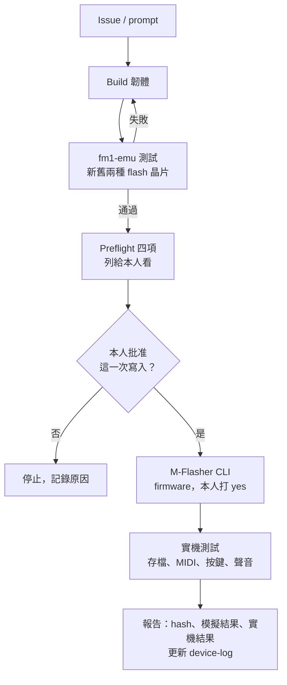

# 工作流與權限

這一節整理怎麼讓 coding agent 幫忙操作 FM-1：哪些事可以放手讓它做、哪些每次都要我批准、哪些它根本不該發起。規則的正式版本在 repo 根目錄的 `AGENTS.md`，這頁是給人看的說明，兩邊必須一致。

## 權限分級 { #tiers }

| 等級 | 操作 | 規則 |
|---|---|---|
| 唯讀 | `m-flasher find`、`info`、`backup`；下載檔案；算 hash；跑模擬器 | 不必問，直接做 |
| 模式切換 | `m-flasher download-mode`、`restart` | 可以做，但先說一聲。不是 flash 寫入 |
| 韌體寫入 | `m-flasher firmware PACKAGE.fwsc`、瀏覽器 installer | 只有在我於**這個 session** 批准了**這一次**寫入之後。絕不傳 `--yes`，M-Flasher 的 `yes` 由我自己打 |
| 禁止發起 | `m-flasher bootloader …`、`restore …`、`run-ram …`、任何 erase、任何 flash 位址計算 | 不執行。說明要做什麼，交給我自己做，即使我隨口叫它做也一樣 |

每條指令對應哪一級，見 [M-Flasher CLI](m-flasher-cli.md)。

其他一律適用的規則：

- 機器回報任何意外狀況（不認得的晶片 ID、型號不確定、CRC 不符）就停下來回報，不要繞過工具的拒絕。
- 不要把原廠 016 降回 015，見[注意事項](../getting-started/cautions.md)。
- m-bootloader 在我明確開始那個階段之前不在範圍內。
- 任何裝置操作之後更新[我的機器](../device-log.md)：日期、執行了什麼、結果、hash。

## Preflight 檢查表

提出任何韌體寫入之前，agent 要把下面四項**全部**列給我看：

1. 這台機器的完整 flash 備份存在，附 SHA-256，且已記錄在[我的機器](../device-log.md)。
2. Flash 晶片 JEDEC ID 已知（`0x856014` 舊的 Puya，`0xB36014` 新的 UCUN），而且目標韌體有寫明支援它。見[兩種 Flash 晶片](../hardware/flash-chips.md)。
3. 套件是從上游 release 下載的，SHA-256 與 release asset 的 digest 相符。
4. 目前裝的韌體與 bootloader，以及這次寫入會改變什麼。

缺任何一項就不提出寫入。

## 建議的端到端流程 { #flow }

文字版：

1. **Issue / prompt**：說清楚要改什麼或要裝什麼。
2. **Build**：產出 `.fwsc`。只裝別人的韌體時這步換成「下載 release 並核對 hash」。
3. **模擬器測試**：在 [fm1-emu](emulator.md) 跑同一個套件，舊晶片與 `uc25hq80` 各一次。失敗就回到第 2 步。
4. **Preflight + 本人批准**：列出上面四項，等我說可以。這是唯一的人工關卡，也是最重要的一個。
5. **M-Flasher CLI**：`m-flasher firmware`，不加 `--yes`，M-Flasher 列出變更後由我打 `yes`。
6. **實機測試**：Save → 關機 → 開機 → Load，加上 USB MIDI、按鍵與聲音。聲音與手感要人判斷。
7. **報告**：套件 hash、模擬結果、實機結果，寫進 device-log。

## Skill 決策，script 執行

讓 agent 自由組合 shell 指令去刷機，每次的步驟都可能不一樣。比較穩的分工是：

- **Skill**（給 agent 的知識與流程說明）負責判斷：現在機器在什麼狀態、該跑哪一步、preflight 缺什麼、什麼情況要停。
- **Script / wrapper** 負責執行：固定的指令順序、固定的檢查、固定的輸出格式。agent 只能呼叫它，不能改它的步驟。

這樣寫入路徑永遠是同一條，出事時也知道是哪一步。現有的 FM-1 skills 見 [Agent Skills](skills.md)。

!!! warning "Prompt 不是權限控管"
    上面的分級目前只寫在 `AGENTS.md` 裡，靠 agent 自己遵守。這擋不住誤會、模型出錯或 prompt injection。最終應該由 wrapper 或 CI gate 強制執行：例如寫入指令只能透過一個會檢查 preflight、要求互動確認、拒絕 `--yes` 的 wrapper 呼叫。這個 wrapper 還沒寫。`[調研]`

## 自動化的兩個層級

**Level 1：純軟體自動化。** Build、模擬器測試、備份、hash、切換 download mode、在我批准後刷入、重啟、驗證。只要機器的韌體還能在 USB MIDI 上回應，或已經在 download mode，整條鏈都不必碰機器上的按鍵（例外見 [M-Flasher CLI](m-flasher-cli.md#hands-free)）。機器完全不回應 USB 時，這條鏈就斷了。

**Level 2：hardware-in-the-loop 測試台（未來的想法）。** 讓 agent 連救援都能做，需要額外硬體：`[調研]`

- 用 RP2040（Raspberry Pi Pico）做的 USB_KEY，強制晶片 ROM 進入 download mode。USB_KEY 能在韌體甚至 bootloader 壞掉時進 download mode，這點上游有寫。`[上游]`
- 可控制的供電，做 power cycle。
- USB data switch，在一般連線與 USB_KEY 之間切換，避免兩邊同時驅動 D+/D−。
- USB camera，讓 agent 看螢幕確認狀態。

這要自己設計電路與驗證程序，不是買一個智慧插座就好。目前只是記下來，沒有計畫要做。

## 這個 repo 還沒有的東西

| 項目 | 狀態 |
|---|---|
| 韌體 build toolchain | 沒有。目前只裝上游 release 的套件 |
| 本機 `fm1-emu` checkout | 沒有。用的是線上頁面，見 [fm1-emu 模擬器](emulator.md) |
| repo 自己的 FM-1 skill | 沒有。見 [Agent Skills](skills.md) 裡的社群方案 |
| `fm1` CLI wrapper | 沒有。上面說的強制 gate 就是它的目的 |

不要假設這些東西存在。

## 這一節的其他頁

- [M-Flasher CLI](m-flasher-cli.md)：指令、選項、每條指令的權限等級、一次完整的備份加刷入。
- [fm1-emu 模擬器](emulator.md)：刷機前能在電腦上驗證什麼、不能驗證什麼。
- [Agent Skills](skills.md)：社群現有的 FM-1 skills。
- [用 FM-1 控制 agent](agent-deck.md)：反過來把 FM-1 當成 agent 的控制器。
