# 魔術方塊 CUBE

把 FM-1 變成三階魔術方塊的隨身夥伴：一台 WCA 規則的計時器、一台在機器上自己算 random-state 打亂的打亂器、一本會自己畫出 case 圖的公式書、一個在琴鍵上轉的虛擬方塊，再加上三種出題方式。體驗參考 ccTimer、cstimer 與 [thecube.guru 的計時器](https://thecube.guru/zh/%E9%AD%94%E8%A1%93%E6%96%B9%E5%A1%8A%E8%A8%88%E6%99%82%E5%99%A8/)，再加上只有 FM-1 有的東西：琴鍵轉方塊、燈亮下一步要按的鍵、`K1`–`K4` 轉視角。

**狀態（2026-11-27）：**

- **v0.1**：四塊（TIMER、CUBE、ALGS、DRILL）一次做完（本人 2026-11-27 決定），在 host simulator、device build、fm1-emu 兩種晶片與疊在備份上的預演都驗證過，見 [v0.1 驗證](#v01-verify)。**還沒刷進實機。**
- 獨立的韌體，在 `firmware/cube/`，名稱暫定 CUBE，正式名稱發布前對照 Hub 再定。
- 授權 GPL-3.0-or-later：用了 THEORY 的 `srs.c` 與 `gtext.c`（GPL-3.0-or-later）。打亂的搜尋是自己依 Kociemba 的公開描述寫的，沒有抄任何實作。
- 識別碼 `FM-1_40`（開發版 `FM-1_4000`）：2026-11-27 對照 Hub 的 `catalog.json`，沒有任何 identity 以 40 開頭，也沒有任何 identity 是它的前綴。
- 存檔在 `0xC8000`–`0xCDFFF`，見[存檔](#storage)。

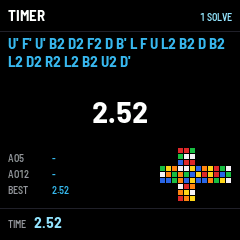{ width="240" } 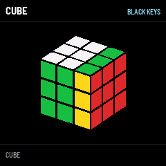{ width="240" } 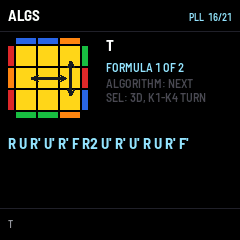{ width="240" }

## 頁面與操作 { #pages }

`HOME` 按一下開 MENU（停在剛剛那一頁），`SELECT` 選、`PLAY` 進；在 MENU 再按 `HOME` 回到選中的那一頁。**按住 `HOME` 0.6 秒顯示這一頁每個按鍵的作用**，任一按鈕關掉（那一下不會做別的事）。網站上的對照表見[操作速查](cube-cheatsheet.md)。

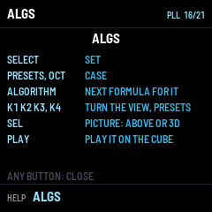{ width="240" }

### TIMER

| 控制 | 作用 |
|---|---|
| 任一鍵（或 `PLAY`） | inspection 開著時：按一下開始 15 秒 inspection。接著**按住 0.3 秒**（數字變綠、`PLAY` 綠燈）**放開就開始**計時 |
| 任一鍵、任一按鈕 | 計時中：停 |
| `K1` | 剛結束的那一筆：OK → +2 → DNF |
| `SEL` 兩下（2.5 秒內） | 刪掉剛結束的那一筆 |
| `REC` | 換一個打亂 |

- inspection 照 WCA：第 8、12 秒各響一聲；超過 15 秒才開始算 +2，超過 17 秒自己記成 DNF。
- 開始方式可以改成 **BOTH ENDS**：同時按住最左的 `F3` 與最右的 `G5`（像計時墊的兩個手掌位置），放開其中一個就開始。只按一邊不會開始。
- 計時用 1 kHz 的 tick 記下每個按鍵邊緣的那一毫秒，不是等下一個畫面，所以畫面忙的時候也不會讓開始或停止晚。
- 畫面：上方是打亂（白色朝上、綠色朝前），下方是 ao5、ao12、best，以及打亂後的展開圖（由程式算出來，不用相機）。計時中只顯示時間。

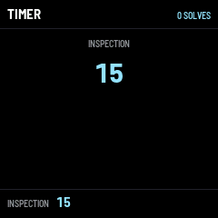{ width="240" } 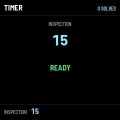{ width="240" }

### CUBE（虛擬方塊）

| 控制 | 作用 |
|---|---|
| 琴鍵 | 依鍵位轉面（見[鍵位](#keys)）；同一鍵按兩下就是 X2 |
| `SEL` + 鍵 | 反方向 |
| 鍵位裡的 UNDO（預設 `E5`） | 退一步；`SEL` + UNDO：回到復原狀態 |
| `REC` 按一下 | 新打亂，**亮燈的鍵就是下一步**，跟著按完就打亂好；按錯了 UNDO 鍵會亮，退回去再繼續 |
| `REC` 按住 0.6 秒 | 直接打亂好 |
| `PLAY` | 虛擬計時：第一個轉動開始，轉回復原自己停 |
| `K1` / `K2` / `K3` | 繞畫面的 x / y / z 軸轉視角，每格 15°（只轉相機，不改方塊的記號） |
| `K4` | 斜看的 preset：右前、左前、右後、左後、右下、左下 |
| 只按 `SEL` | 顯示鍵位圖 |

轉層有 110 ms 的動畫（SETTINGS 可關）。打亂完成後的第一個面轉動（不算 `x y z`）開始計時。

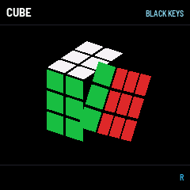{ width="240" } 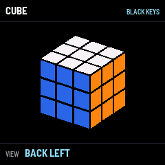{ width="240" } 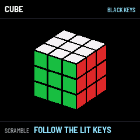{ width="240" }

### ALGS（公式書）

| 控制 | 作用 |
|---|---|
| `SELECT` | 公式集：LBL、2-LOOK OLL、2-LOOK PLL、OLL、PLL、F2L |
| `PRESETS`、`OCT-` / `OCT+` | case |
| `ALGORITHM` | 同一個 case 的下一個公式（畫面寫 FORMULA 2 OF 3） |
| `K1` `K2` `K3` / `K4` | 轉 3D 視角 / 斜看的 preset（和 CUBE 頁一樣） |
| `SEL` | 圖：從上面看，或 3D |
| `PLAY` | 在方塊上一步一步播放選中的公式，燈同步亮對應的鍵；再按停 |

一個 case 常有好幾個公式（不同手法、不同起手方向），68 個 case 有第二到第五個公式，見[公式書](#algs)。

case 圖不是手畫的：把公式反過來套在復原的方塊上，就是這個公式解的 case。OLL、PLL 預設從上面看，像一般的公式表：OLL 只標黃色（其他灰），側面的黃色畫成邊條；PLL 畫出側面的顏色，再用**箭頭標出哪些塊換到哪裡**（箭頭也是從公式算的：每張貼紙跟著打亂走，算出它要回到哪一格）。F2L 與 LBL 用 3D。公式書的圖都是**黃色朝上、綠色朝前**（白色十字在底下）。

{ width="240" } 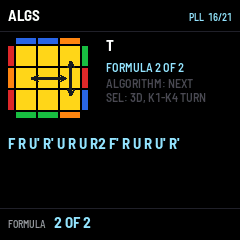{ width="240" } 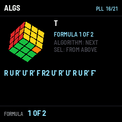{ width="240" }

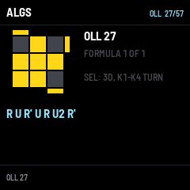{ width="240" } 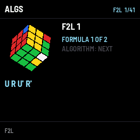{ width="240" }

### DRILL（出題）

先在設定畫面用 `SELECT` 選公式集、`K1` 選模式，畫面會列出這個模式的三個步驟；`PLAY` 開始一回合（約 12 張，header 顯示 CARD 3/12）。進度用 THEORY 的 Leitner 卡片（`srs.c`）：每個公式集各自一份，四個一組慢慢打開，答錯的這回合最後再問一次。

| 模式 | 怎麼玩 | 評分 |
|---|---|---|
| RECOGNIZE | 看 case 圖，想它是哪一個、公式是什麼，`PLAY` 看答案 | 畫面下方三個鍵：`PLAY` 記得、`SEL` 慢、`REC` 不會 |
| REAL CUBE | 照畫面上的打亂（公式的反向，前面加隨機的 U）在**自己的方塊**上打亂（黃色朝上），然後按住一個鍵放開開始，用公式解回來，按鍵停；`REC` 跳過 | 記下時間，每個 case 有自己的平均；再用同樣三個鍵評分 |
| VIRTUAL | 畫面上的方塊就是那個 case，在琴鍵上轉回去；用哪一個公式都可以（OLL 只要頂層朝上、F2L 只要前兩層，最後差一個 U 也算）；`REC` 放棄 | 步數不超過最短的公式加 2 算記得，否則算慢 |

新的 case 第一次出現時直接顯示公式（NEW CASE: LEARN IT），`PLAY` 下一張。答案畫面上 PLL 也有箭頭。HINT LIGHTS 開著時，VIRTUAL 模式會亮第一個公式的下一步；半圈（例如 `U2`）沒有對應的鍵，按 `U` 兩下，燈會等第二下。

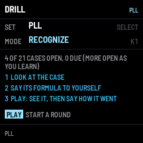{ width="240" } 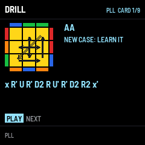{ width="240" } 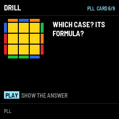{ width="240" }

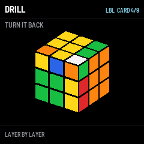{ width="240" } 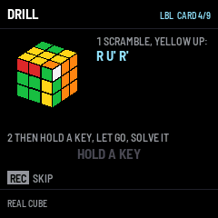{ width="240" } 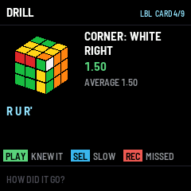{ width="240" }

### STATS 與 SETTINGS

STATS：這個 session 最近 100 筆（新的在上，+2 的後面有 `+`），右邊是 mo3、ao5、ao12、ao50、ao100、best、mean，下面是選中那一筆的打亂。`SELECT` 捲動。

平均照 WCA：去掉最好與最差各一筆（50 筆以上各去掉 5 %），DNF 算最差，DNF 比去掉的多就是 DNF；單次顯示截到 0.01 秒，平均四捨五入到 0.01 秒。

SETTINGS（`SELECT` 選行，`K1`、`PRESET` 或 `OCT-` / `OCT+` 改，`PLAY` 執行）：

| 設定 | 選項 |
|---|---|
| SCRAMBLE | RANDOM STATE（預設）/ RANDOM MOVE |
| MOVES | random-move 的長度 15–30（預設 25；RANDOM STATE 時是灰的） |
| INSPECTION | 15 S / OFF |
| START | ANY KEY / BOTH ENDS |
| KEYS | BLACK KEYS / TWO HANDS / SEL / CUSTOM |
| EDIT KEYS | `PLAY` 進入：按一個鍵，轉 `SELECT` 改它的動作，`HOME` 存好離開 |
| TURNS DRAWN | 轉層動畫開關 |
| HINT LIGHTS | DRILL 的提示燈開關 |
| CLEAR SESSION | `PLAY` 兩下清空所有 solve |

SCRAMBLE 那一行選中時，footer 顯示最近一次 random-state 搜尋花了多久，例如 `LAST: 22 MOVES IN 4.0 S, 1411K NODES (1)`，可以拿來量實機的速度。

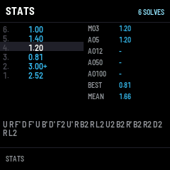{ width="240" } 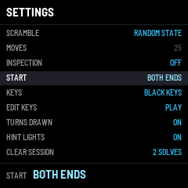{ width="240" } 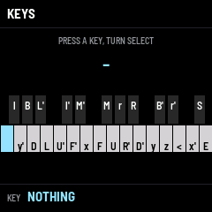{ width="240" }

## 鍵位 { #keys }

四種，SETTINGS 選；每一種都可以用 `SEL` + 鍵轉反方向。速查表見[操作速查](cube-cheatsheet.md)。

**BLACK KEYS（預設）**：白鍵順時針，右邊緊鄰的黑鍵逆時針。`L` 在最左、`R` 在最右。

| 白 | 黑 | | 白 | 黑 |
|---|---|---|---|---|
| F3 `L` | F#3 `L'` | | F4 `U` | F#4 `U'` |
| G3 `D` | G#3 `D'` | | G4 `E` | G#4 `E'` |
| A3 `B` | A#3 `B'` | | A4 `S` | A#4 `S'` |
| B3 `x` | — | | B4 `z` | — |
| C4 `F` | C#4 `F'` | | C5 `r` | C#5 `r'` |
| D4 `M` | D#4 `M'` | | D5 `u` | D#5 `u'` |
| E4 `y` | — | | E5 UNDO | — |
| | | | F5 `R` | F#5 `R'` |
| | | | G5 （空） | — |

**TWO HANDS**：參考 cstimer / qqtimer 的電腦鍵盤配置精神：右手在高音區轉 `R U F`，左手在低音區轉 `L D B`，旋轉與 wide 放在小指與拇指的位置。不是逐鍵照抄（cstimer 的鍵盤表還沒有對照過 `[調研]`）。

**SEL**：16 個白鍵 = 16 個順時針動作，按住 `SEL` 變逆時針；黑鍵是旁邊那個白鍵的 X2。

**CUSTOM**：從目前的鍵位複製一份，逐鍵改；27 個鍵的動作存在設定裡。

記號照 WCA / SiGN：`M` 跟 `L` 同方向、`E` 跟 `D`、`S` 跟 `F`；小寫是兩層（`r` = `Rw`），`x y z` 跟 `R U F` 同方向。

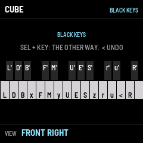{ width="240" }

## 打亂：在 FM-1 上做 random-state { #scramble }

WCA 的三階打亂不是隨機轉 25 下，而是從約 4.3×10¹⁹ 種狀態裡均勻挑一種，再找一條到那裡的短路徑。這樣沒有哪一個打亂比較簡單。手機 app 是這樣做的，CUBE 在 FM-1 上也是這樣做：

1. **隨機狀態**：角塊排列、邊塊排列（Fisher–Yates）、角塊方向、邊塊方向各自均勻，排列的奇偶不合時換兩個邊塊。再排除 0 或 1 步就解開的狀態（WCA 也排除）。
2. **找路徑**：Kociemba 的 two-phase 演算法。phase 1 把方塊轉進 ⟨U, D, R2, L2, F2, B2⟩，phase 2 只用這些步解完。打亂就是解法的反向。
3. **表格**（都在 flash，`just cube-tables` 在電腦上產生，353,685 B）：phase 1 用 twist × slice（twist 以保持 U-D 軸的 8 個旋轉對稱縮減成 291 類）與 flip × slice（slice 以 16 個對稱縮減成 45 類，flip 跟著共軛）兩張 pruning；phase 2 用角塊排列 × 中層排列、邊塊排列 × 中層排列（排列以 16 個對稱縮減成 2,768 類）。Kociemba 原版的大表（flipslice × twist）放不進 FM-1。
4. **六個方向**：同一個狀態沿 U-D、R-L、F-B 三個軸看，加上它的反向，一共六個搜尋輪流跑，哪個先找到短的就用哪個（min2phase 的做法）。
5. **在背景跑**：搜尋可以分段，main loop 每個畫面給它幾毫秒（閒著 8 ms、計時中 10 ms、要畫東西時 3 ms），在你解上一顆的時候把下一個打亂準備好。按鍵的時間由 tick 記，所以這不影響計時。開機時還沒有自己算好的那一個，就先從電腦預先算好的 100 個 random-state 打亂裡隨機挑一個（也是 random-state）。

量到的數字：

| 在哪裡 | 結果 |
|---|---|
| 這台 Mac（`just cube-unit`，1,000 個隨機狀態） | 全部解開並驗證；17–23 步（21 步以下約 35 %，大多 21–22）；平均 1.6 M 節點、最多 9.8 M；每個約 9 ms |
| fm1-emu `FM1_STRICT=1`（量每個指令的週期與 flash cache 的 miss） | 第一個：22 步、1,411 K 節點、背景 4.0 秒 `[模擬]` |
| 實機 | **還沒量**：SETTINGS 的 SCRAMBLE 那一行會顯示 |

長度和打亂的公平性無關（公平來自狀態均勻），所以 22、23 步也是合格的 random-state 打亂；WCA 的 TNoodle 通常給 19–21 步。要更短需要更大的表或更多搜尋時間，見[之後](#later)。

**RANDOM MOVE**：face move 隨機轉 15–30 下（預設 25），同一面不連續、同一軸不連三下（`R L R`），跟 cstimer 舊式的一樣。

驗證：`cube.c` 的貼紙模型由 `just cube-vectors` 交叉檢查。它把我們算出的貼紙字串交給 Kociemba 自己的 solver（Python `kociemba` 套件），再確認它的解法真的能解開我們的方塊。

## 公式書 { #algs }

| 集合 | 數量 | 內容 |
|---|---|---|
| LBL | 10 | 層先法每一步一個公式：第一層角塊三種、中層左右、黃十字、黃面（Sune）、黃角放位置、黃角轉方向、黃邊循環 |
| 2-LOOK OLL | 10 | 邊三種（一字、L、點）＋ 角七種（OCLL） |
| 2-LOOK PLL | 6 | 角兩種（相鄰：T-perm；對角：Y-perm）＋ 邊四種（Ua、Ub、H、Z） |
| OLL | 57 | OLL 1–57，照常見的編號 |
| PLL | 21 | Aa、Ab、E、F、Ga–Gd、H、Ja、Jb、Na、Nb、Ra、Rb、T、Ua、Ub、V、Y、Z |
| F2L | 41 | 右前那一組的每一種情況 |

每個 case 的第一個公式決定它的圖；第二到第五個是同一個 case 的其他常見公式（68 個 case 有，大多是 OLL 與 PLL，例如 Aa 的 `R' F R' B2 R F' R' B2 R2`、T 的 `F R U' R' U R U R2 F' R U R U' R'`）。

`just cube-unit` 檢查每一個公式：能 parse；**每個公式都要從那個 case 達到這一組的目標**：OLL 是頂層全部朝上（兩個 OLL 公式朝上之後的排列本來就不同），PLL 是復原，F2L 是前兩層，2-LOOK PLL 的角塊步驟是角塊到位，都先把整顆的轉向轉回來、允許最後差一個 U；第一個公式的 case 還要符合：OLL、PLL 不動前兩層，PLL 不動頂層的方向，F2L 不動十字與另外三組；同一個集合裡的 case 兩兩不同（從哪一面看、最後差一個 U 都算同一個）。所以 57 個 OLL、21 個 PLL、41 個 F2L 都各自涵蓋了所有 case。

替代公式是照記憶寫的候選，交給程式檢查：需要先轉 `y` 或先轉 U 才對的，程式會找出前綴補上（例如 `y` 開頭）；79 個候選裡 73 個留下，6 個錯的（多半是鏡像版本）丟掉。DRILL 的 VIRTUAL 模式用同一個檢查，所以用哪個公式做都算。

- OLL 與 PLL 的公式是常見教材裡的那些，編號照慣例。編號與圖案的對應還沒有逐一和 speedsolving wiki 的圖比對過 `[調研]`。
- **F2L 的編號是 CUBE 自己的順序，不是 speedsolving wiki 的 F2L 1–41。** 一開始照記憶寫的 41 個裡有一個會破壞十字、四對重複；缺的五種用程式在 ⟨R, U, F⟩ 裡搜最短的補上，所以有幾個公式不是一般人背的那種寫法（例如 F2L 40 `R F U R U' R' F' U' R'`）。

## 存檔 { #storage }

| 物件 | 位址 | 內容 | 什麼時候寫 |
|---|---|---|---|
| `OBJ_CUBE` | `0xCC000` | 設定與自訂鍵位 | 改設定停手 3 秒後 |
| `OBJ_SOLVES` | `0xCA000` | 最近 100 筆：時間、懲罰、打亂 | 每一筆、改懲罰、刪除、清空 |
| `OBJ_DRILL` | `0xC8000` | 六個公式集的 Leitner 進度、REAL 每個 case 的平均 | 一回合結束時 |

都透過 fm1-base 的 `APP_STORE_MAP` / `plat_store_*`，每個物件兩個 sector。這台機器 2026-11-25 的備份裡 `0xC0000`–`0xCDFFF` 全是空的 `[實機]`（讀備份檔確認），疊在那份備份上預演時只寫 `0xCA000`、`0xCC000` `[模擬]`，見 [flash 配置圖](../hardware/flash-map.md)。

## v0.1 驗證 { #v01-verify }

2026-11-27，本人的 Mac：

| 項目 | 結果 |
|---|---|
| `just cube-unit` | `cube_test` 100,107 項全過：每種記號四次回原狀、`x = R M' L'` 等關係、Kociemba 的 40 組向量、random-move 規則、WCA 平均、四種鍵位、每個 case 的每一個公式（含替代公式）。`solve_test`：RAM 裡建的表與 `gen/` 的表各解隨機狀態，全部驗證通過 |
| `just fw-test cube` | 123 項 `ok`：inspection、按住放開開始、放開後 2,520 ms 按下記到 2,522 ms、+2 / DNF（15 秒、17 秒）、刪除、BOTH ENDS（只按一邊不開始）、ao5、虛擬方塊轉面與 UNDO、`SEL` 反向、視角、跟著燈打亂、偏離後亮 UNDO、ALGS 播完 T-perm 的兩個公式方塊都復原、切換公式、3D 與轉視角、按住 `HOME` 的說明頁（關掉的那一下不做別的事）、DRILL 三種模式（含 `U2` 要按兩下的 case）、一回合結束進度存檔、設定與鍵位與 solve 重開後還在 |
| `just fw-build cube` | app 501,336 B（槽 581,564 B）；`.ram_text` 5,100 / 32,768 B；`.data+.bss` 45,932 / 98,304 B；沒有 soft-double，檢查全部 `ok`；package 616,003 B，identity `FM-1_4000` |
| fm1-emu `uc25hq80`、`p25q80` | 兩種晶片都開機、計時一筆、在 SETTINGS 關掉 inspection，重開後 1 SOLVE 與 INSPECTION OFF 都讀回；只寫 `0xCA000`、`0xCC000` `[模擬]` |
| 疊在備份上預演 | package 疊在 `2026-11-25-2330-pre-morse-0.8` 上：安裝改了 `0x04000`–`0x7E000` 的 123 個 sector（都在韌體區）；開機後計時、改設定只寫 `0xCA000`、`0xCC000`，THEORY、Morse、METRONOME 的 sector 沒動 `[模擬]` |

fm1-live 的 `--shot` 預設會按一下 `PLAY`，腳本測試時要加 `FM1_NO_PLAY=1`；它的旋鈕編號 `e0` 是 `SELECT`，`e3` 不是 `K1`，要改設定用 `PLAY` 比較穩 `[模擬]`。

### 上機前要本人試的 { #try }

刷機要本人在當次 session 核准，照 [AGENTS.md](https://github.com/daviddwlee84/M-VAVE_FM-1/blob/main/AGENTS.md) 的 preflight。之後在實機上試：

1. 開機進 TIMER，上面有一個 20 步左右的打亂，右下角有展開圖。
2. 按一下任一鍵：INSPECTION 15 倒數。按住一個鍵：出現紅色的 HOLD，0.3 秒後變綠色的 READY、`PLAY` 綠燈；放開開始計時，再按任一鍵停；時間和按住放開的感覺一致。
3. `K1` 轉：那一筆變 +2、DNF、OK。
4. 等 10 秒，進 SETTINGS 選 SCRAMBLE 那一行：footer 顯示 `LAST: … MOVES IN … S`，**記下實機的秒數**。
5. CUBE：按 `F5` 轉 R、`E5` 退回；`REC` 跟著亮的鍵打亂；`K1`–`K4` 轉視角。
6. ALGS：選 PLL、T，`PLAY` 播放，最後方塊復原。
7. DRILL：PLL、RECOGNIZE 玩一回合，回 MENU 再進 DRILL，開放的 case 數還在。
8. 關機再開：solve 的筆數與設定都還在。

## 之後 { #later }

- 更短的 random-state 打亂（19–21 步）：phase 2 換更強的 pruning（min2phase 的 EPermCCombP，2-bit 約 97 KB），或把 pruning 改成 2-bit 換出空間。
- solve 匯出（csTimer 相容的 JSON，USB SysEx 加網頁，照 METRONOME 的備份）。
- 解法提示（用同一個 solver）、2×2 與其他方塊。
- 藍牙智慧方塊（GAN 等用的是一般 GATT，不是 MIDI；own BLE stack 能不能當 central 連要另外調研）。
- TWO HANDS 逐鍵對照 cstimer 的鍵盤表；F2L 改用 speedsolving 的編號與常見公式。
