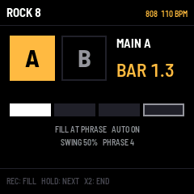
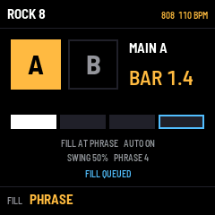
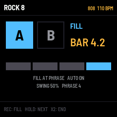
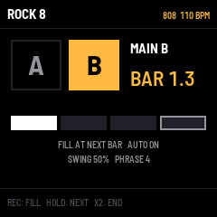
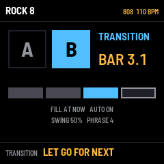
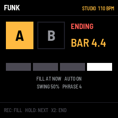

# Live 鼓機 DRUMS

把 FM-1 變成一個可以帶著走的鼓手：選曲風、選鼓組、按 `PLAY` 就有 groove。想換段時，它在**樂句的最後一小節**自己放過門。3.5 mm 輸出接 mixer，不管旁邊是 MODX、吉他還是任何樂器都能一起玩。它和 Yamaha PSR、BeatBuddy、Boss RC-10R 的對照，以及為什麼先做鼓而不是整個伴奏機，見[伴奏機與 live 鼓機（探索）](jam.md)。

**狀態（2026-11-19）：**

- **v0.1**：在 host simulator、device build 與 fm1-emu 兩種晶片驗證過 `[模擬]`，見 [v0.1](#v01) 與 [v0.1 驗證](#v01-verify)。還沒刷進實機，也還沒疊在這台機器的備份上預演。
- 獨立的韌體，不是 [RHYTHM](rhythm.md) 的一頁（本人 2026-11-19 決定）。在 `firmware/drums/`，名稱暫定 DRUMS，正式名稱發布前對照 Hub 再定。
- 授權 GPL-3.0-or-later，因為搬了 RHYTHM 的 transport。
- 識別碼 `FM-1_58`（開發版 `FM-1_5800`）：2026-11-19 對照 Hub 的 catalog 沒人用。
- 存檔在 `0xD0000`（`APP_STORE_MAP {0xDC000, 0xD0000}`），上面一格 `0xD2000` 是 RHYTHM。刷機前用 `just emu-rehearse` 確認這一格在最新的備份裡是空的。

## v0.1 { #v01 }

v0.1 做的是下面[設計](#model)的一部分：MAIN A / B、三種 `FILL AT`、`AUTO FILL`、transition、ending、tap tempo、`REC` 的三個手勢、右半邊的 pad、靜音、swing。還沒有：MAIN C / D、intro、break、song mode、MIX / KIT 頁、MIDI clock、sample 鼓組。

**操作（實際做出來的）：**

| 控制 | 作用 |
|---|---|
| `PLAY` | 停止中：從 `MAIN A` 開始。播放中：放 ending 後停；按住 0.7 秒：立刻停；ending 中再按：立刻停 |
| `REC` | 停止中：tap tempo（取最後 4 下）。播放中：按一下過門（等 0.3 秒確認不是按兩下）、按住 0.45 秒 transition（放開後換到另一個 MAIN）、按兩下 ending |
| F3 / G3 | `MAIN A` / `MAIN B`。停止中按：從那一段開始。按現在這一段：放一個過門再回來（PSR 的做法） |
| F#3 | 過門（立刻送出，沒有按兩下的等待） |
| E4 | ending |
| F4–G5 | 15 個 pad，見下表 |
| `SEL` + pad | 那一軌靜音 / 取消（只影響節奏型，pad 照樣響） |
| `SELECT` | style：停止中連 BPM 一起換成那個 style 的；播放中下一小節換，BPM 不變 |
| `PRESETS` | 鼓組：808、STUDIO |
| `K1`、`OCT-` / `OCT+` | BPM ±1（30–240），播放中從下一個 tick 起換，不會跳拍 |
| `K2` | swing：off 16 分音符往後 0–12 tick（顯示 50–75 %，66 % 是三連音的感覺） |
| `K3` | `FILL AT`：NOW、NEXT BAR、PHRASE |
| `K4` | 樂句長度：4、8、16 小節 |
| `ARP` | `AUTO FILL` 開關（燈亮是開） |

設定停手 3 秒後自動存。`HOME`、`SEQ`、`ALGORITHM` 在 v0.1 沒有作用，和設計草稿的分配不同：`SEQ` 原本要管 `FILL AT` 與樂句長度，現在改成 `K3`、`K4`。

**Pad（F4–G5）：** kick、hat、snare、open hat、rim、ride、clap、tom 低、shaker、tom 中、cowbell、tom 高、crash、hat、snare（由左到右，黑白鍵都算）。最右邊兩個是第二個 hat 與 snare，方便兩指連打。

**燈：** F3 / G3 亮的是現在這一段，閃的是排隊中的那一段；F#3 在過門時亮、排隊時閃；pad 在那一軌發聲時亮一下，靜音的那一軌不亮；`PLAY` 播放中綠燈，每小節第一拍紅燈。

**10 個 style：** ROCK 8、POP 16、FUNK、SHUFFLE（三連音格）、DISCO、HIP-HOP、BOSSA、REGGAE（one drop）、WALTZ 3/4、BALLAD 6/8。每個有 MAIN A、MAIN B，過門是自己的或同拍號共用的兩種（snare 漸強、tom 下行）。ending 是第一拍的 kick 加 crash。節奏型全部是自己寫的，在 `styles.h`，一行一軌。

**兩套合成鼓組：** 808（長 kick、金屬感的 hat）與 STUDIO（短而緊的 kick、噪音 hat）。每一軌一個 voice，再打一次就重來；closed hat 會切掉 open hat。

{ width="240" } { width="240" } { width="240" }

{ width="240" } { width="240" } { width="240" }

畫面：左上兩格是 MAIN A / B（藍色是過門中）；右邊是正在放什麼和「小節.拍」；中間一排是樂句，最後一格的框是 PHRASE 模式放過門的位置；下面是設定，以及排隊中的要求或靜音的軌。

### 試玩

PR 頁面上有 fm1-emu 網頁版的連結，打開就是這個 package，不用帳號（做法見 [模擬器](../agentic/emulator.md)）。它是瀏覽器模擬，聽起來和實機的喇叭不同。

### v0.1 驗證 { #v01-verify }

2026-11-19，在雲端的 Linux 容器裡：

| 項目 | 結果 |
|---|---|
| `just drums-unit` | groove 270 項、kit 104 項全過：每種 `FILL AT` 在一小節的每個 16 分音符按下過門都落在對的小節、樂句 4 / 8 / 16、3/4 與 6/8、MAIN 與過門同時排隊、transition、ending 後靜音、swing、靜音；每個鼓組的每一軌都會響、數值有限、6 秒內結束 |
| `just fw-test drums` | 全部 `ok`：tap tempo、PHRASE 過門在第 4 小節、NEXT BAR、AUTO FILL 換到 B、NOW、transition、pad 與靜音、播放中換 style 與鼓組、ending 後安靜（-70.9 dBFS）、按住 `PLAY` 立刻停、重開後設定還在 |
| `just fw-build drums` | app 104,748 B；`.ram_text` 5,100 / 32,768 B；`.data+.bss` 38,132 / 98,304 B；沒有 soft-double，檢查全部 `ok`；package 616,003 B，identity `FM-1_5800` |
| fm1-emu `uc25hq80`、`p25q80` | 兩種晶片都開機、播放（audio peak 16,007），改設定（`ARP`）後 3 秒存檔，重開讀回 `AUTO OFF`；只寫 `0xD0000` 這一個 sector；播放時 ISR 佔 11 % 的指令 `[模擬]` |
| 疊在備份上預演 | **還沒做**：雲端容器裡沒有備份。刷機前在 Mac 上跑 `just emu-rehearse firmware/drums/build/drums.fwsc backups/<最新>/<檔案>.bin` |

這次的 device build 是在連不到 gitee.com 的雲端容器裡做的，SDK 的三個檔案改從別的 fm1-base package 取出並核對 SHA-256，見[開發環境](index.md#sdk-from-package)。

## 使用情境 { #uses }

| 情境 | 需要什麼 |
|---|---|
| 接 mixer，和任何樂器一起玩 | 3.5 mm 立體聲輸出（見 [I/O](../hardware/io.md)）、每一軌的音量與左右 |
| 和 MODX 或鍵盤 jam | 跟著外部的 MIDI clock 跑，或自己送 clock |
| 練吉他 | 雙手不用離開吉他：song mode 自己換段、自己放過門；也可以用 MIDI 踏板觸發 |
| FM-1 自己玩 | 琴鍵當 finger drum pad 現場加打 |

## 一個 style 裡有什麼 { #model }

綜合 PSR、RC-10R 與 BeatBuddy：

| 段落 | 說明 |
|---|---|
| `INTRO` | 1–2 小節，可以關掉 |
| `MAIN A`–`D` | 同一個曲風的四種變化，通常越後面越熱鬧 |
| `FILL` | 每個 MAIN 一個專屬的過門，另外還有幾個共用的（短、長、只有 tom） |
| `TRANSITION` | 按住時一直循環的過渡段（BeatBuddy） |
| `BREAK` | 一小節的停頓，只留 crash 或什麼都不留 |
| `ENDING` | 放完就停 |

- 鼓組和 style 分開選：任何節奏型都可以配任何鼓組。
- **Song（v0.3）**：幾段排在一起，每段有小節數，例如 `intro 2 | A 8 | B 8 | A 8 | ending`。每段的最後一小節自動放過門，練吉他時不用動手。

## 時間規則 { #timing }

transport 搬 RHYTHM 的 `firmware/rhythm/app.c`：`tr`、`tick_at`、`q8_mul`、`beat_q8_at`，以及 `app_render` 裡逐 sample 的排程。時鐘就是音訊的 sample 數，不會飄。差別在每拍改成 **24 tick**（RHYTHM 是 12）：32 分音符的 flam 放得下，MIDI clock 的 24 PPQN 也剛好一個 tick 對一個 pulse。

**過門什麼時候放**，由設定 `FILL AT` 決定：

| `FILL AT` | 按下過門之後 | 參考 |
|---|---|---|
| `NOW` | 從下一個 16 分音符放到這小節結束 | PSR |
| `BAR` | 下一小節整小節放 | Polly、RHYTM-SEC-1 |
| `PHRASE` | 等到這個樂句（4 / 8 / 16 小節）的最後一小節才放 | **沒有產品這樣做** |

其他規則：

- 按住（`TRANSITION`）：放 transition 並一直循環，放開後在這小節結束時換到下一個 MAIN（BeatBuddy）。
- 換 MAIN：在小節尾或樂句尾換，看設定；`AUTO FILL` 開著就先放過門。
- 所有要求都先排隊，到邊界才生效；後來的要求蓋掉前面的。
- 過門一律寫成一小節。從小節中間開始時只放剩下的部分。

## 操作 { #controls }

照實際的面板排（面板圖見 [Conductor 速查](../agentic/conductor-cheatsheet.md)）：左邊是 `SELECT`、`PRESETS`、`ALGORITHM` 與 `OCT-` / `OCT+`；右邊是 `K1`–`K4`，以及兩排按鈕 `FX SEL ENV LFO EDIT GLO` 和 `HOME SAVE ARP SEQ PLAY REC`。

| 控制 | 作用 |
|---|---|
| `PLAY` | 停止中：先放 intro（有開的話），再進 `MAIN A`。播放中：放 ending 後停。按住：立刻停 |
| `REC` | 停止中：tap tempo（RHYTHM 的 `tap_tempo`）。播放中是「BeatBuddy 鈕」：按一下過門、按住 transition、按兩下 ending |
| `ALGORITHM` | 曲風分類 |
| `SELECT` | 分類裡的 style |
| `PRESETS` | 鼓組 |
| `K1`–`K4` | BPM、swing、energy（ghost note 與 hi-hat 密度）、humanize |
| `OCT-` / `OCT+` | BPM ±1 |
| `ARP` | `AUTO FILL` 開關 |
| `SEQ` | `FILL AT` 與樂句長度 |
| `FX`（按住） | build-up：濾波往上掃並拿掉 kick，放開時回來 |
| `SEL` + 右半邊的琴鍵 | 那一軌靜音 / 取消，做 drop 用 |
| `HOME` | 換頁：PLAY → MIX（每一軌的音量與左右）→ KIT（音高、長度）→ SONG → SETTINGS |
| `SAVE` | 存自己的 song；設定停手 3 秒後自動存（RHYTHM 的做法） |

**琴鍵（F3–G5，27 個）：**

| 區域 | 白鍵 | 黑鍵 |
|---|---|---|
| 左半 F3–E4（演奏控制） | `MAIN A`、`B`、`C`、`D`、`BREAK`、`INTRO`、`ENDING` | 過門 1–3、`TRANSITION`、crash 收在拍上（stop-time） |
| 右半 F4–G5（15 個 pad） | kick、snare、rim、clap、closed hat、open hat、ride、crash、三個 tom、cowbell、tambourine、shaker 等 | |

右半邊的 pad 可以設定要不要對齊拍子。力度要用 fm1-base 的 `APP_TOUCH`，但它的時間精度還沒量過；RHYTHM 量拍子用的是 1 kHz tick 裡的 `plat_keys`。

**外接踏板：** 「BeatBuddy 鈕」的三個手勢也可以從 MIDI CC 觸發。踏板從 TRS MIDI IN 或 Bluetooth MIDI 進來，練吉他時用腳踩。

**燈（`firmware/common/ledfx`）：** 現在的 MAIN 亮著；排隊中的 MAIN 或過門閃；每個 pad 在它那一軌發聲時亮一下；播放中 `PLAY` 亮綠燈。

## 聲音 { #sound }

### 合成鼓組（先做）

- kick：正弦波往下掃頻。
- snare：噪音加一個音高。
- hi-hat 與鈸：濾過的噪音或 FM 金屬聲。
- 另有 clap、tom、rim、cowbell。
- 鼓組：808、909、electro、lo-fi。
- 約 10–12 個 voice；open hat 會被 closed hat 切掉（choke group）。
- 每一軌有自己的音量與左右，立體聲輸出。
- 低音補償（給 FM-1 的小喇叭用）可以關掉，接 mixer 時不需要。

程式小，授權單純，沒有素材來源的問題。

### Sample 鼓組（評估過再決定）

用 `firmware/common/adpcm` 的 IMA ADPCM 解碼（4 bit）。粗算可以放幾套：

| 項目 | 數字 |
|---|---|
| app slot | 581,564 B（[語音合成](tts.md)） |
| 程式本身 | 約 100–150 KB（RHYTHM v0.2 是 104 KB） |
| 可以給 sample 的空間 | 約 400 KB |
| 4 bit、22.05 kHz | 11.2 KB / 秒 |
| 一套 12 件的鼓組 | 約 5 秒，約 56 KB |
| 可以放 | **5–6 套** |

- 22.05 kHz 只到 11 kHz，鈸會悶。所以做成混合的：kick、snare、tom 用 sample，hi-hat 與鈸用合成；或鈸改用 32 kHz。
- sample 只能放在程式裡（const 陣列），不能放在 flash 的資料區（[AGENTS.md](https://github.com/daviddwlee84/M-VAVE_FM-1/blob/main/AGENTS.md) 不准自己算 flash 位址）。
- 要先做一個像 [voicelab](tts.md) 那樣的小實驗：放一套鼓組進去，在 fm1-emu 用 `--bench` 量程式大小與 CPU，再決定。
- 素材：要找 CC0 的 sample 包，或自己錄。

## 節奏型 { #content }

- 用文字格線寫，build 時經 fm1-base 的 `gen = [...]` 轉成 C 表。
- 一個事件 2 byte（tick、哪一軌、力度等級）。一個 style 約 18 小節、約 1 KB，50 個 style 約 50 KB。
- 自己寫，或從 Google Magenta 的 Groove MIDI Dataset 取。它是 CC BY 4.0（Polly 用的就是它），要標出處。據說資料裡有分 beat 與 fill，還沒查證 `[調研]`。
- 曲風清單（草稿）：rock 8beat / 16beat、pop、ballad、funk、shuffle / blues、swing / jazz、bossa nova、samba、reggae、hip-hop、lo-fi、house、drum & bass、6/8、3/4 waltz、5/4、7/8。

格式草稿（`.` 是空格，數字是力度等級；每拍 4 格，實際存成 24 tick）：

```text
style   rock8   "Rock 8beat"   time=4/4   group=rock
main A  kick    9... .... 9.7. ....
main A  snare   .... 9... .... 9...
main A  hat     6.4. 6.4. 6.4. 6.4.
fill A  snare   .... .... 9797 9999
fill A  tom1    .... 9.9. .... ....
fill A  crash   ....                     # 接到下一小節的第一拍
```

## 同步與輸出 { #sync }

- **音訊**：3.5 mm 立體聲輸出到 mixer 或錄音介面。
- **跟 MODX 的 clock 跑**：MODX 背後有 5-pin 的 MIDI IN / OUT，經轉接頭接到 FM-1 的 TRS MIDI IN，FM-1 就能直接跟著 MODX，不用電腦。要把 MODX 的 MIDI I/O 設成 MIDI（不是 USB）。這來自論壇與第三方轉載的手冊，還沒對照 Yamaha 官方手冊 `[調研]`（[Yamaha Synth 論壇](https://yamahasynth.com/community/modx-series-synthesizers/midi-routing-usb-din5-midi-out)）。
- **FM-1 當主控**：送 0xF8（24 PPQN）與 start / stop。走 USB 或 Bluetooth，中間要有電腦或 USB host，因為 FM-1 沒有 MIDI OUT 接頭。
- **跟外部 clock 跑**：clock 可以從 USB、Bluetooth 或 TRS 進來，用 `now_smp()` 量間隔，算出每個 tick 的長度。
- **MIDI note 輸出**：每一軌照 General MIDI 的鼓譜送到 DAW（之後再做）。
- 這個 repo 裡還沒有任何韌體處理 MIDI clock。

## 程式結構 { #code }

| 檔案 | 內容 |
|---|---|
| `groove.c` / `groove.h` | 不碰平台：style、song、要求佇列、邊界判斷、pattern 展開成事件。在電腦上測（`just drums-unit`） |
| `kit.c` | 合成鼓聲 |
| `sample.c` | ADPCM 鼓組（實驗之後才決定要不要） |
| `app.c` / `app.h` | 畫面、按鈕、transport、存檔 |
| `content/*.txt` | 內建的 style 與鼓組參數 |

`groove.c` 要測的情況：

- 在一小節的每一個 16 分音符按過門，三種 `FILL AT` 各自落在哪裡。
- 按住與放開 transition 的時間點。
- 按一下和按兩下的分辨。
- 3/4、6/8，以及樂句長度 4 / 8 / 16。
- MAIN 和過門同時排隊時的先後。
- 外部 clock 有抖動時。

## 進度 { #roadmap }

| 版本 | 內容 |
|---|---|
| v0.1（2026-11-19 做完，見[上面](#v01)） | 兩套合成鼓組、約 10 個 style、`MAIN A` / `B`、過門（`NOW` / `BAR` / `PHRASE`）、tap tempo、`REC` 的三個手勢、右半邊的 pad |
| v0.2 | 更多變化：`MAIN C` / `D` 與它們的過門、每段三種過門、半小節與兩小節的過門、`INTRO`、`BREAK`；MIX 頁、sample 實驗（見[之後](#next)） |
| v0.3 | 標準鼓 MIDI 輸出（GM 鼓譜、`LOCAL` 開關）、MIDI clock 進出、song mode、外接踏板的 CC |
| v0.4 | 在機器上編輯：把 preset 複製成 USER style，用格線改；更多鼓組與 style；練習功能（靜音小節、慢慢加速，和 RHYTHM 重疊） |

(v0.1 已經有 `ENDING`、`TRANSITION`、`AUTO FILL`，原本排在 v0.2。)

每一版照[開發環境](index.md)的流程：host simulator 的 `fw-test`；fm1-emu 兩種晶片都要做存檔、重開、讀回；疊在最新備份上預演；最後才問要不要刷。

## 之後 { #next }

本人試過 v0.1 之後（2026-11-19）問的四件事，以及打算怎麼做。都還沒有程式。

### 一個 style 不只 A / B

v0.1 的一個 style 是 MAIN A、MAIN B、各自的過門、ending 五個 part。下一步加 `MAIN C`、`MAIN D` 與它們的過門，style 的文字裡用 `C`、`D`（MAIN）和 `c`、`d`（過門）表示。沒寫 C / D 的 style 就沿用 B，所以現有的 10 個 style 不用改也能用。

ending 放在 E4，就是為了把 F3–D#4 這 12 個鍵留給演奏控制。v0.1 只用了 F3、F#3、G3，其餘的打算這樣排：

| 鍵 | 白鍵 | 鍵 | 黑鍵 |
|---|---|---|---|
| F3 | `MAIN A`（已有） | F#3 | 過門 1（已有） |
| G3 | `MAIN B`（已有） | G#3 | 過門 2：短的，只有最後兩拍 |
| A3 | `MAIN C` | A#3 | 過門 3：tom 下行 |
| B3 | `MAIN D` | C#4 | `TRANSITION`（按住，和 `REC` 按住一樣） |
| C4 | `BREAK`：一小節的停頓 | D#4 | crash 收在拍上（stop-time） |
| D4 | `INTRO` | | |
| E4 | `ENDING`（已有） | | |

### 過門的長度

v0.1 的過門一律是一小節；`NOW` 是從按下的地方放到小節結束，所以實際長度已經會變。之後再加：

- **半小節**：只放過門的後兩拍，例如 4/4 的第 3、4 拍。Yamaha PSR 新一點的機種有 Half Bar Fill-in 這個選項，這點只見於使用者論壇 `[調研]`。可以是一個設定（`FILL LEN`：½、1、2 小節），也可以是 G#3 的短過門。
- **兩小節**：漸強型的過門，`PHRASE` 模式放在樂句的最後兩小節。style 的文字裡讓一個過門跨兩小節。
- **任意長度**：transition 已經是按住多久就放多久，放開後在那一小節結束時換段。

### 標準鼓 MIDI 輸出（v0.3）

把 FM-1 的聲音關掉，改用別的音源打鼓：

- 每一軌照 General MIDI 的鼓譜送到第 10 channel：kick 36、rim 37、snare 38、clap 39、closed hat 42、open hat 46、crash 49、ride 51、tom 50 / 47 / 43、cowbell 56、shaker 70。力度取自節奏型的 1–9，pad 也一樣送。
- `LOCAL` 開關：FM-1 自己的聲音開或關。
- 送 MIDI clock（0xF8）與 start / stop。v0.1 的每拍 96 tick，正好每 4 tick 一個 clock（24 PPQN）。
- 走 USB 時，FM-1 和另一台 USB 裝置之間要有電腦或 USB host；走 Bluetooth 要開 `ble = true`（見 [I/O](../hardware/io.md)）。

### 在機器上編輯 pattern（v0.4）

內建的 preset 保持唯讀，用起來和現在一樣。要改時，把一個 preset 複製成 USER style，在格線頁上改：一軌一列、一步一格，琴鍵或旋鈕放音與力度，播放中就聽得到。

存檔照規則走 fm1-base 的 store（`APP_STORE_MAP`）。一個 store 物件最多 3,840 byte，一個事件 3 byte，一個 part 大約 20–60 個事件，所以一個 USER style（含 C / D 共 9 個 part）大約 1–1.5 KB，一個物件放得下兩個。要更多就在 `APP_STORE_MAP` 多加幾個物件；用哪幾格要先查 [Flash 配置](../hardware/flash-map.md)，並在刷機前預演。

## 還沒決定的事 { #open }

- 正式名稱。
- 做完 sample 實驗後，要不要放 sample 鼓組。
- 琴鍵力度（`APP_TOUCH`）的時間精度夠不夠拿來打鼓。
- 練習功能放這裡還是放 RHYTHM。
