# 吉他指板與和弦書（GUITAR）

把 FM-1 變成隨身的吉他指板與和弦圖：選一個調，指板上標出音階的每個位置，可以一次只看一個把位（CAGED、3NPS）；彈一個和弦，就畫出它的按法，最簡單的排第一。靈感來自 [ChordRoot](https://chordroot.com/)，但只借想法，不抓它的資料。

**狀態（2026-11-18）：v0.1（NECK + SHAPE）在 host simulator 和 fm1-emu 兩種晶片上驗證過，也疊在實機備份上預演過 `[模擬]`；還沒刷進實機。** 驗證結果見 [v0.1 驗證](#v01-verify)。v0.2 進行中（draft PR #3）：封閉和弦、power chord、SHAPE 的篩選，以及 [LEARN](#learn) 學習模式，目前只在 host simulator 與單元測試驗證過 `[模擬]`，實機套件還要在本人的 Mac 上重 build 與跑 fm1-emu。

- 韌體在 `firmware/guitar/`，GPL-3.0-or-later，名稱 GUITAR，識別碼 `FM-1_55`（開發版 `FM-1_5500`）。原本選的 `FM-1_53` 和 Hub 上 LSDJ Burrito 的 `FM-1_537…` 開頭相同（嚴格說格式不會撞，但 Morse 遇到 `FM-1_13` 對 `FM-1_137` 時也照這個原則換掉），所以改成 `FM-1_55`：2026-11-18 對照 Hub catalog（12:01 UTC 版）沒有人用 `[上游]`。上 Hub 前仍要用 #check 再查一次。
- 和 THEORY、RHYTHM 分開，是獨立的韌體（2026-11-18 本人決定，見[設計提案](#background)）。直接 `include` THEORY 的 `theory.c`、`synth.c`、`gtext.c`，所以授權跟著 THEORY 是 GPL-3.0-or-later。
- 設定存在 `0xD4000`（見[存檔](#flash)）。
- 指板核心 `fret.c` 與課程 `lesson.c` 的 `just guitar-unit` 有 298,903 個檢查（v0.2），全部通過。

## 背景 { #background }

2026-11-18 的調研（Firmware Hub catalog、GitHub、一般搜尋，`[調研]`）：FM-1 上沒有任何顯示吉他指板、和弦圖或音階指法的韌體。現有的吉他韌體（fm1-guitar、Riffsmith、FoMni、ChoralRoot、Strumline）都是讓 FM-1「聽起來或彈起來像吉他」。其他平台的參考：ChordRoot（和弦圖、no barre 簡易版、tunings）、Tuitar（ESP32 上的指板與找音遊戲）、Gingoduino（MIT，微控制器上的 Fretboard 模組）。

包裝方式本人選了「RHYTHM 與 GUITAR 都另做韌體」：各自有自己的 `FM-1_` identity 與設定 sector，穩定之後再比照 fm1-morse 拆成獨立 repo 上 Hub。

## 頁面 { #pages }

用 `HOME` 依序切換 NECK → SHAPE → LEARN。

| 頁面 | 做什麼 | 版本 |
|---|---|---|
| **NECK** | 一個調的音階在指板 0–12 品上的所有位置；整個指板，或一次一個把位（CAGED 5 個、3NPS 7 個、五聲音階 2NPS 5 個） | v0.1 |
| **SHAPE** | 和弦圖：手指編號、barre、空弦 ○、悶音 ×、根音標色，最簡單的按法排第一 | v0.1 |
| **LEARN** | 按調由淺入深學和弦：認按法、按出組成音，Leitner box 排程，進度存檔 | v0.2 |
| BOX | 音階指法速查：5 品放大，每個點寫手指編號 | 之後 |
| FIND | 找音練習（Leitner，項目 = 弦 × 品區） | 之後 |

### NECK { #neck }

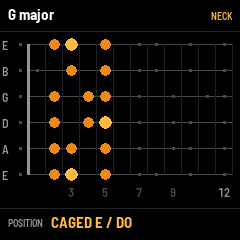{ width="240" } 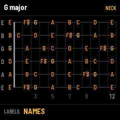{ width="240" } 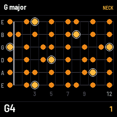{ width="240" }

host simulator 的截圖 `[模擬]`。左：G 大調、CAGED 的 E 把位（2–5 品），把位外的調內音是小灰點。中：整個指板，標示換成音名。右：按住 G4，指板上每個 G 都圈起來，footer 顯示 `G4` 和級數 `1`。

- **方向**：高音弦在上，和 tab 一樣。左邊一欄是每根弦的空弦音名（依調拼寫）。
- **點**：調內的音；主音較亮、較大。在把位模式下，把位外的調內音縮成小灰點。
- **按住琴鍵**：那些音（不分八度）在指板上的每個位置都畫白圈；放開就消失，footer 留著剛才的音名或和弦名與級數。
- **把位超出 12 品**時，指板自動往右捲，左下角標出第一格的品數。

| 操作 | 作用 |
|---|---|
| 轉 `SELECT` | 沿五度圈換調 |
| 按住 `SEL` 再按一個琴鍵 | 跳到以那個音為主音的調 |
| `K1` | 音階：THEORY 的 12 種（大調、各調式、和聲／旋律小調、大小五聲、blues） |
| `K2` | 標示：點、音名、級數（`b3`、`#4`，相對於同主音的大調） |
| `K3` | 把位：整個指板 → CAGED C、A、G、E、D → 3NPS 1–7（五聲音階是 2NPS 1–5；blues 沒有 NPS） |
| `K4` | 樂器與 tuning（兩頁共用） |
| `PLAY` | 把目前把位的音由低到高彈一遍，指板上跟著標出正在響的那一格（再按一次停） |
| `OCT-` / `OCT+` | 琴鍵發聲的八度 |

### SHAPE { #shape }

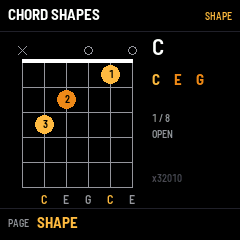{ width="240" } 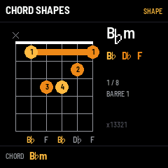{ width="240" } 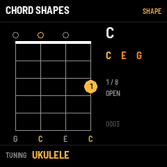{ width="240" }

host simulator 的截圖 `[模擬]`。左：C 的第一個按法 `x32010`，手指 3、2、1。中：Bbm 的 A 型 barre（第 1 品）。右：換成烏克麗麗，C 變成 `0003`。

- **圖**：直的弦（低音弦在左），橫的品，最上面是上弦枕；按法在 5 品以上時上弦枕換成細線，左邊標起始品數。
- **點**裡是手指編號（1 食指到 4 小指）；根音用亮色。barre 畫成一條橫槓。弦上方是 ○（空弦）或 ×（不彈）。圖下面是每根弦實際的音名。
- **右欄**：和弦名、組成音、第幾個按法（`1 / 8`）、`OPEN` / `BARRE n` / `FRET n`、省略五音時標 `NO 5TH`；封閉和弦標出型（`E FORM`：根音在 6 弦、`A FORM`：5 弦、`D FORM`：4 弦），power chord 標根音在第幾弦（`ROOT ON 6`）；按法的文字寫法（`x32010`）；最下面是 `K3` 的篩選。
- 沒有空弦的按法（封閉和弦、power chord）從它自己的最低品畫起，左邊標品數，和和弦書一樣。

| 操作 | 作用 |
|---|---|
| 彈一個和弦 | 辨認出來（THEORY 的 `th_identify`），畫出它的按法 |
| 按住 `SEL` 再按一個琴鍵 | 根音換成那個音 |
| 轉 `SELECT` | 下一個按法 |
| `K1` | 和弦性質：常用的排前面（大、小、7、m7、maj7、sus4、sus2、5、dim、aug、m7b5、dim7、6、m6、7sus4、add9、madd9、9、maj9、m9、mMaj7、aug7、augMaj7） |
| `K2` | 根音，一格半音（拼法跟大調一樣：Bb、F#、Db） |
| `K3` | 要看哪些按法（v0.2）：**EASY**（全部，最簡單的排第一）、**OPEN**（有空弦的）、**BARRE**（封閉和弦：有 barre、沒有空弦）、**MOVABLE**（沒有空弦、可以整個平移的，含 power chord） |
| `K4` | 樂器與 tuning |
| `PLAY` | 照這個按法的實際音高，從低音弦往上 strum |

LED：NECK 亮調內的音（主音 mid、其他 glow），SHAPE 亮和弦的組成音（根音 mid）；按住的鍵 lit；`PLAY` 播放時亮綠燈。設定在最後一次操作 3 秒後存起來。

### LEARN { #learn }

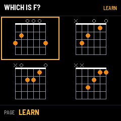{ width="240" } 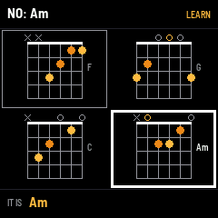{ width="240" } 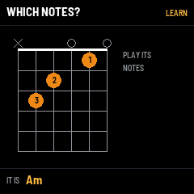{ width="240" } 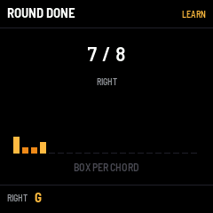{ width="240" }

host simulator 的截圖 `[模擬]`。一：「WHICH IS F?」，從四個和弦圖選一個（框起來的是目前選的）。二：選錯（答 F，正確是 Am），白框是正確答案，每個圖旁邊寫出名稱。三：「WHICH NOTES?」，只給按法、不給名稱，在琴鍵上按出它的組成音。四：一回合 8 張結束，下面一格一個和弦，高度是它的 box（亮色表示已到解鎖門檻 box 2），還沒開放的和弦是一條細線。

一回合 8 張卡，從最弱的和弦（box 最低，同 box 時新階段優先）開始，同一個和弦不會連著出現。全新的和弦（box 0）一定先出「名稱 → 按法」；之後兩種題型隨機。

| 題型 | 畫面 | 怎麼答 |
|---|---|---|
| **名稱 → 按法** | 標題是 `WHICH IS Am?`，下面四個小和弦圖（根音不標色，避免提示） | 轉 `SELECT` 選，按 `PLAY` 確定 |
| **按法 → 組成音** | 一個大和弦圖（含手指編號），不寫名稱 | 在琴鍵上按出那個按法實際響的音（不分八度，可以一起按，也可以按住一個再一個一個加），**全部放開**時判斷；`PLAY` 可以先聽一次，不扣分 |

答完：標題顯示 `RIGHT: C` 或 `NO: Am`，自動 strum 正確的按法，琴鍵亮出它的組成音（根音 mid）。再按 `PLAY` 下一張；一回合結束後按 `PLAY` 開始下一回合。LEARN 頁的 `K1`–`K4` 不作用，固定標準調音；`SEL` 加琴鍵在這頁只是一般的琴鍵。

**Leitner**（`lesson.c`）：答對升一個 box（最高 5）；答錯回到 box 0，原本在 box 3 以上的只退到 box 1。目前開放的每一階段裡，所有和弦都到 box 2，就解鎖下一階段（footer 顯示 `NEW CHORDS` 和新和弦）。footer 平常顯示 `STAGE 1 KEY C  3/8`。

**課程**（v0.2，`lesson.c` 的 `ls_items`，可以再調）：

| 階段 | 調 | 新和弦與教的按法 |
|---|---|---|
| 1 | C | C `x32010`、G `320003`、Am `x02210`、F `xx3211`（小 F，簡易版） |
| 2 | C | Em `022000`、Dm `xx0231`、G7 `320001` |
| 3 | G | D `xx0232`、D7 `xx0212`、Cmaj7 `x32000` |
| 4 | D | A `x02220`、Bm `x2443x`（不用 barre 的簡易版）、A7 `x02020` |
| 5 | A、E | E `022100`、F#m `xx4222`（四弦簡易版）、E7 `020100`、B7 `x21202` |
| 6 | F | 封閉和弦：F `133211`、Bm `x24432`、Bb `x13331`、Gm `355333` |

F 和 Bm 在前面的階段先學簡易版，第 6 階段再多一張完整封閉的卡（兩張分開記 box）。單元測試檢查每個教的按法都按得出來（`fr_shape_make` 能排出指法）、響的音都在和弦裡、組成音齊全（只允許省略五音）、根音在最低音，以及解鎖、box 上下限、回合不重複的規則。

## 指板核心 fret.c { #core }

`firmware/guitar/fret.c`：C99，不呼叫平台、不用 libc、不用浮點數，和 `theory.c` 一樣可以在電腦上單獨測（`just guitar-unit`）。

### Tuning

每種 tuning 是一行：弦數加上每根空弦的 MIDI 音。弦從音最低的那根算起（吉他的低音 E 是 0 號弦），畫面再決定怎麼擺。

| 名稱 | 空弦 |
|---|---|
| STANDARD | E2 A2 D3 G3 B3 E4 |
| DROP D | D2 A2 D3 G3 B3 E4 |
| DADGAD | D2 A2 D3 G3 A3 D4 |
| OPEN G | D2 G2 D3 G3 B3 D4 |
| BASS | E1 A1 D2 G2 |
| BASS 5 | B0 E1 A1 D2 G2 |
| UKULELE | G4 C4 E4 A4（reentrant：0 號弦是高音 G） |
| MANDOLIN | G3 D4 A4 E5（每組複弦當一根） |

### 把位 { #positions }

- **CAGED**：每個把位是一個 4 品寬的窗（食指到小指）。窗的位置從「同調號的大調主音在 0 號弦上的品數 r」算：C 型 r+4、A 型 r+6、G 型 r+9、E 型 r−1、D 型 r+1（取 0–11 品）。C 大調在標準調弦上就是 C 型 0–3 品、A 型 2–5、G 型 5–8、E 型 7–10、D 型 9–12。窗裡的調內音全部標出；夾在兩根弦之間、窗裡沒有的音（例如 C 大調 G 型的 B），用較高那根弦往回一品的位置補上（食指往後伸）。小調與調式用它的關係大調的窗，所以 A 小調和 C 大調的五個把位相同。
- **NPS**：從音階的第 n 個音在 0 號弦上的位置（0–11 品）開始，往上每根弦固定放 3 個音（七聲音階）或 2 個音（五聲音階）。如果某根弦會落到 0 品以下，整組往上一個八度。
- 單元測試：15 個調號 × 12 種音階 × 每個把位，**把位範圍內每個調內音剛好出現一次**、沒有調外音；NPS 每根弦的音數正確；CAGED 窗最多 5 品寬。另外對照教科書上的把位：G 大調 E 型、C 大調 C 型／E 型／G 型、G 大調 3NPS 第 1 把位、A 小調五聲第 1 把位。

### 和弦按法的搜尋 { #search }

不抄和弦表，用搜尋產生：

1. 對每個起始品 b（1–12），每根弦可以是 ×、空弦（如果是和弦音）、或 b 到 b+3 品之間的和弦音。逐弦往下搜，一個和弦約幾百個組合。
2. 留下來的要符合：每個音都是和弦音；組成音都在（完全五度可以省略）；最低音是根音（reentrant 的烏克麗麗不要求）；至少 4 根弦有聲（4 弦樂器至少 3 根）；跨度不超過 4 品。
3. **手指**：不用 barre 時，從最低的品往上、同一品先低音弦，依序給 1、2、3、4 指。超過 4 指時試 barre：食指壓在最低品，從最低那根有這一品的弦壓到最高那根，中間每根弦都要按在這一品以上；壓不了就丟掉。這個規則對 C、G、D、Am、E、F barre 都得出教科書的指法。
4. **排序**（分數越低越前面）：每根要按的手指 +2、每根空弦 −1、低音側悶音 +2、高音側悶音 +6、中間悶音 +10、barre +6、起始品數、省略五音 +3、兩根弦同一個音 +4、最低兩個音只差二度或四度 +4（例如 `x00230` 雖然少一指，聽起來不如 `x02230`）。
5. 留最前面 8 個，去掉重複的。

**對照測試**：26 個吉他手先學的開放和弦（C、A、G、E、D、Am、Em、Dm、各種 7、m7、maj7、sus4、sus2）每一個都被搜到，而且排在前三；3 個 barre 和弦（F `133211`、Bm `x24432`、Fm `133111`）在前八。8 種 tuning × 13 個根音 × 23 種和弦性質的每個結果都再檢查一次：和弦音、根音在低音、手指數、跨度、排序。標準調弦上，四個音以下的和弦每一個都至少有一個按法（九和弦有些找不到 4 品內的按法）。

在電腦上（`-O0`）一個和弦的搜尋約 0.5 ms，只在換和弦或換 tuning 時跑一次。

排序的權重是憑經驗調的。實際用起來覺得哪個按法排錯，把它加進 `tests/fret_test.c` 的 `OPEN` 表再調權重。

## 存檔 { #flash }

設定是一筆 `rec_t`（`GT01`；v0.1 是 24 bytes 的 `ver 1`，v0.2 是 60 bytes 的 `ver 2`，後面多了 LEARN 的進度：每個和弦的 box、開放到第幾階段、完成幾回合），透過 fm1-base 的 store（`APP_STORE_MAP {0xDC000, 0xD4000}`）存在 `0xD4000`。讀到 v0.1 的 24 bytes 記錄時保留原本的設定，LEARN 進度從頭開始。LEARN 在每一回合結束時存一次；回合中途的答案在 20 秒沒有新答案時存（一回合不會存 8 次，關機也最多掉最後 20 秒的答案）；換頁時也會跟著設定存。store 是 A/B 兩個 sector 輪流寫，所以連續存兩次會看到 `0xD4000` 和 `0xD5000` 都改了，兩個都在 GUITAR 自己的範圍內。選這裡是因為：`0xD6000` 是 THEORY 0.2 的閃卡進度、`0xD8000` 是 THEORY 的設定、`0xDA000` 是 Morse、`0xDC000` 是面板校正，而 `0xFC000` 是 SLOOP、Agent Deck、CTL-1 共用的設定區。

疊在 `2026-11-18-pre-theory-0.2` 備份上預演（兩種晶片，`[模擬]`）：開機 0 次寫入；存檔只改 `0xD4000` 一個 sector；`0xD6000`、`0xD8000`（THEORY）、`0xDA000`（Morse）、`0xFC000` 都和備份相同。備份本身的 `0xD4000`–`0xD5FFF` 全是 `0xFF`。這份備份是裝 THEORY 0.2 之前做的，THEORY 0.2 的閃卡進度在 `0xD6000`，GUITAR 不碰那裡。

## v0.1 驗證 { #v01-verify }

2026-11-18，全部 `[模擬]`。後三列在本人的 Mac 上跑（PR 的 worktree）。

| 項目 | 怎麼驗證 | 結果 |
|---|---|---|
| 指板核心 | `just guitar-unit` | 299,610 個檢查全部通過 |
| 畫面、辨認、聲音、存檔 | `just fw-test guitar`（`tests/basic.txt`） | 全部 ok：G 大調開機、琴鍵燈、單音 `G4 1`、和弦 `C IV`、CAGED E 與 3NPS 的格子、捲動、音名與級數標示、`PLAY` 跑音階、換調換音階、D 小調五聲 2NPS、`SEL` 加琴鍵；SHAPE 的 C `x32010` 指法 `032010`、strum 5 個聲部、彈 Am 得到 `x02210`、F、B7 `x21202`、Bbm、Gm、烏克麗麗 C `0003`；存檔、重開讀回 |
| 實機套件 | `just fw-build guitar`（本人的 Mac，dev build `FM-1_5300`，改 identity 之前） | app 125,944 B（槽 581,564 B），RAM `.data+.bss` 29,052 / 98,304 B，`.ram_text` 5,100 / 32,768 B；沒有 soft-double，`firmware/guitar` 沒有 compiler warning；套件 616,003 B |
| 換 identity 後重做 | 合併 main（含 RHYTHM）後在本人的 Mac 上 `fw-build`，再用 fm1-emu 兩種晶片開機 | 套件 identity `FM-1_5500`，616,003 B，SHA-256 `90e0d1cc…4bef4`；大小同上；兩種晶片都開機，0 次寫入 |
| 兩種晶片：改設定、重開讀回 | fm1-emu `uc25hq80`、`p25q80` headless，`FM1_BENCH_KEYS` 轉 `SELECT` 到 A major、按 `HOME` 到 SHAPE | 每次存檔寫 3 次；重開 0 次寫入，讀回 SHAPE 頁與 A major |
| 疊在實機備份上 | `emu_rehearse.py` 疊在 `2026-11-18-pre-theory-0.2`，兩種晶片 | 開機 0 次寫入；存檔只寫 `0xD4000`（見[存檔](#flash)） |

刷進實機之前要照 AGENTS.md：兩種晶片都跑過存檔與重開、`emu-rehearse` 報告寫入的 sector、完整備份、本人逐次同意。

## v0.2 驗證 { #v02-verify }

2026-11-18，全部 `[模擬]`，在本人的 Mac 上跑（commit `c328228`；之後只加了回合中途的存檔，見[存檔](#flash)）。

| 項目 | 結果 |
|---|---|
| `just guitar-unit` | 298,903 個檢查全部通過 |
| `just fw-test guitar` | 全部 ok（含 LEARN 一整個回合、選對、選錯、按出 C 的組成音、重開讀回進度） |
| `just fw-build guitar` | app 131,944 B（槽 581,564 B），RAM `.data+.bss` 29,212 / 98,304 B，`.ram_text` 5,100 / 32,768 B；沒有 soft-double，`firmware/guitar` 沒有 compiler warning；套件 `FM-1_5500`，616,003 B，SHA-256 `336772c5…7d79ec`（第一次 build 剛好碰到 Docker daemon 重啟而失敗，重跑成功） |
| fm1-emu 兩種晶片 | `HOME` 兩次進 LEARN（`WHICH IS F?`）、`SELECT` 選錯、`PLAY` 顯示 `NO: F` 並框出 F、`PLAY` 下一題、回 NECK：存 2 次，每次 3 次寫入；重開 0 次寫入 |
| 疊在 `2026-11-18-pre-theory-0.2` 備份上 | 開機 0 次寫入；存檔只改 `0xD4000` 與 `0xD5000`（A/B 輪流）；`0xD6000`、`0xD8000`、`0xDA000`、`0xFC000` 都和備份相同 |

## v0.2 計畫 { #v02 }

2026-11-18 本人試用 v0.1 的回饋：「體驗不錯」；想要封閉和弦、power chord、不同把位（參考 [learning-guitar 的音階頁](https://marsishandsome.github.io/learning-guitar/01_Basic/01_Guitar_Scale.html)），以及像 THEORY、MORSE 那樣的學習模式：按調由淺入深學和弦，C 調先學、G 調多學一個、再往下到 F 調，新手按不好封閉和弦時也有開放和弦可用。

### 1. 封閉和弦與 power chord { #v02-shapes }

**狀態：已完成**（host simulator 與單元測試 `[模擬]`）。

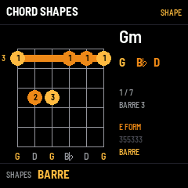{ width="240" } 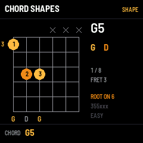{ width="240" }

- **Power chord**：v0.1 的搜尋要求至少 4 根弦有聲，所以 `5` 和弦只找得到 `022400` 這種有空弦的按法，找不到吉他手常用的兩、三根弦的 `x355xx`、`022xxx`。v0.2 的 `5` 和弦只用 2–3 根相鄰的弦（根音、五度、八度），根音可以在 6、5、4 弦（和更高的弦），三弦版排在兩弦版前面。G5 第一個是 `355xxx`（手指 1-3-4 記成 1-2-3），C5 是 `x355xx`。
- **封閉和弦**：搜尋本來就會找到 barre（F `133211`、Bm `x24432`），只是排在開放和弦後面。SHAPE 加一個 `K3` 篩選：**EASY**（現在的排序）、**OPEN**（只要有空弦的）、**BARRE**（只要封閉和弦）、**MOVABLE**（沒有空弦、可以整個平移的）。每個封閉和弦標出它是哪一型。目前用根音所在的弦判斷（6 弦 E 型、5 弦 A 型、4 弦 D 型）；C、G 型的封閉和弦比較少用，還沒有標。BARRE 篩選的定義是「有 barre 而且沒有空弦」：像 `022433` 這種低音 E 空弦加上 barre 的按法不算。
- 單元測試（`just guitar-unit`，297,612 個檢查）：E 型的大、小、7、m7 在 1–9 品、A 型在 1–7 品都出現在 BARRE 篩選裡（A 型再往上時 E 型的位置比較低，排在前面）；BARRE、OPEN、MOVABLE 篩選出來的每個按法都符合定義；12 個根音的 power chord 都有 6 弦根與 5 弦根的三弦版本。

### 2. 更多把位：Do、Re、Mi、Sol、La 型 { #v02-positions }

那個頁面教五種「型」（Do 型、Re 型、Mi 型、Sol 型、La 型，另外還有高把位的 Mi 型），以及怎麼把兩個型接起來。它們和 CAGED 是同一組五個把位，只是用唱名來命名。頁面的圖沒有文字說明，所以**每個型對應哪個 CAGED 形狀還沒對照過** `[調研]`。v0.2 的做法：

- NECK 的 `K3` 把位清單加上唱名的命名（設定可以選 CAGED 或唱名），名稱依照實際對照的結果決定（要先看那幾張圖，或請本人確認）。
- **CONNECT**：一次顯示相鄰的兩個把位，重疊的音用另一個顏色，練換把。
- 每個把位的手指編號（原本規劃的 BOX 頁）：5 品放大，點裡寫 1–4。

### 3. 學習模式 LEARN { #v02-learn }

**狀態：卡片 1、2、Leitner、進度存檔已完成**（host simulator 與單元測試 `[模擬]`），用法見 [LEARN](#learn)。下面是原本的規劃，實作時的差異：課程寫在 `lesson.c` 的表裡（還沒有 TSV 與網頁匯入）；進度和設定放在同一筆記錄，不另開 sector；卡片 2 改成「按法 → 組成音」（按出音，用 pitch class 比對，不用 `th_identify`）；錯的選項先挑同一階段或同性質的和弦。

比照 MORSE 的 PRACTICE 和 THEORY 規劃中的 TODAY：一回合交錯的卡片，用 Leitner box 排程，進度跨天保存。

**課綱：按調解鎖，每個調只多學幾個新和弦。** 順序是開放和弦最友善的調先學，接著才是要用封閉和弦的調：

| 階段 | 調 | 這一階段的新和弦（v0.2 草案） | 封閉和弦的簡易替代 |
|---|---|---|---|
| 1 | C | C、G、Am、F | F 先用 `xx3211`（四弦小 F），F 的完整封閉 `133211` 留到第 6 階段 |
| 2 | C（補完） | Em、Dm、G7 | — |
| 3 | G | D、（Em、C、G、Am 已會） | — |
| 4 | D | A、Bm | Bm 先用 `x20432` 或 `x2443x`，完整的 `x24432` 留到第 6 階段 |
| 5 | A、E | E、F#m（`244222`）、C#m | F#m、C#m 先用三、四弦的小按法 |
| 6 | F（封閉和弦） | F `133211`、Bb、Bm `x24432`、Gm | 這一階段才要求 E 型、A 型封閉 |

（每一階段大約 3 個新和弦，像 MORSE 的 Koch 方式：前一階段的和弦都到 box 2 才解鎖下一階段。實際的和弦清單先寫在 TSV，之後可以用網頁匯入，比照 THEORY。）

**卡片題型**（FM-1 只有琴鍵，沒有弦，所以練的是「認得按法」和「知道組成音」）：

1. **名稱 → 按法**：畫面給 `Am`，從 4 個和弦圖選一個（`SELECT` 選、`PLAY` 確定）。錯的選項用相似的按法（同一個型的另一個和弦、差一根弦的），比照 Morse 的 `ln_alike`。
2. **按法 → 名稱**：畫一個和弦圖，在琴鍵上按出它的組成音（不分八度、不分轉位，用 THEORY 的 `th_identify` 判斷）；按錯了就秀出正確的音。
3. **調裡的級數**：「G 調的 IV 是什麼？」按出 C 的組成音。把 THEORY 的級數和吉他的按法接起來。
4. **換和弦**（之後，和 RHYTHM 合作）：節拍器下輪流顯示 `C → Am → F → G`，每拍按出那個和弦，評早晚。

**簡易版與完整版**：每個和弦卡記住使用者目前學的是哪個按法。新手階段給簡易版；到第 6 階段，同一個和弦多一張「完整封閉」的卡。SHAPE 頁也有 BEGINNER 開關，打開時封閉和弦一律先顯示簡易版（還沒做；目前 SHAPE 的 EASY 篩選已經把開放按法排前面）。

**存檔**：進度需要另一個物件，在 `APP_STORE_MAP` 裡加一個 sector pair（候選 `0xD0000`，要先用最新備份和 `emu-rehearse` 確認是空的，而且 RHYTHM 在 `0xD2000`、THEORY 0.2 在 `0xD6000`）。網頁備份與匯入沿用 Morse 的 hostlink（之後）。

### 4. 順序

1. Power chord 與 `K3` 篩選（小改動，先做）。
2. 唱名把位命名、CONNECT、BOX 指法（先確認五個型與 CAGED 的對應）。
3. LEARN：卡片 1 和 2、Leitner、進度存檔（完成）；課綱 TSV 與網頁匯入之後。
4. 卡片 3、換和弦練習（等 RHYTHM 的節拍器穩定）。

**待本人決定**：課綱第 1 階段要不要先教 Em、Am（兩、三指，最容易），還是照提案先教 C 調的 I–IV–V–vi；F 在第 1 階段用小 F 還是延後到第 2 階段。

## 之後 { #next }

- 刷實機前照 AGENTS.md 做完整 preflight（`FM-1_5500` 的套件已經在本人的 Mac 上 build 過）。
- release 版要在 `fm1.toml` 補 `install`、`screenshot`（build 會提醒）。
- 指板方向可以反過來（低音弦在上）、左手吉他鏡像。
- SHAPE 的轉位與 slash chord（`C/E`）、jazz 的 shell voicing（目前要求根音在低音）。
- FIND 找音練習（LEARN 的另一種卡）。
- 網頁匯入自訂 tuning。
