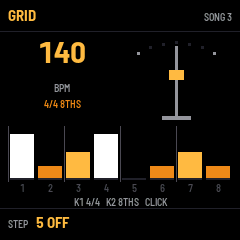

# 節拍器 METRONOME

給現場用的節拍器：一首歌一個白鍵，存好每首歌的速度、拍號、節奏型與音色，演出時按一下就換歌。另外有一頁在琴鍵上點出節奏型（亮度就是輕重音），以及仿照經典 rhythm watch 的四層混音頁。

**狀態（2026-11-20）：** v0.1 在 host simulator、device build、fm1-emu 兩種晶片與疊在備份上的預演都驗證過 `[模擬]`，2026-11-20 刷進實機，本人試用「感覺效果不錯」`[實機]`。見 [v0.1 驗證](#v01-verify)。

- 韌體在 `firmware/metronome/`，GPL-3.0-or-later，名稱 METRONOME。click 的合成與 transport 沿用 [RHYTHM](rhythm.md)。
- 識別碼 `FM-1_59`（開發版 `FM-1_5900`）：2026-11-19 對照 Hub 的 catalog 沒人用 `[上游]`。上 Hub 前要再查一次。
- 設定與 16 首歌存在 `0xCE000`（`APP_STORE_MAP {0xDC000, 0xCE000}`）。`0xD0000` 到 `0xDE000` 都被自製 app 與面板校正用掉了，見 [flash 配置](../hardware/flash-map.md)。這台機器 2026-11-20 的備份裡 `0xCE000` 是空的 `[實機]`。
- 為什麼另做一個韌體，不放進 RHYTHM：本人 2026-11-19 決定。RHYTHM 是練習機，這個是上台用的工具，開機就要是歌單。

## 現有的節拍器韌體 { #survey }

2026-11-19 查 [The Firmware Hub](https://thefirmwarehub.com/catalog.json) 的 catalog（269 個韌體）`[上游]`：**沒有專門做節拍器的韌體**。節拍器只是別的韌體的附屬功能：

| 韌體 | 和節拍器有關的部分 |
|---|---|
| [h1](https://github.com/jakehandy/h1) | 合成器，內建 metronome |
| [Frodhes](https://github.com/leonardoMirabal/frodhes) | 電鋼琴、木琴，有 tap tempo 與 MIDI clock sync |
| [BEETLE BLUE](https://github.com/SikkenWorks/BEETLE-BLUE) | 鼓的 tracker，Live Mode 可以排 setlist（是歌單，不是節拍器） |
| 自製 [RHYTHM](rhythm.md) | METRO 頁：拍號、細分、tap tempo、gap click；沒有 preset |

GitHub 上搜 `fm1 metronome` 也沒有結果。

## 操作 { #controls }

兩頁，`HOME` 在 SET 與這首歌的節奏頁（GRID 或 CLASSIC）之間切換。設定停手 3 秒後自動存。黑鍵在每一頁都是 tap tempo（照拍子按，取最後 4 下），也會跟著拍子閃。

| 控制 | SET | GRID | CLASSIC |
|---|---|---|---|
| `PLAY` | 開始 / 停止 | 同左 | 同左 |
| 白鍵 | 選歌（有存的鍵半亮，播放中的全亮） | 小節裡的一個 step，按一下換一級 | tap tempo |
| 黑鍵 | tap tempo | tap tempo | tap tempo |
| `REC` | EDIT 開 / 關 | tap tempo | tap tempo |
| `SEL` | EDIT 時：按住 `SEL` 再按白鍵，清掉那首歌 | 切到 CLASSIC | 切到 GRID |
| `SELECT` | BPM ±1（30–300） | 同左 | 同左 |
| `OCT-` / `OCT+` | BPM ±5 | BPM ±5 | BEAT ±1（0–9，0 是沒有重音） |
| `ALGO` | 音色：CLICK、WOOD、BEEP | 同左 | 同左 |
| `K1` | 換歌的時機：NEXT BAR / NOW | 拍數 1–9 | 四分音符的音量 0–7 |
| `K2` | | 一拍幾格：四分、8 分、3 連音、16 分 | 8 分音符的音量 |
| `K3` | | | 3 連音的音量 |
| `K4` | | | 16 分音符的音量 |

### SET：歌單 { #set }

- 16 首歌對應 16 個白鍵，由左到右是 1 到 16。有存的鍵半亮，正在用的那首全亮，沒存的不亮。
- 平常（不在 EDIT）：按有存的鍵就換到那首。播放中預設在**下一小節**才換，等的時候那個鍵會閃，換過去時新的歌從它自己的第一拍開始。`K1` 可以改成 NOW（下一個 tick 立刻換）。按沒存的鍵只會提示 `EMPTY`。
- `REC` 進 EDIT（`REC` 燈亮，畫面寫 `SET: EDIT`）：
    - 按一個鍵就選它。空的鍵會先複製目前這首歌的設定。
    - 同一個鍵照拍子再按幾下就是 tap tempo（選它的那一下算第一下）。
    - 或用 `SELECT`、`OCT-` / `OCT+` 精確調。
    - 按住 `SEL` 再按白鍵就清掉那首。最後一首不能清。
    - 再按一次 `REC` 離開。
- 畫面上半是 BPM、拍號與一個擺錘；下半是 16 格，每格寫歌號與 BPM。

### GRID：在琴鍵上點節奏型 { #grid }

- 一小節是「拍數 × 一拍幾格」個 step（最多 16 個），一個白鍵一格。
- 每按一下換一級：不響 → ghost（很小聲，鍵微亮）→ 一般（鍵半亮）→ 重音（鍵全亮）→ 不響。**鍵的亮度就是它有多大聲**。
- 播放中正在響的那一格全亮（重音的那格反過來暗一下），畫面上那一格變綠色。
- `K1` 改拍數、`K2` 改一拍幾格時，節奏型會重設成預設（第一拍重音、其他拍一般、拍與拍之間 ghost）。
- 不均分的節奏（附點、shuffle）在 16 分或 3 連音的格子上點。swing 旋鈕之後再做。

例：4/4 八分音符，把第 2 拍的「and」設成重音、第 3 拍關掉，就是 `A g N A . g N g`。

### CLASSIC：rhythm watch 的版面 { #classic }

照經典 rhythm watch 那種「每種音符一個音量鈕」的用法 `[調研]`（本人小時候用的那台；只參考操作方式，畫面是自己畫的）：

- `K1`–`K4` 是四分、8 分、3 連音、16 分的音量（0–7），可以混在一起，例如四分加小聲的 16 分。
- 四分音符在拍點上響；其他三層在拍與拍之間響。
- BEAT（`OCT-` / `OCT+`）是每幾拍一個重音，0 是不加重音。
- 畫面是七段顯示器風格的 TEMPO 與 BEAT，右邊兩顆燈：紅色是重音，綠色是一般的拍。

## 畫面 { #screens }

host simulator 的截圖 `[模擬]`：

| SET（播放中） | SET: EDIT | 換歌等下一小節 |
|---|---|---|
|  |  |  |
| **GRID**（4/4 八分） | **CLASSIC** | |
|  |  | |

## 時間怎麼算 { #timing }

和 [RHYTHM](rhythm.md#timing) 一樣，以 audio 的 sample 數為時鐘，每個 click 落在它自己的 sample 上，不是下一個 block。一拍是 12 個 tick，四分、8 分、3 連音、16 分都剛好落在 tick 上。

播放中的改動交給 render 在某個 tick 切換，所以拍子不會斷：

| 改動 | 什麼時候生效 | 拍子 |
|---|---|---|
| 換歌（NEXT BAR） | 目前這首的下一個小節線 | 新歌從第一拍開始 |
| 換歌（NOW）、EDIT 裡選別首 | 下一個 tick | 新歌從第一拍開始 |
| BPM、step、拍號、音量、音色 | 下一個 tick | 接著原本的拍子數下去 |

## 存檔 { #storage }

一筆 record（`rec_t`，460 B）：magic、版本、目前的頁、正在用的歌、換歌時機，以及 16 首歌。每首歌 28 B：

| 欄位 | 內容 |
|---|---|
| `used` | 有沒有存（鍵會不會亮） |
| `mode` | GRID 或 CLASSIC |
| `bpm` | 30–300 |
| `bpb`、`div` | GRID 的拍數 1–9、一拍幾格 1 / 2 / 3 / 4（乘起來最多 16） |
| `beat` | CLASSIC 的重音間隔 0–9 |
| `sound` | CLICK、WOOD、BEEP |
| `mix[4]` | CLASSIC 四層的音量 0–7 |
| `steps[16]` | GRID 每格的級數 0–3 |

讀回來的 record 不合法（版本不同、數值超出範圍）就用預設值：只有第 1 首，120 BPM、4/4。

## 程式結構 { #code }

| 檔案 | 內容 |
|---|---|
| `metro.c` / `metro.h` | 平台無關：每個 tick 響什麼（GRID 的級數、CLASSIC 的四層）、預設節奏型、record 檢查、tap tempo。`just metro-unit` 在電腦上測 |
| `app.c` | 頁面、輸入、LED（`firmware/common/ledfx` 的 GLOW / MID / LIT 三級）、render、畫面、存檔 |
| `tests/basic.txt` | host simulator 的劇本，`just fw-test metronome` |

## v0.1 驗證 { #v01-verify }

| 項目 | 結果 |
|---|---|
| `just metro-unit` | 1,430 個檢查全過：每種拍號與每拍格數（1–9 拍 × 1–4 格，最多 16 格）每個 step 都在自己的 tick 上、一小節一個重音；3 連音落在 tick 0、4、8；CLASSIC 的四層與 BEAT；不合法的 record；tap tempo 的平均與上下限 |
| `just fw-test metronome` | 全部 `ok`：4/4 一小節一個重音三個一般拍（有聲音，peak -17.4 dBFS）；EDIT 裡在第 2 鍵 tap 4 下得 100 BPM；第 3、4 首用 `SELECT` 與 `OCT-` 設；按住 `SEL` 清掉第 4 首；播放中按第 3 首，**下一小節**才從 120 換到 140；按空的鍵不會換；播放中轉 `SELECT` 立刻跟上；GRID 改成 8 分並改兩格後，一小節的重音、一般、ghost 數量都對；CLASSIC 的 BEAT 3 與 8 分音符層；黑鍵 tap tempo；重開機後 16 首歌、頁面與設定都還在 |
| `just fw-build metronome` | app 86,976 B；`.ram_text` 5,100 / 32,768 B；`.data+.bss` 25,976 / 98,304 B；沒有 soft-double，檢查全部 `ok`；package 616,003 B，identity `FM-1_5900` |
| fm1-emu `uc25hq80`、`p25q80` | 2026-11-20 在 Mac 上 headless 跑 PR #10 的 preview package（SHA-256 `698e08b1…bec75c6fd`）：空白 flash 開機 0 次寫入；`FM1_BENCH_KEYS` 腳本 REC、在 `D4`（第 6 首）tap 4 下、REC，存檔寫 4 次、只改 `0xCE000`；重開 0 次寫入，讀回第 6 首 100 BPM `[模擬]` |
| 疊在備份上預演 | 2026-11-20，備份 `pre-metronome-0.1`（THEORY 0.3，SHA-256 `b09767c3…d119b0d0`），兩種晶片：開機 0 次寫入，進 SET、第 1 首 120 BPM；存檔只改 `0xCE000`，`0xD6000`、`0xD8000`、`0xDA000` 不變 `[模擬]` |
| 實機 | 2026-11-20 本人用 `fm1_install.py` 從 THEORY 0.3 更新，`--info` 回報 `FM-1_5900 [running]`；本人試用：「感覺效果不錯」`[實機]` |

同一個 commit 在 Mac 上本地 build 的 package 和 preview 大小相同，差 43 bytes：檔頭的 CRC 和 `FM1B_BUILD`（fm1-base 的 `build_id()` 把 app 目錄下所有原始碼一起 hash，工作目錄多一個或少一個檔案就會不同）。比對兩份 package 時這是正常的。

前三列是 2026-11-19 在雲端 Linux 容器跑的。device build 用的 SDK 三個檔案是從 JAMTRACK 0.2.3 的 package 取出、核對過 SHA-256，見[開發環境](index.md#sdk-from-package)。

## 之後 { #next }

- 畫面主題：擺錘之外，指揮棒的拍子圖形、可愛的角色。先量一張圖要多少 flash 再決定（[CORD](https://github.com/chasedeanda/cord-fm1) 證明放得下圖）。
- 更多音色、swing、每首歌的名字（要先想好怎麼輸入文字）。
- 實機上校正延遲：tap tempo 只看按鍵間隔，不受延遲影響；要比較 click 與 LED 有沒有對齊。
- 和 [RHYTHM](rhythm.md) 共用 click 與 transport（抽到 `firmware/common/`）。
