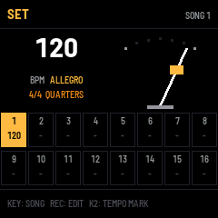
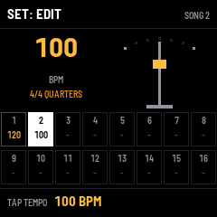
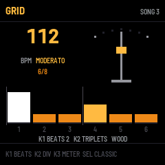
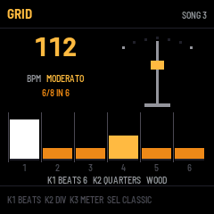
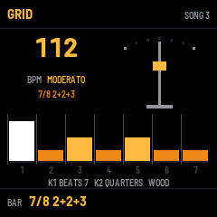
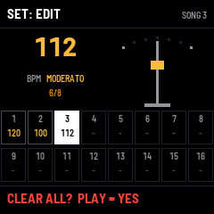

# 節拍器 METRONOME

給現場用的節拍器：一首歌一個白鍵，存好每首歌的速度、拍號、節奏型與音色，演出時按一下就換歌。另外有一頁在琴鍵上點出節奏型（亮度就是輕重音），以及仿照經典 rhythm watch 的四層混音頁。

**狀態（2026-11-20）：** v0.3（歌單經 USB 匯出／匯入、網頁歌單編輯器、獨立 repo）在 host simulator、device build 與 fm1-emu 兩種晶片驗證過 `[模擬]`，2026-11-20 release 0.3 刷進實機，網頁讀出、送回、重開機都通過 `[實機]`，見 [v0.3](#v03)。v0.2（速度術語、拍號 preset、全部清空、防誤觸）在 host simulator、device build 與 fm1-emu 兩種晶片驗證過 `[模擬]`，2026-11-20 刷進實機，本人試用 OK `[實機]`，見 [v0.2](#v02)。v0.1 在 host simulator、device build、fm1-emu 兩種晶片與疊在備份上的預演都驗證過 `[模擬]`，2026-11-20 刷進實機，本人試用「感覺效果不錯」`[實機]`。見 [v0.1 驗證](#v01-verify)。

- 韌體在獨立的 repo [fm1-metronome](https://github.com/daviddwlee84/fm1-metronome)（2026-11-20 從這裡的 `firmware/metronome/` 用 `git subtree split` 拆出去，歷史保留），這裡以 submodule 掛在 `firmware/metronome/`，用 `third_party/fm1-base` build。GPL-3.0-or-later，名稱 METRONOME。網頁在它的 GitHub Pages：[歌單編輯器](https://daviddwlee84.github.io/fm1-metronome/web/)、[cheatsheet](https://daviddwlee84.github.io/fm1-metronome/web/cheatsheet.html)、[try](https://daviddwlee84.github.io/fm1-metronome/web/try/)。click 的合成與 transport 沿用 [RHYTHM](rhythm.md)。
- 識別碼 `FM-1_59`（開發版 `FM-1_5900`，release 0.3 是 `FM-1_59000300`）：2026-11-19 對照 Hub 的 catalog 沒人用 `[上游]`；2026-11-20 再把 catalog 裡 269 個韌體的 `ident`（是 regex）拿來比對 `FM-1_5900`、`FM-1_59000100`、`FM-1_59000200`，除了萬用的 `FM-1_\d{3,8}` 都沒有符合 `[上游]`。Hub 的 [identity 檢查](https://thefirmwarehub.com/submit/#check) 要的是**韌體回報的完整數字**，3 到 8 位：只打 `FM-1_59` 會顯示「An identity is FM-1_ and 3 to 8 digits」，那是格式不對，不是被佔用。上 Hub 前用完整的 release identity 再查一次。
- 設定與 16 首歌存在 `0xCE000`（`APP_STORE_MAP {0xDC000, 0xCE000}`）。`0xD0000` 到 `0xDE000` 都被自製 app 與面板校正用掉了，見 [flash 配置](../hardware/flash-map.md)。這台機器 2026-11-20 的備份裡 `0xCE000` 是空的 `[實機]`。
- 為什麼另做一個韌體，不放進 RHYTHM：本人 2026-11-19 決定。RHYTHM 是練習機，這個是上台用的工具，開機就要是歌單。

## 現有的節拍器韌體 { #survey }

2026-11-19 查 [The Firmware Hub](https://thefirmwarehub.com/catalog.json) 的 catalog（269 個韌體）`[上游]`：**沒有專門做節拍器的韌體**。節拍器只是別的韌體的附屬功能：

| 韌體 | 和節拍器有關的部分 |
|---|---|
| [h1](https://github.com/jakehandy/h1) | 合成器，內建 metronome |
| [Frodhes](https://github.com/leonardoMirabal/frodhes) | 電鋼琴、木琴，有 tap tempo 與 MIDI clock sync |
| [BEETLE BLUE](https://github.com/SikkenWorks/BEETLE-BLUE) | 鼓的 tracker，Live Mode 可以排 setlist（是歌單，不是節拍器） |
| 自製 [RHYTHM](rhythm.md) | METRO 頁：拍號、細分、tap tempo、gap click；沒有 preset |

GitHub 上搜 `fm1 metronome` 也沒有結果。

## 操作 { #controls }

### 使用邏輯 { #how }

本人 2026-11-20 試用 0.2 之後整理的用法：

- **SET 是上台用的頁面**：選歌、看速度，能改的基本上只有 BPM（`SELECT`、`OCT`、`K2` 跳速度術語、EDIT 裡 tap）。拍號、節奏型、音色以外的設定都在下一層。
- **`HOME` 往下一層**，每首歌選一種：
    - **GRID**：細緻的設定。小節裡每一格的輕重、`K1` 拍數、`K2` 一拍幾格、`K3` 拍號 preset（6/8、7/8 …）。適合要固定節奏型的歌。
    - **CLASSIC**：直覺、快。四個旋鈕混四分、8 分、3 連音、16 分，`OCT` 設幾拍一個重音。自己練習、不換歌的時候，可以整段時間只用這一頁。
- 演完用 EDIT 裡長按 `SEL` 的[全部清空](#clear-all)，排下一場。

兩頁，`HOME` 在 SET 與這首歌的節奏頁（GRID 或 CLASSIC）之間切換。設定停手 3 秒後自動存。黑鍵在每一頁都是 tap tempo（照拍子按，取最後 4 下），也會跟著拍子閃。

| 控制 | SET | GRID | CLASSIC |
|---|---|---|---|
| `PLAY` | 開始 / 停止 | 同左 | 同左 |
| 白鍵 | 選歌（有存的鍵半亮，播放中的全亮） | 小節裡的一個 step，按一下換一級 | tap tempo |
| 黑鍵 | tap tempo；**播放中、不在 EDIT 時不作用**（防誤觸，頁尾提示 `REC: EDIT`） | tap tempo | tap tempo |
| `REC` | EDIT 開 / 關 | tap tempo | tap tempo |
| `SEL` | EDIT 時：按住 `SEL` 再按白鍵，清掉那首歌；按住 2 秒不按鍵，問 `CLEAR ALL?`（[全部清空](#clear-all)） | 切到 CLASSIC | 切到 GRID |
| `SELECT` | BPM ±1（30–300）；轉得快（一格不到 50 ms）一格 ±5 | 同左 | 同左 |
| `OCT-` / `OCT+` | BPM ±5 | BPM ±5 | BEAT ±1（0–9，0 是沒有重音） |
| `ALGO` | 音色：CLICK、WOOD、BEEP | 同左 | 同左 |
| `K1` | 換歌的時機：NEXT BAR / NOW | 拍數 1–9 | 四分音符的音量 0–7 |
| `K2` | 跳到下一個[速度術語](#markings)的典型速度 | 一拍幾格：四分、8 分、3 連音、16 分 | 8 分音符的音量 |
| `K3` | | 拍號 preset（[見下](#presets)） | 3 連音的音量 |
| `K4` | | | 16 分音符的音量 |

### SET：歌單 { #set }

- 16 首歌對應 16 個白鍵，由左到右是 1 到 16。有存的鍵半亮，正在用的那首全亮，沒存的不亮。
- 平常（不在 EDIT）：按有存的鍵就換到那首。播放中預設在**下一小節**才換，等的時候那個鍵會閃，換過去時新的歌從它自己的第一拍開始。`K1` 可以改成 NOW（下一個 tick 立刻換）。按沒存的鍵只會提示 `EMPTY`。
- `REC` 進 EDIT（`REC` 燈亮，畫面寫 `SET: EDIT`）：
    - 按一個鍵就選它。空的鍵會先複製目前這首歌的設定。
    - 同一個鍵照拍子再按幾下就是 tap tempo（選它的那一下算第一下）。
    - 或用 `SELECT`、`OCT-` / `OCT+` 精確調。
    - 按住 `SEL` 再按白鍵就清掉那首。最後一首不能清。
    - 再按一次 `REC` 離開。
- 畫面上半是 BPM、速度術語、拍號與一個擺錘；下半是 16 格，每格寫歌號與 BPM。拍號的寫法兩種模式一致：GRID 是 `4/4  8THS`，3 連音寫成複拍子（`6/8`），CLASSIC 是 `BEAT 5  CLASSIC`（BEAT 0 是 `NO ACCENT  CLASSIC`）。

#### 全部清空 { #clear-all }

演出完要拿來排下一場：在 EDIT 裡按住 `SEL` 2 秒、中間不按琴鍵，頁尾變紅字 `CLEAR ALL?  PLAY = YES`。按 `PLAY` 才清（不會開始播），按其他鍵或 5 秒不理就取消。清完只剩第 1 首（120 BPM、4/4），播放中會停下來，換歌時機（`K1`）保留。按住 `SEL` 期間有按白鍵就是「清一首」，不會問全部清空。

#### 速度術語 { #markings }

BPM 旁邊顯示目前速度屬於哪個古典速度術語。[維基百科〈速度 (音樂)〉](https://zh.wikipedia.org/zh-tw/%E9%80%9F%E5%BA%A6_(%E9%9F%B3%E6%A8%82)) 的範圍會重疊（例如 Andante 76–108、Moderato 90–120）`[上游]`，畫面上只能顯示一個，所以照機械節拍器（Maelzel）刻度切成不重疊的段，60–65 補上 Larghetto。切法是自己定的：

| 術語 | BPM | `K2` 跳到 |
|---|---|---|
| LARGHISSIMO（極緩板） | 30–39 | 35 |
| LARGO（緩板／廣板） | 40–59 | 50 |
| LARGHETTO（甚緩板） | 60–65 | 63 |
| ADAGIO（柔板／慢板） | 66–75 | 70 |
| ANDANTE（行板） | 76–107 | 92 |
| MODERATO（中板） | 108–119 | 112 |
| ALLEGRO（快板） | 120–167 | 132 |
| PRESTO（急板） | 168–199 | 184 |
| PRESTISSIMO（最急板） | 200–300 | 208 |

SET 的 `K2` 每轉一格跳到上一段或下一段的典型速度。不在典型速度上時，先跳到本段的典型速度（140 往下轉是 132，再轉才是 112）。跳完可以再用 `SELECT` 細調。

### GRID：在琴鍵上點節奏型 { #grid }

- 一小節是「拍數 × 一拍幾格」個 step（最多 16 個），一個白鍵一格。
- 每按一下換一級：不響 → ghost（很小聲，鍵微亮）→ 一般（鍵半亮）→ 重音（鍵全亮）→ 不響。**鍵的亮度就是它有多大聲**。
- 播放中正在響的那一格全亮（重音的那格反過來暗一下），畫面上那一格變綠色。
- `K1` 改拍數、`K2` 改一拍幾格時，節奏型會重設成預設（第一拍重音、其他拍一般、拍與拍之間 ghost）。
- 不均分的節奏（附點、shuffle）在 16 分或 3 連音的格子上點。swing 旋鈕之後再做。
- **6/8 等複拍子**：一拍分 3 格（`K2` TRIPLETS）時，拍號寫成複拍子：1 拍是 3/8、2 拍是 6/8、3 拍是 9/8、4 拍是 12/8。這時一拍是附點四分，**BPM 也是附點四分的速度**：譜上寫「八分音符 = 120」的話，要設 40。
- 對節拍器來說，拍號的分母只決定兩件事：click 落在哪種音符上、BPM 指哪種音符。聲音上 6/8 只有兩種讀法，GRID 都已經做得到，不需要多一個「拍子單位」的設定：

    | 想要的 | GRID 怎麼設 | BPM 指的是 |
    |---|---|---|
    | 6/8 數 2 下（快的 6/8、搖擺感） | `K1` 2、`K2` TRIPLETS（畫面寫 `6/8`） | 附點四分 |
    | 6/8 數 6 下（慢的 6/8） | `K1` 6、`K2` QUARTERS，第 4 格按成 NORMAL 或 ACCENT | 八分（畫面會寫 `6/4`，聲音一樣） |
    | 7/8（2+2+3） | `K1` 7、`K2` QUARTERS，第 1、3、5 格重音 | 八分 |

#### 拍號 preset（`K3`） { #presets }

不用懂「2/4 加 3 連音就是 6/8」：`K3` 一格換一種拍號，拍數、一拍幾格和重音一次設好。

| preset | 拍數 × 格 | 重音 | BPM 指的是 |
|---|---|---|---|
| 2/4、3/4、4/4、5/4 | 2–5 × 1 | 第 1 拍 | 四分 |
| 6/8 | 2 × 3 | 第 1 拍，另一拍一般，其他 ghost | 附點四分 |
| 6/8 IN 6 | 6 × 1 | 1 重、4 一般、其他 ghost | 八分 |
| 9/8、12/8 | 3、4 × 3 | 同 6/8 | 附點四分 |
| 5/8 3+2 | 5 × 1 | 1 重、4 一般 | 八分 |
| 7/8 2+2+3 | 7 × 1 | 1 重、3 和 5 一般 | 八分 |

存檔裡沒有記錄「用的是哪個 preset」，畫面是比對目前的拍數、格數和每格的級數反推出來的：以八分為一拍的 preset 顯示它的名稱（`6/8 IN 6`、`7/8 2+2+3`），改過任何一格就變回一般的寫法（`6/4  QUARTERS`）。不在 preset 上的時候，`K3` 第一格會先跳到同樣大小的 preset，沒有就跳到 4/4。

例：4/4 八分音符，把第 2 拍的「and」設成重音、第 3 拍關掉，就是 `A g N A . g N g`。

### CLASSIC：rhythm watch 的版面 { #classic }

照經典 rhythm watch 那種「每種音符一個音量鈕」的用法 `[調研]`（本人小時候用的那台；只參考操作方式，畫面是自己畫的）：

- `K1`–`K4` 是四分、8 分、3 連音、16 分的音量（0–7），可以混在一起，例如四分加小聲的 16 分。
- 四分音符在拍點上響；其他三層在拍與拍之間響。
- BEAT（`OCT-` / `OCT+`）是每幾拍一個重音，0 是不加重音。
- 畫面是七段顯示器風格的 TEMPO 與 BEAT，右邊兩顆燈：紅色是重音，綠色是一般的拍。

## 畫面 { #screens }

host simulator 的截圖 `[模擬]`：

| SET（播放中） | SET: EDIT | 換歌等下一小節 |
|---|---|---|
|  |  |  |
| **GRID**（4/4 八分） | **CLASSIC** | **速度術語**（`K2` 跳到 MODERATO） |
|  |  |  |
| **GRID 6/8** | **`K3`：6/8 IN 6** | **`K3`：7/8 2+2+3** |
|  |  |  |
| **全部清空：問 PLAY** | | |
|  | | |

## 時間怎麼算 { #timing }

和 [RHYTHM](rhythm.md#timing) 一樣，以 audio 的 sample 數為時鐘，每個 click 落在它自己的 sample 上，不是下一個 block。一拍是 12 個 tick，四分、8 分、3 連音、16 分都剛好落在 tick 上。

播放中的改動交給 render 在某個 tick 切換，所以拍子不會斷：

| 改動 | 什麼時候生效 | 拍子 |
|---|---|---|
| 換歌（NEXT BAR） | 目前這首的下一個小節線 | 新歌從第一拍開始 |
| 換歌（NOW）、EDIT 裡選別首 | 下一個 tick | 新歌從第一拍開始 |
| BPM、step、拍號、音量、音色 | 下一個 tick | 接著原本的拍子數下去 |

## 存檔 { #storage }

一筆 record（`rec_t`，460 B）：magic、版本、目前的頁、正在用的歌、換歌時機，以及 16 首歌。每首歌 28 B：

| 欄位 | 內容 |
|---|---|
| `used` | 有沒有存（鍵會不會亮） |
| `mode` | GRID 或 CLASSIC |
| `bpm` | 30–300 |
| `bpb`、`div` | GRID 的拍數 1–9、一拍幾格 1 / 2 / 3 / 4（乘起來最多 16） |
| `beat` | CLASSIC 的重音間隔 0–9 |
| `sound` | CLICK、WOOD、BEEP |
| `mix[4]` | CLASSIC 四層的音量 0–7 |
| `steps[16]` | GRID 每格的級數 0–3 |

讀回來的 record 不合法（版本不同、數值超出範圍）就用預設值：只有第 1 首，120 BPM、4/4。

## 程式結構 { #code }

| 檔案 | 內容 |
|---|---|
| `metro.c` / `metro.h` | 平台無關：每個 tick 響什麼（GRID 的級數、CLASSIC 的四層）、預設節奏型、record 檢查、tap tempo。`just metro-unit` 在電腦上測 |
| `app.c` | 頁面、輸入、LED（`firmware/common/ledfx` 的 GLOW / MID / LIT 三級）、render、畫面、存檔 |
| `tests/basic.txt` | host simulator 的劇本，`just fw-test metronome` |

## v0.1 驗證 { #v01-verify }

| 項目 | 結果 |
|---|---|
| `just metro-unit` | 1,430 個檢查全過：每種拍號與每拍格數（1–9 拍 × 1–4 格，最多 16 格）每個 step 都在自己的 tick 上、一小節一個重音；3 連音落在 tick 0、4、8；CLASSIC 的四層與 BEAT；不合法的 record；tap tempo 的平均與上下限 |
| `just fw-test metronome` | 全部 `ok`：4/4 一小節一個重音三個一般拍（有聲音，peak -17.4 dBFS）；EDIT 裡在第 2 鍵 tap 4 下得 100 BPM；第 3、4 首用 `SELECT` 與 `OCT-` 設；按住 `SEL` 清掉第 4 首；播放中按第 3 首，**下一小節**才從 120 換到 140；按空的鍵不會換；播放中轉 `SELECT` 立刻跟上；GRID 改成 8 分並改兩格後，一小節的重音、一般、ghost 數量都對；CLASSIC 的 BEAT 3 與 8 分音符層；黑鍵 tap tempo；重開機後 16 首歌、頁面與設定都還在 |
| `just fw-build metronome` | app 86,976 B；`.ram_text` 5,100 / 32,768 B；`.data+.bss` 25,976 / 98,304 B；沒有 soft-double，檢查全部 `ok`；package 616,003 B，identity `FM-1_5900` |
| fm1-emu `uc25hq80`、`p25q80` | 2026-11-20 在 Mac 上 headless 跑 PR #10 的 preview package（SHA-256 `698e08b1…bec75c6fd`）：空白 flash 開機 0 次寫入；`FM1_BENCH_KEYS` 腳本 REC、在 `D4`（第 6 首）tap 4 下、REC，存檔寫 4 次、只改 `0xCE000`；重開 0 次寫入，讀回第 6 首 100 BPM `[模擬]` |
| 疊在備份上預演 | 2026-11-20，備份 `pre-metronome-0.1`（THEORY 0.3，SHA-256 `b09767c3…d119b0d0`），兩種晶片：開機 0 次寫入，進 SET、第 1 首 120 BPM；存檔只改 `0xCE000`，`0xD6000`、`0xD8000`、`0xDA000` 不變 `[模擬]` |
| 實機 | 2026-11-20 本人用 `fm1_install.py` 從 THEORY 0.3 更新，`--info` 回報 `FM-1_5900 [running]`；本人試用：「感覺效果不錯」`[實機]` |

同一個 commit 在 Mac 上本地 build 的 package 和 preview 大小相同，差 43 bytes：檔頭的 CRC 和 `FM1B_BUILD`（fm1-base 的 `build_id()` 把 app 目錄下所有原始碼一起 hash，工作目錄多一個或少一個檔案就會不同）。比對兩份 package 時這是正常的。

前三列是 2026-11-19 在雲端 Linux 容器跑的。device build 用的 SDK 三個檔案是從 JAMTRACK 0.2.3 的 package 取出、核對過 SHA-256，見[開發環境](index.md#sdk-from-package)。

## v0.2 { #v02 }

2026-11-20，本人試用 v0.1 之後的回饋：

| 回饋 | v0.2 |
|---|---|
| 想看古典速度術語 | BPM 旁顯示術語，SET 的 `K2` 跳段，見[速度術語](#markings) |
| SET 上拍號寫法不一致（`4/4 QUARTERS` 與 `CLASSIC BEAT 5`） | 兩種模式用同一種格式。GRID 與 CLASSIC 各自的拍數設計保留（本人決定：GRID 的 `K1`/`K2` 已經能表達各種拍子），GRID 頁尾補上 `K1: BEATS  K2: DIV` |
| 要不要 6/8 | 3 連音寫成複拍子；GRID 的 `K3` 拍號 preset（6/8、6/8 IN 6、9/8、12/8、5/8、7/8 …），不懂樂理也設得出來。分母對節拍器只是標示，見 [GRID](#grid) |
| 歌名放很後面，要能演完一次清空 | [全部清空](#clear-all) |
| `OCT` 原本的 ±5 | 保留；`SELECT` 快轉也有 ±5 |
| 防誤觸 | SET 播放中、不在 EDIT 時，黑鍵不 tap tempo（只顯示提示、不出聲）。EDIT 裡或停止時照舊 |

record 的格式沒變（`REC_VER 1`），v0.1 存的歌直接沿用。

### v0.2 驗證 { #v02-verify }

| 項目 | 結果 |
|---|---|
| `just metro-unit` | 2,319 個檢查全過：多了每個拍號 preset 都合法、比對得回自己、改過一格就不算 preset、12/8 一小節 1 重 3 一般 8 ghost；每個 BPM 剛好屬於一段、段的邊界、典型速度在段內、`K2` 往上往下的走法與兩端 |
| `just fw-test metronome` | 全部 `ok`：`K2` 從 120 走 132 → 184 → 132 → 112；`SELECT` 慢轉 ±1、20 ms 一格 ±5；GRID 2 拍 × 3 格顯示 6/8；`K3` 從 6/8 走到 6/8 IN 6、7/8，往下到 2/4，改過一格後從同大小的 preset 開始；全部清空：按住 `SEL` 時按了鍵不會問、按 `OCT+` 取消、5 秒取消、`PLAY` 清完剩第 1 首 120 BPM 而且沒在播，重開機後還是；SET 播放中按黑鍵 3 下 BPM 不變 |
| `just fw-build metronome` | app 88,744 B；`.data+.bss` 25,992 / 98,304 B；沒有 soft-double；package 616,003 B，identity `FM-1_5900` |
| fm1-emu `uc25hq80`、`p25q80` | headless：空白 flash 開機 0 次寫入；REC、`D4` tap 4 下、REC，存檔寫 4 次、只改 `0xCE000`；重開 0 次寫入、讀回。把 v0.2 疊在 v0.1 存過歌的模擬 flash 上：開機 0 次寫入，第 6 首 100 BPM 還在，顯示 `ANDANTE` `[模擬]` |
| 實機 | 2026-11-20 本人用 `fm1_install.py` 從 0.1 更新，試用後同意 merge `[實機]` |
| 疊在實機備份上預演 | 2026-11-20，備份 `pre-metronome-0.2`（METRONOME 0.1 用過一陣子，SHA-256 `d0e71df6…252ce2071`），兩種晶片：開機 0 次寫入，本人存的狀態原樣（CLASSIC 頁、第 1 首 76 BPM、BEAT 4，顯示 `ANDANTE`）；存一次檔只寫 `0xCF000`（METRONOME 的存檔區 `0xCE000`–`0xCFFFF` 兩個 sector 輪流寫），THEORY 的 `0xD6000`、`0xD8000` 與 Morse 的 `0xDA000` 不變 `[模擬]` |

## v0.3：歌單到電腦、網頁編輯器、獨立 repo { #v03 }

本人 2026-11-20 的需求：像 Morse 一樣有自己的 repo 和 GitHub Page，網頁上排好歌單再匯入機器，cheatsheet 寫進使用邏輯，有 play 頁方便之後上 Hub。本人要求一次做完再發 release。

### 協定 { #protocol }

照 THEORY 進度備份的做法（[THEORY](theory.md)，同一套 hostlink、pack7、CRC-16）：

- frame：`F0 7D 4D 54 <ver=1> <type> <payload> F7`（`MT`），payload 每個 byte 都是 7-bit。
- 機器 → 電腦：HELLO `41`（protocol、韌體 major、minor、transport）、HEARTBEAT `42`、SET `44`（第幾片、共幾片、pack7 後的資料）、SET_DONE `45`（0 載入、1 拒絕、2 資料壞了）。
- 電腦 → 機器：HELLO_ACK `01`、SET_REQ `04`、SET_LOAD `05`（格式同 SET）。
- `46` / `06` 在 v0.4 變成即時連線的 STATE 和 CTRL（[見下](#v04-protocol)）。
- 紀錄 454 B：格式 1、目前的歌、換歌時機、頁，16 首歌各 28 B（逐欄位寫，不是直接倒 struct），CRC-16/CCITT-FALSE（低位元組在前）。切成 10 片、每片 49 B。
- 收到完整的歌單後畫面問 `LOAD THIS SETLIST?`、顯示幾首歌；`PLAY` 載入（播放中會先停）並存檔，`HOME` 不載入，其他鍵都不理。CRC 或數值不對就直接拒絕，不會問。

### 電腦端與網頁 { #web }

| 位置（fm1-metronome） | 內容 |
|---|---|
| `host/fm1_metronome/` | Python：`backup FILE` / `restore FILE`。在這裡用 `just metro-backup` / `just metro-restore`。認機器靠 HELLO，不靠 port 名稱 |
| `web/index.html` | 歌單編輯器：16 首歌、速度（術語跳段、tap）、GRID 的格子與拍號 preset、CLASSIC 的四層，WebAudio 試聽（照 `metro.c` 的 tick 與 `app.c` 的音色），存檔、開檔、從機器讀、送進機器。編輯和試聽不用接機器；按 *Connect* 才要 MIDI 權限。不支援 Web MIDI 的瀏覽器（Safari、iPhone、iPad）會明講要改用 Chrome 或 Edge |
| `web/setlist.js` | 網頁的協定、紀錄、JSON、速度術語、拍號 preset，瀏覽器和 node 都能載入 |
| `web/cheatsheet.html` | 可列印，開頭是[使用邏輯](#how)的圖 |
| `web/try/` | fm1-emu 的 iframe。原本 package 是這個網站上的 release 複本（GitHub Pages 有 CORS），2026-11-20 Hub 上架後改成 `?fw=metronome`，複本刪掉 |

JSON 檔：`{"app": "METRONOME", "kind": "setlist", "format": 1, "active": 5, "switch": "now", "page": "set", "songs": [{"key": 1, "bpm": 96, "mode": "grid", "sound": "wood", "grid": {"beats": 3, "div": 2, "steps": "AgNgNg"}, "classic": {"accent_every": 4, "quarter": 7, ...}}]}`。只寫有存的歌；steps 用 `. g N A`。手寫只要給 `key` 和 `bpm`，其他用預設。

### v0.3 驗證 { #v03-verify }

| 項目 | 結果 |
|---|---|
| `just metro-unit` | 2,319 個檢查全過（沒變） |
| `just fw-test metronome` | 全部 `ok`：開機送 HELLO；SET_REQ 送出 10 片，和 Python 算的逐 byte 相同；三首歌的 SET_LOAD → 問 → `HOME` 回 `45 01` 不載入 → 再送 → `PLAY` 回 `45 00`，載入、存檔、重開機還在；CRC 壞掉的回 `45 02` 不問 |
| `just metro-test` | pytest 8 個、node 29 個檢查：韌體劇本裡的 frame、Python 和網頁三方一致，網頁寫出的 JSON 和 Python 的逐 byte 相同 |
| fm1-emu，虛擬 USB 線 | 兩種晶片，`FM1_USB_SEND` 送 frame、`FM1_BENCH_KEYS` 按 `PLAY`，headless：備份 10 片；還原三首歌回 `45 00`、寫 4 次；重開機再備份，讀回的和送出的相同 `[模擬]` |
| release 0.3 | `just metro-release 0.3`：package 616,003 B，identity `FM-1_59000300`，SHA-256 `b1163655d81dea885906cf4dbf926abce43f649a779313b3ca7078346e925a54`；拆成 submodule 後重新 build，SHA 相同 |
| 疊在實機備份上預演 | release 0.3 疊在 `pre-metronome-0.2`（0.1 存的歌）上，兩種晶片開機 0 次寫入；經虛擬 USB 讀出本人的 4 首歌（76、122、115、110 BPM，第 1 首 CLASSIC、BEAT 4）`[模擬]` |
| 網頁 | Playwright（Chromium）：編輯、拍號 preset、改一格後 preset 名稱消失、播放游標、CLASSIC、手機寬度 390 px 沒有橫向捲動、沒有 JS 錯誤。try 頁在 GitHub Pages 上按 Start 跑的是 METRONOME 0.3。本機 http 伺服器上 fm1-emu 讀不到 package（https 頁面擋 http 的 mixed content），會退回內建的 Felucca，要在 https 上測 |
| 實機 | 2026-11-20 本人用 `fm1_install.py` 從 0.2 裝 release 0.3（`--info`：`FM-1_59000300`）。Chrome 開網頁：連線、讀出機器的歌單、新增歌送回，機器跳出確認頁，`PLAY` 後套用，關機重開還在 `[實機]` |

### 發佈與上架 { #release }

- 2026-11-20：[fm1-metronome v0.3](https://github.com/daviddwlee84/fm1-metronome/releases/tag/v0.3) 發佈，附 `metronome-0.3.fwsc`（release asset 的 digest 是 `sha256:b1163655…6e925a54`，就是實機測過的那份）和 `firmware.json`。tag 在 `aa1d2c7`。
- The Firmware Hub（2026-11-20 讀的規則 `[上游]`）：Sven 每個都親自看，先上測試站再上線；之後的 release 三小時內自動跟上。要用這份 release 檔在實機做三種測試，2026-11-20 都用 `fm1_install.py`（USB-MIDI，和 Hub 網頁安裝同一套）做完 `[實機]`：從 METRONOME 裝 SLOOP 2.8.5（classic install）；從 SLOOP 裝回 METRONOME（fast install，歌單在 SLOOP 期間沒被動到）；在 M-Flasher 還原原廠 015 後從原廠裝 METRONOME（fast install，預設一首 120 BPM），之後用 `metro-restore` 送回歌單。紀錄在 [device-log](../device-log.md)。
- 2026-11-20 05:42（UTC 2026-11-19 21:42）本人送出 Hub 的表單，identity `FM-1_59000300`（送出前對當天的 catalog 查過沒人用）。結果頁的網址只有本人知道，不記在這裡；送出後頁面先顯示 `checking`。表單的 sounds 勾選框即使 `"sounds": "none"` 也要勾，不勾送不出去（表單提示「none: just tick it」）。
- 2026-11-19 21:45 UTC 八項檢查全綠（source 17 個檔案、LICENSE、fmhub.json、sounds none、release 0.3、identity、Felucca 的 update loader、flash chip 兩種），23:00 UTC **自動上線**，沒等 Sven 按（「auto: live – every line of the check is green, tested and rights ticked」）`[上游]`。頁面是 <https://thefirmwarehub.com/firmware/metronome/>，catalog 的 id 是 `metronome`（取自 repo 名），`chip` 寫 `new`（從 package 讀的，檢查頁寫兩種晶片）。之後 try 頁改用 `?fw=metronome`，`fm1.toml` 的 credits 改成指向這個 repo 的 RHYTHM（fm1-metronome `eb68fbd`）。
- 社群清單：aroum/fm1-custom-fw 會放在 1.1.4 節（Morse 是 127 號，維護者用自己的 commit 收錄後關掉 PR）；awesome-fm-1 放 *Not a synth*，但那個 repo 從 2026-11-12 起沒有 merge 任何 PR。

## v0.4：即時連線、藍牙、live 頁與指揮動畫 { #v04 }

本人 2026-11-20 選的範圍：即時連線，USB 和藍牙一起做；網頁要有跟著拍子動的畫面、網頁出聲時機器靜音、從網頁遙控，以及依拍號指揮的動畫。在 fm1-metronome 的 branch `v0.4`。`FW_MINOR 4`、host 0.4.0。record 格式不變，實機上的歌單沿用。

### 設計：同步時鐘，不是每拍一個訊息 { #live }

- USB 有幾 ms 的抖動，藍牙 MIDI 常見 10–30 ms，而且會成批到達，所以不每拍送訊息。
- 機器只在狀態改變時送 STATE：開始、停止、換歌（排定和真的換過去）、改速度或改歌的設定。另外播放中每秒送一次，讓網頁追上兩邊時鐘的漂移（晶振差 100 ppm，一分鐘約 6 ms）。
- STATE 描述一段「segment」：這首歌、一個 anchor tick 和它在機器上的 sample、q8（每 tick 的 sample 數 ×256），以及送出當下的 sample。網頁照 `app.c` 的 `q8_mul` 算出之後每一拍的時間，和機器的 render 用同一套 32-bit 算式。
- 有換歌排在下一小節時，機器緊接著再送一份帶 flag 4 的 STATE，網頁可以提前排好。
- 網頁端的時鐘：偏移量取最近 8 秒內「到達時間減機器時間」的最小值，一律用訊息的 timeStamp（藍牙用 BLE-MIDI 的 timestamp），不用網頁讀到它的時間。剩下的固定延遲用校正處理：跟著機器的 click 按 8 下，取中位數。

### 協定 { #v04-protocol }

| 方向 | type | 內容 |
|---|---|---|
| 機器 → 電腦 | STATE `46` | 48 B，7-bit pack：seq；flags（1 播放中、2 靜音、4 這是等著的換歌、8 switch NOW）；active；這段的歌號；歌的 28 B（和 record 同排法）；anchor tick、anchor sample、q8、now（u32，low byte first，44.1 kHz） |
| 電腦 → 機器 | CTRL `06` | 1 START、2 STOP、3 PICK n、4 BPM（兩個 7-bit）、5 MUTE 0/1、6 STATE? |

- CTRL 走和實體按鍵一樣的函式（`key_play`、`song_try`、`bpm_by`），所以畫面、LED、語音、存檔都一樣。
- 機器在問問題（LOAD THIS SETLIST?、CLEAR ALL?）時，只接受 STOP 和 STATE?。
- 每個 CTRL 都會回一份 STATE，所以網頁看得到結果，包括被拒絕的情況。
- `MT_PROTO` 維持 1。舊網頁連 0.4 不受影響；0.3 收到 CTRL 會忽略。

### 靜音的安全規則 { #v04-mute }

- 靜音只放在 RAM，不存檔，只有網頁能開。標頭會顯示紅色 `MUTE`。
- 電腦一離開（hostlink 逾時、USB 拔掉、藍牙斷線），機器自己恢復出聲：舞台上不會因為電腦而沒聲音。
- 靜音時開始播放，第一拍排在 150 ms 後（平常是 50 ms），讓網頁先收到 STATE、排好第一個 click。

### 藍牙 { #v04-ble }

- 設定：`ble = true`、`ble_stack = "own"`（JieLi 的 stack 會丟掉進來的 SysEx）、`ble_diag = false`。沿用 Morse 0.5 的作法。
- 開關：SET EDIT 轉 `K4`（只在 EDIT 有效，舞台上碰到也不會切），存在 record 原本空著的那個 byte 的 bit 0。0.3 以前那個 byte 一律是 0，所以舊 record 讀起來是藍牙開。從電腦載入歌單時這個設定會保留。
- 藍牙不寫 flash：own stack 的位址由 flash 晶片的 unique ID 算出來，也沒有配對資料要存（`app_ble_load` / `app_ble_save` 回 0）。[flash 用途表](../hardware/flash-map.md)不用改。
- 標頭：`BT` 沒連線時灰色、連上時藍色；`PC` 表示有電腦在講話。
- 大小：app 從 0.3 的約 91 KB 變成 127,604 B，RAM（`.data+.bss`）從 25,992 變成 35,320 / 98,304 B，和 Morse 加藍牙時的增量相近。

### 網頁 { #v04-web }

| 檔案 | 做什麼 |
|---|---|
| `web/link.js` | USB（Web MIDI）或藍牙（Web Bluetooth），從 Morse 的頁面搬來：看埠講什麼話來認，兩邊都有回應時 USB 優先；藍牙封包照 timestamp 對時。歌單編輯器也改用它，所以 0.4 讀取、傳送歌單也能走藍牙 |
| `web/live.js` | 純邏輯：時鐘與 segment 計畫（`ticks(from, to)`、`where(t)`），node 測 |
| `web/conductor.js` | 依歌選指揮圖形，畫指揮家。`patternFor` 和 `pos` 是純函式 |
| `web/live/` | 舞台頁：大字 BPM、速度術語、拍號、小節與拍點、指揮家；Start/Stop、BPM ±1/±5、16 首歌（按一下等於按機器的白鍵）；「Clicks from this computer」；校正（按 `T`，USB 和藍牙分開記在瀏覽器裡）；沒有機器時可以跑 demo |

指揮圖形的選法（`conductor.js`）：

| 歌 | 打法 |
|---|---|
| GRID，一拍分成四分、八分、十六分 | 照拍數（1–9）。第 1 拍往下，最後一拍往上，中間的先左後右（3 拍：下、右、上；4 拍：下、左、右、上；6 拍德式） |
| GRID 三連音（6/8、9/8、12/8） | 打附點四分：6/8 打 2、12/8 打 4 |
| 以八分為一拍、有分組的 preset | 一組一拍，長短不同：5/8 3+2 打 2、7/8 2+2+3 打 3。6/8 IN 6 打 6 |
| CLASSIC | 照 BEAT（重音間隔），BEAT 0 打 1 |

### v0.4 驗證 { #v04-verify }

| 項目 | 結果 |
|---|---|
| `just fw-test metronome` | 新增：ack 後立刻送 STATE；START、每秒、PICK 下一小節（兩份）、BPM 都會送；空歌位和超出範圍的 BPM 不接受；MUTE 時 click 照算、輸出峰值 −180 dBFS，解除後 −17.6 dBFS；CLEAR ALL? 時 START 不接受；靜音中拔掉 USB 自動解除；藍牙連線、ack、START、斷線後解除靜音；`K4` 關藍牙、重開保留、載入歌單後保留。三份 STATE 以完整 frame 釘在腳本裡 |
| `just metro-test` | pytest 13 個（STATE 解碼、CTRL frame 與腳本一致）；node：setlist 29 個、live 66 個。live 包括：USB 2–5 ms jitter、藍牙按 timestamp、藍牙成批到達（四個裡有一個晚 30 ms）、100 ppm 漂移，拍點都在固定延遲之外 1 ms 以內；u32 sample 回繞；跨換歌的 tick；每種拍號的指揮圖形與軌跡連續；藍牙封包來回 |
| `just fw-build metronome` | package 616,003 B，SHA-256 `d961e3b1f5ecdff605e927b728641b69d0d1686cbf06e2912941cd5283bc0086`（identity `FM-1_5900`，開發版） |
| fm1-emu 兩種晶片，headless、虛擬 USB | 新 flash：ack → STATE；START、每秒 STATE、PICK 空歌位回 STATE（不換）、MUTE（flags 3）、STOP。經 CTRL 改 BPM 100：寫 4 次；重開 0 次寫入，讀回 100 `[模擬]` |
| 疊在實機備份上預演 | 疊在 `2026-11-20-pre-hub-test-3-metronome`（0.3 存的歌）上，兩種晶片開機 0 次寫入，經虛擬 USB 讀出 4 首（141、119、179、208）`[模擬]` |
| Chrome 接 fm1-emu（`just metro-emu`，「METRONOME FM-1 (emu)」） | live 頁用 Web MIDI 連上，讀出歌單；從網頁按 Start、+5 BPM（125）、網頁出聲（機器 muted），指揮家跟著機器的拍子走；歌單編輯器透過 `link.js` 讀取正常 `[模擬]` |
| 網頁畫面 | Playwright：demo 的 4/4、5/8 3+2、6/8、7/8，淺色和深色模式，手機寬度 390 px 沒有橫向捲動，沒有 JS 錯誤 |
| 藍牙 | 模擬器沒有無線電，**只能在實機上驗證**：連線、歌單、STATE 的延遲、校正 |

測試時本人的 FM-1 也插在電腦上（埠名「Felucca」，跑 0.3）。編輯器的 hunt 先聽到實機，讀到實機的歌單（唯讀，見 [device-log](../device-log.md)）。之後的瀏覽器測試就停了，以免碰到實機。

### 實機上要試的 { #v04-try }

1. USB 連 live 頁：Start/Stop、換歌（下一小節換）、BPM，畫面跟著動。
2. 「Clicks from this computer」：機器標頭出現 `MUTE`，聲音改由電腦出；拔掉 USB 或關掉頁面，機器自己恢復出聲。
3. 跟著機器的 click 按 `T` 8 下校正，記下 USB 的校正值。
4. SET EDIT 轉 `K4` 確認藍牙開著。macOS 的 Audio MIDI 設定或 live 頁的「Connect over Bluetooth」連上，重做 1–3，記下藍牙的校正值和手感。
5. 藍牙下用編輯器讀一次、送一次歌單。
6. `K4` 關藍牙，重開機後還是關的。

## 之後 { #next }

- 畫面主題：擺錘之外，指揮棒的拍子圖形、可愛的角色。先量一張圖要多少 flash 再決定（[CORD](https://github.com/chasedeanda/cord-fm1) 證明放得下圖）。
- 更多音色、swing。
- 即時連線：實機量 USB 和藍牙的延遲與校正值；網頁上更多動畫（角色、畫面主題）。
- 每首歌的名字（要先想好怎麼輸入文字）：本人 2026-11-20 說放到很後面。曲目順序表演者自己記得，演完用[全部清空](#clear-all)。
- 實機上校正延遲：tap tempo 只看按鍵間隔，不受延遲影響；要比較 click 與 LED 有沒有對齊。v0.4 的 live 頁有網頁端的校正。
- 和 [RHYTHM](rhythm.md) 共用 click 與 transport（抽到 `firmware/common/`）。
