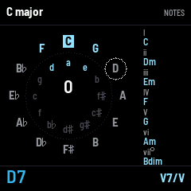
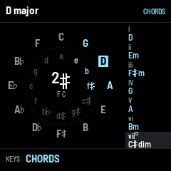
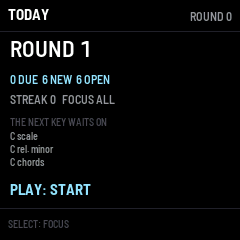
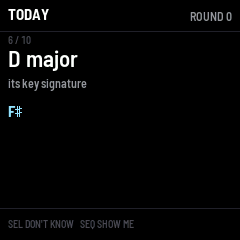
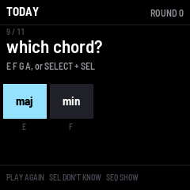
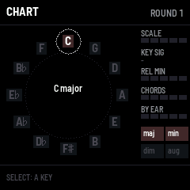
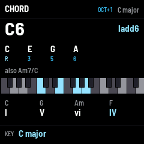

# 樂理練習機（構想草案）

把 FM-1 變成隨身的樂理、鍵盤與聽力練習機：五度圈、和弦進行、各調的音階與琶音、相對音感、節奏聽寫。內容偏向流行編曲，但古典的基本功也要涵蓋。延續[摩斯電碼機](morse.md)的閃卡與回合，以及[背單字 app](vocab.md) 的 spaced repetition 構想。

**狀態（2026-11-18）**

- **v0.1（WHEEL）**：19:00 前後刷進實機，本人試用的感想是「好像還可以」`[實機]`。
- **v0.2**：加上 MENU、TODAY 閃卡回合、CHORD、CHART、SETTINGS、進度備份。在 host simulator 和 fm1-emu 兩種晶片上驗證過 `[模擬]`，還沒刷實機。
- 驗證結果見 [v0.1 驗證](#v01-verify)、[v0.2 驗證](#v02-verify)；刷機紀錄見[我的機器](../device-log.md)。

- 韌體在 `firmware/theory/`，GPL-3.0-or-later，名稱 THEORY，識別碼 `FM-1_49`。
- 樂理核心的 `just theory-unit` 有 26,661 個檢查，全部通過，其中包含和 music21 的拼法對照。

**已決定的方向（2026-11-18，本人決定）**

- 第一個版本先做 **WHEEL**：五度圈探索加上和弦辨識。
- 音階、和弦、調號由程式產生。和弦進行用羅馬數字寫成 TSV，旋律用 Alda 子集寫。
- 要有網頁可以匯入教材和備份進度，比照 Morse。
- 聽音除了相對音感，也要有絕對音感和節奏聽寫。本人小時候在 Yamaha 練過聽音，覺得節奏盲聽和 Morse 的盲聽很像。

## 有沒有人做過 { #prior-art }

2026-11-18 查過以下來源 `[調研]`：

- [Firmware Hub catalog](https://thefirmwarehub.com/catalog.json)（07:16 UTC 版，258 個套件）
- [awesome-fm-1](https://github.com/cicloid/awesome-fm-1)
- [aroum/fm1-custom-fw](https://github.com/aroum/fm1-custom-fw)
- GitHub

**FM-1 上已經有兩個教學韌體**，但都還沒上 Hub：

| 作品 | 做什麼 | 狀態 |
|---|---|---|
| [Shed](https://github.com/Luisnvb/fm1-shed) | Jazz 聽力訓練，9 種 drill：級數、和弦性質、旋律與和聲音程、tension、琶音、調式、bass、旋律聽寫。每題先放 cadence（ii–V–I，初學者用 I–IV–V–I）再出題。用琴鍵作答，或用 `PRESET` 從清單選。一回合 20 題，難度隨連對調整，60% 的題目從最弱的項目出。另有 Vamp 模式，用 LED 帶彈。規格見 [SHED_SPEC](https://github.com/Luisnvb/fm1-shed/blob/main/SHED_SPEC.md)，網頁版是 [shed-web](https://github.com/Luisnvb/shed-web) | 建在 FM1 Open SDK 上，GPL-3.0 加 SDK linking exception。**沒有 release**，2026-10-23 之後沒有更新。音名拼法沒有定義 |
| [FM1 Keyboard Academy](https://github.com/chmess/fm1-keyboard-academy) | 初學者課程，8 章。每課的流程是 listen → watch → play → review，LED 亮出下一個鍵。彈錯就停住，正確率 80% 解鎖下一課。附 30 首旋律，以及一個 Node 寫的 MIDI 匯入工具 | 有 release v0.1.2（2026-10-24），GPL-3.0 加 SDK exception。在 fm1-emu 的兩種晶片上都能開機，畫面是第一課「FIND MIDDLE C」，開機 8 秒內寫 flash 21 次 `[模擬]`（2026-11-18）。會寫到哪些 sector 還沒用 `emu-rehearse` 查過。**本人在 fm1-emu 試用（2026-11-18）：效果還可以，但每個音都有琴鍵燈提示，所以非常簡單** |

**其他相關的 FM-1 作品**：

- [Kris Jangle](https://github.com/doohinkus/kris-jangle)：播一首聖誕歌的開頭，你把它彈回來。
- [FM-1 Midi-Mania](https://github.com/shan-sherif/fm-1-midi-mania)：音符往下掉的節奏遊戲。
- [Flyfish](https://github.com/delirioux/flyfish)：練一首蕭邦練習曲。
- 和弦樂器類：ChoralRoot、fm1-chord、CTL-1、FoMni。它們可以用一指彈和弦、彈調內和弦、用 LED 顯示調，但目的是彈奏，不是教學。

各韌體的晶片標示見[韌體地圖](../firmware/index.md#learning)。

**其他平台**（核心玩法來自一般認知，沒有逐一查證 `[調研]`）：

| 類別 | 例子 | 可以借用的做法 |
|---|---|---|
| 聽力 app | [Functional Ear Trainer](https://apps.apple.com/app/id1088761926)、EarMaster、Tenuto、Teoria | 先放 cadence 再出題；答案不是音的時候才用清單 |
| 接 MIDI 鍵盤的課程 | Melodics、Simply Piano、Flowkey、Synthesia、Piano Marvel | wait mode（等你彈對才往下）、逐音評時間 |
| 會發光的鍵盤 | Casio Key Lighting、ROLI LUMI | 亮出下一個鍵 |
| 控制器的 scale / chord mode | Novation Launchkey、OP-XY、Telepathic Orchid | 把調和和弦排到琴鍵上 |
| 開源 | [OpenEar](https://github.com/ShacharHarshuv/open-ear)（MIT）、GNU Solfege（GPL-3）、[LenMus](https://github.com/lenmus/lenmus)（GPL-3）、[Piano Booster](https://github.com/pianobooster/PianoBooster)（GPL-3） | 題型的分類 |
| 微控制器 | [Gingoduino](https://github.com/sauloverissimo/gingoduino)（MIT，ESP32 / RP2040 上的樂理引擎） | 沒找到微控制器上的聽力訓練作品 |

**和 Shed、Keyboard Academy 不同的地方**

1. **跨天的 spaced repetition。** 同一套排程管理樂理知識、聽力、節奏和手上技巧。Shed 只在單一回合內追蹤弱項；Keyboard Academy 是線性的課程。
2. **隨身的樂理參考。** 五度圈加上和弦辨識：彈一個和弦，就告訴你它的名字和在這個調裡的級數。
3. **流行與華語的和弦進行。** 王道進行、4536251、卡農，並同時顯示 Roman 與 Nashville number。
4. **每個調都拼對音名。** 15 個調號都正確：C# 大調有 E# 和 B#，Db 大調寫 Gb 不寫 F#。
5. **網頁備份與匯入**，沿用 Morse 的做法。

## 學習方法 { #method }

查證的研究整理在這裡。沒有直接讀到全文的標 `[調研]`。

| 原則 | 根據 | 在 FM-1 上的做法 |
|---|---|---|
| **用彈的來回答** | retrieval practice；琴鍵本來就是答題的地方 | 樂理卡也用彈的：「E 大調的調號？」就按出四個升記號的鍵 |
| **先集中，再交錯** | [Carter & Grahn 2016](https://www.frontiersin.org/articles/10.3389/fpsyg.2016.01251/full)：交錯練習的曲子評分較好，但演奏者仍偏好集中練習。[Wong et al. 2021](https://ink.library.smu.edu.sg/soss_research/4316)：學音程時如果沒有參考歌曲，交錯明顯比較好，學的人卻多半以為集中比較有效 | 新項目先連續出 2–3 次，之後一回合混合不同主題和調，同一個調不連續出現 |
| **短回合** | [UT Austin CML 的練習建議](https://cml.music.utexas.edu/online-resources/intelligent-music-practice/10-tips-for-effective-practice)：一小時拆成 2–3 段，在還想練的時候停。這是實務建議，不是實驗結果 | 一回合約 20 張卡，5–10 分鐘，和 Morse 一樣 |
| **聽力先建立調性** | Functional Ear Trainer 和 [Bruce Arnold](https://brucearnold.com/?p=794) 都是先放 cadence 再出一個音。[Chenette《Foundations of Aural Skills》](https://uen.pressbooks.pub/auralskills/)也是從找主音開始 | 每題聽力先放 I–IV–V–I |
| **調性螺旋** | ABRSM 2025–26 鋼琴音階：新的調先分手練，下一級再合手；調從 C 往五度圈兩側展開，不是繞一圈 | 解鎖順序是 C → G、F → D、Bb → A、Eb → … |
| **知識用 SRS，技巧看實際表現** | [Duke, Simmons & Cash 2009](https://cml.music.utexas.edu/research/skill-learning-and-procedural-memory)：練習時間和次數不能預測隔天的表現，最好的人會找出錯的地方、刻意改變速度。[Allingham & Wöllner 2022](https://ediss.sub.uni-hamburg.de/handle/ediss/9763)：大家都慢練，但證據很少，而且快慢動作可能組織不同 | DRILL 找出錯的位置，從那裡切一小段重練。速度階梯要練到、甚至超過目標速度 |
| **提示要逐漸撤掉** | 運動學習的 guidance hypothesis（Salmoni, Schmidt & Walter 1984）：提示或回饋給得太頻繁、太好用，練習時表現很好，但學的人會依賴它，拿掉之後就做不出來；之後的研究對「最好多頻繁」有分歧（[Wulf et al. 2010 的整理](https://www.frontiersin.org/articles/10.3389/fpsyg.2010.00190/full)）`[調研]`。本人試用 Keyboard Academy 的感想正是如此 | WHEEL 的 LED 只顯示調，不亮出下一個音。DRILL 的帶彈燈只在新項目時亮，box 升高後改成只在猶豫或答錯時亮；有亮燈提示的作答不算答對 |
| **每個階段同時練四面** | Berklee Ear Training、Chenette | 每個階段都有樂理、鍵盤、聽力、節奏、流行應用 |
| **相對音感是主線** | 教科書和課程的共識。成人學絕對音感：[Wong et al. 2020](https://scholars.ln.edu.hk/en/publications/is-it-impossible-to-acquire-absolute-pitch-in-adulthood/) 訓練 12–40 小時後，43 人裡有 6 人（14%）能以 90% 以上的正確率說出 12 個音名 | 絕對音感做成一條選用的獨立路線，不和主線混在一起 |
| **先聽再看符號** | [Kodály method](https://en.wikipedia.org/wiki/Kod%C3%A1ly_method)：節奏先聽、唸、動，內化之後才看譜 | 節奏卡先出盲聽，熟了才出看譜的題 |

Spaced repetition 用在樂理上沒有找到同儕審查的研究 `[調研]`。社群裡有 Anki 的聽力 deck。長期使用者的心得是 SRS 比較適合記事實（調號、和弦組成音），不太適合手上技巧，所以手上技巧的卡片看實際彈奏表現評分。

Yamaha 音樂教室的幼兒科（4、5 歲）除了彈鍵盤，還有用 Do Re Mi 唱音名和聽音的練習（[第三方介紹](https://eleschool-compass.com/naraigoto/brand/yamaha-music.html)）`[調研]`。用固定唱名的細節沒有查到，這裡只記本人的經驗。

## 課綱 { #curriculum }

綜合 ABRSM 的調性螺旋、Berklee 先大調後小調的順序、Chenette 先找主音的做法、Hooktheory 公開的和弦統計（I、IV、V、vi 最常見）。

| 階段 | 樂理 | 鍵盤 | 聽力 | 節奏 | 流行 |
|---|---|---|---|---|---|
| 1 基礎 | 鍵盤位置、全音與半音、大調公式 | C、G、F 大調，一個八度，先分手 | cadence 後聽 1、3、5 級 | ta（四分）、ti-ti（兩個八分）、四分休止 | |
| 2 順級三和弦 | I–vii°，Roman 與 Nashville | I–IV–V–I，就近轉位（nearest voice），左手根音 | 大三和弦和小三和弦 | ta-a（二分）、附點四分 | I–V–vi–IV、vi–IV–I–V、I–vi–IV–V |
| 3 五度圈 | 調號、關係小調 | 加上 D、A、Bb、Eb 與關係小調（自然、和聲） | 所有級數、調內的音程、辨認 I / IV / V / vi 的進行 | tika-tika（四個十六分）、ti-tika | 4536251、卡農（1 5 6 3 4 1 4 5） |
| 4 七和弦與小調 | V7、ii–V–I、四種七和弦 | shell voicing | 和弦性質、bass 是幾級 | 切分、連結線 | 12 小節藍調、Andalusian（i–bVII–bVI–V）、王道進行（IVM7–V7–iii7–vi） |
| 5 十二個調 | 其餘的調 | 所有調的音階和琶音；I–IV–V–I、ii–V–I 沿五度圈移調 | 下行與和聲音程、轉位、3–5 個音的旋律聽寫 | 三連音、八分休止 | |
| 6 色彩 | 副屬和弦（V/V、V/vi）、借用和弦（iv、bVI、bVII）、調式 | 五聲與藍調音階、slash chord 的 bass 線 | 半音級數、借用和弦 | 十六分的切分 | 小室進行（vi–IV–V–I） |
| 7 之後 | | 交錯的短回合、速度階梯 | 持續複習 | 持續複習 | 自己匯入的進行 |

**解鎖的方式和 Morse 的 Koch 字組一樣。** 每一個「主題 × 調」是一個項目。目前開放的項目都到 box 2 以上，才開放下一個調或下一個主題。

## 頁面 { #pages }

用 `ALGO` 切換頁面，`HOME` 開選單，和 Morse 一樣。

| 頁面 | 做什麼 | 版本 |
|---|---|---|
| **MENU** | 所有頁面的清單，`HOME` 叫出來 | v0.2 |
| **TODAY** | 一回合交錯的閃卡 | v0.2 |
| **WHEEL** | 五度圈探索加上和弦辨識：隨身的樂理參考，不打分數 | v0.1 |
| **CHORD** | 自由彈，全畫面說出是什麼和弦、每個音是什麼、在調裡是第幾級、最近彈的進行 | v0.2 |
| **EAR** | 聽音與節奏的自由練習，可以只練某一種題型 | v0.3 |
| **DRILL** | 音階與琶音：節拍器、LED 帶彈、速度階梯、時間均勻度 | v0.4 |
| **GROOVE** | 流行和弦進行伴奏：FM-1 彈 bass 和鼓，你彈和弦 | v0.5 |
| **LISTEN** | 被動聆聽：在隨機的調裡一直播進行，可以隱藏級數，適合通勤 | v0.5 |
| **CHART** | 五度圈上的熟練度熱圖 | v0.2 |
| **SETTINGS** | 開機頁、每回合張數、cadence 速度 | v0.2 |

### WHEEL（v0.1） { #wheel }

{ width="240" } { width="240" }

上面兩張是 host simulator 的截圖 `[模擬]`。左邊：C 大調裡彈了 D F# A C，footer 顯示 `D7` 和 `V7/V`，五度圈上的 D 被圈起來，它在調內 6 個和弦（反白的格子）外面。右邊：D 大調的 CHORDS 模式，按 C 鍵彈出 `C#dim`，右欄的 vii° 跟著反白。

- **Header**：調名，右邊是琴鍵模式（`NOTES` / `CHORDS`），八度不是 0 時也會標出來。
- **五度圈**：外圈是大調，內圈是關係小調（小寫）。調內的大、小三和弦反白，主音的和弦加框。剛彈的和弦如果是大或小三和弦家族，就在它的位置畫圈。圓心是調號（`2♯`），下面列出升降的音名。
- **右欄**：7 個順級和弦，上面是級數，下面是和弦名。剛彈的那一個反白。
- **Footer**：剛彈的東西：和弦名（調外的和弦換顏色）與級數、轉位、省略五音；單音是音名加級數；兩個音是音程。全部放開後，畫面保留剛才按得最滿的那一組。轉旋鈕時 footer 暫時顯示新的設定。

| 操作 | 作用 |
|---|---|
| 轉 `SELECT` | 沿五度圈換調，順時針多一個升記號；調號落在 Db 到 F# 之間（小調與調式落在 Eb 小調到 G# 小調之間） |
| 按住 `SEL` 再按一個琴鍵 | 跳到以那個音為主音的調 |
| `K1` | 調式：大調、小調、和聲小調、旋律小調、dorian、phrygian、lydian、mixolydian、locrian |
| `K2` | 三和弦或七和弦 |
| `K3` | 級數寫成 Roman 或 Nashville |
| `K4` | 和弦鍵的對應：**字母 = 根音**（預設：D 大調按 F 是 F#m，按 C 是 C#dim），或 **C = I**（同一個手型在每個調都彈出同樣的級數） |
| `PLAY` | 切換琴鍵模式：**NOTES**（彈什麼就辨認什麼）或 **CHORDS**（白鍵彈順級和弦，就近轉位，下面加一個根音；`PLAY` 亮綠燈）。黑鍵在 v0.1 不出聲 |
| `OCT-` / `OCT+` | 發聲的八度，−2 到 +2，不影響辨認 |

LED 只用來顯示調，不帶彈：NOTES 模式下調內的音 glow、主音 mid；CHORDS 模式下白鍵 glow、I 級的鍵 mid；按住的鍵 lit。按鍵的音也從 USB-MIDI 送出，可以錄進 DAW。設定在最後一次操作 3 秒後存起來。

### 開機頁、MENU、SETTINGS（v0.2）

- **第一次開機**（包括從 0.1 升級上來）先問 `START PAGE?`：MENU / TODAY / WHEEL / CHORD / CHART。`SELECT` 選，`PLAY` 確認，選完存起來，之後開機直接進那一頁。做法比照 Morse 0.7 的開機頁設定。
- **頁面切換**：`ALGO` 依序切換頁面；`HOME` 在 MENU 和上一頁之間來回。
- **SETTINGS**：
    - 開機頁。
    - 每回合張數，8–24，預設 15。
    - cadence 速度：NORMAL / SLOW / FAST。
    - 操作是 `SELECT` 選列，`K1` 或 `SEL` 改值。
- 設定沿用 0.1 紀錄裡原本空著的 byte（0 代表預設），所以 0.1 的設定升級後保留，裝回 0.1 也讀得懂。

### TODAY（v0.2） { #today }

{ width="240" } { width="240" } { width="240" }

上面三張是 host simulator 的截圖 `[模擬]`：
- 開始畫面：到期 / 新卡 / 已開放的數量，以及下一個調還差哪些項目。
- 調號卡：已經按了 F#，還差一個音。
- 和弦性質卡：大、小兩個選項，對應琴鍵 E4、F4。

**項目**一共 63 個，依調解鎖：C、G、F、D、Bb、A、Eb、E、Ab、B、Db、F#。
- 每個調帶來 5 種卡片：音階、調號（C 沒有）、關係小調、級數和弦、聽音級數。
- 和弦性質的聽音卡另外開放：大、小隨 C 開放，減隨 D，增隨 A。
- 已開放的項目都到 box 2，才開下一個調。
- 項目表在 `firmware/theory/course.h`，**只能往後加**：進度紀錄和備份都靠項目的位置對應。

| 卡片 | 畫面 | 怎麼作答 |
|---|---|---|
| 音階 | `D major` / its scale, up | 照順序一個一個彈，不分八度 |
| 調號 | `E major` / its key signature | 按出所有升降的音 |
| 關係小調 | `Bb major` / its relative minor | 按出它（G） |
| 級數和弦 | `IV in Eb` | 按出和弦音，不分八度、不分轉位；級數每次隨機 |
| 聽音級數 | `Eb major` / listen | 先放 I–IV–V–I 再放一個音，按出那個音。box 0–1 只出 1、3、5 級 |
| 和弦性質 | which chord? | 聽一個和弦，用 E4 F4 G4 A4 選（或 `SELECT` + `SEL`） |

**怎麼作答**（本人問「一次按完、一個一個點亮，還是要確認鍵」，2026-11-18 決定這樣做）：

- **答案托盤**：
    - 彈下去的音會累積成一組，螢幕上拼出音名、LED 微亮。
    - 可以一次按下整個和弦，也可以一個一個按，不需要確認鍵。
    - 全部放開時，如果音的數量等於答案的數量，就自動判斷。
- **擦到不算**：按住不到 50 ms 就放開的鍵當作擦到，不加進托盤。迷你鍵按和弦時很容易擦到隔壁的鍵。
- **改得回來**：
    - 按錯的音再按一次，就從托盤拿掉。
    - 音太多時，畫面提示「play one again to take it out」。
- **改過或猶豫過，算「慢」**：box 不動，回合末再問。只有送出整組錯的答案才回到 box 0。
- **音階**：彈錯一個音不往前，可以接著彈對的；錯一次算慢，錯兩次才算錯。
- **單音題**：第一次猜錯給一次重來，第二次答對算慢。
- **評分**：
    - 從可以作答開始計時，門檻依卡片種類不同；聽音卡重播兩次以上也算慢。
    - 夠快、而且 box ≥ 1：一次升兩格。
    - `SEQ` 是「直接看答案」，算錯。
- **LED 不帶彈**：作答時只亮按住的鍵和托盤裡的音，答完才亮出答案。

**回合怎麼排：主題式 + 交錯**（本人問「卡片混在一起會不會效果不好」）：

- 交錯練習主要幫助分辨相似、容易混淆的類別（Brunmair & Richter 2019 的 meta-analysis `[調研]`；[Wong et al. 2021](https://ink.library.smu.edu.sg/soss_research/4316)）。新的內容則應該先集中認識（[Carter & Grahn 2016](https://www.frontiersin.org/articles/10.3389/fpsyg.2016.01251/full)）。
- 所以一回合是這樣排的：
    1. **新項目先集中出**：最多 3 張，照課程順序，畫面寫 `NEW`，顯示答案也播出聲音，按任意鍵往下。
    2. **樂理段**：新項目在這裡第一次被問。
    3. **聽音段**。
    4. **弱卡再出一次**。
- 每一段裡不同的調交錯，同一個調不會連續出現。
- 開始畫面轉 `SELECT` 可以選 FOCUS：ALL / THEORY / EAR，只練一個主題。

**按鍵**：

| 按鍵 | 作用 |
|---|---|
| 琴鍵 | 作答（照樣發聲） |
| `PLAY` | 開始一回合；聽音卡重播 |
| `SEL` | 不會（算錯）；結果畫面直接下一張 |
| `SEQ` | 看答案（算錯） |
| `SELECT` | 開始畫面選 FOCUS；和弦性質卡移動選項 |

存檔的時機是回合結束，以及中途離開回合時，和 Morse 一樣，所以不會每張卡都寫 flash。

### CHART（v0.2）

{ width="240" }

- 五度圈上每個調的底色代表它所有項目的平均 box，色階沿用 Morse；還沒開放的調是暗的。
- `SELECT` 移動游標，右邊列出那個調每種卡片的 box，右下是四種和弦性質。

### CHORD（v0.2） { #chord }

{ width="240" }

本人提的「自由按鍵，由我們判斷組成音是不是什麼和弦，顯示方式類似 ChoralRoot」。

- **和弦名**：大字顯示；調外的和弦換顏色。右邊是 WHEEL 設定的調裡的級數，以及轉位、省略五音。
- **組成音**：每個音拼對音名，下面標出它是和弦裡的 R、3、b3、5、b7、9、13…。
- **其他讀法**：C E G A 是 C6，也可以讀成 `Am7/C`。減七和弦（例如 `Bdim7`）會列出另外三個根音的讀法：`Ddim7/B Fdim7/B G#dim7/B`。
- **27 鍵小鍵盤**：按住的鍵亮起，和弦音標出來。
- **進行軌跡**：最近 4 個和弦依序寫成級數，例如依序彈 C、G、Am、F 就是 `I V vi IV`；`PLAY` 清除。
- `SELECT` 換調，`K1`–`K3` 和 WHEEL 共用（調式、七和弦、Roman / Nashville）。

認得的和弦有：三和弦、sus、6、七和弦（含 dim7、m7b5、mMaj7、增七）、add9、9、maj9、m9、6/9、7b9、7#9、13（省略 11 度，五音也可省）、power chord。

## 卡片 { #cards }

| 類別 | 題目 | 怎麼作答 |
|---|---|---|
| 樂理 | 調號（「E 大調？」） | 按出升降記號的鍵 |
| | 五度圈關係（「Eb 的關係小調？」） | 按 C |
| | 拼音階（「D 大調」） | 依序彈 7 個音，不分八度 |
| | 組和弦（「F#m7」「Bb 調的 V7」） | 同時按下，不分八度，不分轉位 |
| | 級數（「A 大調裡的 D？」） | 用 `SELECT` 選 IV |
| 聽音：相對 | 級數：cadence 之後放一個音 | 按出那個音（畫面告訴你調，所以按對的鍵就等於答對級數） |
| | 調內的音程：先給第一個音 | 彈出第二個音 |
| | 和弦性質 | 四選一，用 E4 F4 G4 A4 作答（同 Morse 的 `CHOICE_KEY`） |
| | 和弦進行：聽四個和弦 | 依序按白鍵，從主音起算是 I–vii |
| | bass | 彈出 bass 線 |
| 聽音：絕對（選用） | 沒有 cadence 的單音 | 按出那個音。每題換音色和音域，題與題之間放一段隨機音簇，蓋掉前一題的音高 |
| 節奏 | 聽 1–2 小節 | 從 4 個小譜面選一個 |
| | 盲聽 | 在任一鍵 tap 回來，依 onset 的時間誤差評分，沿用 Morse RHYTHM 的經驗 |
| | 看譜 | count-in 之後 tap 出來 |
| 旋律 | 聽 3–8 個音 | 彈回來 |
| | 看小五線譜 | 彈出來 |
| 鍵盤 | 音階、琶音：節拍器下彈一個八度，上行加下行 | 評分看音對不對、時間均勻度、速度 |
| | cadence 與轉位：彈 I–IV–V–I | 評分看每個和弦的音，以及各聲部移動了多少 |
| | 移調：同一個進行沿五度圈換調 | 同上 |

**自動評分對應四個等級**：答錯是 Again；答對但慢（反應時間或速度低於目標）是 Hard；答對是 Good；又快又穩是 Easy。v1 的 Leitner 排程裡，Again 回到 box 0，Hard 不動，Good 升一格，Easy 升兩格。

## 小譜面 { #notation }

```text
┌────────────────────────────────┐
│ RHYTHM   聽到的是哪一個？ 3/8    │
│  E4  |  ♩   ♩   ♫   ♩  |       │
│  F4  |  ♩   ♫   ♩   ♩  |       │
│  G4  |  ♩.  ♪   ♫   ♩  |       │
│  A4  |  ♩   ♩   ♩   𝄽  |       │
├────────────────────────────────┤
│ PLAY 再聽         SEL 不會      │
└────────────────────────────────┘
```

- 節奏用單線譜，旋律用小五線譜。
- 符頭、符桿、符尾、beam、休止符、附點、連結線是幾個小 bitmap 加上線段，依時值用程式排出來。
- 4 個節奏選項每個大約 40 px 高，放得進 176 px 高的主畫面。
- **節奏也用程式產生。** 依 Kodály 式的節奏單元（cell）分級：ta、ti-ti、休止、ta-a、tika-tika、附點、切分、三連音、連結線。新的 cell 照課綱的順序開放。
- 選項裡的錯誤答案只和正確答案差一個 cell，概念和 Morse 的 `ln_alike` 用相似的碼當選項一樣。
- 時值用每拍 12 tick 表示，可以表達三連音。

## 機器限制怎麼處理 { #hardware }

| 限制 | 做法 |
|---|---|
| 27 鍵，F3–G5（MIDI 53–79） | 判斷時不分八度。任何調的一個八度音階都放得下。左手用 F3–E4，右手用 F4–G5。`OCT±` 只改變發聲的八度 |
| 每鍵一顆單色 LED | 音階內的音 glow，主音 lit。DRILL 帶彈時下一個音閃爍，可以關掉，改成憑記憶彈。答錯後亮出正確答案 |
| 240×240 彩色 LCD，沒有畫圓的 primitive | 用 `fm_sinf` / `fm_cosf` 算出 12 個位置，再用 `cv_line` / `cv_pset` 畫，分段畫進 strip canvas |
| 字型只有 ASCII | ♯ ♭ ° ø 做成幾個小 bitmap。核心用 `TH_GLYPH_*` 巨集決定輸出的字元，預設是 ASCII 的 `#` `b` `o` `/o` |
| fm1-base 沒有 synth | 自己寫：8 voice 的 2-op FM 電鋼琴（從 `common/chime` 改）、一個 bass voice、節拍器的 click。音符在 `app_render` 裡依 sample 數排程，因為 `app_tick` 的旗標會有最多一個 block（5.8 ms）的抖動 |
| 沒有關機後還會走的時鐘 | 用回合計算，同 Morse。接電腦時可以由網頁送日期 |
| store object 最多 3,840 B | 進度每個項目約 3 B，1,000 個以內放得下一個 object |

## 內容表示：程式產生、TSV、Alda { #content }

**MIDI 還是 Alda？答案是大部分都用程式算出來**，分三層：

1. **裝置上用程式產生**：音階、和弦、調號、五度圈、羅馬數字、和弦辨識、就近轉位。表格加起來不到 2 KB，整個核心在 Mac 上編出來約 13 KB 的程式碼，涵蓋大約九成的內容。
2. **和弦進行目錄**：用羅馬數字寫成 TSV（欄位之間是 tab，下面為了好讀改用空白對齊），build 時經 fm1-base 的 `gen = [...]` 轉成 C 表：

    ```text
    # id         name                 numerals              tags
    royal-road   Royal Road           IVM7 V7 iii7 vi       jpop cpop
    axis         Axis                 I V vi IV             pop
    4536251      4536251              4536251               cpop
    canon        Canon                1 5 6 3 4 1 4 5       pop classical
    andalusian   Andalusian cadence   i bVII bVI V          minor
    ```

    裝置的字型沒有中文，所以畫面上顯示英文的 id。「王道進行」這類中文名稱只放在文件和網頁上。

    **小調級數的歧義在寫入時解決，不留到裝置上。** 同一個 `VI` 有兩種讀法：在 A 小調裡，以大調為準是 F#，以自然小調為準（古典課本，以及 Wikipedia 上王道進行的小調寫法 `VIM7–VII7–v7–i`）是 F。照錯的寫法輸入，不會報錯，只會彈出錯的和弦。所以：

    - **裝置上不存字串，只存解析好的和弦**：每個和弦存成「根音相對主音的 fifths 位移 + 性質」，每個和弦 2 B。移調照樣只是加法，裝置也不需要 `th_roman_parse`。
    - **網頁編輯器即時顯示解析結果**：做法比照 [Morse 的網頁](https://daviddwlee84.github.io/fm1-morse/web/)。打 `i bVI bIII bVII` 時，旁邊立刻列出 `Am F C G`，並且可以試聽。
    - **可疑的寫法給警告**：小調裡大寫的 `III`、`VI`、`VII` 沒有加升降記號，而且解析出來的根音不在自然小調裡（A 小調的 C#、F#、G#），這幾乎都是古典寫法。編輯器提示「你是不是要寫 `bVI`？」，build 時的 generator 也做同一個檢查，有問題就讓 build 失敗。
    - **檔頭可以宣告寫法**：例如 `# numerals: classical`，宣告之後就照自然小調讀，再換算成上面的儲存格式。從 Wikipedia 或課本抄進行時不用自己改寫。
    - 畫面上顯示哪一種寫法，是 SETTINGS 裡的另一個選項，和怎麼輸入無關。

3. **旋律**（聽寫、樂句）：用 **Alda 子集**寫，例如 `o4 d8 e f+ g a4 b > c+2`，和弦寫成 `d/f+/a`。
    - 自己寫一個小 Python parser，build 時轉成每個事件 2 B 的 bytecode（音高 + 時值索引），同時輸出 `.mid` 方便在 Mac 上試聽。
    - [Alda](https://github.com/alda-lang/alda) 的官方工具是 EPL-2.0，只拿來選用對照（`alda parse` 的輸出），不放進韌體。
    - 子集涵蓋哪些語法（調號、連結線、三連音）等真的要寫旋律時再定。

**MIDI 只用在電腦端的匯入匯出**（[mido](https://github.com/mido/mido)，MIT）。裝置上不放 MIDI 檔，理由是：

- SMF 沒有級數和拼法的資訊，移調和顯示音名都要另外推斷。
- 還要多寫一個 parser。

**拼法用 line of fifths。** 每個音是 fifths 線上的一個位置（C=0、G=1、F=−1、F#=6、Gb=−6）。音階和和弦存成相對根音的 fifths 位移，所以：

- 移調就是加法。
- 每個音階級數一個字母，自然成立。
- D 大調寫 F#，Db 大調寫 Gb，C# 大調有 E# 和 B#，G# 和聲小調有 F##。

**其他的拼法規則**：

- 調外的音：在 C 大調裡用 Db、Eb、F#、Ab、Bb，也就是從主音往下 b2 到往上 #4 這個範圍。
- 辨認出來的和弦根音：選相對調號升降記號最少的拼法。所以 C 大調裡是 C#dim7 不是 Dbdim7，B 大調裡是 C# 不是 Db。
- **級數的升降記號一律以同主音的大調為準**，這是流行音樂和 Wikipedia 的寫法：A 小調的 G 是 `bVII`、C 是 `bIII`、G#dim 是 `viio`。古典教科書會把前兩個寫成 VII、III，這點列在「還沒決定的事」。

## 網頁：匯入教材、備份進度 { #web }

[開啟 THEORY 備份網頁](../assets/theory/progress.html){ .md-button }

**v0.2 已經有進度備份**（比照 Morse 自己寫，本人 2026-11-18 決定）：
- 框架是 `F0 7D 54 48 01 <type> … F7`（"TH"）。
- 紀錄是 218 B：format、設定 12 B、進度、CRC-16。切成 5 個 frame。
- 載入時 FM-1 先問（`PLAY` 載入、`HOME` 保留原本的），損壞的資料拒收。
- **電腦端**：`just theory-backup FILE`、`just theory-restore FILE`。JSON 是 `fm1-theory-progress` v1，項目用名稱標示，例如 `scale:D`、`earq:dim`。
- **網頁**：上面的按鈕，Chrome / Edge 的 Web MIDI。
- **找 port 的方式**：電腦端和網頁都依協定的 header 找 FM-1，不依 port 名稱，因為 macOS 把這台叫 `Felucca`；收到 HEARTBEAT 也算連上。

以下是原本的構想，匯入教材還沒做：

- 用 Web MIDI 頁面，和 Morse 的 `web/index.html` 一樣透過 `hostlink` SysEx 溝通。
- **備份與還原進度**：格式比照 Morse 的 `fm1-morse-progress` JSON。
- **匯入自己寫的進行或旋律**：
    1. 在瀏覽器裡解析 TSV / Alda 子集。旁邊即時列出解析出的和弦，可以試聽，可疑的小調級數會出警告（見[內容表示](#content)）。
    2. 用 SysEx 把解析好的和弦送到 FM-1，送的是 fifths 位移加性質，不是字串。
    3. FM-1 在螢幕上問一次，按 `PLAY` 確認。
    4. 存進 **store object**。
- **走 `APP_STORE_MAP`，不需要修改 AGENTS.md 的 flash 規則。** 一個 object 3,840 B，大約可以放 100 個進行或短旋律。真的需要更大的 deck，才走[背單字頁的資料區草案](vocab.md#delivery)。
- parser 會有兩份：Python 版給 build 用，JS 版給網頁用。兩份用共用的 test vectors 確保結果一致，Morse 的 protocol vectors 也是這樣做。

## 排程與存檔 { #srs }

- **v0.2 的引擎是 `firmware/theory/srs.c`**：從 Morse 的 `learn.c` 改成通用版，和 Morse 同一個作者、同樣 GPL。
    - box 0–5，box n 每 2^n 回合出一次。
    - 錯的回到 box 0，回合末再問；慢的 box 不動，回合末再問；夠快的升兩格。
    - 另外加上：分段（樂理、聽音）、同一個調不連續、FOCUS 篩選，以及組別的結尾表。
    - unit test 是 `tests/srs_test.c`，由 `just theory-unit` 一起跑。
- **項目是「卡片種類 × 調」**，一共 63 個，每個約 3 B（一個 box 加上最後一次出現的回合）。進度紀錄 312 B，存在自己的物件 `0xD6000`，設定紀錄還是在 `0xD8000`。
- 等背單字 app 把 FSRS 移植成 C 之後，可以考慮放進 `firmware/common` 兩邊共用。
- **FM-1 不知道今天幾號。** 它沒有關機後還會走的時鐘，開機時的計時器大約 3 分鐘就歸零一次（[背單字頁](vocab.md)也提過）。所以「隔 1、7、15、30 天再複習」這種以天計算的遺忘曲線，必須有人告訴它日期。這個 app 的取捨是**以回合計算，日期只是選配**：
    - 一天練好幾回合，間隔會縮短，等於多複習幾次。對樂理知識來說，這只是多花一點時間，不會忘得更多。
    - 好幾天沒練，回合數不會增加，所以**回來時不會堆一大疊到期的卡**。以天計算的排程休息一週後會堆積；隨手拿起來練的口袋機器比較適合用回合。
    - FSRS 的遺忘模型 R(t) 以天為單位，所以只有在知道日期時才能用。背單字要和 Anki 同步，Anki 的排程本身就以天計算，那邊比較需要日期。
    - 有日期的時候（接電腦開網頁，或之後透過 Bluetooth 用手機開網頁，見 Morse 0.5 的 Bluetooth 計畫），可以把「一天」當作另一個上限：同一天內多練的回合，不會讓高 box 的卡太早出現。這留到有網頁之後再做。
- 設定存在 `0xD8000` / `0xD9000`，進度存在 `0xD6000` / `0xD7000`。這台機器的所有備份裡這些 sector 都沒被寫過，也不和 Morse 的 `0xDA000` 或面板校正的 `0xDC000` 重疊。預演結果見 [v0.2 驗證](#v02-verify) 和 [flash 配置圖](../hardware/flash-map.md)。

## 樂理核心 { #core }

`firmware/theory/`，GPL-3.0-or-later。寫法比照 Morse 的 `learn.c`：C99，不呼叫平台、不用 libc、不用浮點，所以可以直接放進 fm1-base 的 unity build（fm1-base 不接受 `double`）。

| 功能 | 函式 |
|---|---|
| 音名 | `th_name`、`th_parse_name`、`th_spell_pc`（依調拼）、`th_note_name`（`C#4`）、`th_interval_name` |
| 音階與調 | 12 種音階（7 種調式、和聲與旋律小調、大小調五聲音階、藍調）、`th_keysig`、`th_key_acc`、五度圈位置、`th_key_for_pc` |
| 和弦 | 27 種性質（三和弦、sus、七和弦、6、add9、九和弦、6/9、7b9、7#9、13、power chord）、`th_chord`、`th_chord_name`（`F#m7b5`、`C/E`）、`th_diatonic` |
| 級數 | `th_roman_name`（`IVM7`、`viio`、`bVII`、`V7/V`）、`th_nashville_name`（`6m`、`b7`）、`th_roman_parse`、`th_prog_parse`（`4536251`、`i-bVII-bVI-V`） |
| 其他讀法、組成音 | `th_identify_all`（依偏好排序的所有讀法）、`th_tone_label`（R、b3、5、b7、9、#11、13…） |
| 和弦辨識 | `th_identify`：MIDI 音符進去，出來根音、性質、轉位、有沒有省略五音、是不是調內的音。偏好的順序是：不需要省略五音 → 根音在 bass → 根音在調內 → 比較簡單的和弦。所以 C E G A 在 C 上是 C6，在 A 上是 Am7 |
| 就近轉位 | `th_voice_near`：在範圍內選出和前一個和弦相比移動最少的 close voicing |

**測試**：`just theory-unit`，樂理核心 28,070 個檢查，加上 srs 3,333 個檢查。

- 手寫的答案：15 個大調和 15 個小調逐音比對、所有 7 音音階在所有調都是連續的 7 個字母、調號、五度圈、順級和弦的 Roman 名稱、和弦辨識的案例。
- 「名稱 → 解析」的往返：所有調的順級和弦，以及副屬和弦。
- 所有調所有順級和弦在每個轉位都辨認正確。例外是 m7 與 m7b5 的第一轉位，它們會辨認成 6 / m6，因為根音在 bass 優先。
- 隨機 2,000 組就近轉位都是最少移動。
- **和 music21（BSD-3）對照**：`just theory-vectors` 用 music21 10.5.2 產生 `tests/vectors.h`，內容是 162 個音階、30 個調號、567 個和弦、35 個音程、450 個 Roman numeral，目前全部一致。music21 的 13 和弦有 11 度，對照前先拿掉，因為我們照一般 voicing 省略它。小調的 Roman numeral 沒有對照，因為 music21 的 VI、VII 以小調音階為準，和我們的寫法不同。

## 內容來源與 licence { #licence }

App 是 GPL-3.0-or-later，所以 CC BY-SA 的內容可以用（CC BY-SA 4.0 [可以單向相容到 GPLv3](https://creativecommons.org/2015/10/08/cc-by-sa-4-0-now-one-way-compatible-with-gplv3/)）。不過內容原則上還是自己寫：音階公式、和弦組成、常見進行都是事實，不受著作權保護。

| 來源 | Licence | 能不能用 |
|---|---|---|
| [Open Music Theory](https://viva.pressbooks.pub/openmusictheory/) | CC BY-SA 4.0 | 可以，要標示出處；主要當參考 |
| [Chenette《Foundations of Aural Skills》](https://uen.pressbooks.pub/auralskills/) | CC BY-SA（版本沒有確認） | 同上 |
| [musictheory.net](https://musictheory.net/legal) | 課文與靜態圖片是 CC BY 4.0；資料、程式、聲音是專有的 | 課文可以用，要標示出處 |
| Wikipedia | CC BY-SA 4.0 | 可以，要標示出處 |
| teoria.com | CC BY-NC-ND 4.0 | **不行** |
| Hooktheory TheoryTab | 專有，[服務條款](https://www.hooktheory.com/terms)禁止抓取和 data mining | **不行**；只引用它公開的統計結論 |
| music21 | BSD-3-Clause | 只當測試工具，不進韌體 |
| Alda | EPL-2.0 | 只當選用的對照工具 |
| Shed、Keyboard Academy | GPL-3.0 加 SDK exception | 只參考做法。它們建在 FM1 Open 上，程式碼本來就不能直接拿來用 |

## Roadmap

0. ~~在 fm1-emu 試用 Keyboard Academy~~（2026-11-18，心得見[學習方法](#method)）。Shed 的 SHED_SPEC 還沒細讀。
1. ~~樂理核心和 unit test~~（2026-11-18 完成）。
2. ~~**v0.1 WHEEL**~~：fm1-base app、8 voice synth、五度圈、♯♭ glyph、和弦辨識。2026-11-18 完成並刷進實機。
3. ~~**v0.2**~~：MENU、TODAY、CHORD、CHART、SETTINGS、進度備份（CLI 和網頁）。2026-11-18 在 host simulator 和 fm1-emu 完成，刷實機要另外走 preflight。
4. **v0.3**：照 [v0.2 試用心得](#v02-feedback) 改 TODAY（教學、點亮式托盤、更隨機）和 CHART；EAR / PITCH 頁（絕對音感三種遊戲、節奏與旋律聽寫、小譜面、節奏產生器）。
5. **v0.4 DRILL**：節拍器、帶彈、時間評分、速度階梯。
6. **v0.5 GROOVE 與 LISTEN**：TSV / Alda pipeline、網頁匯入、伴奏。
7. 之後比照 Morse 拆成獨立 repo，再上 Hub（見 [Hub](../firmware/hub.md)）。

**之後的「演奏模式」**（本人 2026-11-18 在 fm1-emu 試 CHORDS 模式時想到）：

- 用 `ARP` 切換，和弦不是一次全部按下去，而是一個音接一個音、有一點間隔地出來（strum 或琶音），像 [ChoralRoot](../firmware/choralroot/index.md) 的 strum / arpeggiate。
- 間隔和方向用旋鈕調。
- 這屬於彈奏，不是練習，所以放在演奏模式（如果有的話），不放進 WHEEL 的辨認畫面。
- 本人也覺得 `K4` 的「字母 = 根音」換調體驗不錯。

## v0.1 驗證 { #v01-verify }

2026-11-18。前四列是 `[模擬]`，最後一列是實機。

| 項目 | 怎麼驗證 | 結果 |
|---|---|---|
| 畫面、辨認、聲音、存檔 | `just fw-test theory`（`tests/basic.txt`） | 77 項全部 ok：C、C/E、D7 = `V7/V`、Bb = `bVII`、單音、音程、Nashville、換調、CHORDS 兩種對應、`SEL` 加琴鍵、調式、七和弦、八度、存檔重開讀回、和弦有聲音（peak > −40 dB） |
| 實機套件 | `just fw-build theory` | app 122,308 B（槽 581,564 B），RAM `.data+.bss` 29,452 / 98,304 B，沒有 soft-double |
| 兩種晶片：改設定、重開讀回 | fm1-emu `uc25hq80`、`p25q80`，`FM1_BENCH_KEYS` 腳本轉 `SELECT`、按 `PLAY` | 存檔寫 3 次，重開 0 次寫入，讀回 D major 和 CHORDS |
| 疊在實機備份上 | `emu_rehearse.py` 疊在 `2026-11-18-pre-morse-0.5` 和刷機前剛做的 `2026-11-18-pre-theory-0.1` 備份上，兩種晶片 | 開機 0 次寫入；存檔只寫 `0xD8000`；Morse 的 `0xDA000`–`0xDBFFF` 和 `0xFC000` 的共用設定都和備份相同 |
| 實機 | 本人用 `fm1_install.py` 從 Morse 0.6 更新（fast install） | `done: the FM-1 runs FM-1_4900`；本人試用：「好像還可以」`[實機]` |

模擬器的 `--shot` 沒給腳本時，會自己按一次 `PLAY` 和一個琴鍵。驗證「重開讀回」時要給一個不會用到的腳本（例如 `FM1_BENCH_KEYS='60000:PLAY'`），否則它會把剛存的琴鍵模式切回去。

## v0.2 驗證 { #v02-verify }

2026-11-18，全部 `[模擬]`。

| 項目 | 怎麼驗證 | 結果 |
|---|---|---|
| 核心與排程 | `just theory-unit` | 28,070 + 3,333 個檢查全過。新的和弦和 music21 一致；回合排法、評分、交錯、FOCUS、解鎖、備份往返都測過 |
| 整個 app | `just fw-test theory` | 169 項全過，包括：<br>• 第一次開機選頁<br>• TODAY 的托盤：擦到不算、按錯再按拿掉、音階錯一次算慢、單音題重來一次<br>• 聽音卡播完才能答、和弦性質選項、回合結束和重開讀回<br>• CHART、CHORD 的軌跡 `I V vi IV` 和 `also Am7/C`、減七的三個讀法、SETTINGS<br>• 備份送出、載入（先問，`HOME` 保留、`PLAY` 載入），損壞的拒收 |
| 電腦端 | `just theory-test` | 6 項全過：CRC 檢查值、record 和 JSON 往返、和韌體測試共用的 vector、對模擬裝置備份和還原 |
| 網頁 | 用 node 執行網頁的 JS，和 Python 比對 | record bytes 相同，JSON 往返相同 |
| 實機套件 | `just fw-build theory` | app 151,304 B（槽 581,564 B），RAM `.data+.bss` 33,132 / 98,304 B，沒有 soft-double |
| 兩種晶片 | fm1-emu `uc25hq80`、`p25q80`，用腳本選開機頁、開始回合、按掉一張新卡、離開 | 寫 7 次；重開 0 次寫入，直接進 TODAY，回合數讀回 |
| 疊在實機備份上 | 疊在刷 0.1 前的 `2026-11-18-pre-theory-0.1` 上，兩種晶片 | 開機 0 次寫入；之後只寫 `0xD6000`、`0xD8000`；Morse 的 `0xDA000` 和 `0xFC000` 不變 |

## v0.2 試用心得 { #v02-feedback }

本人 2026-11-18 在 fm1-emu 試玩 v0.2 `[模擬]`：

- **TODAY 勉強能用，但對新手來說不知道在幹嘛。** 本人學過琴所以猜得出來；完全沒學過的人看到 `C major / its scale, up`，不知道要做什麼。
- **和弦題想要逐一點亮的作答方式**：
    - 一個一個點亮，再按一次取消、撤回。
    - 點亮的音持續發聲，聽得到自己目前組出來的和弦。
    - 現在的托盤雖然可以拿掉音，但音不會持續響，而且自動判斷的時機（全部放開）不直覺。
- **題目常重複，不夠隨機。** 選了 FOCUS 之後比較不會亂跳。
- **想要單獨練絕對音感**，三種玩法：
    - 隨機一個音，限時按對。
    - 一串音連續出現，照順序按對。
    - 一次壓很多音，把所有音找出來。
- **CHORD 不錯。**
- **CHART 不知道要做什麼**：它只能看，沒有說明，也沒有接下來可以做的事。

v0.3 的對應方向：
- **TODAY 的教學**：每種卡片第一次出現時，說明一句要做什麼（例如「照順序彈出 C 大調的 7 個音」），按鍵提示也寫成完整的句子。
- **點亮式托盤**：每按一下就切換一個音，點亮的音持續發聲，用 `PLAY` 送出（或者在音數對了之後停一下再自動送出），`SEL` 清空。
- **出題更隨機**：級數、根音、聽音的音在同一回合裡不重複；開放的項目太少時，同一個項目改成換題目的變化，而不是重複同一題。
- **EAR / PITCH 練習頁**：絕對音感的三種遊戲（單音限時、一串照順序、一團找全部），先做成不排程的遊戲，再考慮放進 SRS。
- **CHART 能動手**：加說明和圖例；選一個調按 `PLAY`，就開一回只練那個調的 TODAY。

## 還沒決定的事

- **要不要和背單字 app 共用排程模組**（FSRS 放進 `firmware/common`）。
- **小調級數的古典寫法**（VI、VII）：輸入端靠檔頭宣告和編輯器的警告處理（見[內容表示](#content)）。畫面上要不要也提供古典寫法的顯示，還沒決定。
- **DRILL 的時間評分標準**：均勻度的門檻、速度階梯每一階的幅度。
- **TODAY 作答的門檻**：擦到的 50 ms、各種卡片「快」和「慢」的秒數，要在實機上試過再調。
- **Alda 子集的範圍**。
