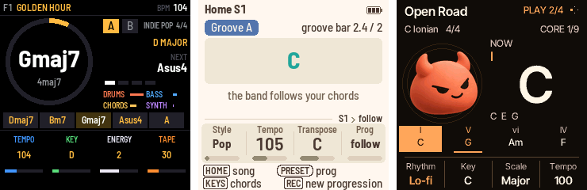

# 伴奏類韌體：挑調、挑節奏就開始玩

想要的是「選一個調、選一種節奏，按下去就有鼓、bass、和弦在跑，我在上面 solo」。SLOOP 也做得到，但要自己疊軌、自己排 sequence。這一頁整理 Firmware Hub 上已經把伴奏做好的韌體，並對照 Yamaha PSR 那種 arranger 的玩法。自己做一個的設計在[伴奏機 JAM（構想）](../dev/jam.md)。

資料來自 Firmware Hub 的 `catalog.json` 與各專案 README（2026-11-19）`[上游]`；模擬器結果標 `[模擬]`。三個都還沒刷進實機。

## PSR 的 arranger 是怎麼玩的 { #psr }

Yamaha PSR 這類 arranger keyboard 的伴奏（style）分成幾種段落：

| 段落 | 作用 |
|---|---|
| `INTRO` | 開頭的前奏，結束後接 MAIN |
| `MAIN A`–`D` | 同一個 style 的幾種變化，通常越後面越熱鬧 |
| `FILL IN` | 過門。演奏中按另一個 MAIN，先放一段過門再換過去（`AUTO FILL IN`） |
| `BREAK` | 短暫的停頓 |
| `ENDING` | 結尾，放完自動停 |
| `SYNC START` | 開著它的話，左手在伴奏區一按下和弦，伴奏就開始 |
| `ACMP` | 左手彈的和弦被辨識出來，伴奏跟著轉 |

不同型號的按鈕不一樣：PSR-2000 是 INTRO / MAIN / ENDING，PSR-E 系列是 MAIN / AUTO FILL 加 INTRO / ENDING / rit.，PSR-S650 有獨立的 `AUTO FILL IN` 與 `SYNC START`。這些出自第三方網站轉載的使用手冊，還沒對照 Yamaha 官方 PDF `[調研]`：

- [PSR-1100：Intro / Ending 與 Auto Fill In](https://www.manualsdir.com/manuals/230092/yamaha-1100.html?page=69)
- [PSR-E433 第 41 頁](https://www.manualowl.com/m/Yamaha/PSR-E433/Manual/288825?page=41)
- [PSR-A300 第 54 頁](https://www.manualowl.com/m/Yamaha/PSR-A300/Manual/152648?page=54)

所以「在這段結尾放過門」在 PSR 上的做法是：在想要換段的那一小節按下一個 MAIN，過門就從那裡開始放，下一小節進新段落。MODX 的 scene / pattern 切換沒有過門這一層。

## 三個最接近的 { #compare }

| | [JAMTRACK](https://github.com/Philip-Bos/jamtrack-fm1) | [Polly](https://github.com/charlesvestal/fm1-polly) | [CORD](https://github.com/chasedeanda/cord-fm1) |
|---|---|---|---|
| 版本、授權 | 0.2.3，MIT | 0.6.4，GPL-3.0 | 1.0.3，GPL-3.0 |
| 是什麼 | 跟你一起玩的 backing band | QY70 風格的口袋 arranger | 挑和弦進行、按 PLAY 就伴奏 |
| 內建內容 | 160 個 jam（16 個曲風各 10 個）；28 種 groove、24 種 bass line、24 種伴奏手法、15 條 synth line | 16 個 style（裝自己的 QY70 ROM 可以再加 128 個），16 個和弦進行 | 130 個和弦進行點子，含 2/4、3/4、5/4、6/8、7/4 |
| 和弦進行 | Nashville 級數（`1maj7 6m7 4maj7 5sus4`），換調、換大小調整首跟著轉；GENERATE 產生新的 | 照小節、拍子寫根音與和弦性質；`REC` 錄一個新的；`follow` 時跟著你彈的和弦走 | 可以複製後改，最多 16 格和弦；存成 Songs（6 首） |
| 段落 | A（verse）/ B（chorus） | 一首歌由多個 section 組成，各自指定和弦進行與重複次數；每個 style 有 Groove A / B | 一個進行循環；Drop / Back |
| 過門 | `SEQ`：**在這一輪結尾放過門**再換段；按住 `SEQ` 立刻放 | `HOME` + 黑鍵 1–5：Intro、Groove A、Groove B、Fill、Ending，**從下一小節開始** | Perform 頁 K1：排一小節的 fill，放完回原本的 groove |
| Intro / Ending | 沒有 intro；停止可以選「立刻」或「這小節結束再加一下」 | 有，Song 頁也能設定 | 沒寫 |
| 上面 solo | **有**：預設 `SOLO LEAD`，三個為 solo 做的 mono 音色（帶 glide），也能改用其他音色；琴鍵燈顯示和弦音與音階 | Melody M1 / M2 跟著 section 跑；有沒有專用 solo 音色 README 沒寫 | 沒有專用的 lead；你彈的會接管和聲 |
| 音色 | 37 種音色、10 套鼓（drum samples 是 CC0） | Sonivox EAS 的 General MIDI；也能當 16 軌 GM 音源 | FM 與 virtual analog 八組 bank |
| 外部同步 | MIDI clock in、STOP / CONTINUE、loop pedal 的 CC | MIDI in（USB、TRS），可以用自己的 clock 帶 arranger | 沒寫 |
| 新晶片（Hub 標示） | 認得 | 認得 | 認得 |

另外幾個也有伴奏成分，但重點不同 `[上游]`：[Pocket Band](https://github.com/elpabl0/pocketband)（在 16 個曲風小鎮的地圖上選點，寫出四人編制的草稿）、[PERF-1](https://github.com/deamonSLINKY/PERF-1)（19 個曲風自己演奏，有 Jam 頁）、[HERA](https://github.com/benbadio/hera-fm1)（Roland J-6 式的 100 組和弦，只認舊晶片）、[COQUÍ](https://github.com/saulofilho/coqui-fm1)（拉丁節奏，跟著你按住的和弦彈 montuno）、[Blop](https://github.com/OSR-Experiment/OSR-1)（一指和弦加 bass 與鼓，只認舊晶片）。

### 先試哪一個

- **只想挑調、挑 groove 就 solo**：JAMTRACK。它也是唯一有「這一輪結尾自動放過門」和專用 solo 音色的。
- **想照歌曲排段落**（每段自己的和弦進行、前奏、尾奏）：Polly，最接近 PSR / QY70 的 arranger。
- **想從和弦進行出發寫歌**：CORD。

PSR 的東西這三個都沒有全部做到：沒有 MAIN A–D 四種變化，也沒有可以設定「這一段播到第幾小節才放過門」。這是[自己做一個](../dev/jam.md)的理由。

## 模擬器試玩 `[模擬]` { #emu }

2026-11-19，fm1-emu 0.5.1（Linux 版），`--shot 6000` 開機 6 秒，兩種晶片（`uc25hq80`、`p25q80`）結果相同：



| 韌體 | 檔案 SHA-256（與 Hub catalog 相同） | 開機 6 秒 | 第一次開機寫的 sector |
|---|---|---|---|
| JAMTRACK 0.2.3 | `4111f8e9b2019ba4bbc1d3137c490ffcd4261574ad7265992dc15ef0806e1902` | 一開機就在放 jam（F1 GOLDEN HOUR，D 大調，104 BPM） | 沒有 |
| Polly 0.6.4 | `e3f6a5ab9d049161d631937694dd43ba38a7e8a9ab15c0ebed72c2b913368f36` | Home 頁，Pop style，Groove A 在跑 | `0x97000` |
| CORD 1.0.3 | `249d4d1802725b245bad395156360c0c8c42d261c89c83b98eee8d2f6a2a8643` | Open Road（C Ionian，Lo-fi，100 BPM）在放 | `0x9D000` |

- 三個的程式都在 `0x92FFF` 以內；Polly 另外帶了一塊資料在 `0xAB000`–`0xB5FFF`（SLOOP 放 samples 的區域）。
- Polly 與 CORD 第一次開機寫的位置在 SLOOP 的 project 區（`0x97000` 起）。這台機器的 SLOOP project 已經在 2026-11-17 被 ChoralRoot 蓋掉（見 [Flash 配置](../hardware/flash-map.md)），但之後如果又在 SLOOP 裡存了曲子，裝這兩個會再蓋一次。
- 這是空白 flash 上的結果，不是疊在這台機器的備份上。**刷機前要在 Mac 上用最新的備份跑 `just emu-rehearse`**，再把結果寫進[多韌體切換](switching.md)。

在 Mac 上下載並核對 GitHub release 的 digest：

```sh
just fm1-fetch-more
just emu-run downloads/jamtrack-0.2.3.fwsc
```
