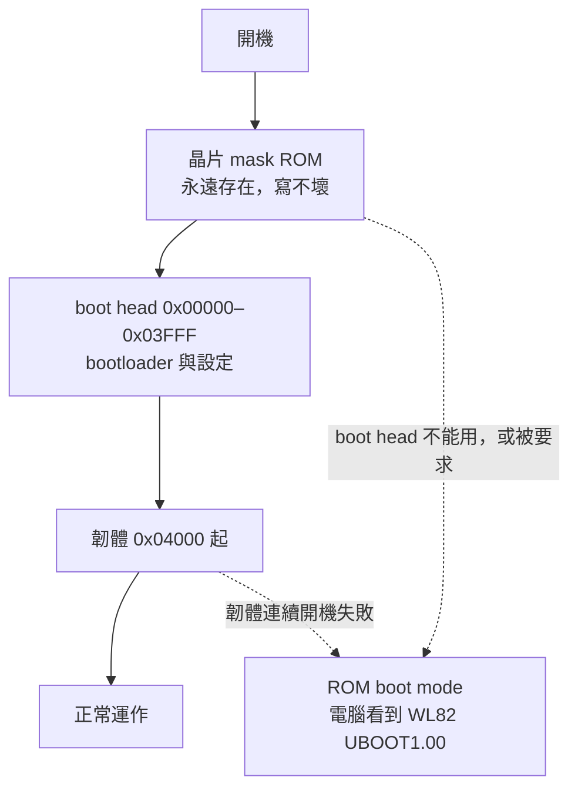

# 變磚的原理與分級

「變磚」其實有好幾種，嚴重程度差很多。這頁說明各種狀況是怎麼發生的、怎麼判斷自己在哪一級。具體的救法步驟在[救援](recovery.md)。

主要整理自 [MvaveFM1Unbricker](https://github.com/Quixotic7/MvaveFM1Unbricker) 的 README（作者自己的機器在更新中斷後救回來過），以及 m-bootloader、M-Flasher 的文件。`[上游]`，除非另外標示。上游另有一份[圖解指南](https://quixotic7.github.io/MvaveFM1Unbricker/)，含「find my fix」精靈。

## 先懂開機流程

文字版：晶片的 mask ROM 先跑，它載入 flash 最前面 16 KiB 的 boot head（bootloader），bootloader 再啟動 `0x04000` 之後的韌體。ROM 裡內建一個 USB 的 **ROM boot mode**（也叫 download mode、update mode），電腦會看到一顆叫 `WL82 UBOOT1.00` 的 USB 磁碟。**任何更新都擦不掉它**，從那裡可以讀寫整顆 flash。

所以關鍵問題永遠是：**機器還進不進得了 ROM boot mode。**

## 分級

| 級別 | 現象 | 原因 | 救得回來嗎 |
|---|---|---|---|
| **0. 被鎖在某個韌體** | 機器能用，但存檔關機就消失、或 installer 都更新不了 | 新晶片 `0xB36014` 裝了只認舊晶片的韌體，它的 update loader 也不認得晶片 | 可以。進 ROM boot mode 重刷認得新晶片的韌體 |
| **1. 舊資料打架** | 換韌體後 preset 亂碼、音高不對，或新韌體開機就當掉 | 前一個韌體留在 flash 裡的資料被新韌體讀到 | 可以。清掉或還原資料區 |
| **2. Soft brick** | 黑畫面，installer 說找不到 FM-1，**但電腦看得到 `WL82 UBOOT1.00`** | 韌體壞了或開不起來，晶片已退回 ROM boot | 可以，只要一條 USB 線。M-Flasher 或 Unbricker 重刷 |
| **3. 黑畫面，但還沒退回 ROM boot** | 黑畫面，USB 上什麼都沒有 | 韌體卡住，但保護機制還沒觸發 | 多半可以，先試下面「讓它掉進 ROM boot」的方法 |
| **4. boot head 壞了** | 黑畫面，USB 上什麼都沒有，怎麼按都一樣 | `0x00000`–`0x03FFF` 被換成不能啟動的東西（例如裝了不相容的替代 bootloader） | 需要硬體把晶片逼進 ROM boot：USB_KEY 或 Transporter |
| **5. 寫到一半斷電** | 同上 | 更新寫入中途電池沒電：半套韌體在自己的保護程式跑起來之前就卡死 | 需要硬體（Transporter）。上游說這種情況按鍵與重開都沒用 |

第 2 級以上才是一般說的磚。第 0、1 級機器其實是好的。

### 新晶片的「被鎖住」（第 0 級）

Unbricker 的 README 開頭就寫：新款 flash 晶片（`0xB36014`）正在把使用者鎖在刷不出去的韌體裡。只認舊晶片的韌體，連它自己的更新程式都不認得晶片，所以每個 installer 都失敗。

解法是繞過韌體，直接走 ROM boot mode。這就是為什麼 M-Flasher 這條路對新晶片機特別重要：它從來不靠機器上的韌體幫忙。我的機器就是新晶片，目前每次切換都走這條路。`[實機]`

### 舊資料打架（第 1 級）

Felucca 系的韌體（Felucca、SLOOP、ChoralRoot…）把曲子、音色、設定放在 `0x97000`–`0xDFFFF`，更新時把 loader 暫存在 `0xE0000`，全域設定放在 `0xFC000`。前兩塊落在**原廠 V15 自己的設定區**（`0x93000`–`0xE8FFF`）裡面，而 installer 只重寫韌體區。

- **回到原廠後 preset 壞掉**：原廠把那些殘留當成自己的設定來讀。先試原廠選單的 System → Reset Patches；不行的話 Unbricker 有 `repair-settings`（上游註明還沒在真的壞掉的機器上測過）。對我來說更簡單：還原自己的原廠完整備份。
- **新韌體開機就當掉**：例如 Felucca 1.0.1 寫入完全正確，卻因為 0.9-beta 留下的資料開不起來；ChoralRoot 在 Sloop 的資料上也發生過。韌體區是好的，重刷沒用，要處理的是資料區。上游建議先還原官方 V15，因為 V15 即使有舊資料也開得起來。

各區域的位置見[Flash 配置圖](../hardware/flash-map.md)。

## 讓它掉進 ROM boot（第 3 級）

黑畫面不代表已經進 ROM boot。依序試，機器直接接電腦、用確定能傳資料的線、不經 hub：

1. **到處找，不只看磁碟。** JieLi 的 USB vendor id 是 `4C4A`，ROM boot 磁碟是 PID `8057`。macOS 上它是一顆讀不了的磁碟，M-Flasher 會自己找到它。
2. **開著放兩分鐘。** Felucca 系的韌體有 watchdog 與 boot-loop guard：開機卡住會被重置，連續失敗兩次後 guard 自己進 ROM boot。
3. **開機按住。** 關機，同時按住 `OCT-` 與 `OCT+` 開機，持續 10 秒。韌體只要有跑到主迴圈就會進 update mode（螢幕可能維持黑的）。
4. **快速重開三次。** 開、等 10 秒、關，重複。每次開機都當掉的話，第三次會落在 ROM boot。（這也是機器「意外」進去的原因。）
5. **還能動的機器**：M-Flasher 的 DOWNLOAD MODE、Unbricker 的 `softkey`、Firmware Hub 的 Rescue 都是送一個訊息叫它進去。各韌體的按鍵組合不同，見[救援](recovery.md)。

全部試過 USB 上仍然什麼都沒有，才是第 4、5 級。

## V15 與 V16：為什麼不能隨便換

這兩版原廠韌體的 flash 配置不同，是很多舊教學出問題的原因：

| | V15 | V16 |
|---|---|---|
| 韌體佔用範圍 | `0x04000`–`0x92FFF` | 到 **`0xA8FFF`**，超出一般工具寫入的範圍 |
| M-VAVE 目前提供 | 已不提供 | 只提供這版 |
| 多數社群 installer 與教學假設的基礎 | 是 | 不是 |
| preset 區 | — | 一執行就會覆寫，降回 V15 後出現亂碼與音高錯誤 |

- Unbricker 的 `restore` 與 Transporter 只寫 `0x04000`–`0x92FFF`，所以**拒絕** V16（寫一半的韌體更糟）。要直接放 V16 得用 `full-restore`，它連 boot head 一起寫。
- 官方已不提供 V15，上游把 V15、V16 與一台全新舊晶片機的完整 dump 放在 [FM1Backups](https://github.com/Quixotic7/FM1Backups)。
- M-Flasher 支援 V16，包括它的配置與 DX7 資料檔，並會在 015 與 016 之間切換時警告。

我的機器出廠是 **015**，而且我有自己的完整備份，所以不需要 FM1Backups。這也是我不裝 016 的原因之一。`[實機]`

## 怎麼避免

- **充飽電再刷。** 最難救的第 5 級就是寫入中途沒電。FM-1 更新時用的是自己的電池。
- **資料線、直接接、不經 hub，寫入中不要碰線，電腦不要睡眠。**
- **不要動 boot head，除非你有硬體救援手段。** 這是我暫緩 m-bootloader 的理由，見[上游追蹤](../watch.md)。
- **先備份，而且備份要在出問題之前做。** 原廠備份只能做一次。
- **新晶片機只裝認得新晶片的韌體**，見 [The Firmware Hub](../firmware/hub.md)。
- **換韌體前先預演**：`just emu-rehearse`，見[多韌體切換](../firmware/switching.md)。
- **Windows 跳出「格式化磁碟」時按取消。** 絕對不要格式化 `WL82 UBOOT1.00`。

## 工具與替代指南

| 資源 | 用途 |
|---|---|
| [M-Flasher](install-m-flasher.md) | 我用的。備份、還原、安裝，三個平台 |
| [MvaveFM1Unbricker](https://github.com/Quixotic7/MvaveFM1Unbricker) | Python 腳本，同樣走 ROM boot。讀兩次比對的備份、只寫韌體區、逐 byte 驗證；另有 `full-restore`、`repair-settings`、`softkey` |
| [圖解指南](https://quixotic7.github.io/MvaveFM1Unbricker/) | 為什麼會變磚、find my fix 精靈 |
| [Firmware Hub 的 FM-1 rescue](https://thefirmwarehub.com/tools/rescue/) | 依「你看到什麼」分步驟，含瀏覽器裡的 Rescue 按鈕 |
| [FM-1 Transporter](https://github.com/kurogedelic/FM-1-transporter) | 硬體救援：Seeed XIAO RP2040 接在 USB 資料線上把晶片逼進 ROM boot。Unbricker 附接線與步驟（`TRANSPORTER-GUIDE.md`） |
| [m-unbricker](https://jvitkauskas.github.io/m-unbricker/) | 手上有兩台 FM-1 時，用一台救另一台 |
| [cardputer-synth-rescue](https://github.com/jvitkauskas/cardputer-synth-rescue) | 用 Cardputer 救 |
| [FM1-Unbricking-For-Dummies](https://github.com/GoodPerson42/FM1-Unbricking-For-Dummies) | 另一份簡易指南 |
| [FM1Backups](https://github.com/Quixotic7/FM1Backups) | V15、V16 套件與全新機的完整 dump |

Transporter 的韌體拒絕寫 boot head，所以 boot head 壞掉時它只能把機器帶進 ROM boot，實際寫回 boot head 仍要靠 M-Flasher 或 Unbricker 的 `full-restore`。

## Unbricker 怎麼看替代 bootloader

Unbricker 的 README 沒有反對 m-bootloader，但它把「換掉 boot head」明確列為一種會出事的情況 `[上游]`：

- 它舉的例子就是「用 M-Flasher 裝了一個替代 bootloader，結果開不起來」：韌體可以完全正確，機器仍然是黑的。
- 它的 `restore` **從不寫 boot head**（`0x00000`–`0x03FFF`），所以救不了這種情況。要用 `full-restore`，它會把原廠的 boot head 連同韌體一起寫回去。
- `full-restore` 預設只接受原廠 V15 或 V16 的 boot head（比對 sha256）。要寫回 m-bootloader 得加 `--other-head`，而且來源是你自己的備份。
- 前提是機器還能以 `WL82 UBOOT1.00` 出現。**Transporter 這條硬體路線不能寫 boot head**，它的韌體會拒絕。
- 如果寫 boot head 的途中被打斷，機器在重新執行同一個指令之前都開不了機。

這和我暫緩 m-bootloader 的理由一致：boot head 是唯一一個「寫壞了就可能需要額外硬體」的區域，而我的新晶片在這方面的實測資料最少。

## 我的機器目前在哪

沒有變過磚。每次切換都經 ROM boot mode、寫入前後都有備份、boot head 從沒動過（原廠）。最接近出事的一次是差點把 SMK-37 版的 ChoralRoot 當成 FM-1 版，見 [ChoralRoot](../firmware/choralroot/index.md)。`[實機]`
